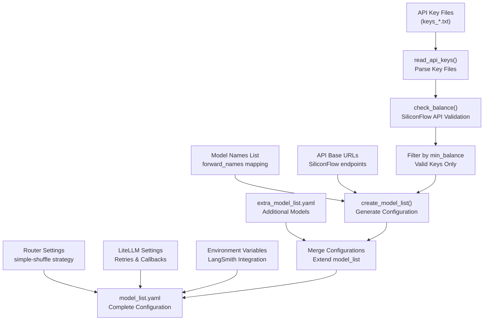
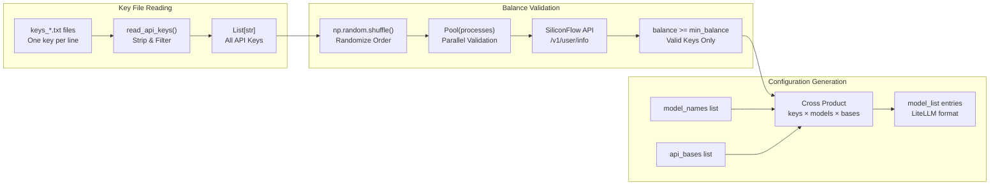
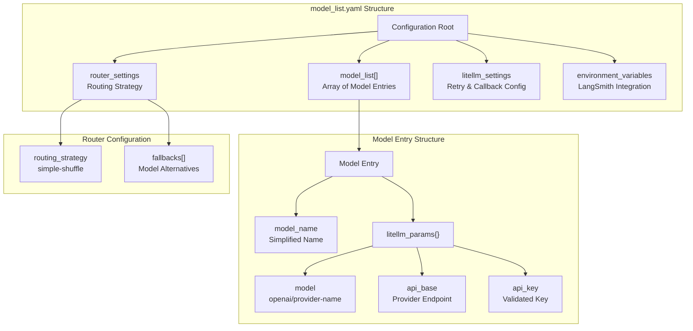

<!-- source: DeepWiki mcp.deepwiki.com · repo jarrycyx/openlens-ai · page 4.1 Model Configuration · fetched 2026-10-26 -->

# Model Configuration

<details>
<summary>Relevant source files</summary>

The following files were used as context for generating this wiki page:

- [llm_router/create_yaml.py](llm_router/create_yaml.py)

</details>


This document covers the model configuration system that generates and manages YAML configuration files for the LLM Router Infrastructure. The system automatically creates `model_list.yaml` files from API key files, validates account balances, and configures multiple language models for load balancing through LiteLLM proxy.

For information about deploying vLLM inference engines, see [vLLM Deployment](#4.2). For performance testing of configured models, see [Performance Testing](#4.3).

## Purpose and Scope

The model configuration system provides automated generation of LiteLLM-compatible YAML configuration files that define multiple language models with API key rotation and load balancing. The primary component is the `create_yaml.py` script which reads API keys from text files, validates their balances, and generates comprehensive model configurations.

## Configuration Generation Workflow

The model configuration process follows a structured workflow that transforms API key files into a complete LiteLLM configuration:

**Model Configuration Generation Process**


Sources: [llm_router/create_yaml.py:88-159]()

## API Key Management

The system reads API keys from text files and validates them before inclusion in the configuration. Each key file contains one API key per line, and the system supports multiple key files for different providers.

**API Key Processing Pipeline**


Sources: [llm_router/create_yaml.py:35-56](), [llm_router/create_yaml.py:58-86](), [llm_router/create_yaml.py:108-158]()

### Balance Checking

The `check_balance()` function validates API keys by querying the SiliconFlow API endpoint:

| Parameter | Description | Default Value |
|-----------|-------------|---------------|
| `api_key` | The API key to validate | Required |
| `timeout` | Request timeout in seconds | 10 |
| `min_balance` | Minimum required balance | 0.01 |

The function returns a tuple `(api_key, is_valid, balance)` and uses multiprocessing for efficient parallel validation of large key sets.

Sources: [llm_router/create_yaml.py:58-86]()

## Model Name Mapping

The system includes a `forward_names` dictionary that maps internal model identifiers to simplified names used by the LiteLLM proxy:

```yaml
# Example mappings from forward_names
"zai-org/GLM-4.5": "glm-4.5"
"zai-org/GLM-4.5-Air": "glm-4.5-air"
"Qwen/Qwen3-235B-A22B-Instruct-2507": "qwen3-235b-a22b-instruct-2507"
"BAAI/bge-reranker-v2-m3": "bge-reranker-v2-m3"
```

This mapping allows the system to use simplified model names in client applications while maintaining compatibility with provider-specific model identifiers.

Sources: [llm_router/create_yaml.py:20-34]()

## Generated Configuration Structure

The `create_model_list()` function generates a comprehensive YAML configuration with multiple sections:

**YAML Configuration Structure**


Sources: [llm_router/create_yaml.py:146-158](), [llm_router/create_yaml.py:221-236]()

### Router Settings

The generated configuration includes router settings for load balancing and fallback behavior:

| Setting | Value | Purpose |
|---------|-------|---------|
| `routing_strategy` | `"simple-shuffle"` | Random distribution across available models |
| `fallbacks` | `[{"glm-4.5-air": ["glm-4.5"]}]` | Fallback model mapping for reliability |

### LiteLLM Settings

The configuration includes LiteLLM-specific settings for reliability and observability:

| Setting | Value | Purpose |
|---------|-------|---------|
| `num_retries` | `3` | Automatic retry attempts for failed requests |
| `success_callback` | `["langsmith"]` | Integration with LangSmith tracing |

Sources: [llm_router/create_yaml.py:221-230]()

## Command Line Interface

The `create_yaml.py` script provides a comprehensive command-line interface for configuration generation:

### Required Arguments

| Argument | Description | Example |
|----------|-------------|---------|
| `--api-key-files` | Paths to key files (one key per line) | `keys_sf1.txt keys_sf2.txt` |

### Optional Arguments

| Argument | Default | Description |
|----------|---------|-------------|
| `--model-names` | GLM-4.5, GLM-4.5-Air, Qwen models | Model identifiers to configure |
| `--api-bases` | `["https://api.siliconflow.cn/v1/"]` | Provider API endpoints |
| `--min-balance` | `0.01` | Minimum account balance required |
| `--processes` | CPU count | Parallel processes for balance checking |
| `--output` | `model_list.yaml` | Output configuration file path |
| `--extra` | `llm_router/extra_model_list.yaml` | Additional model configurations |

Sources: [llm_router/create_yaml.py:161-203]()

## Integration with Extra Models

The system supports merging additional model configurations from an `extra_model_list.yaml` file. This allows for hybrid configurations combining dynamically generated entries with manually configured models:

```python
# Example extra model integration
extra_model_list = yaml.safe_load(open(args.extra, "r"))["model_list"]
config["model_list"].extend(extra_model_list)
```

This feature enables the inclusion of specialized models or custom configurations that don't follow the standard API key pattern.

Sources: [llm_router/create_yaml.py:215-237]()

## Error Handling and Validation

The system includes comprehensive error handling for various failure scenarios:

- **File Not Found**: Missing API key files trigger `FileNotFoundError`
- **Balance Check Failures**: Network timeouts return `(api_key, False, 0.0)`
- **Invalid Keys**: Authentication failures are logged and excluded
- **YAML Loading Errors**: Extra model list failures generate warnings but don't halt execution

The parallel balance checking uses process pools to handle large numbers of API keys efficiently while maintaining error isolation between validation attempts.

Sources: [llm_router/create_yaml.py:45-46](), [llm_router/create_yaml.py:82-85](), [llm_router/create_yaml.py:217-219]()

---

