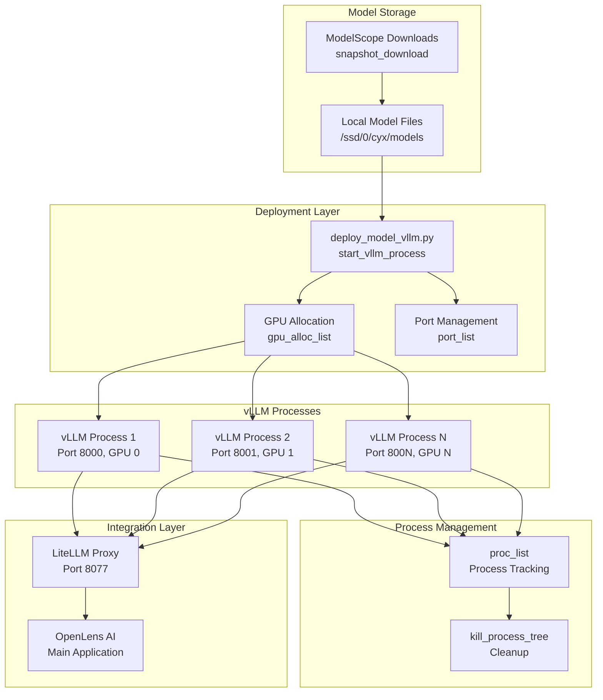
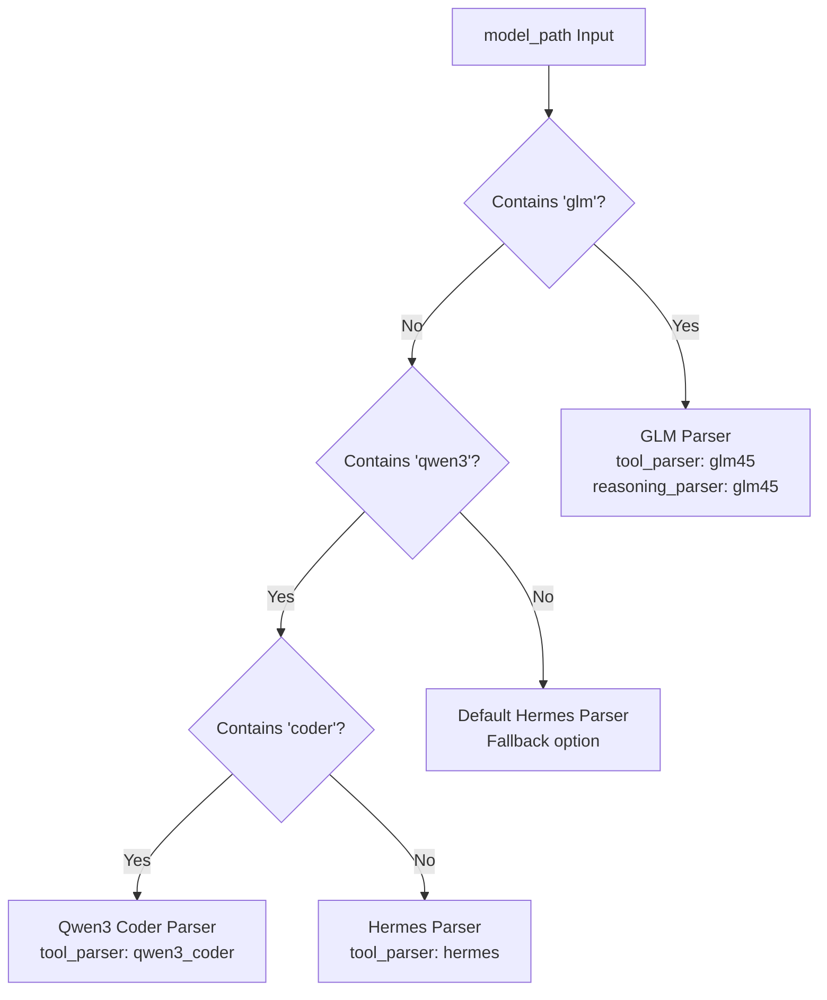
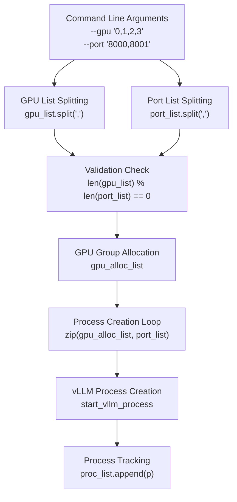

<!-- source: DeepWiki mcp.deepwiki.com · repo jarrycyx/openlens-ai · page 4.2 vLLM Deployment · fetched 2026-10-26 -->

# vLLM Deployment

<details>
<summary>Relevant source files</summary>

The following files were used as context for generating this wiki page:

- [llm_router/deploy_model_vllm.py](llm_router/deploy_model_vllm.py)
- [llm_router/model_dl.py](llm_router/model_dl.py)

</details>


This page covers the deployment and management of vLLM inference engines within the OpenLens AI system. vLLM deployment provides high-performance model serving infrastructure that supports multi-GPU configurations, model-specific optimizations, and integration with the LLM routing system.

For information about LLM model configuration and routing, see [Model Configuration](#4.1). For performance testing of deployed models, see [Performance Testing](#4.3).

## Overview

The vLLM deployment system serves as the inference backend for the OpenLens AI multi-agent framework. It provides optimized model serving with support for tensor parallelism, quantization, and specialized parsing for different model architectures.

## vLLM Deployment Architecture



Sources: [llm_router/deploy_model_vllm.py:1-119]()

## Model Download and Storage

The system uses ModelScope for downloading and caching models locally before deployment.

| Component | Purpose | Configuration |
|-----------|---------|---------------|
| `snapshot_download` | Downloads models from ModelScope | Cache directory: `/ssd/0/cyx/models` |
| Model Cache | Local storage for downloaded models | Persistent across deployments |
| Model Selection | Configurable model ID selection | Currently supports Qwen3, DeepSeek, GLM families |

Sources: [llm_router/model_dl.py:1-12]()

## vLLM Server Configuration

The `start_vllm_process` function in [deploy_model_vllm.py:7-60]() provides comprehensive server configuration with the following parameters:

### Core Configuration Parameters

| Parameter | Default | Purpose |
|-----------|---------|---------|
| `max_len` | "64000" | Maximum model input length |
| `enforce_eager` | True | Enable eager execution mode |
| `port` | "8000" | API server port |
| `gpu` | "0" | GPU device allocation |
| `memory_utilization` | 0.75 | GPU memory utilization ratio |
| `quant4bit` | False | Enable 4-bit quantization |

### Model-Specific Parser Configuration

The deployment system automatically configures tool and reasoning parsers based on model type:



Sources: [llm_router/deploy_model_vllm.py:23-36]()

## Multi-GPU Deployment

The deployment system supports distributed inference across multiple GPUs with automatic process allocation:

### GPU Allocation Strategy



Sources: [llm_router/deploy_model_vllm.py:88-108]()

### Tensor Parallelism Configuration

The system automatically calculates tensor parallel size based on GPU allocation:

- `gpu_per_process = len(gpu.split(","))` [llm_router/deploy_model_vllm.py:8]()
- `--tensor-parallel-size` set to `gpu_per_process` [llm_router/deploy_model_vllm.py:13]()
- `CUDA_VISIBLE_DEVICES` environment variable controls GPU visibility [llm_router/deploy_model_vllm.py:47]()

## Process Management

### Process Lifecycle Management

The deployment system provides comprehensive process management capabilities:

| Function | Purpose | Implementation |
|----------|---------|----------------|
| `start_vllm_process` | Launch vLLM server instances | [llm_router/deploy_model_vllm.py:7-60]() |
| `kill_process_tree` | Graceful process termination | [llm_router/deploy_model_vllm.py:62-74]() |
| Process tracking | Monitor running instances | [llm_router/deploy_model_vllm.py:95-108]() |

### Logging and Output Management

Optional logging configuration supports debugging and monitoring:

- Log file generation with timestamps: `vllm_log_{timestamp}_{port}.txt` [llm_router/deploy_model_vllm.py:55]()
- Output directory: `llm_router/outputs/` [llm_router/deploy_model_vllm.py:53]()
- Conditional logging based on `--log-to-file` flag [llm_router/deploy_model_vllm.py:51]()

## Command Line Interface

The deployment script provides a comprehensive CLI for configuration:

### Required Arguments

```bash
python deploy_model_vllm.py -m <model_path> -p <port> -g <gpu_ids>
```

### Optional Configuration

| Argument | Default | Description |
|----------|---------|-------------|
| `--mem-ut` | "0.9" | GPU memory utilization ratio |
| `--quant4bit` | False | Enable 4-bit quantization |
| `--max-len` | "64000" | Maximum input sequence length |
| `--log-to-file` | False | Enable file logging |
| `--enforce-eager` | False | Enable eager execution mode |

Sources: [llm_router/deploy_model_vllm.py:77-86]()

## Integration with LLM Router

The vLLM deployment integrates with the broader LLM router infrastructure:

1. **Model Serving**: vLLM processes serve models on configured ports
2. **LiteLLM Integration**: Deployed models are accessed through LiteLLM proxy at port 8077
3. **Load Balancing**: Multiple vLLM instances support distributed inference
4. **Health Monitoring**: Process management enables automatic cleanup and restart

For complete integration setup, see [Model Configuration](#4.1) for LiteLLM proxy configuration and [Performance Testing](#4.3) for deployment validation.

Sources: [llm_router/deploy_model_vllm.py:1-119]()

---

