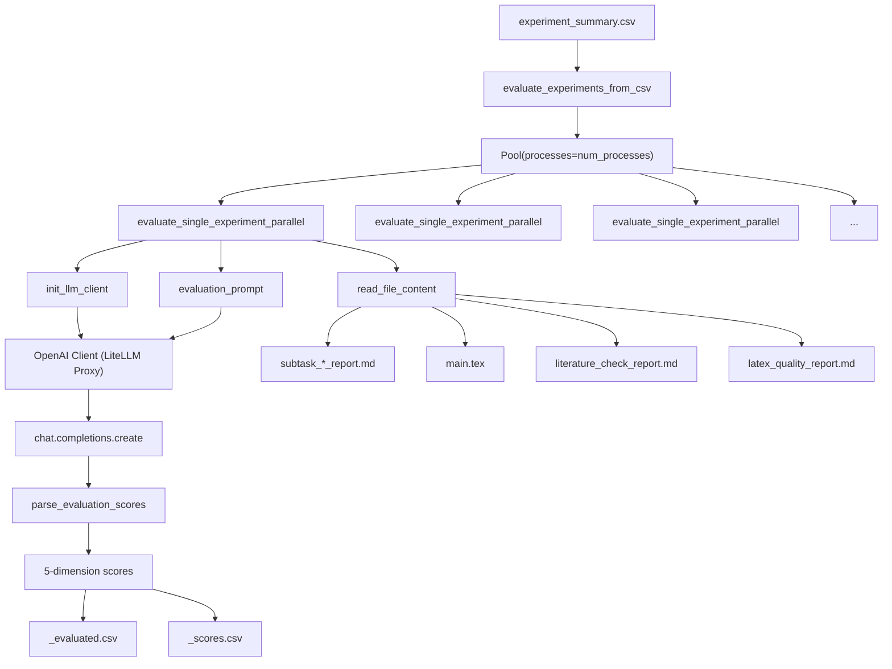
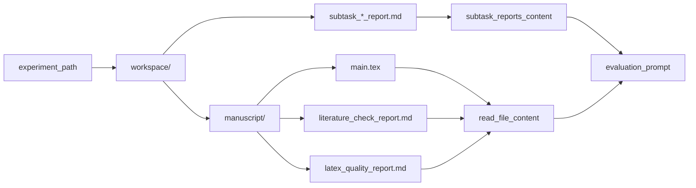

<!-- source: DeepWiki mcp.deepwiki.com · repo jarrycyx/openlens-ai · page 5.2 Quality Assessment · fetched 2026-10-26 -->

# Quality Assessment

<details>
<summary>Relevant source files</summary>

The following files were used as context for generating this wiki page:

- [exp/eval/evaluate_experiment_quality.py](exp/eval/evaluate_experiment_quality.py)

</details>


This document covers the LLM-based quality assessment system that evaluates the quality of research experiments generated by OpenLens AI. The system provides automated scoring across five key dimensions to validate experiment completeness and research quality.

For information about the evaluation datasets used in testing, see [Evaluation Datasets](#5.1). For details about parallel test execution, see [Parallel Testing](#5.3).

## Purpose and Scope

The quality assessment system automatically evaluates completed research experiments using large language models to score experimental quality across multiple dimensions. This provides objective measurement of research output quality and helps identify areas for system improvement.

The system processes experiment directories containing workspace files, subtask reports, and generated research papers, then produces structured quality scores and detailed evaluations.

Sources: [exp/eval/evaluate_experiment_quality.py:1-322]()

## Quality Evaluation Dimensions

The assessment evaluates experiments across five critical dimensions, each scored on a 1-3 scale:

| Dimension | Score Range | Description |
|-----------|-------------|-------------|
| **Plan Completion** | 1-3 | Whether the experimental plan was successfully completed |
| **Code Execution** | 1-3 | Presence of unresolved errors during code execution |
| **Result Validity** | 1-3 | Reasonableness and validity of experimental results |
| **Paper Completeness** | 1-3 | Completeness of paper structure and absence of LaTeX errors |
| **Conclusion Quality** | 1-3 | Effectiveness and accuracy of research conclusions |

### Scoring Criteria

- **Score 1**: Severe issues that make the research fundamentally wrong
- **Score 2**: Moderate issues that still make the research valid  
- **Score 3**: Minor or no issues

Sources: [exp/eval/evaluate_experiment_quality.py:47-53](), [exp/eval/evaluate_experiment_quality.py:169-177]()

## Assessment Workflow

### Quality Assessment Flow



Sources: [exp/eval/evaluate_experiment_quality.py:233-286](), [exp/eval/evaluate_experiment_quality.py:94-230]()

### File Processing Pipeline



Sources: [exp/eval/evaluate_experiment_quality.py:135-157](), [exp/eval/evaluate_experiment_quality.py:32-41]()

## Implementation Details

### LLM Client Configuration

The system initializes an LLM client that connects to a local LiteLLM proxy server for quality assessment:

```python
# From evaluate_experiment_quality.py:24-27
client = OpenAI(
    api_key="0",
    base_url="http://127.0.0.1:8077/v1",
)
```

The client uses temperature 0.1 for consistent evaluations and supports up to 4000 tokens for detailed assessments.

Sources: [exp/eval/evaluate_experiment_quality.py:18-29](), [exp/eval/evaluate_experiment_quality.py:198-203]()

### Score Parsing System

The `parse_evaluation_scores` function extracts numerical scores from LLM evaluation text using pattern matching:

```python
# Pattern matching examples from evaluate_experiment_quality.py:60-89
if '1. Plan Completion Score:' in line:
    score = line.split('Score:')[1].split('/')[0].strip()
    scores['plan_completion'] = int(score)
```

The parser handles five score categories with fallback to 0 for parsing errors.

Sources: [exp/eval/evaluate_experiment_quality.py:44-91]()

### Parallel Processing Architecture

The system uses Python's `multiprocessing.Pool` to evaluate multiple experiments concurrently:

```python
# From evaluate_experiment_quality.py:251-257
evaluate_func = partial(evaluate_single_experiment_parallel, experiment_root, model)
with Pool(processes=num_processes) as pool:
    evaluation_results = pool.map(evaluate_func, experiments)
```

Default configuration uses 4 processes for parallel evaluation.

Sources: [exp/eval/evaluate_experiment_quality.py:251-261]()

## Evaluation Prompt Structure

### Prompt Template

The system generates structured evaluation prompts that include:

1. **Instruction Set**: Five evaluation dimensions with scoring criteria
2. **Format Requirements**: Exact format specification for consistent parsing
3. **Content Sections**: 
   - Subtask reports (truncated to ~160KB)
   - Main LaTeX file (truncated to ~160KB)
   - Literature and quality reports

### Content Truncation

Large files are truncated to prevent token limit issues:

```python
# From evaluate_experiment_quality.py:182-185
{subtask_reports_content[:40*1000*4]}...
{main_tex_content[:40*1000*4]}...
```

Sources: [exp/eval/evaluate_experiment_quality.py:160-186]()

## Output and Reporting

### CSV Output Files

The system generates two CSV output files:

| File Type | Naming Convention | Contents |
|-----------|------------------|----------|
| **Detailed Evaluations** | `*_evaluated.csv` | Question, dataset, thread_ids, full evaluation text |
| **Score Summary** | `*_scores.csv` | Question, dataset, thread_ids, five numerical scores |

### Result Structure

Each evaluation result contains:

```python
# From evaluate_experiment_quality.py:217-227
result = {
    'question': experiment_data['question'],
    'dataset': experiment_data['dataset'], 
    'thread_ids': experiment_data['thread_ids'],
    'evaluation': evaluation,
    'plan_completion': scores['plan_completion'],
    'code_execution': scores['code_execution'],
    'result_validity': scores['result_validity'],
    'paper_completeness': scores['paper_completeness'],
    'conclusion_quality': scores['conclusion_quality'],
}
```

Sources: [exp/eval/evaluate_experiment_quality.py:264-286]()

## Command Line Interface

### Usage Pattern

```bash
python exp/eval/evaluate_experiment_quality.py \
    --csv-file exp/saved_exp/eval_0915/experiment_summary.csv \
    --experiment-root exp/saved_exp/eval_0915 \
    --model glm-4.5 \
    --num-processes 4
```

### Arguments

| Argument | Default | Description |
|----------|---------|-------------|
| `--csv-file` | `exp/saved_exp/eval_0915/experiment_summary.csv` | Input experiment summary file |
| `--experiment-root` | `exp/saved_exp/eval_0915` | Root directory containing experiment outputs |
| `--model` | `glm-4.5` | LLM model name for evaluation |
| `--num-processes` | `4` | Number of parallel processes |

Sources: [exp/eval/evaluate_experiment_quality.py:293-315]()

---

