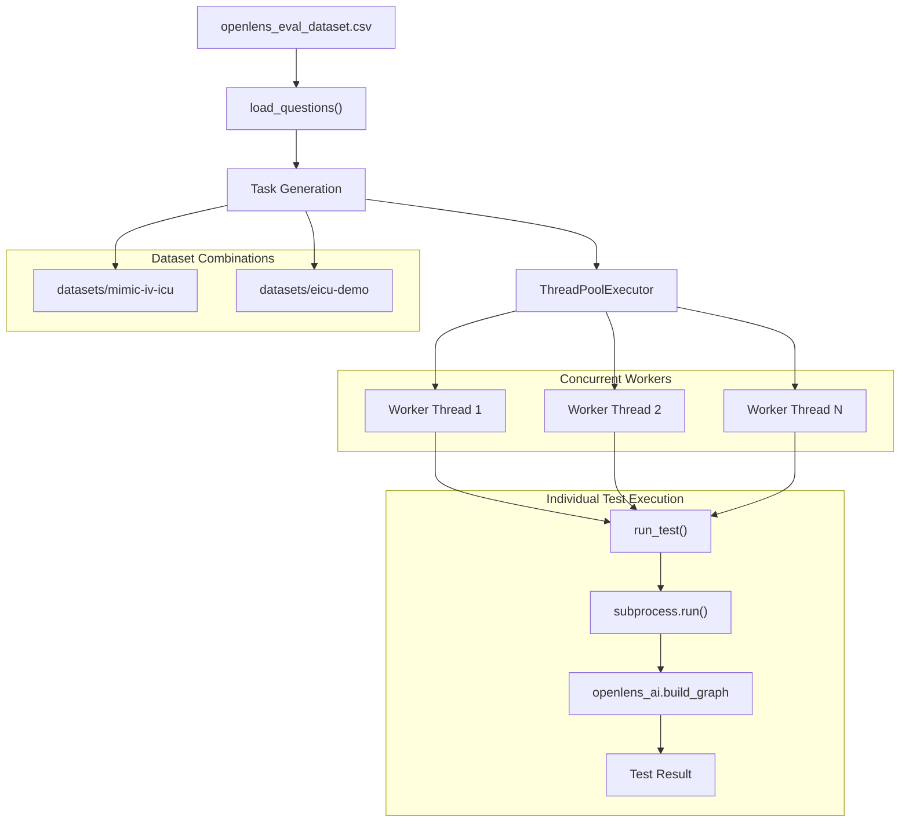
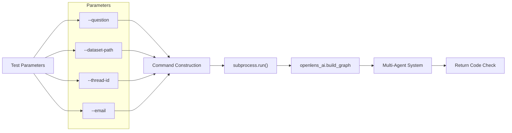
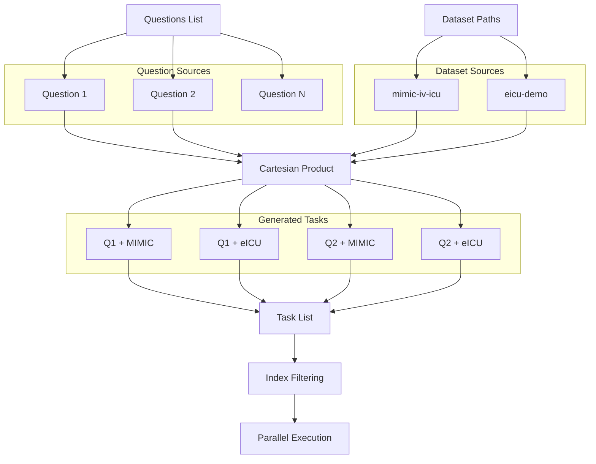

<!-- source: DeepWiki mcp.deepwiki.com · repo jarrycyx/openlens-ai · page 5.3 Parallel Testing · fetched 2026-10-26 -->

# Parallel Testing

<details>
<summary>Relevant source files</summary>

The following files were used as context for generating this wiki page:

- [exp/eval/parallel_test.py](exp/eval/parallel_test.py)
- [exp/eval/run_parallel_tests.sh](exp/eval/run_parallel_tests.sh)

</details>


This page covers the concurrent execution system for running multiple evaluation experiments in OpenLens AI. The parallel testing framework enables efficient batch testing of research questions across multiple medical datasets, utilizing multi-threaded execution to maximize throughput while maintaining experiment isolation.

For information about the datasets used in testing, see [Evaluation Datasets](#5.1). For details on how experiment quality is assessed, see [Quality Assessment](#5.2). For tracking experiment progress and results, see [Experiment Tracking](#5.4).

## Purpose and Scope

The parallel testing system orchestrates concurrent execution of OpenLens AI experiments across different research questions and medical datasets. It manages resource allocation, coordinates test execution, and tracks completion status for large-scale evaluation workflows.

**Sources:** [exp/eval/parallel_test.py:1-12]()

## System Architecture

The parallel testing framework operates as a test orchestrator that spawns multiple concurrent experiments, each running the complete OpenLens AI multi-agent workflow.

### Parallel Execution Workflow



**Sources:** [exp/eval/parallel_test.py:51-105]()

### Core Components

| Component | Function | Purpose |
|-----------|----------|---------|
| `load_questions()` | Loads evaluation questions from CSV | Reads research questions from dataset file |
| `run_test()` | Executes individual test subprocess | Runs single experiment with specific parameters |
| `create_thread_id()` | Generates unique test identifiers | Creates trackable IDs for each test combination |
| `ThreadPoolExecutor` | Manages concurrent execution | Controls parallel worker threads |

**Sources:** [exp/eval/parallel_test.py:13-21](), [exp/eval/parallel_test.py:22-42](), [exp/eval/parallel_test.py:43-50]()

## Test Execution Details

### Individual Test Execution

Each test runs as a subprocess calling the main OpenLens AI system with specific parameters:



**Sources:** [exp/eval/parallel_test.py:22-42]()

The `run_test()` function constructs subprocess commands with the following pattern:
```bash
python -m openlens_ai.build_graph --question "<question>" --dataset-path "<path>" --thread-id "<id>" --email "<email>"
```

### Thread ID Generation

The `create_thread_id()` function generates unique identifiers for each test combination by combining dataset name and question content:

| Element | Source | Processing |
|---------|--------|------------|
| Dataset Name | `Path(dataset_path).name` | Extracted from file path |
| Question ID | First 30 alphanumeric characters | Sanitized question text |
| Format | `test_{dataset}_{question}` | Underscores replace spaces |

**Sources:** [exp/eval/parallel_test.py:43-50]()

## Configuration and Parameters

### Command Line Arguments

| Parameter | Default Value | Purpose |
|-----------|---------------|---------|
| `--csv-file` | `exp/eval/openlens_eval_dataset.csv` | Source file for evaluation questions |
| `--email` | `dzdzzd@126.com` | Notification email address |
| `--max-workers` | `4` | Maximum concurrent worker threads |
| `--datasets` | `datasets/mimic-iv-icu`, `datasets/eicu-demo` | Dataset paths for testing |
| `--start-index` | `0` | Starting index for question subset |

**Sources:** [exp/eval/parallel_test.py:52-64]()

### Task Generation Strategy

The system creates a cartesian product of questions and datasets, generating individual test tasks for each combination:



**Sources:** [exp/eval/parallel_test.py:74-84]()

## Integration with Evaluation Framework

### Shell Script Wrapper

The system includes a shell script wrapper that provides a simplified interface for running parallel tests:

```bash
python exp/parallel_test.py \
    --csv-file eval/openlens_eval_dataset.csv \
    --email "dzdzzd@126.com" \
    --max-workers 4 \
    --datasets datasets/mimic-iv-icu datasets/eicu-demo
```

**Sources:** [exp/eval/run_parallel_tests.sh:7-12]()

### Result Tracking

The parallel testing system tracks execution results through:

- **Success Counting**: Tracks completed vs. failed tests
- **Exception Handling**: Captures and reports execution errors  
- **Progress Reporting**: Provides real-time status updates
- **Return Code Validation**: Uses subprocess return codes for success detection

**Sources:** [exp/eval/parallel_test.py:86-105]()

### Resource Management

The `ThreadPoolExecutor` manages concurrent execution with configurable worker limits to balance throughput with system resource constraints. Each worker thread operates independently, allowing for isolated experiment execution without cross-contamination.

**Sources:** [exp/eval/parallel_test.py:87-103]()

---

