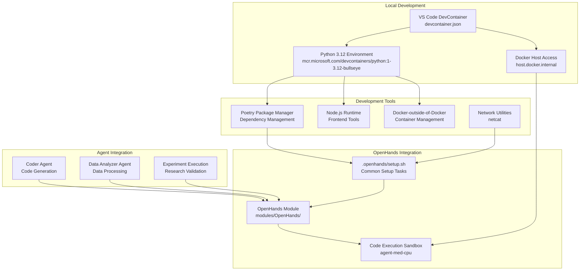
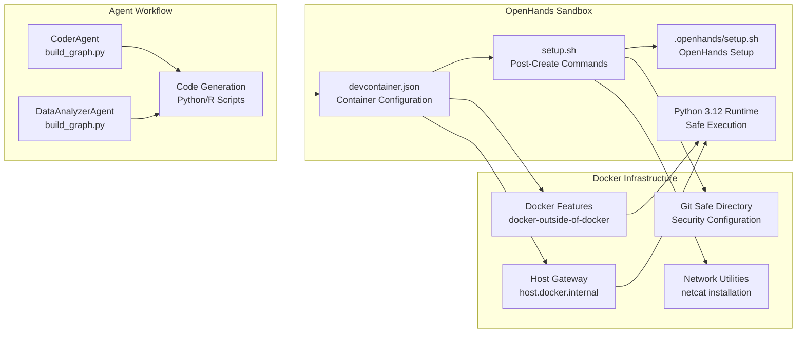

<!-- source: DeepWiki mcp.deepwiki.com · repo jarrycyx/openlens-ai · page 6 Development Environment · fetched 2026-10-26 -->

# Development Environment

Relevant source files

The following files were used as context for generating this wiki page:

- [modules/OpenHands/.devcontainer/devcontainer.json](modules/OpenHands/.devcontainer/devcontainer.json)
- [modules/OpenHands/.devcontainer/setup.sh](modules/OpenHands/.devcontainer/setup.sh)

This document covers the setup and configuration of the OpenLens AI development environment, with particular focus on the OpenHands integration that provides code execution capabilities to the system's agents. This includes containerized development setup, Docker configuration, and the sandbox environment used by the Coder Agent for safe code execution.

For information about configuring the main application environment variables and API keys, see [Configuration](#2.1). For details about the multi-agent system that uses this development environment, see [Multi-Agent System](#3).

## Development Environment Overview

The OpenLens AI development environment is built around a containerized architecture that supports both local development and agent-based code execution. The system uses OpenHands as a code execution sandbox, integrated through Docker containers and VS Code development containers.

### Development Environment Architecture

Sources: [modules/OpenHands/.devcontainer/devcontainer.json:1-19](), [modules/OpenHands/.devcontainer/setup.sh:1-12]()

## OpenHands Integration Architecture

The OpenHands integration provides a secure code execution environment for the system's agents. This sandbox allows the Coder Agent and Data Analyzer Agent to execute generated code safely without affecting the host system.

### Container and Execution Flow

Sources: [modules/OpenHands/.devcontainer/devcontainer.json:8-18](), [modules/OpenHands/.devcontainer/setup.sh:5-11]()

## VS Code Development Container Configuration

The development environment uses a VS Code development container configured through `devcontainer.json`. This container provides a consistent development experience across different systems.

### Container Specification

| Configuration | Value | Purpose |
|---------------|-------|---------|
| Base Image | `mcr.microsoft.com/devcontainers/python:1-3.12-bullseye` | Python 3.12 development environment |
| Docker Feature | `docker-outside-of-docker:1` | Access to host Docker daemon |
| Poetry Feature | `poetry:2` | Python dependency management |
| Node Feature | `node:1` | JavaScript/Node.js support |

The container configuration includes specific run arguments and environment variables:

- **Run Arguments**: `["--add-host=host.docker.internal:host-gateway"]` enables communication with the host Docker daemon
- **Container Environment**: `DOCKER_HOST_ADDR: "host.docker.internal"` provides Docker host access for OpenHands

Sources: [modules/OpenHands/.devcontainer/devcontainer.json:8-18]()

### Post-Creation Setup Process

The `setup.sh` script executes after container creation and performs essential configuration:

1. **Git Security Configuration**: Marks the repository as safe using `git config --global --add safe.directory` to prevent ownership errors in containerized environments
2. **Network Utilities**: Installs `netcat` for network debugging and connectivity testing  
3. **OpenHands Setup**: Sources `.openhands/setup.sh` for OpenHands-specific configuration tasks

The setup process ensures that the development environment can safely execute agent-generated code while maintaining proper security boundaries.

Sources: [modules/OpenHands/.devcontainer/setup.sh:4-11]()

## Integration with Multi-Agent System

The development environment directly supports the multi-agent workflow by providing code execution capabilities. The Coder Agent generates experimental code that executes within the OpenHands sandbox, while the Data Analyzer Agent processes datasets using the same secure environment.

### Agent Execution Flow

| Agent | Code Type | Execution Environment |
|-------|-----------|----------------------|
| Coder Agent | Python experiments, data analysis scripts | OpenHands container with Python 3.12 |
| Data Analyzer Agent | Dataset processing, statistical analysis | OpenHands container with scientific libraries |
| Supervisor Agent | Coordination scripts, workflow management | Host environment with container orchestration |

The containerized approach ensures that experimental code generated by the agents cannot affect the host system, while still providing access to necessary computational resources and network connectivity for research tasks.

Sources: [modules/OpenHands/.devcontainer/devcontainer.json:14-18](), [modules/OpenHands/.devcontainer/setup.sh:11]()

---

