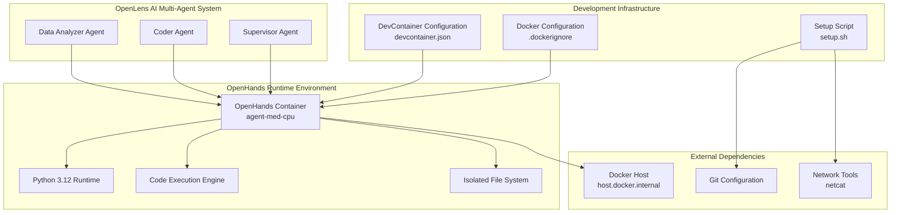
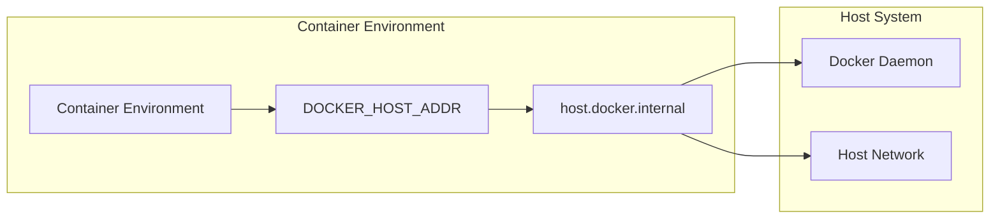
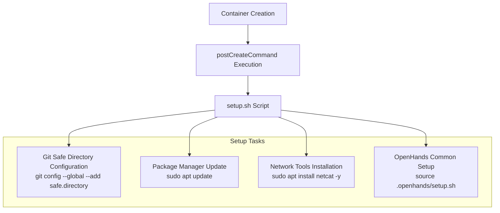
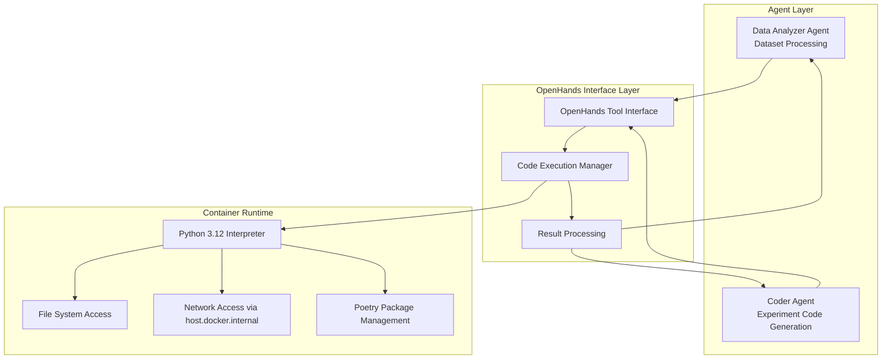

<!-- source: DeepWiki mcp.deepwiki.com · repo jarrycyx/openlens-ai · page 6.1 OpenHands Integration · fetched 2026-10-26 -->

# OpenHands Integration

Relevant source files

The following files were used as context for generating this wiki page:

- [modules/OpenHands/.devcontainer/devcontainer.json](modules/OpenHands/.devcontainer/devcontainer.json)
- [modules/OpenHands/.devcontainer/setup.sh](modules/OpenHands/.devcontainer/setup.sh)
- [modules/OpenHands/.dockerignore](modules/OpenHands/.dockerignore)

## Purpose and Scope

This document covers the integration of OpenHands as a code execution sandbox environment within OpenLens AI. OpenHands provides a containerized runtime for executing code generated by the multi-agent system, particularly for the Data Analyzer and Coder agents. For information about the specific agents that use OpenHands, see [Data Analyzer Agent](#3.3) and [Coder Agent](#3.4). For broader development environment setup, see [Development Environment](#6).

## OpenHands Runtime Architecture

OpenHands serves as the primary code execution environment for OpenLens AI, providing a sandboxed Docker container where agents can safely execute generated code, run experiments, and analyze datasets.

### Integration Overview

**Sources:** [modules/OpenHands/.devcontainer/devcontainer.json:1-19](), [modules/OpenHands/.devcontainer/setup.sh:1-11](), [modules/OpenHands/.dockerignore:1-24]()

## Container Configuration

### DevContainer Specification

The OpenHands integration uses a DevContainer configuration based on Microsoft's Python 3.12 image with additional features for Docker-outside-of-Docker capability.

| Configuration | Value | Purpose |
|---------------|-------|---------|
| Base Image | `mcr.microsoft.com/devcontainers/python:1-3.12-bullseye` | Python 3.12 runtime environment |
| Docker Feature | `docker-outside-of-docker:1` | Enable Docker commands within container |
| Poetry Feature | `poetry:2` | Python dependency management |
| Node Feature | `node:1` | JavaScript runtime for additional tooling |

### Container Environment Variables

The container environment includes the `DOCKER_HOST_ADDR` variable set to `host.docker.internal`, enabling communication with the host Docker daemon from within the container.

**Sources:** [modules/OpenHands/.devcontainer/devcontainer.json:16-18](), [modules/OpenHands/.devcontainer/devcontainer.json:15]()

## Setup and Initialization

### Post-Creation Setup Process

The container initialization follows a structured setup process:

The setup script addresses common containerization issues:
- **Git Safe Directory**: Prevents "dubious ownership" errors in containerized environments where directory ownership may not match the current user
- **Network Tools**: Installs `netcat` for network connectivity testing
- **OpenHands Integration**: Sources the main OpenHands setup script for additional configuration

**Sources:** [modules/OpenHands/.devcontainer/setup.sh:4-5](), [modules/OpenHands/.devcontainer/setup.sh:8](), [modules/OpenHands/.devcontainer/setup.sh:11]()

## Docker Build Configuration

### Excluded Files and Directories

The Docker build process excludes specific files and directories to optimize container size and security:

| Category | Excluded Items | Rationale |
|----------|----------------|-----------|
| NodeJS Dependencies | `frontend/node_modules` | Large dependency tree not needed at runtime |
| Configuration Files | `*.ini`, `*.toml` (except `pyproject.toml`), `*.yml` | Environment-specific configs excluded |
| Documentation | `*.md` (except `README.md`) | Documentation not needed in runtime container |
| Development Files | Hidden files (`.*/`), `__pycache__`, `/dev_config/`, `/docs/`, `/evaluation/`, `/tests/` | Development artifacts excluded from production image |

### Critical Included Files

The configuration preserves essential files:
- `pyproject.toml` - Python project dependencies and metadata
- `README.md` - Essential documentation for container users

**Sources:** [modules/OpenHands/.dockerignore:2](), [modules/OpenHands/.dockerignore:5-7](), [modules/OpenHands/.dockerignore:11-12](), [modules/OpenHands/.dockerignore:15-16](), [modules/OpenHands/.dockerignore:19-23]()

## Integration with Multi-Agent System

### Agent-Container Communication

The OpenHands integration provides a secure, isolated environment where agents can execute code without affecting the host system, while maintaining access to necessary resources through controlled interfaces.

**Sources:** [modules/OpenHands/.devcontainer/devcontainer.json:10-12](), [modules/OpenHands/.devcontainer/devcontainer.json:17]()

---

