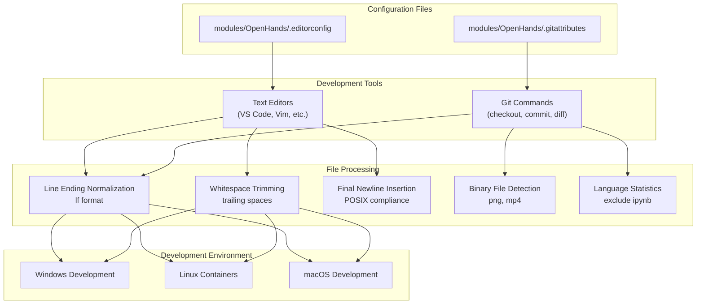
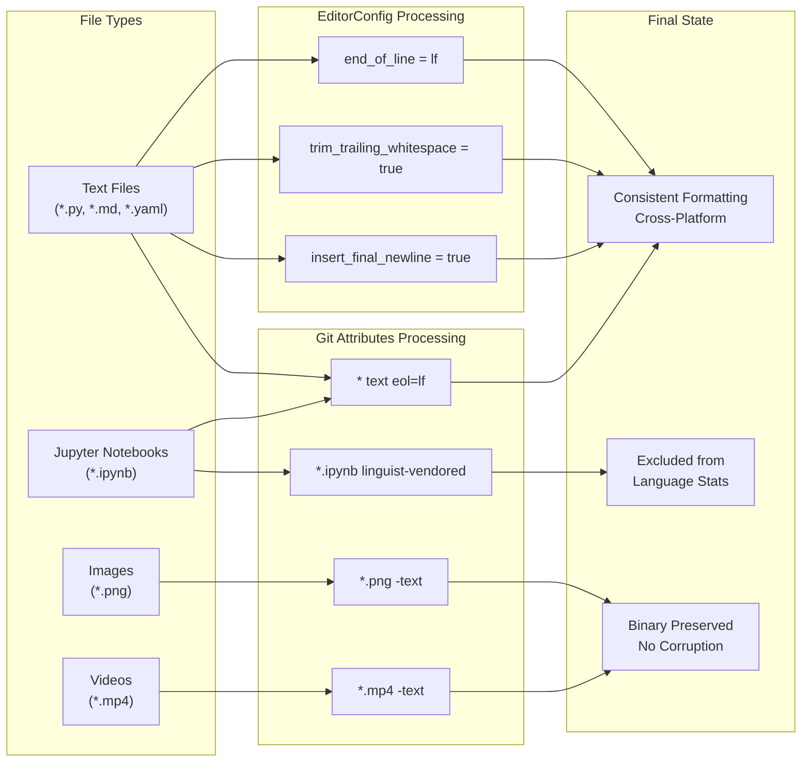

<!-- source: DeepWiki mcp.deepwiki.com · repo jarrycyx/openlens-ai · page 6.2 Editor Configuration · fetched 2026-10-26 -->

# Editor Configuration

<details>
<summary>Relevant source files</summary>

The following files were used as context for generating this wiki page:

- [modules/OpenHands/.editorconfig](modules/OpenHands/.editorconfig)
- [modules/OpenHands/.gitattributes](modules/OpenHands/.gitattributes)

</details>


This document covers the standardized editor settings and Git configuration used throughout the OpenLens AI development environment. These configurations ensure consistent code formatting and file handling across different development platforms and editors.

For information about OpenHands integration and container setup, see [OpenHands Integration](#6.1). For GitHub-specific configurations like issue templates and code ownership, see [GitHub Configuration](#6.3).

## Purpose and Scope

The editor configuration system in OpenLens AI establishes consistent development standards through two primary configuration files that control editor behavior and Git file handling. These configurations are particularly important for cross-platform development where Windows and Unix-like systems handle line endings and file attributes differently.

## EditorConfig Settings

The repository uses EditorConfig to standardize formatting across different editors and development environments. The configuration is defined in [modules/OpenHands/.editorconfig:1-6]().

### Line Ending Standardization

The primary purpose of the EditorConfig is to enforce Unix-style line endings (`lf`) across all files to prevent Git from detecting false modifications when the repository is cloned on Windows systems and run in Linux containers:

```
[*]
end_of_line = lf
```

This setting applies to all file types and ensures consistent line endings regardless of the operating system where development occurs.

### Whitespace Management

The configuration includes two additional formatting rules that apply to all files:

| Setting | Purpose | Effect |
|---------|---------|---------|
| `trim_trailing_whitespace = true` | Remove trailing spaces | Prevents unnecessary whitespace in commits |
| `insert_final_newline = true` | Ensure files end with newline | Maintains POSIX compliance |

**Sources:** [modules/OpenHands/.editorconfig:1-6]()

## Git Attributes Configuration

Git attributes control how Git handles different file types during operations like checkout, diff, and merge. The configuration is defined in [modules/OpenHands/.gitattributes:1-8]().

### Language Detection Override

The repository marks Jupyter notebook files as vendored code to exclude them from language statistics:

```
*.ipynb linguist-vendored
```

This prevents notebooks from skewing repository language detection metrics, which is important for accurate project classification.

### Line Ending Enforcement

Git attributes reinforce the EditorConfig line ending policy by treating all text files as requiring Unix line endings:

```
* text eol=lf
```

This setting works in conjunction with the EditorConfig to ensure consistent line endings throughout the development workflow.

### Binary File Handling

Specific file types are explicitly marked as binary to prevent Git from attempting text processing:

| File Type | Setting | Purpose |
|-----------|---------|---------|
| `*.png` | `-text` | Prevent image corruption |
| `*.mp4` | `-text` | Prevent video corruption |

**Sources:** [modules/OpenHands/.gitattributes:1-8]()

## Configuration Flow Diagram



**Sources:** [modules/OpenHands/.editorconfig:1-6](), [modules/OpenHands/.gitattributes:1-8]()

## Cross-Platform Consistency

The configuration addresses several cross-platform development challenges that are particularly relevant for the OpenLens AI project, which uses Docker containers for code execution while supporting development on multiple operating systems.

### Windows Container Compatibility

The line ending standardization prevents a common issue where files appear modified in Linux containers when the repository is cloned on Windows systems. This is critical for the OpenHands integration, which executes code within Docker containers that expect Unix-style line endings.

### Git Workflow Consistency

The Git attributes ensure that:
- All developers see the same diff output regardless of platform
- Binary files are not corrupted by text processing
- Repository language statistics accurately reflect the codebase composition

**Sources:** [modules/OpenHands/.editorconfig:2-3](), [modules/OpenHands/.gitattributes:3-4]()

## File Type Processing Flow



**Sources:** [modules/OpenHands/.editorconfig:1-6](), [modules/OpenHands/.gitattributes:1-8]()

---

