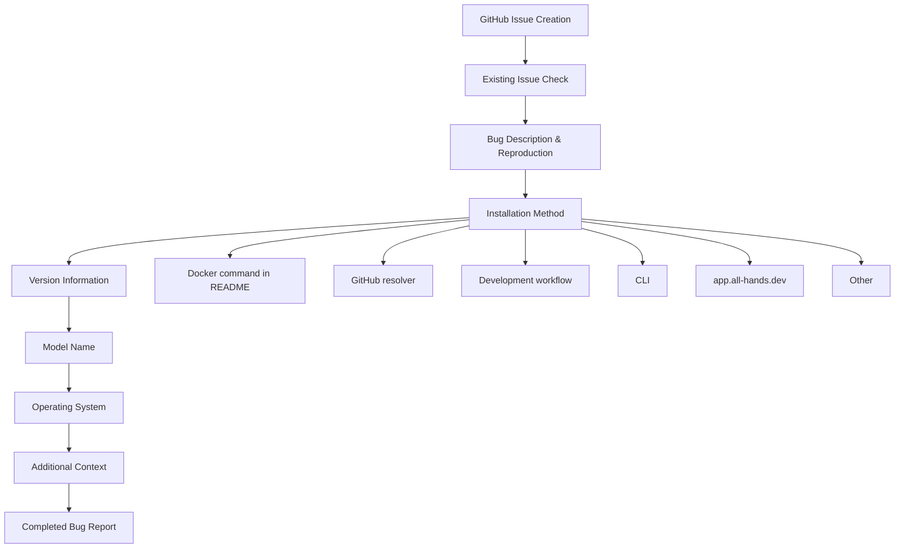
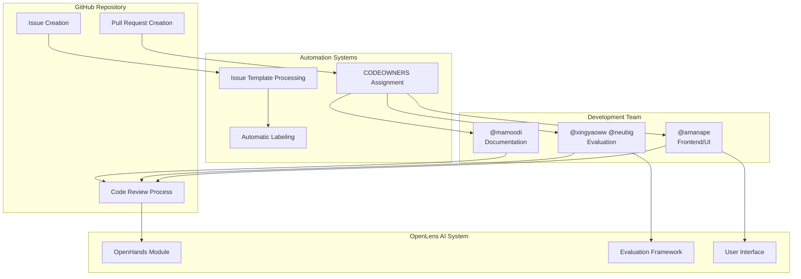

<!-- source: DeepWiki mcp.deepwiki.com · repo jarrycyx/openlens-ai · page 6.3 GitHub Configuration · fetched 2026-10-26 -->

# GitHub Configuration

<details>
<summary>Relevant source files</summary>

The following files were used as context for generating this wiki page:

- [modules/OpenHands/.github/CODEOWNERS](modules/OpenHands/.github/CODEOWNERS)
- [modules/OpenHands/.github/ISSUE_TEMPLATE/bug_template.yml](modules/OpenHands/.github/ISSUE_TEMPLATE/bug_template.yml)

</details>


This document covers the GitHub-specific configuration files within the OpenHands module that control repository behavior, code ownership, and issue management workflows. These configurations are located in the `.github` directory and define automated processes for managing contributions, bug reports, and code review assignments.

For information about general development environment setup, see [Development Environment](#6). For editor-specific configurations, see [Editor Configuration](#6.2).

## Purpose and Scope

The GitHub configuration system manages three primary areas:
- **Code Ownership**: Automatic assignment of reviewers based on file paths through the `CODEOWNERS` file
- **Issue Templates**: Structured bug reporting through YAML-based issue templates
- **Repository Automation**: GitHub-specific workflow configurations for the OpenHands integration

## Code Ownership Configuration

The code ownership system automatically assigns reviewers when pull requests modify specific directories or files. This ensures subject matter experts review relevant changes.

### CODEOWNERS File Structure

The primary configuration is defined in [modules/OpenHands/.github/CODEOWNERS:1-13]():

```
# CODEOWNERS file for OpenHands repository
# Frontend code owners
/frontend/ @amanape
/openhands-ui/ @amanape

# Evaluation code owners
/evaluation/ @xingyaoww @neubig

# Documentation code owners
/docs/ @mamoodi
```

### Ownership Mapping

| Directory Pattern | Assigned Owners | Responsibility Area |
|-------------------|-----------------|-------------------|
| `/frontend/` | `@amanape` | Frontend user interface code |
| `/openhands-ui/` | `@amanape` | OpenHands UI components |
| `/evaluation/` | `@xingyaoww @neubig` | Evaluation framework and testing |
| `/docs/` | `@mamoodi` | Documentation and user guides |

Sources: [modules/OpenHands/.github/CODEOWNERS:1-13]()

## Issue Template Configuration

The repository uses structured YAML templates to standardize bug reporting and ensure comprehensive information collection.

### Bug Report Template

The bug template configuration is defined in [modules/OpenHands/.github/ISSUE_TEMPLATE/bug_template.yml:1-72]():

#### Template Metadata
- **Name**: "Bug"
- **Title Prefix**: "[Bug]: "
- **Automatic Label**: "bug"

#### Required Information Fields


*Bug Report Template Workflow*

#### Installation Method Options

The template provides standardized installation method tracking through [modules/OpenHands/.github/ISSUE_TEMPLATE/bug_template.yml:32-38]():

1. Docker command in README
2. GitHub resolver
3. Development workflow
4. CLI
5. app.all-hands.dev
6. Other

#### Operating System Support

Supported platforms as defined in [modules/OpenHands/.github/ISSUE_TEMPLATE/bug_template.yml:59-62]():
- MacOS
- Linux
- WSL on Windows

Sources: [modules/OpenHands/.github/ISSUE_TEMPLATE/bug_template.yml:1-72]()

## GitHub Workflow Integration

The GitHub configuration integrates with the broader OpenLens AI development workflow through automated processes.


*GitHub Configuration Integration with Development Workflow*

Sources: [modules/OpenHands/.github/CODEOWNERS:1-13](), [modules/OpenHands/.github/ISSUE_TEMPLATE/bug_template.yml:1-72]()

## Configuration Management

### File Locations

All GitHub-specific configurations are centralized in the `.github` directory:

```
modules/OpenHands/.github/
├── CODEOWNERS
└── ISSUE_TEMPLATE/
    └── bug_template.yml
```

### Maintenance Requirements

1. **CODEOWNERS Updates**: Must be updated when team members change or new directories are added
2. **Template Evolution**: Issue templates should be updated based on common support patterns
3. **Integration Testing**: Changes should be tested through actual pull request and issue creation

Sources: [modules/OpenHands/.github/CODEOWNERS:1-13](), [modules/OpenHands/.github/ISSUE_TEMPLATE/bug_template.yml:1-72]()

---

