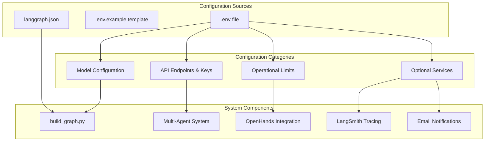
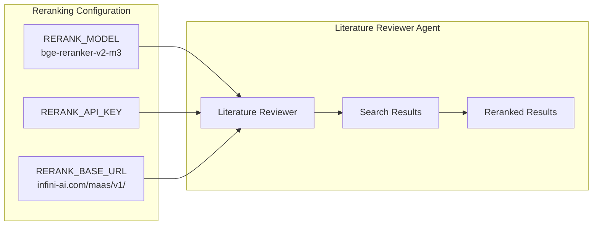
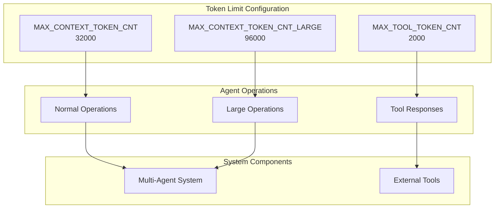
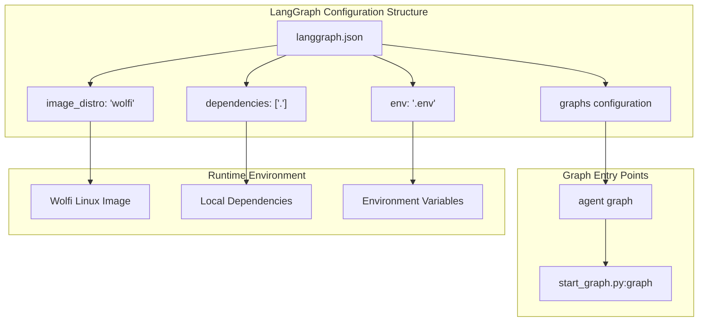

<!-- source: DeepWiki mcp.deepwiki.com · repo jarrycyx/openlens-ai · page 7.1 Configuration Reference · fetched 2026-10-26 -->

# Configuration Reference

Relevant source files

The following files were used as context for generating this wiki page:

- [.env.example](.env.example)
- [langgraph.json](langgraph.json)

This document provides a complete reference for all configuration files and parameters used in the OpenLens AI system. It covers environment variables, service endpoints, model configurations, and operational limits that control system behavior.

For information about setting up the initial configuration during installation, see [Installation](#2.2). For details about configuring specific models and routing infrastructure, see [Model Configuration](#4.1).

## Environment Configuration Overview

The OpenLens AI system uses environment-based configuration to manage connections to external services, model parameters, and operational limits. All configuration is centralized through environment variables defined in a `.env` file.

### Configuration Architecture

**Sources:** [.env.example:1-38](), [langgraph.json:1-9]()

## Core Model Configuration

The system requires configuration for three types of AI models that power different agent capabilities.

### Language Models

| Parameter | Purpose | Default Value |
|-----------|---------|---------------|
| `MODEL` | Primary language model for general tasks | `glm-4.5-air` |
| `CODE_MODEL` | Specialized model for code generation | `glm-4.5-air` |
| `VISION_MODEL` | Vision-language model for image analysis | `glm-4.1v-9b-thinking` |

### Model API Configuration

| Parameter | Purpose | Example Value |
|-----------|---------|---------------|
| `OPENAI_API_KEY` | API key for model access | `<YOUR API KEY>` |
| `BASE_URL` | Model service endpoint | `https://cloud.infini-ai.com/maas/v1/` |

**Sources:** [.env.example:1-5]()

## Reranking Service Configuration

The system uses a reranking model to improve search result relevance for literature review tasks.

| Parameter | Purpose | Value |
|-----------|---------|-------|
| `RERANK_MODEL` | Reranking model identifier | `bge-reranker-v2-m3` |
| `RERANK_API_KEY` | API key for reranking service | `<YOUR API KEY>` |
| `RERANK_BASE_URL` | Reranking service endpoint | `https://cloud.infini-ai.com/maas/v1/` |

**Sources:** [.env.example:7-9]()

## Search Service Configuration

External search capabilities are provided through the Tavily API for web search functionality.

| Parameter | Purpose | Usage |
|-----------|---------|-------|
| `TAVILY_API_KEY` | Tavily search service access | Required for literature search |

**Sources:** [.env.example:11]()

## Operational Limits Configuration

These parameters control resource usage and operational behavior across the system.

### Context Token Limits

| Parameter | Purpose | Default Value |
|-----------|---------|---------------|
| `MAX_CONTEXT_TOKEN_CNT` | Standard context window limit | `32000` |
| `MAX_CONTEXT_TOKEN_CNT_LARGE` | Extended context for complex tasks | `96000` |
| `MAX_TOOL_TOKEN_CNT` | Maximum tokens in tool responses | `2000` |

**Sources:** [.env.example:13-17]()

### Agent Execution Limits

| Parameter | Purpose | Default Value |
|-----------|---------|---------------|
| `OPENHANDS_MAX_ITER` | Maximum OpenHands agent iterations | `100` |
| `MAX_SUBTASK_REDO` | Maximum subtask retry attempts | `2` |
| `MAX_LATEX_POLISH_ROUND` | LaTeX document polishing rounds | `2` |
| `LITERATURE_SEARCH_MIN_TOOL_CALL` | Minimum literature search tool calls | `10` |

**Sources:** [.env.example:15-21]()

### Container Configuration

| Parameter | Purpose | Default Value |
|-----------|---------|---------------|
| `DOCKER_NAME` | OpenHands execution environment | `agent-med-cpu` |

**Sources:** [.env.example:23]()

## Optional Service Configuration

These services provide additional functionality for monitoring, debugging, and notifications.

### LangSmith Tracing

LangSmith provides distributed tracing and monitoring for agent workflows.

| Parameter | Purpose | Default Value |
|-----------|---------|---------------|
| `LANGSMITH_TRACING` | Enable/disable tracing | `true` |
| `LANGSMITH_ENDPOINT` | LangSmith service URL | `https://api.smith.langchain.com` |
| `LANGSMITH_PROJECT` | Project identifier | `openlens` |
| `LANGSMITH_API_KEY` | LangSmith access key | `<YOUR API KEY>` |

**Sources:** [.env.example:28-31]()

### Email Notifications

SMTP configuration for system notifications and alerts.

| Parameter | Purpose | Example Value |
|-----------|---------|---------------|
| `SMTP_SERVER` | SMTP server address | `smtpdm.aliyun.com` |
| `SMTP_PORT` | SMTP server port | `25` |
| `EMAIL_USER` | Sender email address | `<YOUR EMAIL>` |
| `EMAIL_PASSWORD` | Email authentication | `<YOUR EMAIL SMTP PASSWORD>` |

**Sources:** [.env.example:33-36]()

## LangGraph Configuration

The `langgraph.json` file configures the LangGraph framework that orchestrates the multi-agent workflow.

### LangGraph Parameters

| Parameter | Purpose | Value |
|-----------|---------|-------|
| `dependencies` | Local package dependencies | `["."]` |
| `graphs.agent` | Main graph entry point | `./start_graph.py:graph` |
| `env` | Environment file location | `.env` |
| `image_distro` | Container base image | `wolfi` |

**Sources:** [langgraph.json:1-9]()

## Configuration Validation

The system expects specific environment variables to be properly configured for different operational modes:

### Required Configuration
- Model API keys and endpoints (`OPENAI_API_KEY`, `BASE_URL`)
- Core model identifiers (`MODEL`, `CODE_MODEL`, `VISION_MODEL`)
- Docker container name (`DOCKER_NAME`)

### Development Configuration
- LangSmith tracing for debugging (`LANGSMITH_*` variables)
- Reranking service for enhanced search (`RERANK_*` variables)

### Production Configuration
- Email notifications for alerts (`SMTP_*`, `EMAIL_*` variables)
- Tavily search for comprehensive literature review (`TAVILY_API_KEY`)
- Optimized token limits based on usage patterns

**Sources:** [.env.example:1-38]()

---

