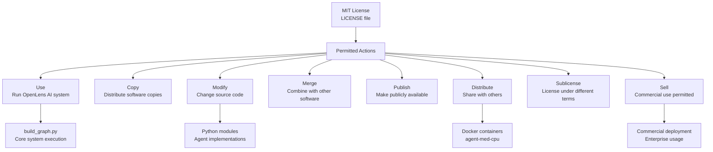
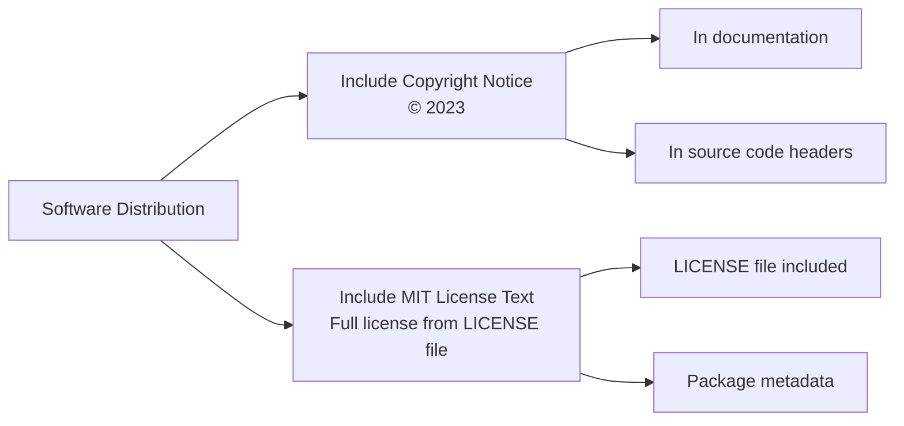
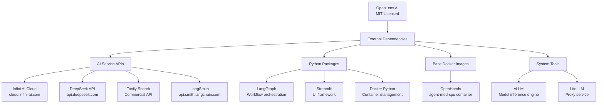
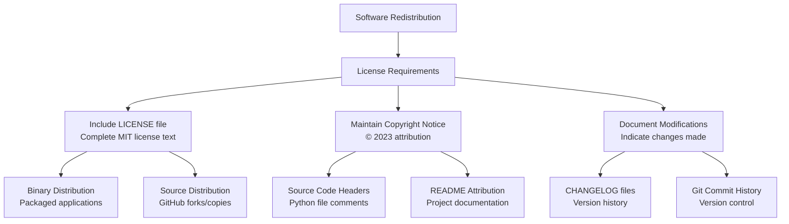

<!-- source: DeepWiki mcp.deepwiki.com · repo jarrycyx/openlens-ai · page 7.3 License and Legal · fetched 2026-10-26 -->

# License and Legal

Relevant source files

The following files were used as context for generating this wiki page:

- [LICENSE](LICENSE)

This document covers the licensing terms and legal considerations for the OpenLens AI project. It explains the MIT license under which the software is distributed, outlines permissions and limitations, and provides guidance on legal compliance for users and contributors.

For configuration details related to the project setup, see [Configuration Reference](#7.1). For overall repository organization, see [Repository Structure](#7.2).

## MIT License Overview

OpenLens AI is distributed under the MIT License, one of the most permissive open-source licenses available. The license grants broad permissions for use, modification, and distribution of the software while requiring minimal obligations from users.

The complete license text is contained in the repository root at [LICENSE:1-26]().

| **License Type** | **MIT License** |
|------------------|-----------------|
| **Copyright Year** | 2023 |
| **Permissions** | Use, copy, modify, merge, publish, distribute, sublicense, sell |
| **Conditions** | Include copyright notice and license text |
| **Limitations** | No warranty, no liability |

Sources: [LICENSE:1-26]()

## License Terms and Permissions

The MIT License grants the following permissions without restriction:

### Permitted Actions

Sources: [LICENSE:6-12]()

### Required Conditions

The license requires only two conditions to be met:

1. **Copyright Notice**: The copyright notice from [LICENSE:4]() must be included
2. **License Text**: The full license text from [LICENSE:1-26]() must be included

Sources: [LICENSE:15-16]()

## Warranty and Liability Disclaimers

The MIT License explicitly disclaims warranties and limits liability:

### No Warranty Provision

The software is provided "AS IS" without warranty of any kind, as stated in [LICENSE:18-22]():

| **Warranty Type** | **Status** |
|-------------------|------------|
| **Express Warranty** | None |
| **Implied Warranty** | None |
| **MERCHANTABILITY** | No warranty |
| **FITNESS FOR PURPOSE** | No warranty |
| **NON-INFRINGEMENT** | No warranty |

### Liability Limitations

The license limits liability for various types of damages as specified in [LICENSE:22-25]():

- **No liability for claims**
- **No liability for damages** 
- **No liability for other issues arising from use**
- **Applies to contract, tort, or other legal theories**

Sources: [LICENSE:18-25]()

## Third-Party Dependencies and Legal Compliance

OpenLens AI integrates with numerous external services and dependencies that have their own licensing terms:

Sources: [Configuration files and deployment scripts referenced throughout the codebase]()

### License Compliance Guidelines

When using OpenLens AI, users should:

1. **Review API Terms**: Each external AI service has its own terms of service
2. **Check Package Licenses**: Python dependencies may have different license requirements  
3. **Respect Usage Limits**: API services may have usage restrictions or commercial requirements
4. **Include Required Notices**: Maintain all required copyright and license notices

## Distribution and Modification Guidelines

### For Users

Users may freely use OpenLens AI for any purpose, including:
- **Personal research projects**
- **Academic research and publications**  
- **Commercial applications and services**
- **Integration into larger software systems**

### For Contributors

Contributors should ensure:
- **Code contributions**: Compatible with MIT License terms
- **Documentation**: Include appropriate license headers
- **Dependencies**: Verify compatibility of any new dependencies added

### For Redistributors

When redistributing OpenLens AI:
- **Include LICENSE file**: The complete [LICENSE:1-26]() must be included
- **Maintain copyright**: Preserve copyright notice from [LICENSE:4]()
- **Document modifications**: Clearly indicate any changes made to the original software

Sources: [LICENSE:15-16]()

## Legal Contact and Questions

For legal questions or concerns regarding the OpenLens AI project licensing:

- **Review the complete license**: See [LICENSE:1-26]() for full terms
- **Check project documentation**: Refer to other sections in [Reference](#7) for technical details
- **Consult legal counsel**: For specific legal advice regarding your use case

The MIT License is well-established and widely understood in the open-source community, providing clear guidance for most use cases.

Sources: [LICENSE:1-26]()