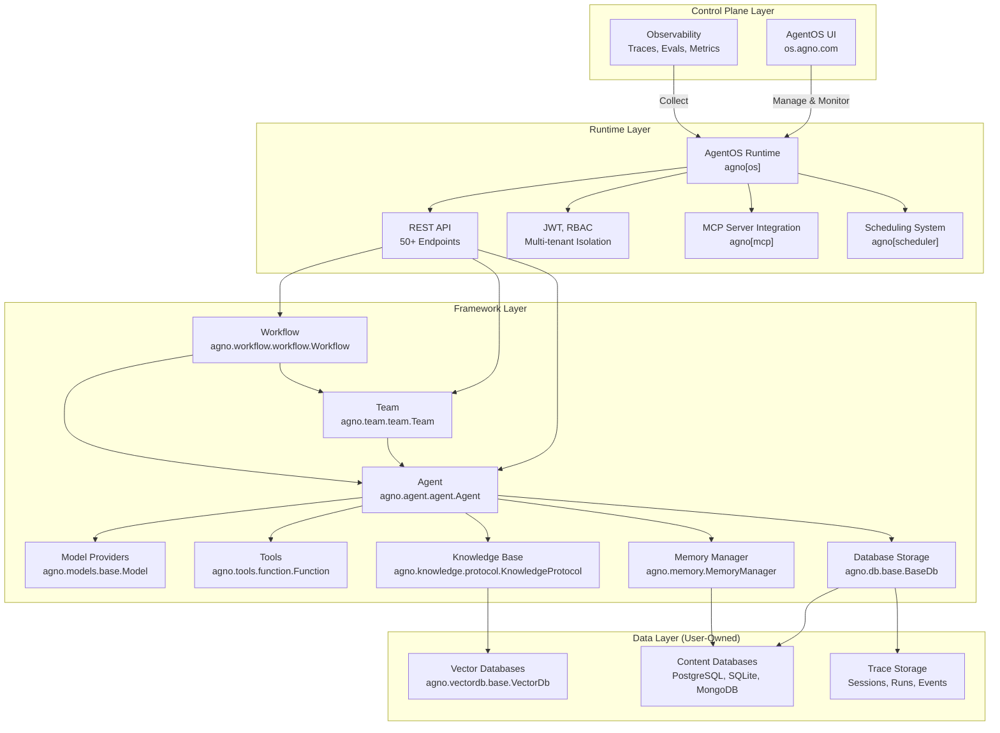
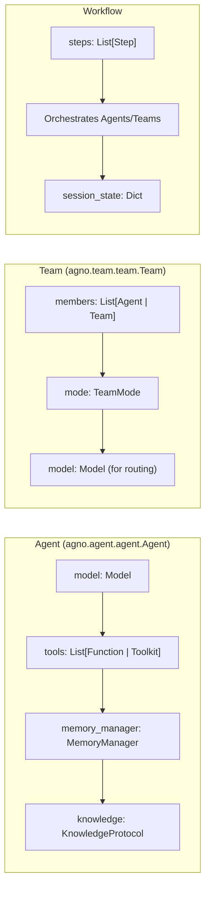

<!-- source: DeepWiki mcp.deepwiki.com · repo agno-agi/agno · page 1 Overview · fetched 2026-10-26 -->

# Overview

Relevant source files

The following files were used as context for generating this wiki page:

- [.github/pull_request_template.md](.github/pull_request_template.md)
- [.github/workflows/test_on_release.yml](.github/workflows/test_on_release.yml)
- [CONTRIBUTING.md](CONTRIBUTING.md)
- [README.md](README.md)
- [libs/agno/agno/agent/agent.py](libs/agno/agno/agent/agent.py)
- [libs/agno/agno/models/base.py](libs/agno/agno/models/base.py)
- [libs/agno/agno/models/message.py](libs/agno/agno/models/message.py)
- [libs/agno/agno/models/response.py](libs/agno/agno/models/response.py)
- [libs/agno/agno/run/agent.py](libs/agno/agno/run/agent.py)
- [libs/agno/agno/run/team.py](libs/agno/agno/run/team.py)
- [libs/agno/agno/team/team.py](libs/agno/agno/team/team.py)
- [libs/agno/agno/tools/reasoning.py](libs/agno/agno/tools/reasoning.py)
- [libs/agno/agno/utils/events.py](libs/agno/agno/utils/events.py)
- [libs/agno/pyproject.toml](libs/agno/pyproject.toml)
- [libs/agno/tests/integration/agent/test_event_streaming.py](libs/agno/tests/integration/agent/test_event_streaming.py)
- [libs/agno/tests/integration/teams/test_event_streaming.py](libs/agno/tests/integration/teams/test_event_streaming.py)
- [libs/agno/tests/integration/test_basic.py](libs/agno/tests/integration/test_basic.py)
- [libs/agno/tests/integration/test_os_basic.py](libs/agno/tests/integration/test_os_basic.py)
- [libs/agno/tests/unit/models/test_message.py](libs/agno/tests/unit/models/test_message.py)
- [libs/agno/tests/unit/run/test_run_input.py](libs/agno/tests/unit/run/test_run_input.py)
- [scripts/run_model_tests.sh](scripts/run_model_tests.sh)

This document introduces the Agno framework, its three-layer architecture, and core design principles. It provides a high-level understanding of how Agno enables building, deploying, and managing AI agent systems at scale.

For hands-on examples, see [Quick Start Guide](#1.1). For detailed architectural patterns, see [Architecture Overview](#1.2). For definitions of core terms, see [Key Concepts and Terminology](#1.3).

## What is Agno

Agno is a framework and runtime for agent platforms, allowing users to build, run, and manage agent systems. It provides the building blocks to create AI agents, coordinate them into teams, and orchestrate them through multi-step workflows. It then serves those systems in production as stateless, session-scoped APIs with built-in monitoring and management capabilities. [README.md:17-23]()

The framework addresses fundamental requirements for production agentic software:

1.  **Framework Agnostic**: Build agents using the Agno SDK or integrate existing agents from other frameworks like the Claude Agent SDK, LangGraph, or DSPy via adapters. [README.md:19](), [libs/agno/pyproject.toml:77](), [libs/agno/pyproject.toml:203-206]()
2.  **Production Runtime**: Run agents as production services with tracing, scheduling, and RBAC via the `AgentOS` runtime. [README.md:20](), [libs/agno/pyproject.toml:77]()
3.  **Dynamic Governance**: Agno provides approval workflows and human-in-the-loop controls for sensitive tool executions using `ToolExecution` states and `requires_confirmation` flags. [README.md:54](), [libs/agno/agno/models/response.py:27-64](), [libs/agno/agno/tools/function.py:33-51]()
4.  **Integrated Learning**: Agents can persist user profiles, memories, and learned knowledge across sessions using the `LearningMachine`. [README.md:23](), [libs/agno/agno/agent/agent.py:43](), [libs/agno/agno/agent/agent.py:121-132]()

**Sources:** [README.md:15-60](), [libs/agno/pyproject.toml:1-80](), [libs/agno/agno/agent/agent.py:73-132]()

## Three-Layer Architecture

Agno separates concerns into three distinct layers, each serving a specific role in the system lifecycle.

Title: Agno Three-Layer Architecture  
Sources: [README.md:17-21](), [README.md:50-59](), [libs/agno/pyproject.toml:77-80](), [libs/agno/agno/agent/agent.py:73-160]()

### Framework Layer

The framework layer provides building blocks for creating agentic systems. Core classes include:

| Class | Purpose | Source |
| :--- | :--- | :--- |
| `Agent` | Individual AI unit with tools, memory, knowledge, and guardrails | [libs/agno/agno/agent/agent.py:73]() |
| `Team` | Multi-agent coordination with routing and delegation | [libs/agno/agno/team/team.py:80]() |
| `Workflow` | Multi-step orchestration with conditional logic and state | [libs/agno/pyproject.toml:112-113]() |
| `Function` | The primary tool abstraction wrapping Python callables | [libs/agno/agno/tools/function.py:2]() |

These primitives share common infrastructure for model access via the `Model` base class [libs/agno/agno/models/base.py:134](), tool execution via `Function` [libs/agno/agno/tools/function.py:112](), and persistence.

**Sources:** [libs/agno/agno/agent/agent.py:73-180](), [libs/agno/agno/team/team.py:80-183](), [libs/agno/agno/models/base.py:134]()

### Runtime Layer

The runtime layer (`AgentOS`) serves agents, teams, and workflows as production APIs.

*   **Stateless Execution**: Horizontally scalable design where state is persisted to user-owned databases. [README.md:23]()
*   **Session Management**: Persistence of `AgentSession`, `TeamSession`, and `WorkflowSession` across runs. [libs/agno/agno/agent/agent.py:63](), [libs/agno/agno/team/team.py:55]()
*   **Security**: JWT-based RBAC and multi-user, multi-tenant isolation. [README.md:56](), [libs/agno/pyproject.toml:77]()
*   **Interfaces**: Native support for Slack, Telegram, WhatsApp, Discord, and the AG-UI protocol. [README.md:57](), [libs/agno/pyproject.toml:70-73]()

**Sources:** [README.md:50-60](), [libs/agno/pyproject.toml:77](), [libs/agno/agno/agent/agent.py:90-112]()

### Control Plane Layer

The control plane ([os.agno.com](https://os.agno.com)) provides a web interface for testing, monitoring, and managing deployed systems. It connects to running `AgentOS` instances to:

*   Chat with agents and inspect real-time tool calls and events. [README.md:25](), [libs/agno/agno/models/response.py:12-23]()
*   View session history and detailed metrics via `SessionMetrics` and `MessageMetrics`. [libs/agno/agno/agent/agent.py:48](), [libs/agno/agno/models/message.py:10]()
*   Manage human approval requests for paused tool executions. [README.md:54](), [libs/agno/agno/models/response.py:45-63]()

**Sources:** [README.md:21-25](), [libs/agno/agno/models/response.py:12-63](), [libs/agno/agno/models/message.py:56-118]()

## Core Orchestration Primitives

Agno provides three orchestration primitives, each designed for different coordination patterns.

Title: Agno Orchestration Primitives  
Sources: [libs/agno/agno/agent/agent.py:73-175](), [libs/agno/agno/team/team.py:80-112](), [libs/agno/pyproject.toml:112-113]()

### Agent

The `Agent` class represents a single AI unit. It is the primary building block for stateful interactions, supporting tools, persistent memory, and RAG capabilities via the `knowledge` parameter. [libs/agno/agno/agent/agent.py:73-162]()

### Team

The `Team` class coordinates multiple agents. It allows specialized agents to collaborate on complex tasks, using a lead model to route or delegate queries based on the `TeamMode`. [libs/agno/agno/team/team.py:80-122]()

### Workflow

Workflows orchestrate multi-step processes using sequential or parallel steps. They are ideal for predictable pipelines where data must flow through specific stages of processing using `session_state`. [libs/agno/pyproject.toml:112-113](), [libs/agno/agno/agent/agent.py:63]()

## Integration Ecosystem

Agno provides a unified interface to a broad ecosystem of AI providers, tools, and storage systems.

### Model Providers (40+)

All model providers implement the `Model` base class interface for inference, streaming, and tool calling. [libs/agno/agno/models/base.py:134]()

| Provider | Key Implementation | Source |
| :--- | :--- | :--- |
| **OpenAI** | `OpenAIChat` | [libs/agno/pyproject.toml:106]() |
| **Anthropic** | `Claude` | [libs/agno/pyproject.toml:92]() |
| **Google** | `Gemini` | [libs/agno/pyproject.toml:97]() |
| **AWS** | `AwsBedrock` | [libs/agno/pyproject.toml:93]() |
| **Mistral** | `Mistral` | [libs/agno/pyproject.toml:104]() |

**Sources:** [libs/agno/pyproject.toml:88-108](), [libs/agno/agno/models/base.py:134]()

### Tools and Context

Tools extend agent capabilities by allowing them to interact with external systems.
*   **Function Class**: Wraps Python callables into a schema the model can understand via `from_callable`. [libs/agno/agno/tools/function.py:112]()
*   **Context Providers**: Supply live information from sources like Slack, Google Drive, or the filesystem. [README.md:53]()
*   **MCP**: Support for the Model Context Protocol to connect to external tool servers. [libs/agno/pyproject.toml:78]()

**Sources:** [README.md:52-54](), [libs/agno/pyproject.toml:115-181](), [libs/agno/agno/tools/function.py:112]()

### Knowledge and Storage

Agno abstracts the complexities of data persistence:
*   **Vector Databases**: Native support for providers including `LanceDB`, `PgVector`, `Milvus`, and `ChromaDB`. [libs/agno/pyproject.toml:196-212]()
*   **Storage Backends**: Support for `PostgreSQL`, `SQLite`, `MongoDB`, and `Redis` for session and memory storage via `BaseDb`. [libs/agno/pyproject.toml:183-195](), [libs/agno/agno/agent/agent.py:135]()

**Sources:** [libs/agno/pyproject.toml:183-212]()

## Getting Started

To begin building with Agno:

1.  **Quick start**: See [Quick Start Guide](#1.1) for a minimal working example.
2.  **Architecture**: See [Architecture Overview](#1.2) for detailed design patterns.
3.  **Concepts**: See [Key Concepts and Terminology](#1.3) for definitions.
4.  **Documentation**: Visit [docs.agno.com](https://docs.agno.com).

**Sources:** [README.md:27-46]()

---

