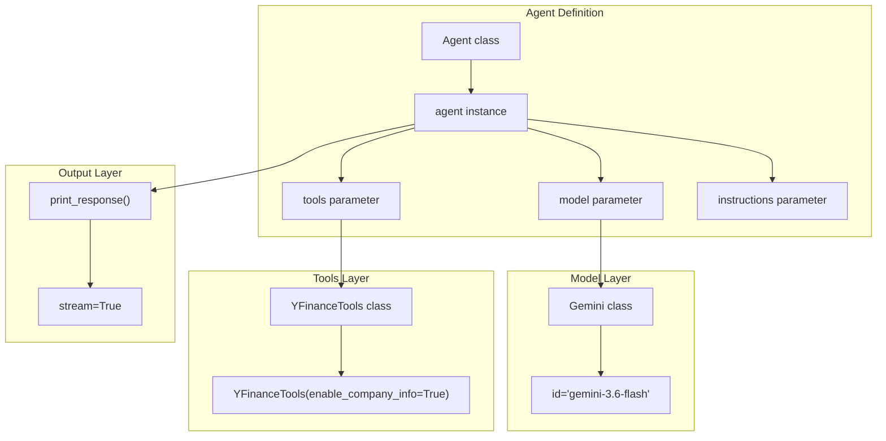
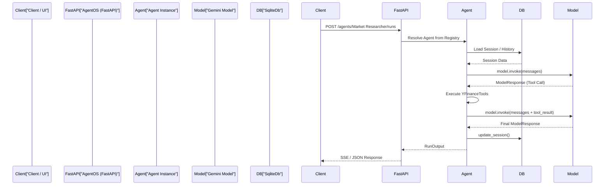
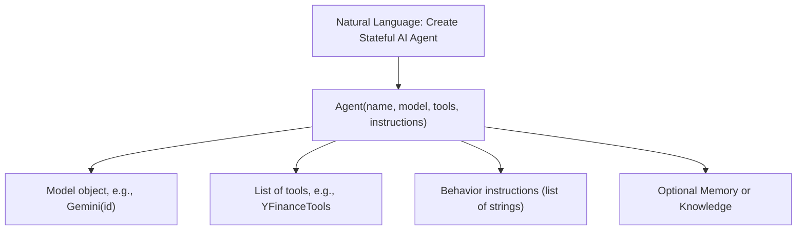
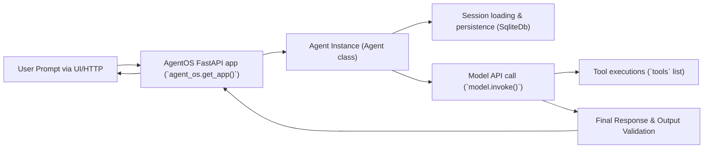

<!-- source: DeepWiki mcp.deepwiki.com · repo agno-agi/agno · page 1.1 Quick Start Guide · fetched 2026-10-26 -->

# Quick Start Guide

<details>
<summary>Relevant source files</summary>

The following files were used as context for generating this wiki page:

- [cookbook/00_quickstart/README.md](cookbook/00_quickstart/README.md)
- [cookbook/00_quickstart/TEST_LOG.md](cookbook/00_quickstart/TEST_LOG.md)
- [cookbook/00_quickstart/agent_search_over_knowledge.py](cookbook/00_quickstart/agent_search_over_knowledge.py)
- [cookbook/00_quickstart/agent_with_guardrails.py](cookbook/00_quickstart/agent_with_guardrails.py)
- [cookbook/00_quickstart/agent_with_memory.py](cookbook/00_quickstart/agent_with_memory.py)
- [cookbook/00_quickstart/agent_with_state_management.py](cookbook/00_quickstart/agent_with_state_management.py)
- [cookbook/00_quickstart/agent_with_storage.py](cookbook/00_quickstart/agent_with_storage.py)
- [cookbook/00_quickstart/agent_with_structured_output.py](cookbook/00_quickstart/agent_with_structured_output.py)
- [cookbook/00_quickstart/agent_with_tools.py](cookbook/00_quickstart/agent_with_tools.py)
- [cookbook/00_quickstart/agent_with_typed_input_output.py](cookbook/00_quickstart/agent_with_typed_input_output.py)
- [cookbook/01_demo/README.md](cookbook/01_demo/README.md)
- [cookbook/01_demo/TEST_LOG.md](cookbook/01_demo/TEST_LOG.md)
- [cookbook/01_demo/config.yaml](cookbook/01_demo/config.yaml)
- [cookbook/01_demo/run.py](cookbook/01_demo/run.py)
- [cookbook/03_teams/02_modes/broadcast/04_structured_debate.py](cookbook/03_teams/02_modes/broadcast/04_structured_debate.py)
- [cookbook/05_agent_os/16_agui/openui/README.md](cookbook/05_agent_os/16_agui/openui/README.md)
- [cookbook/07_knowledge/01_getting_started/README.md](cookbook/07_knowledge/01_getting_started/README.md)
- [cookbook/07_knowledge/README.md](cookbook/07_knowledge/README.md)
- [cookbook/10_reasoning/README.md](cookbook/10_reasoning/README.md)
- [cookbook/90_models/azure/claude/README.md](cookbook/90_models/azure/claude/README.md)
- [cookbook/90_models/cohere/retry.py](cookbook/90_models/cohere/retry.py)
- [cookbook/90_models/cometapi/README.md](cookbook/90_models/cometapi/README.md)
- [cookbook/91_tools/mcp/github.py](cookbook/91_tools/mcp/github.py)
- [cookbook/91_tools/mcp/mcp_toolbox_demo/README.md](cookbook/91_tools/mcp/mcp_toolbox_demo/README.md)

</details>


This guide demonstrates the fastest path to building and deploying an AI agent with Agno. In approximately 20 lines of code, you will create a stateful, tool-using agent, serve it as a production API via AgentOS, and connect it to the AgentOS UI for monitoring and testing.

For detailed system architecture, see **Architecture Overview (1.2)**. For terminology and core concepts, see **Key Concepts and Terminology (1.3)**. For comprehensive agent configuration options, see **Agent System (2.1)**.

---

## Installation

Install Agno with the AgentOS runtime and your preferred model provider:

```bash
pip install -U 'agno[os]'
```

The `os` extra bundle includes `fastapi`, `uvicorn`, `websockets`, `sqlalchemy`, `PyJWT`, and `opentelemetry-sdk` required for production deployment [[README.md:50-59]]().

---

## Creating Your First Agent

The most common starting point is a tool-enabled agent that can act on live data. Create a file named `agent_with_tools.py`:

```python
from agno.agent import Agent
from agno.models.google import Gemini
from agno.tools.yfinance import YFinanceTools

# 1. Define the Agent
agent = Agent(
    name="Market Researcher",
    model=Gemini(id="gemini-3.6-flash"),
    instructions=[
        "Use Yahoo Finance for facts that can change.",
        "Lead with the answer, then show the evidence.",
        "Use a table when comparing companies.",
    ],
    tools=[YFinanceTools(enable_company_info=True, enable_stock_fundamentals=True)],
    markdown=True,
)

# 2. Run the Agent (Local CLI)
if __name__ == "__main__":
    agent.print_response("What is the current price of NVDA?", stream=True)
```

### Component Breakdown

The diagram below maps the example's code entities to their underlying framework classes and system roles:



| Class/Parameter | Purpose |
|-----------------|---------|
| `Agent` | Core class for creating autonomous entities with models, tools, and memory [[cookbook/00_quickstart/agent_with_tools.py:26-45]](). |
| `Gemini` | Implementation of the `Model` interface for Google's Gemini API [[cookbook/00_quickstart/agent_with_tools.py:28-28]](). |
| `tools` | List of toolkits or functions (e.g., `YFinanceTools`) provided to the model to act [[cookbook/00_quickstart/agent_with_tools.py:36-42]](). |
| `instructions` | Defines agent persona and behavior rules [[cookbook/00_quickstart/agent_with_tools.py:29-35]](). |
| `print_response` | Helper to execute the agent and print output to the console [[cookbook/00_quickstart/agent_with_tools.py:51-54]](). |

**Sources:** [[cookbook/00_quickstart/agent_with_tools.py:19-54]](), [[cookbook/00_quickstart/README.md:29-40]]()

---

## Serving with AgentOS

To move from a local script to a production service, use the `AgentOS` runtime. This provides a REST API, session persistence, and UI connectivity.

Create a `run.py` script like this minimal example:

```python
from agno.agent import Agent
from agno.models.google import Gemini
from agno.os import AgentOS
from agno.db.sqlite import SqliteDb

# Define the agent with Gemini model
agent = Agent(name="Market Researcher", model=Gemini(id="gemini-3.6-flash"))

# Create the AgentOS runtime, register the agent, and set up the SQLite database
agent_os = AgentOS(
    agents=[agent], 
    db=SqliteDb(db_file="tmp/quickstart/agent_os.db"),
    tracing=True
)

# Obtain the FastAPI ASGI application
app = agent_os.get_app()
```

Run the server with:

```bash
export GOOGLE_API_KEY=your-key
fastapi dev run.py --port 7777
```

This setup:

- Registers the agent in AgentOS [[cookbook/00_quickstart/README.md:118-122]]().
- Configures SQLite for session and run persistence.
- Enables tracing for observability.
- Exposes a REST API and WebSocket interface for clients.

**Sources:** [[cookbook/00_quickstart/README.md:118-122]](), [[cookbook/01_demo/run.py:25-75]]()

---

## Execution Flow: From HTTP Request to Agent Response

The diagram below shows the runtime data flow from an incoming client request through the AgentOS runtime, Agent logic, model invocation, tool usage, session management, and back to the client.



- **Client** sends a run request with input prompt.
- **FastAPI/AgentOS** resolves the agent and its state.
- The **Agent** loads session context and memory from the database.
- The **model** (Gemini) generates output or tool call actions.
- The **Agent** executes tools (e.g., YFinanceTools) as requested by the model.
- The **Agent** re-invokes the model with tool results.
- Updated session state is saved back in the database.
- The final response is streamed or returned to the client.

**Sources:** [[cookbook/00_quickstart/README.md:118-127]](), [[cookbook/01_demo/run.py:60-71]]()

---

## Connecting to the AgentOS UI

The AgentOS Control Plane UI at [os.agno.com](https://os.agno.com) serves as the dashboard for:

- Adding and connecting AgentOS instances (local or remote).
- Selecting agents, teams, or workflows for chat interaction.
- Viewing session histories and detailed run traces.
- Inspecting stored memories, knowledge, and learning data.

**Steps to connect your local AgentOS server:**

1. Open [os.agno.com](https://os.agno.com).
2. Click **"Add OS"** and choose **"Local"**.
3. Enter your locally running server endpoint (e.g., `http://localhost:7777`).
4. After connection, select your agent and begin chatting.

The UI supports rich interactions including:

- Real-time streaming message display.
- Inspection of structured output and tool calls.
- Access to logs and diagnostic tracing.

This empowers rapid iteration and debugging in production.

**Sources:** [[cookbook/00_quickstart/README.md:124-127]](), [[cookbook/01_demo/README.md:49-58]]()

---

## The Capability Ladder

Agno is architected as a capability ladder. You start with a simple agent and add increasing features and capabilities:

| Feature | Cookbook Example | Description |
|---------|------------------|-------------|
| **Tools** | `agent_with_tools.py` | Enable live data interaction with toolkit integration [[cookbook/00_quickstart/agent_with_tools.py]](). |
| **Structured Output** | `agent_with_structured_output.py` | Return validated typed objects for reliability [[cookbook/00_quickstart/agent_with_structured_output.py]](). |
| **Storage** | `agent_with_storage.py` | Persist conversations and contexts to a database [[cookbook/00_quickstart/agent_with_storage.py]](). |
| **Memory** | `agent_with_memory.py` | Long-term personalized memory for users [[cookbook/00_quickstart/agent_with_memory.py]](). |
| **Knowledge** | `agent_search_over_knowledge.py` | Retrieval-augmented generation grounded in documents [[cookbook/00_quickstart/agent_search_over_knowledge.py]](). |
| **Learning** | `agent_with_learning.py` | Cross-user shared learning and heuristics [[cookbook/00_quickstart/agent_with_learning.py]](). |
| **Human-in-the-Loop** | `human_in_the_loop.py` | Pausing runs for approval gates ensures safe actions [[cookbook/00_quickstart/human_in_the_loop.py]](). |
| **Teams** | `multi_agent_team.py` | Multi-agent dynamic collaboration and coordination [[cookbook/00_quickstart/multi_agent_team.py]](). |
| **Workflows** | `sequential_workflow.py` | Explicit multi-step orchestration of processes [[cookbook/00_quickstart/sequential_workflow.py]](). |

This ladder allows you to start simple and compose complex AI systems by incrementally adding features suited to your application's needs.

**Sources:** [[cookbook/00_quickstart/README.md:51-87]](), [[cookbook/00_quickstart/TEST_LOG.md:21-160]]()

---

## Summary

This quick start guide showed how to:

- Create a simple stateful agent that uses tools and streams responses.
- Deploy the agent in AgentOS runtime with session persistence.
- Connect to the AgentOS UI web app for monitoring and chatting.
- Understand the runtime data flow from client requests to model calls.
- Explore the Agno capability ladder and progressive examples.

Use this foundation as a launchpad for building complex, production-grade AI agents and workflows at scale.

---

# Additional Diagrams Bridging Natural Language and Code Entities

### Agent Construction Flow



### AgentOS Runtime Data Flow



**Sources for Diagrams:** [[cookbook/00_quickstart/agent_with_tools.py]](), [[cookbook/01_demo/run.py:25-75]]()

# End of Quick Start Guide

---

