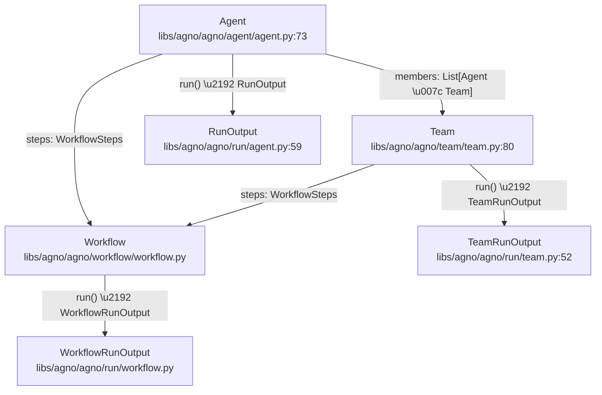
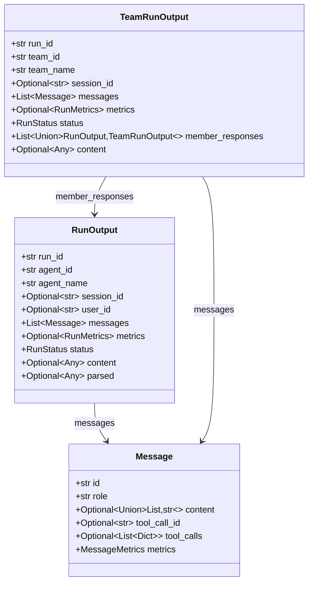
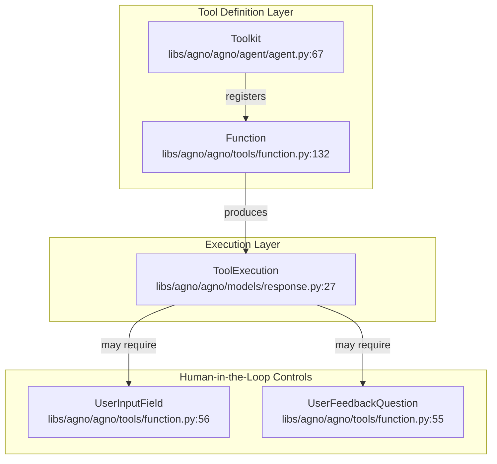

<!-- source: DeepWiki mcp.deepwiki.com · repo agno-agi/agno · page 1.3 Key Concepts and Terminology · fetched 2026-10-26 -->

# Key Concepts and Terminology

<details>
<summary>Relevant source files</summary>

The following files were used as context for generating this wiki page:

- [.github/pull_request_template.md](.github/pull_request_template.md)
- [.github/workflows/test_on_release.yml](.github/workflows/test_on_release.yml)
- [CONTRIBUTING.md](CONTRIBUTING.md)
- [README.md](README.md)
- [libs/agno/agno/agent/agent.py](libs/agno/agno/agent/agent.py)
- [libs/agno/agno/models/base.py](libs/agno/agno/models/base.py)
- [libs/agno/agno/models/message.py](libs/agno/agno/models/message.py)
- [libs/agno/agno/models/response.py](libs/agno/agno/models/response.py)
- [libs/agno/agno/run/agent.py](libs/agno/agno/run/agent.py)
- [libs/agno/agno/run/team.py](libs/agno/agno/run/team.py)
- [libs/agno/agno/team/team.py](libs/agno/agno/team/team.py)
- [libs/agno/agno/tools/reasoning.py](libs/agno/agno/tools/reasoning.py)
- [libs/agno/agno/utils/events.py](libs/agno/agno/utils/events.py)
- [libs/agno/pyproject.toml](libs/agno/pyproject.toml)
- [libs/agno/tests/integration/agent/test_event_streaming.py](libs/agno/tests/integration/agent/test_event_streaming.py)
- [libs/agno/tests/integration/teams/test_event_streaming.py](libs/agno/tests/integration/teams/test_event_streaming.py)
- [libs/agno/tests/integration/test_basic.py](libs/agno/tests/integration/test_basic.py)
- [libs/agno/tests/integration/test_os_basic.py](libs/agno/tests/integration/test_os_basic.py)
- [libs/agno/tests/unit/models/test_message.py](libs/agno/tests/unit/models/test_message.py)
- [libs/agno/tests/unit/run/test_run_input.py](libs/agno/tests/unit/run/test_run_input.py)
- [scripts/run_model_tests.sh](scripts/run_model_tests.sh)

</details>


## Purpose and Scope

This document defines the core abstractions and terminology used throughout the Agno framework. It serves as a reference for understanding the fundamental building blocks that compose the system, from atomic execution units (Agents) to production deployment (AgentOS).

For detailed implementation of specific components refer to their dedicated pages:  
- Agent system and lifecycle → [2.1 Agent System]()  
- Team orchestration → [2.2 Team Orchestration]()  
- Workflow engine → [2.3 Workflow System]()  
- Session persistence → [2.7 Session Management]()  
- Memory and learning → [2.8 Memory and Learning Systems]()  
- Knowledge management and RAG → [5.1 Knowledge Base and Agentic RAG]()  
- Tool definitions and execution → [4.1 Tool Architecture and Function Class]()  
- Production runtime → [7.1 AgentOS Architecture and Initialization]()

---

## Core Execution Units

Agno structures agentic software with three hierarchical execution units: **Agent**, **Team**, and **Workflow**, each building on the previous for increasing coordination complexity.

### Diagram: Core Execution Units and Output Types (Code Entity Mapping)



---

### Agent

- **Class:** `agno.agent.agent.Agent`  
- **File:** [libs/agno/agno/agent/agent.py:73]()  

**Description:**  
The atomic execution unit in Agno. An Agent wraps a large language model (`Model`) instance, augmented by tools, memory, knowledge bases, guardrails, session management, and lifecycle hooks. It exposes an API to run inputs and return structured outputs.

**Key Attributes and Their Roles:**

| Attribute                     | Type                                   | Default   | Purpose                                                       |
|-------------------------------|--------------------------------------|-----------|---------------------------------------------------------------|
| `model`                       | `Optional[Model]`                     | `None`    | The primary LLM model the agent uses for inference.           |
| `name`                        | `Optional[str]`                      | `None`    | Human-readable name of the agent instance.                    |
| `id`                          | `Optional[str]`                      | `None`    | UUID for the agent (auto-generated if not set).               |
| `tools`                       | `Optional[List[Union[Toolkit, Callable, Dict, Function]]]` | `None` | Callable toolkits or functions integrated into this agent.    |
| `memory_manager`              | `Optional[MemoryManager]`             | `None`    | Component responsible for storing and retrieving memories.     |
| `knowledge`                  | `Optional[KnowledgeProtocol]`          | `None`    | Interface to knowledge base for retrieval-augmented generation (RAG). |
| `db`                         | `Optional[Union[BaseDb, AsyncBaseDb]]` | `None`   | Persistence backend for sessions, runs, memories, etc.         |
| `session_id`                 | `Optional[str]`                      | `None`    | Default session context for stateless run isolation.           |
| `session_state`              | `Optional[Dict[str, Any]]`            | `None`    | Mutable state dictionary associated with the session.          |
| `user_id`                    | `Optional[str]`                      | `None`    | User scoping identifier.                                        |
| `add_history_to_context`     | `bool`                              | `False`   | Whether to inject historical conversation content into context. |
| `num_history_runs`           | `Optional[int]`                     | `None`    | Number of past runs' contents to include in context.           |

Agents encapsulate prompt construction, tool calls, memory lookups, knowledge retrieval, run checkpointing, and result aggregation.

Sources: [libs/agno/agno/agent/agent.py:73-179]()

---

### Team

- **Class:** `agno.team.team.Team`  
- **File:** [libs/agno/agno/team/team.py:80]()  

**Description:**  
A Team is a multi-agent orchestration unit consisting of multiple member Agents or nested Teams, coordinated by a leader model. Teams coordinate task delegation among members, combine their outputs according to different modes, and maintain session and context state. This enables complex distributed agent workflows mimicking organizational roles.

**Key Attributes:**

| Attribute                 | Type                                   | Default | Purpose                                                           |
|---------------------------|--------------------------------------|---------|-------------------------------------------------------------------|
| `members`                | `Union[List[Union[Agent, Team]], Callable]` | Required | Member agents or subteams forming this Team.                     |
| `model`                  | `Optional[Model]`                     | None    | The leader model to coordinate and delegate tasks.                |
| `mode`                   | `Optional[TeamMode]`                  | None    | Mode controlling delegation strategy and response synthesis.     |
| `delegate_to_all_members` | `bool`                              | False   | Whether to run all members concurrently without leader filtering. |
| `respond_directly`       | `bool`                              | False   | Return raw member outputs directly, skipping leader synthesis.    |
| `share_member_interactions` | `bool`                            | False   | Share member responses during task execution with other members.  |
| `add_team_history_to_members` | `bool`                         | False   | Include team history context when invoking member agents.         |

Teams run asynchronously or synchronously and return a consolidated result including member outputs and run events.

Sources: [libs/agno/agno/team/team.py:80-147]()

---

### Workflow

- **Class:** `agno.workflow.workflow.Workflow`  

**Description:**  
A Workflow orchestrates complex multi-step processes by chaining together sequences of steps. Steps can be Agents, Teams, or custom Python steps. Workflows manage dependencies, branching (`Condition`), parallelism (`Parallel`), loops (`Loop`), human-in-the-loop patterns, and control flows using metadata and session context injection.

Workflows take run inputs and return aggregated multi-step outputs with their own event streams.

Sources: [libs/agno/agno/agent/agent.py:64]()

---

## Execution Results and Events

All execution units produce structured output classes capturing the state, content, logs, events, and more.

### Diagram: Run Output Type Hierarchy (Code Structure)



### RunOutput

- **Class:** `agno.run.agent.RunOutput`  
- **File:** [libs/agno/agno/run/agent.py:60]()  

**Description:**  
The primary output from an Agent `run()` call containing `messages` (chat history), execution `metrics`, run `status`, and optional structured content and parsed representations.

### TeamRunOutput

- **Class:** `agno.run.team.TeamRunOutput`  
- **File:** [libs/agno/agno/run/team.py:53]()  

**Description:**  
Output from a Team `run()` which aggregates member runs (`member_responses`) as well as team-level messages, status, and metrics.

### Message

- **Class:** `agno.models.message.Message`  
- **File:** [libs/agno/agno/models/message.py:56]()  

**Description:**  
Represents a single chat message or tool call result within run outputs. Supports multimodal content such as images, audio, video, files, and includes cognitive fields like reasoning content and citations.

Key fields include `role` (system, user, assistant, or tool), `content`, `tool_calls`, and media attachments.

Sources: [libs/agno/agno/run/agent.py:60](), [libs/agno/agno/run/team.py:53](), [libs/agno/agno/models/message.py:56-100]()

---

## Tools and Capabilities

Agno provides a flexible **tools system** allowing Agents and Teams to extend behaviors through callable functions and toolkits. Tool use is integrated into the language model output parsing and can support human-in-the-loop controls.

### Diagram: Tool Architecture (Code Entity Flow)



### Function

- **Class:** `agno.tools.function.Function`  
- **File:** [libs/agno/agno/tools/function.py:134]()  

**Description:**  
Defines the schema and Python entrypoint for callable tools. Supports JSON Schema for parameter validation.

### ToolExecution

- **Class:** `agno.models.response.ToolExecution`  
- **File:** [libs/agno/agno/models/response.py:27]()  

**Description:**  
Captures the result of a tool invocation, including whether user confirmation or input is required (`requires_confirmation`, `requires_user_input`), execution status, errors, and pause/resume states for HITL workflows.

### Guardrails

- **Class:** `agno.guardrails.BaseGuardrail`  
- **File:** [libs/agno/agno/agent/agent.py:39]()  

**Description:**  
Provides mechanisms to enforce constraints, safety policies, and behavioral guardrails on agent outputs during execution.

Sources: [libs/agno/agno/tools/function.py:55-134](), [libs/agno/agno/models/response.py:27-67](), [libs/agno/agno/agent/agent.py:39]()

---

## Production Runtime

### AgentOS

**Description:**  
AgentOS is the production runtime and orchestration service for Agno agents, teams, and workflows. It exposes REST and WebSocket endpoints, handles authentication, persistence, event streaming, and scheduling. It serves as the scalable backend system to deploy your agent platform in production.

Sources: [libs/agno/pyproject.toml:77](), [README.md:17-20]()

### MCP (Model Context Protocol)

**Description:**  
A protocol that enables Agno agents to expose and utilize external tool sets via transports like stdio, SSE, or HTTP streams. MCP bridges external capabilities into agent conversations, enabling extensible, decoupled integrations.

Sources: [libs/agno/pyproject.toml:78](), [README.md:65]()

---

## Models and Language Providers

### Model (Base)

- **Class:** `agno.models.base.Model`  
- **File:** [libs/agno/agno/models/base.py:134]()  

**Description:**  
Abstract base class defining the LLM provider interface: invocation, streaming, token counting, retries, and structured outputs. Models encapsulate id, provider name, retry policies, and behaviors regarding function calls and tooling.

**Key Attributes:**

| Attribute          | Type       | Description                                 |
|--------------------|------------|---------------------------------------------|
| `id`               | `str`      | Stable model identifier (e.g. "gpt-4o")     |
| `retries`          | `int`      | Number of retries on transient errors       |
| `retry_with_guidance` | `bool`   | Whether to retry with additional prompt instructions |

Sources: [libs/agno/agno/models/base.py:134-184]()

---

## Learning and Context

### LearningMachine

- **Class:** `agno.learn.machine.LearningMachine`  
- **File:** [libs/agno/agno/agent/agent.py:43]()  

**Description:**  
Coordinates the learning layer by managing user profile stores, session contexts, entity memories, and decision logs. It provides a framework for agents to accumulate knowledge from interactions and adapt over time.

### ContextProvider

**Description:**  
Provides a uniform interface to plug external data sources (e.g., filesystems, Slack, Google Drive, wikis) into agents as natural-language accessible tools. ContextProviders can inject knowledge/tools dynamically into agent workflows.

### Memory

- **Class:** `agno.memory.MemoryManager`  
- **File:** [libs/agno/agno/agent/agent.py:48]()  
- **Related:** `UserMemory` in [libs/agno/agno/db/base.py:36]()

**Description:**  
Manages retrieval and storage of past interactions, enabling agents to remember conversation history and user data. MemoryManager supports persistence and summarization strategies.

### Knowledge

- **Class:** `agno.knowledge.protocol.KnowledgeProtocol`  
- **File:** [libs/agno/agno/agent/agent.py:40]()  

**Description:**  
Defines the interface to external knowledge bases used for retrieval-augmented generation (RAG). Agents query Knowledge instances to provide grounded responses with references.

Sources: [libs/agno/agno/agent/agent.py:40-48](), [libs/agno/agno/db/base.py:36](), [README.md:53]()

---

## Summary Tables

### Media Handling in Messages

| Class  | Module           | Purpose                                  |
|--------|------------------|------------------------------------------|
| `Image`| `agno.media`      | Handles image data and metadata         |
| `Audio`| `agno.media`      | Audio data, including transcripts       |
| `Video`| `agno.media`      | Video media and content management       |
| `File` | `agno.media`      | Generic file attachments                  |

Sources: [libs/agno/agno/models/message.py:9](), [libs/agno/agno/agent/agent.py:46]()

---

# Relationships and Data Flow Overview

```mermaid
graph LR
    subgraph Natural_Language_Space
        UserInput["User Input"]
        ModelResponse["Model Response"]
        ToolCall["Tool Calls/Functions"]
    end
    
    subgraph AgentOS_Runtime
        AgentInstance["Agent (Agent class)"]
        TeamInstance["Team (Team class)"]
        WorkflowInstance["Workflow (Workflow class)"]
        RunOutputInstance["RunOutput / TeamRunOutput"]
        SessionStore["Session Storage (AgentSession/TeamSession)"]
        MemoryMgr["MemoryManager"]
        KnowledgeBase["Knowledge Interface (KnowledgeProtocol)"]
        GuardrailModule["Guardrails (BaseGuardrail)"]
        LearningSys["LearningMachine"]
        ContextSys["ContextProvider"]
        MCPServer["MCP (Model Context Protocol)"]
    end
    
    UserInput --> AgentInstance
    UserInput --> TeamInstance
    UserInput --> WorkflowInstance

    AgentInstance -->|run()/arun()| RunOutputInstance
    TeamInstance -->|run()/arun()| RunOutputInstance
    WorkflowInstance -->|run()/arun()| RunOutputInstance

    AgentInstance --> MemoryMgr
    TeamInstance --> MemoryMgr

    AgentInstance --> KnowledgeBase
    TeamInstance --> KnowledgeBase
    
    AgentInstance --> GuardrailModule
    TeamInstance --> GuardrailModule

    AgentInstance --> LearningSys
    TeamInstance --> LearningSys

    AgentInstance --> ContextSys
    TeamInstance --> ContextSys

    AgentInstance --> MCPServer
    TeamInstance --> MCPServer

    RunOutputInstance -->|persist| SessionStore
    SessionStore --> AgentInstance
    SessionStore --> TeamInstance
    
    ToolCall -->|tools invoke| AgentInstance
    ToolCall -->|tools invoke| TeamInstance

    AgentInstance --> ModelResponse
    TeamInstance --> ModelResponse
```

This diagram maps user inputs and model/tool interactions to their concrete Agno code entities. The Agent, Team, and Workflow classes consume inputs, rely on MemoryManager, Knowledge, Guardrails, and LearningMachine, and produce `RunOutput` objects that are also persisted in session stores. They leverage ContextProviders and MCP integration for extended capabilities.

Sources: [libs/agno/agno/agent/agent.py:73-179](), [libs/agno/agno/team/team.py:80-177](), [libs/agno/agno/run/agent.py:39-140](), [libs/agno/agno/run/team.py:28-128](), [libs/agno/agno/models/message.py:56-140](), [libs/agno/agno/models/response.py:27-130](), [README.md]()  

---

# Summary of Core Terms and Their Relationships

| Term             | Definition                                                                                 | Relationship / Usage                                        |
|------------------|--------------------------------------------------------------------------------------------|------------------------------------------------------------|
| **Agent**        | Basic execution unit wrapping an LLM, tools, memory, knowledge, sessions, guardrails       | Executes user requests, returns RunOutput                   |
| **Team**         | Multi-agent orchestration unit coordinating Agents or nested Teams for distributed solving | Runs member Agents, returns TeamRunOutput                   |
| **Workflow**     | High-level orchestration of steps (Agent/Team/Functions) managing complex execution graphs  | Controls task flows, dependencies, HITL patterns           |
| **AgentOS**      | Production runtime and API server for managing Agents, Teams, and Workflows                | Hosts agents in production                                  |
| **RunOutput**    | Execution result container for Agents                                                      | Returned by `Agent.run()`                                   |
| **TeamRunOutput**| Execution result container for Teams                                                       | Returned by `Team.run()`                                    |
| **Session**      | Persistent context storage scoped by user and session ID                                  | Stores state/history for Agents and Teams                   |
| **Memory**       | Mechanism to store/retrieve past interactions and user profiles                            | Managed by `MemoryManager` and used by Agents/Teams         |
| **Knowledge**    | Data retrieval interface used for grounding outputs                                       | Implements retrieval-augmented generation (RAG)             |
| **Tools**        | Callable functions registered on Agents/Teams for extended capabilities                    | Executed during run, producing ToolExecutions               |
| **Guardrails**   | Policy enforcement components ensuring safety and constraints                              | Applied during agent execution                               |
| **MCP**          | External protocol to expose tools and functionalities to agents                           | Enables out-of-process tool integrations                     |
| **LearningMachine** | Orchestrates learning stores enabling agents to adapt                                   | Coordinates learning from sessions and interactions         |
| **ContextProvider** | Plugins providing external data sources as tools to agents                            | Injects live context and toolsets dynamically                |

---

This reference provides a comprehensive overview of the fundamental architecture and terminology in Agno, enabling developers and operators to understand, extend, and build upon the agent platform.

# End of Document

---

