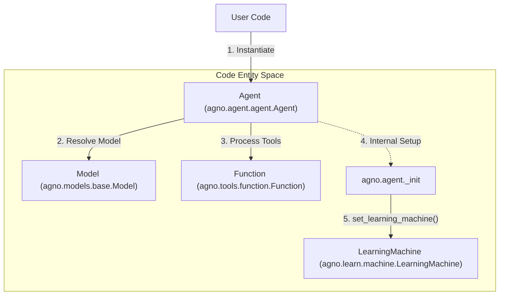
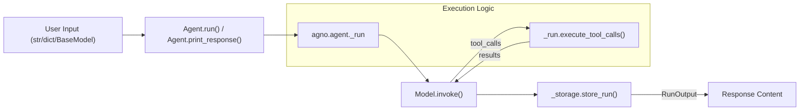

<!-- source: DeepWiki mcp.deepwiki.com · repo agno-agi/agno · page 10.1 Basic Agent Examples · fetched 2026-10-26 -->

# Basic Agent Examples

Relevant source files

The following files were used as context for generating this wiki page:

- [cookbook/00_quickstart/README.md](cookbook/00_quickstart/README.md)
- [cookbook/00_quickstart/TEST_LOG.md](cookbook/00_quickstart/TEST_LOG.md)
- [cookbook/00_quickstart/agent_search_over_knowledge.py](cookbook/00_quickstart/agent_search_over_knowledge.py)
- [cookbook/00_quickstart/agent_with_guardrails.py](cookbook/00_quickstart/agent_with_guardrails.py)
- [cookbook/00_quickstart/agent_with_memory.py](cookbook/00_quickstart/agent_with_memory.py)
- [cookbook/00_quickstart/agent_with_state_management.py](cookbook/00_quickstart/agent_with_state_management.py)
- [cookbook/00_quickstart/agent_with_storage.py](cookbook/00_quickstart/agent_with_storage.py)
- [cookbook/00_quickstart/agent_with_structured_output.py](cookbook/00_quickstart/agent_with_structured_output.py)
- [cookbook/00_quickstart/agent_with_tools.py](cookbook/00_quickstart/agent_with_tools.py)
- [cookbook/00_quickstart/agent_with_typed_input_output.py](cookbook/00_quickstart/agent_with_typed_input_output.py)
- [cookbook/02_agents/08_guardrails/README.md](cookbook/02_agents/08_guardrails/README.md)
- [cookbook/02_agents/08_guardrails/deepkeep_ai_firewall.py](cookbook/02_agents/08_guardrails/deepkeep_ai_firewall.py)
- [cookbook/02_agents/README.md](cookbook/02_agents/README.md)
- [libs/agno/agno/reasoning/anthropic.py](libs/agno/agno/reasoning/anthropic.py)
- [libs/agno/agno/reasoning/azure_ai_foundry.py](libs/agno/agno/reasoning/azure_ai_foundry.py)
- [libs/agno/agno/reasoning/deepseek.py](libs/agno/agno/reasoning/deepseek.py)
- [libs/agno/agno/reasoning/gemini.py](libs/agno/agno/reasoning/gemini.py)
- [libs/agno/agno/reasoning/groq.py](libs/agno/agno/reasoning/groq.py)
- [libs/agno/agno/reasoning/manager.py](libs/agno/agno/reasoning/manager.py)
- [libs/agno/agno/reasoning/moonshot.py](libs/agno/agno/reasoning/moonshot.py)
- [libs/agno/agno/reasoning/ollama.py](libs/agno/agno/reasoning/ollama.py)
- [libs/agno/agno/reasoning/openai.py](libs/agno/agno/reasoning/openai.py)
- [libs/agno/agno/reasoning/openrouter.py](libs/agno/agno/reasoning/openrouter.py)
- [libs/agno/tests/integration/models/deepseek/test_reasoning_streaming.py](libs/agno/tests/integration/models/deepseek/test_reasoning_streaming.py)
- [libs/agno/tests/unit/reasoning/test_reasoning_api_checkers.py](libs/agno/tests/unit/reasoning/test_reasoning_api_checkers.py)
- [libs/agno/tests/unit/reasoning/test_reasoning_checkers.py](libs/agno/tests/unit/reasoning/test_reasoning_checkers.py)

This page demonstrates basic patterns for creating and using agents in Agno, covering simple agent instantiation, tool integration, persistent storage, memory management, structured outputs, guardrails, and multimodal inputs. These examples are primarily drawn from the `cookbook/00_quickstart` and `cookbook/02_agents` directories.

---

## Agent Creation and Execution Flow

The following diagrams illustrate the lifecycle of an agent from initialization to execution, mapping framework classes to their runtime roles and bridging natural language tasks to code entities.

### Agent Initialization Flow

Sources: [libs/agno/agno/agent/agent.py:68-182](), [libs/agno/agno/learn/machine.py:53-100]()

### Core Agent Execution Loop

Sources: [libs/agno/agno/agent/agent.py:1241-1485](), [libs/agno/agno/models/base.py:128-210]()

---

## Basic Agent with Tools

Tools allow agents to interact with the real world. The simplest way to add tools is using built-in toolkits or by passing Python functions. In the Agno framework, functions are converted into `Function` objects during agent initialization [libs/agno/agno/agent/agent.py:171-174]().

| Component | Implementation | Description |
|:---|:---|:---|
| **Agent** | `Agent` | The main orchestrator for tool use and context management. [libs/agno/agno/agent/agent.py:69-182]() |
| **Model** | `Model` | The LLM abstraction used for reasoning and tool calling. [libs/agno/agno/models/base.py:130-184]() |
| **Tools** | `Toolkit` or `Function` | Functions the model may generate JSON inputs for. [libs/agno/agno/agent/agent.py:171-174]() |
| **Tool Execution** | `execute_tool_calls` | The internal mechanism that handles model tool calls. [libs/agno/agno/agent/agent.py:1718-1719]() |

Sources: [libs/agno/agno/agent/agent.py:171-174](), [cookbook/00_quickstart/agent_with_tools.py:26-45]()

---

## Persistent Storage and Sessions

Storage allows an agent to remember conversation history across different runs or script restarts by persisting data to a database.

*   **Session**: A conversation thread identified by a `session_id`. [libs/agno/agno/agent/agent.py:87-88]()
*   **Run**: A single interaction within a session, producing a `RunOutput`. [libs/agno/agno/run/agent.py:53-57]()
*   **Persistence**: Data is saved via a database backend (e.g., `SqliteDb`) and restored automatically when the same `session_id` is used. [libs/agno/agno/agent/agent.py:130]()
*   **Convenience Functions**: The `Agent` class provides methods like `get_session()` and `get_chat_history()` to interact with stored data. [libs/agno/tests/integration/agent/test_agent_convenience_functions.py:31-40]()

Sources: [libs/agno/agno/agent/agent.py:87-109](), [libs/agno/agno/run/agent.py:53-57](), [cookbook/00_quickstart/agent_with_storage.py:1-50]()

---

## Memory and Personalization

While **Storage** tracks history, **Memory** tracks user preferences and facts via the `MemoryManager`. The `LearningMachine` coordinates these stores to allow agents to improve over time.

| Feature | Class/Parameter | Description |
|:---|:---|:---|
| **Memory Manager** | `MemoryManager` | Manages extraction and retrieval of user-level information. [libs/agno/agno/memory/manager.py:1-50]() |
| **Agentic Memory** | `enable_agentic_memory=True` | Enables the agent to manage memories of the user dynamically via tool calls. [libs/agno/agno/agent/agent.py:119-120]() |
| **Learning Machine** | `LearningMachine` | Unified system for coordinating memory, profiles, and context. [libs/agno/agno/learn/machine.py:53-100]() |
| **User ID** | `user_id` | Scopes data to a specific user across different sessions. [libs/agno/agno/agent/agent.py:84]() |

Sources: [libs/agno/agno/agent/agent.py:116-127](), [libs/agno/agno/learn/machine.py:53-100](), [cookbook/00_quickstart/agent_with_memory.py:40-46]()

---

## Structured Input and Output

Agno leverages Pydantic for end-to-end type safety. You can define what the agent accepts and what it must return, which is essential for building reliable pipelines.

| Entity | Code Reference | Purpose |
|:---|:---|:---|
| **Input Schema** | `input_schema` | Validates the user's structured request using a Pydantic `BaseModel`. [libs/agno/agno/agent/agent.py:192-193]() |
| **Output Schema** | `output_schema` | Guarantees the response matches a specific Pydantic model. [libs/agno/agno/agent/agent.py:202-203]() |
| **Structured Output** | `response.content` | When an `output_schema` is set, `content` contains the Pydantic instance. [libs/agno/agno/run/agent.py:55]() |

Sources: [libs/agno/agno/agent/agent.py:192-206](), [cookbook/00_quickstart/agent_with_typed_input_output.py:31-77]()

---

## State Management

`session_state` is a dictionary that agents can read and modify during a session. This is ideal for tracking structured data like watchlists or counters that change during the run.

*   **Context Injection**: Set `add_session_state_to_context=True` to include state in the prompt context. [libs/agno/agno/agent/agent.py:92]()
*   **Tool Access**: Custom tools can read and modify state using the `RunContext.session_state` attribute. [cookbook/00_quickstart/agent_with_state_management.py:40-59]()
*   **Retrieval**: The current state can be retrieved after a run using `agent.get_session_state()`. [libs/agno/tests/integration/agent/test_agent_convenience_functions.py:205-206]()

Sources: [libs/agno/agno/agent/agent.py:89-96](), [cookbook/00_quickstart/agent_with_state_management.py:51-57]()

---

## Guardrails and Safety

Guardrails provide validation and safety checks during the agent's execution loop, preventing prompt injection or PII leakage, or incorporating custom firewalls like DeepKeep [cookbook/02_agents/08_guardrails/deepkeep_ai_firewall.py:5-39]().

| Guardrail Type | Interface | Function |
|:---|:---|:---|
| **Input Validation** | `input_guardrails` / `pre_hooks` | Validates user input before sending to the model. [libs/agno/agno/agent/agent.py:210]() |
| **Output Validation** | `output_guardrails` / `post_hooks` | Checks model responses for safety or formatting. [libs/agno/agno/agent/agent.py:211]() |

Sources: [libs/agno/agno/agent/agent.py:210-211](), [cookbook/02_agents/08_guardrails/deepkeep_ai_firewall.py:26-41]()

---

## Knowledge Base and Agentic RAG

Agents can search through documents (PDFs, URLs, text) using a knowledge base, which provides grounded context to the model.

*   **Knowledge Base**: A collection of documents managed by a class implementing the `Knowledge` interface. [libs/agno/agno/agent/agent.py:151]()
*   **Hybrid Search**: Combines semantic similarity with keyword matching using `SearchType.hybrid`. [cookbook/00_quickstart/agent_search_over_knowledge.py:43]()
*   **Agentic Search**: The agent decides when to call search tools based on instructions when `search_knowledge=True`. [libs/agno/agno/agent/agent.py:152-157]()

Sources: [cookbook/00_quickstart/agent_search_over_knowledge.py:35-54](), [libs/agno/agno/agent/agent.py:151-165]()

---

## Multimodal Inputs

Agents can process images, audio, video, and files through the `agno.media` module. The `Agent.run` method accepts these as parameters, which are then encapsulated in the `Message` object and passed to the underlying `Model`.

| Media Type | Class | Description |
|:---|:---|:---|
| **Image** | `Image` | Represents an image via URL or local path. [libs/agno/agno/media.py:5]() |
| **Audio** | `Audio` | Represents audio data. [libs/agno/agno/media.py:23]() |
| **Video** | `Video` | Represents video data. [libs/agno/agno/media.py:23]() |
| **File** | `File` | Represents generic file attachments. [libs/agno/agno/media.py:23]() |

Sources: [libs/agno/agno/utils/agent.py:22](), [libs/agno/agno/agent/agent.py:44](), [libs/agno/agno/models/message.py:76-81]()

---

