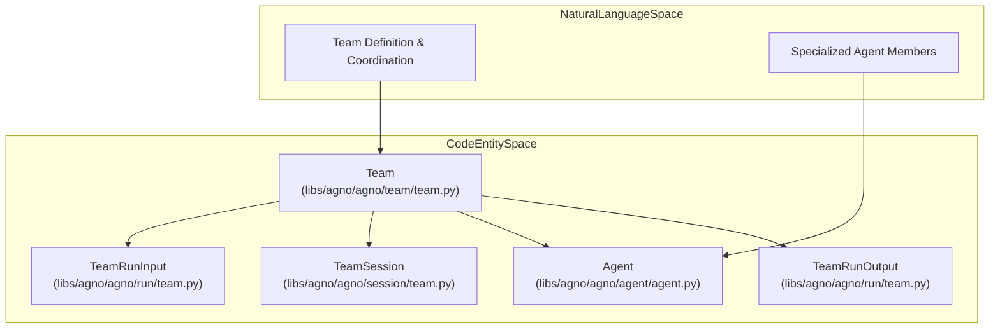
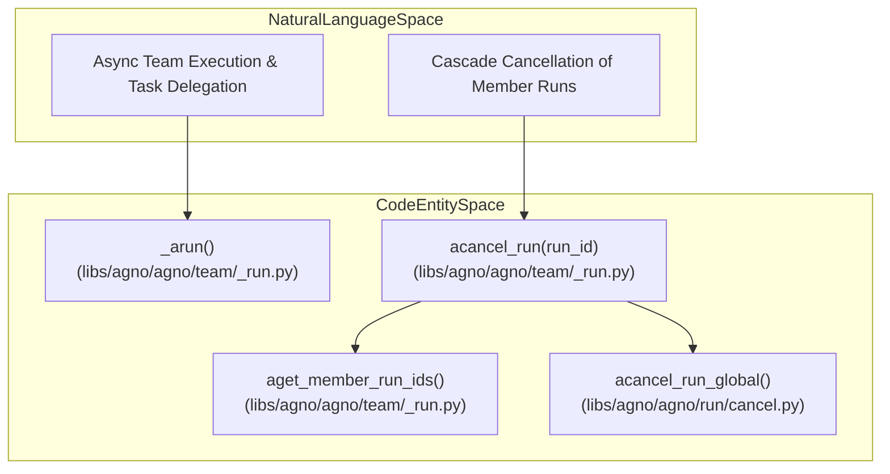
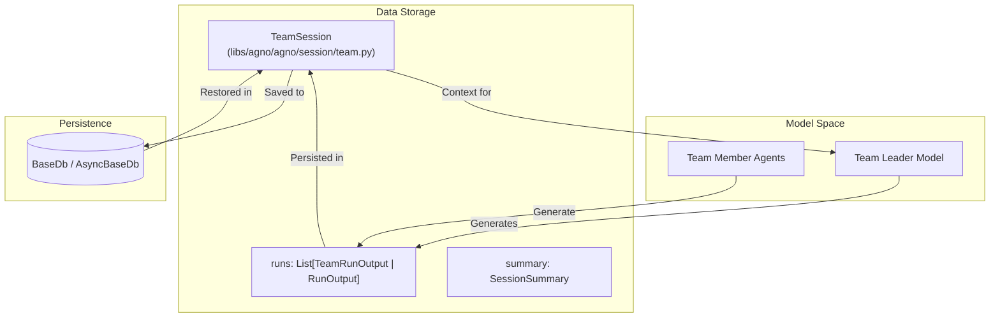

<!-- source: DeepWiki mcp.deepwiki.com · repo agno-agi/agno · page 10.2 Team and Collaboration Examples · fetched 2026-10-26 -->

# Team and Collaboration Examples

Relevant source files

The following files were used as context for generating this wiki page:

- [cookbook/03_teams/07_session/nested_team_deep_history.py](cookbook/03_teams/07_session/nested_team_deep_history.py)
- [cookbook/03_teams/07_session/nested_team_history.py](cookbook/03_teams/07_session/nested_team_history.py)
- [cookbook/91_tools/tavily_tools_advanced.py](cookbook/91_tools/tavily_tools_advanced.py)
- [libs/agno/agno/agent/_run.py](libs/agno/agno/agent/_run.py)
- [libs/agno/agno/run/base.py](libs/agno/agno/run/base.py)
- [libs/agno/agno/session/team.py](libs/agno/agno/session/team.py)
- [libs/agno/agno/session/workflow.py](libs/agno/agno/session/workflow.py)
- [libs/agno/agno/team/_run.py](libs/agno/agno/team/_run.py)
- [libs/agno/agno/tools/tavily.py](libs/agno/agno/tools/tavily.py)
- [libs/agno/tests/integration/knowledge/test_pptx_knowledge.py](libs/agno/tests/integration/knowledge/test_pptx_knowledge.py)
- [libs/agno/tests/integration/teams/human_in_the_loop/test_continue_run_history_context.py](libs/agno/tests/integration/teams/human_in_the_loop/test_continue_run_history_context.py)
- [libs/agno/tests/integration/teams/test_member_dedup.py](libs/agno/tests/integration/teams/test_member_dedup.py)
- [libs/agno/tests/integration/teams/test_team_delegation.py](libs/agno/tests/integration/teams/test_team_delegation.py)
- [libs/agno/tests/integration/workflows/test_workflow_metrics.py](libs/agno/tests/integration/workflows/test_workflow_metrics.py)
- [libs/agno/tests/unit/agent/test_run_regressions.py](libs/agno/tests/unit/agent/test_run_regressions.py)
- [libs/agno/tests/unit/memory/test_memory_manager_async.py](libs/agno/tests/unit/memory/test_memory_manager_async.py)
- [libs/agno/tests/unit/run/test_run_events.py](libs/agno/tests/unit/run/test_run_events.py)
- [libs/agno/tests/unit/team/test_delegate_closure_bug.py](libs/agno/tests/unit/team/test_delegate_closure_bug.py)
- [libs/agno/tests/unit/team/test_get_messages_dedup.py](libs/agno/tests/unit/team/test_get_messages_dedup.py)
- [libs/agno/tests/unit/tools/test_tavily.py](libs/agno/tests/unit/tools/test_tavily.py)
- [libs/agno/tests/unit/workflow/test_workflow_session.py](libs/agno/tests/unit/workflow/test_workflow_session.py)

This page demonstrates practical examples of multi-agent coordination using the `Team` class (`libs/agno/agno/team/team.py`), showing common patterns for collaborative agent workflows, shared memory, distributed execution, and autonomous task management from `cookbook/03_teams`. These examples illustrate how to build complex agentic systems where multiple specialized agents work together to solve problems.

For information about individual agent patterns, see [Agent System](2.1). For workflow orchestration with sequential/parallel steps, see [Workflow System](2.3). For deployment patterns with AgentOS, see [AgentOS Runtime](7).

---

## Team Coordination Architecture

Teams in Agno enable multiple agents to collaborate on tasks by coordinating their execution, sharing context, and combining their outputs. The `Team` class (`libs/agno/agno/team/team.py`) orchestrates agent members and determines how they interact.

### Team Component Structure and Code Entities

**Sources:** `libs/agno/agno/team/_run.py:1-24` (), `libs/agno/agno/session/team.py:18-45` (), `libs/agno/tests/integration/teams/test_team_delegation.py:9-37` ()

---

## Team Execution Modes and Async Flows

Teams support different coordination modes through the `mode` parameter and boolean configuration flags. The orchestration strategy determines how the leader model interacts with members.

### Execution Mode Configuration

| Parameter | Type | Default | Description |
|-----------|------|---------|-------------|
| `mode` | `Optional[TeamMode]` | `None` | Overrides boolean flags when set. Supports `TeamMode.tasks` for autonomous planning. |
| `delegate_to_all_members` | `bool` | `False` | Execute all members instead of selective delegation (`libs/agno/tests/integration/teams/test_team_delegation.py:117-143`()). |
| `respond_directly` | `bool` | `False` | Members respond directly without leader processing (`libs/agno/tests/integration/teams/test_team_delegation.py:46-73`()). |
| `determine_input_for_members` | `bool` | `True` | Leader determines what input each member receives. |

**Sources:** `libs/agno/agno/session/team.py:18-45` (), `libs/agno/tests/integration/teams/test_team_delegation.py:46-143` ()

### Async Execution and Cancellation Flow

**Sources:** `libs/agno/agno/team/_run.py:152-183` (), `libs/agno/tests/integration/teams/test_team_delegation.py:154-198` ()

---

## Session Management and Persistence

Teams maintain state through `TeamSession` instances (`libs/agno/agno/session/team.py`), which are stored in the database. These sessions track the team's progress, member interactions, and overall history.

### Team Session Architecture

**Sources:** `libs/agno/agno/session/team.py:18-45` (), `libs/agno/agno/session/team.py:103-128` ()

### Message Retrieval and Deduplication
The `TeamSession` class provides the `get_messages()` method (`libs/agno/agno/session/team.py:130-155`()) to retrieve historical interactions with complex filtering (`skip_member_messages`, `last_n_runs`). It automatically deduplicates member runs that appear in both standalone storage and nested within `member_responses` (`libs/agno/tests/unit/team/test_get_messages_dedup.py:108-143`()).

**Sources:** `libs/agno/agno/session/team.py:130-155` (), `libs/agno/tests/unit/team/test_get_messages_dedup.py:108-143` ()

---

## History and Memory Coordination

Teams manage shared history across members to ensure contextually aware collaboration.

### History Injection Patterns
*   **Member History Retrieval:** Uses helper utilities to extract relevant context for specific members from the `TeamSession` (`libs/agno/session/team.py:130-155`()).
*   **Deduplication:** Ensures that tool call IDs are unique and not duplicated between team-level and member-level storage (`libs/agno/tests/unit/team/test_get_messages_dedup.py:127-142`()).
*   **Persistence:** Each run within a session preserves temporal order during database storage and retrieval (`libs/agno/session/team.py:103-128`()).

**Sources:** `libs/agno/agno/session/team.py:103-128` (), `libs/agno/tests/unit/team/test_get_messages_dedup.py:108-143` ()

---

## Implementation Details

### Team Run Input Handling
The `TeamRunInput` class (`libs/agno/agno/run/team.py`) serves as a container for raw data passed to `team.run()`. It separates literal input content (strings, Pydantic models, or Messages) from multimodal media like `images`, `videos`, `audios`, and `files`.

**Sources:** `libs/agno/agno/run/team.py:28-44` (), `libs/agno/tests/integration/teams/test_team_delegation.py:75-115` ()

### Run Metrics Aggregation
Teams track performance through `RunMetrics` (`libs/agno/agno/metrics.py`), collecting `input_tokens`, `output_tokens`, and `total_tokens` from the team leader and all member agents to provide a unified resource consumption profile.

**Sources:** `libs/agno/agno/run/team.py:12-44` (), `libs/agno/tests/integration/workflows/test_workflow_metrics.py:107-134` ()

### Multi-Agent Data Flow
Data flows between the user, the team leader, and member agents via `TeamRunOutput` (`libs/agno/agno/run/team.py`). This structure captures `member_responses` (a list of `RunOutput` from members) alongside the leader's own `content`, `citations`, and `reasoning_steps`.

**Sources:** `libs/agno/agno/run/team.py:28-91` (), `libs/agno/agno/session/team.py:38-40` ()

---

