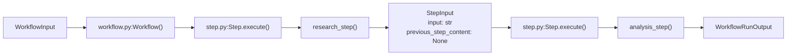
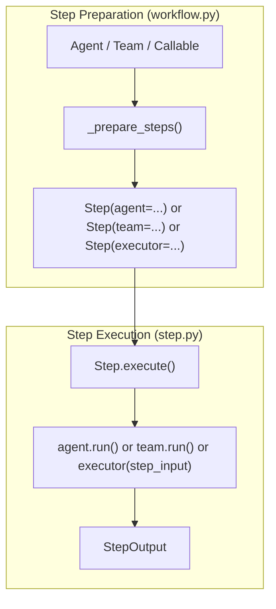
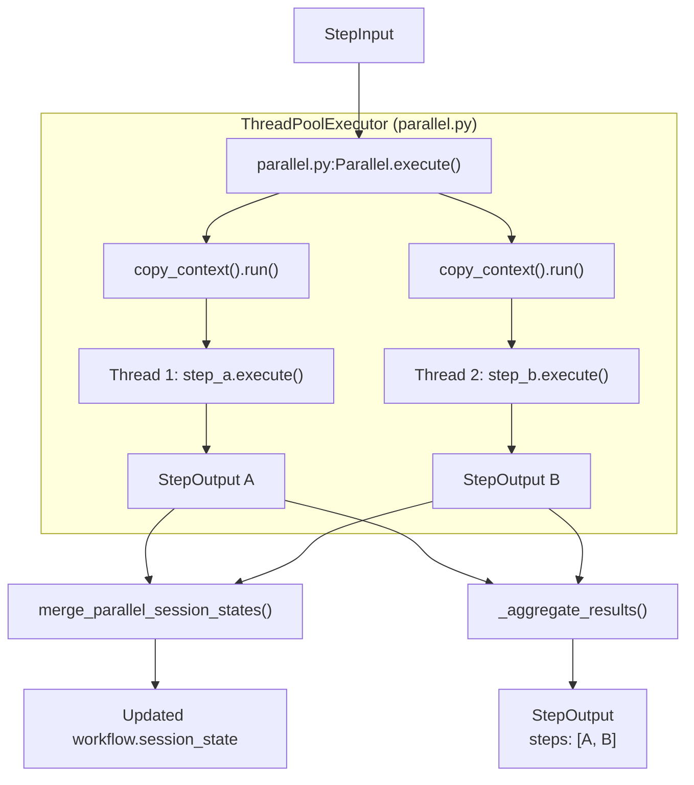
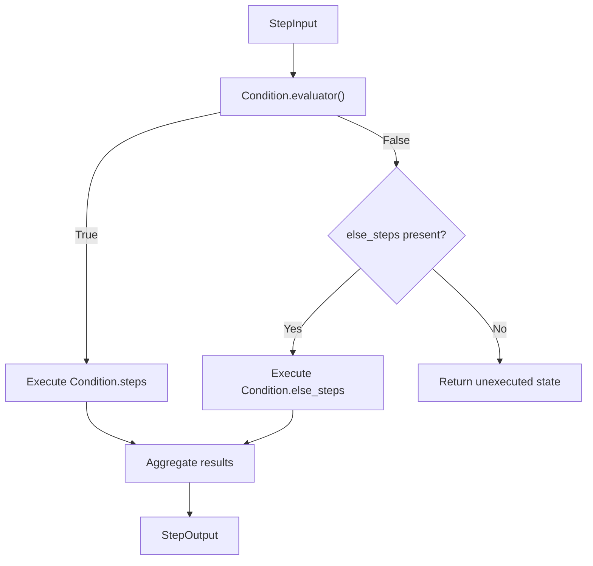
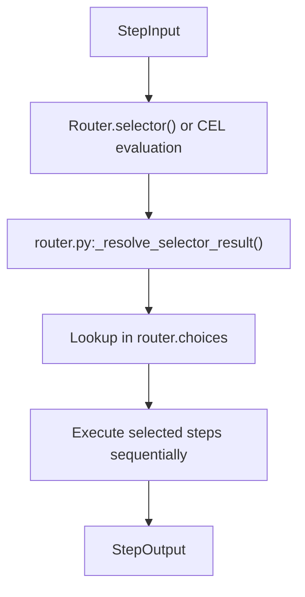
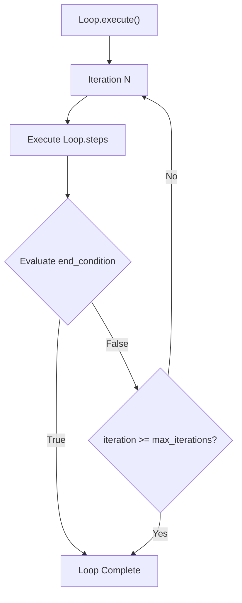
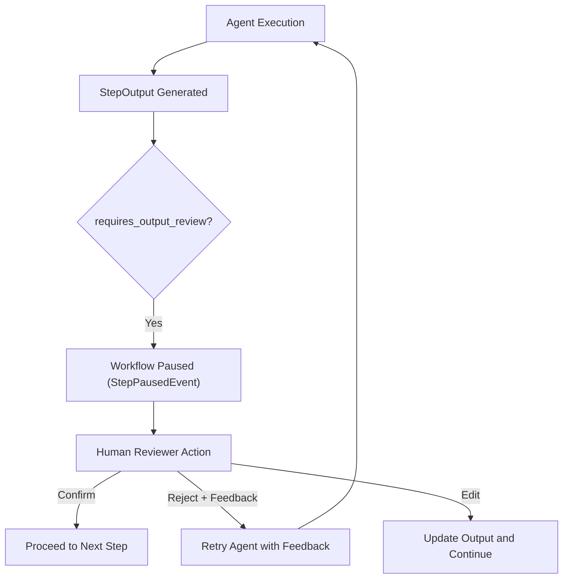
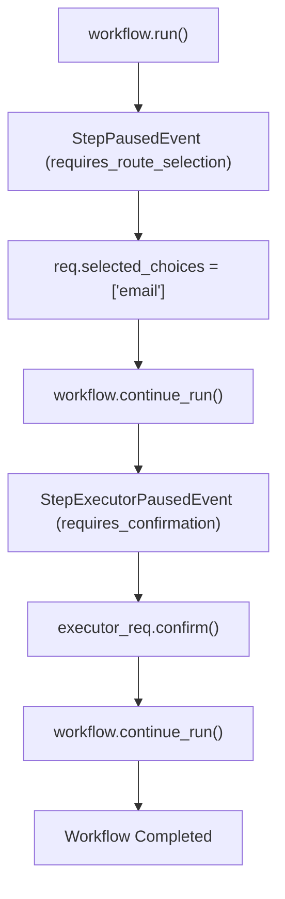

<!-- source: DeepWiki mcp.deepwiki.com · repo agno-agi/agno · page 10.3 Workflow Orchestration Examples · fetched 2026-10-26 -->

# Workflow Orchestration Examples

<details>
<summary>Relevant source files</summary>

The following files were used as context for generating this wiki page:

- [cookbook/04_workflows/03_loop_execution/loop_iterative_accumulation.py](cookbook/04_workflows/03_loop_execution/loop_iterative_accumulation.py)
- [cookbook/04_workflows/08_human_in_the_loop/condition/02_condition_on_error.py](cookbook/04_workflows/08_human_in_the_loop/condition/02_condition_on_error.py)
- [cookbook/07_knowledge/09_archive/vector_dbs/qdrant_db_offline_mode.py](cookbook/07_knowledge/09_archive/vector_dbs/qdrant_db_offline_mode.py)
- [cookbook/93_components/workflows/README.md](cookbook/93_components/workflows/README.md)
- [cookbook/93_components/workflows/save_hitl_condition_loop_router.py](cookbook/93_components/workflows/save_hitl_condition_loop_router.py)
- [cookbook/93_components/workflows/save_hitl_confirmation_steps.py](cookbook/93_components/workflows/save_hitl_confirmation_steps.py)
- [cookbook/93_components/workflows/save_hitl_user_input_steps.py](cookbook/93_components/workflows/save_hitl_user_input_steps.py)
- [libs/agno/agno/agent/_response.py](libs/agno/agno/agent/_response.py)
- [libs/agno/agno/os/middleware/jwt.py](libs/agno/agno/os/middleware/jwt.py)
- [libs/agno/agno/run/workflow.py](libs/agno/agno/run/workflow.py)
- [libs/agno/agno/team/_response.py](libs/agno/agno/team/_response.py)
- [libs/agno/agno/utils/message.py](libs/agno/agno/utils/message.py)
- [libs/agno/agno/workflow/condition.py](libs/agno/agno/workflow/condition.py)
- [libs/agno/agno/workflow/loop.py](libs/agno/agno/workflow/loop.py)
- [libs/agno/agno/workflow/parallel.py](libs/agno/agno/workflow/parallel.py)
- [libs/agno/agno/workflow/router.py](libs/agno/agno/workflow/router.py)
- [libs/agno/agno/workflow/step.py](libs/agno/agno/workflow/step.py)
- [libs/agno/agno/workflow/steps.py](libs/agno/agno/workflow/steps.py)
- [libs/agno/agno/workflow/types.py](libs/agno/agno/workflow/types.py)
- [libs/agno/agno/workflow/workflow.py](libs/agno/agno/workflow/workflow.py)
- [libs/agno/tests/integration/os/test_jwt_middleware.py](libs/agno/tests/integration/os/test_jwt_middleware.py)
- [libs/agno/tests/integration/workflows/test_condition_steps.py](libs/agno/tests/integration/workflows/test_condition_steps.py)
- [libs/agno/tests/integration/workflows/test_loop_steps.py](libs/agno/tests/integration/workflows/test_loop_steps.py)
- [libs/agno/tests/integration/workflows/test_parallel_steps.py](libs/agno/tests/integration/workflows/test_parallel_steps.py)
- [libs/agno/tests/integration/workflows/test_router_steps.py](libs/agno/tests/integration/workflows/test_router_steps.py)
- [libs/agno/tests/integration/workflows/test_steps.py](libs/agno/tests/integration/workflows/test_steps.py)
- [libs/agno/tests/unit/agent/test_followup_messages.py](libs/agno/tests/unit/agent/test_followup_messages.py)
- [libs/agno/tests/unit/workflow/test_executor_hitl.py](libs/agno/tests/unit/workflow/test_executor_hitl.py)
- [libs/agno/tests/unit/workflow/test_parallel_run_context_isolation.py](libs/agno/tests/unit/workflow/test_parallel_run_context_isolation.py)
- [libs/agno/tests/unit/workflow/test_previous_content_values.py](libs/agno/tests/unit/workflow/test_previous_content_values.py)

</details>


This page illustrates multi-step workflows, parallel execution, conditional branching, loops, and Human-in-the-Loop (HITL) patterns using the Agno workflow system. It provides technical detail on implementation, data flow, and key classes based on the `agno.workflow` module and practical examples from the cookbook.

For foundational concepts about the workflow system architecture, see [2.3](). For details on individual step types and their execution semantics, see [2.3.1](). For information on step execution context and state management, see [2.3.2]().

## Sequential Step Execution

The simplest workflow pattern executes steps in sequence. Each step receives the output from the previous step via `StepInput.previous_step_content` and `StepInput.previous_step_outputs` [libs/agno/agno/workflow/workflow.py:730-760]().

### Basic Sequential Workflow

```python
from agno.workflow import Workflow, Step, StepInput, StepOutput

def research_step(step_input: StepInput) -> StepOutput:
    return StepOutput(content="Research findings...")

def analysis_step(step_input: StepInput) -> StepOutput:
    # Access previous step's output
    previous = step_input.previous_step_content
    return StepOutput(content=f"Analysis of: {previous}")

# Create workflow
workflow = Workflow(
    name="Sequential Pipeline",
    steps=[research_step, analysis_step]
)
```

**Sequential Execution Flow (Natural Language Space to Code Entity Space)**


Sources: [libs/agno/agno/workflow/workflow.py:730-760](), [libs/agno/agno/workflow/step.py:181-203]()

### Using Agent and Team Steps

Steps can execute `Agent` or `Team` instances directly. The workflow system auto-wraps these in `Step` objects during initialization via `_prepare_steps()` [libs/agno/agno/workflow/workflow.py:744-754]().

```python
from agno.agent import Agent
from agno.workflow import Workflow

researcher = Agent(name="Researcher")
analyst = Agent(name="Analyst")

workflow = Workflow(
    steps=[researcher, analyst]
)
```

**Agent/Team Step Wrapping Architecture**


Sources: [libs/agno/agno/workflow/workflow.py:744-754](), [libs/agno/agno/workflow/step.py:181-203]()

## Parallel Execution

The `Parallel` construct executes multiple steps concurrently using a `ThreadPoolExecutor`. Results are aggregated into a single `StepOutput` [libs/agno/agno/workflow/parallel.py:47-57]().

### Basic Parallel Execution

```python
from agno.workflow import Parallel

parallel = Parallel(step_a, step_b, name="Parallel Phase")
```

**Parallel Execution Architecture (Natural Language Space to Code Entity Space)**



Each parallel step receives a `deepcopy` of the `session_state` to prevent race conditions. After execution, changes are merged back into the main workflow state using `merge_parallel_session_states`. The `Parallel` class ensures that `ContextVar` propagation is handled correctly for child threads via `copy_context().run()` [libs/agno/agno/workflow/parallel.py:25-25](), [libs/agno/tests/integration/workflows/test_parallel_steps.py:169-184]().

Sources: [libs/agno/agno/workflow/parallel.py:47-57](), [libs/agno/agno/workflow/parallel.py:25-25](), [libs/agno/tests/integration/workflows/test_parallel_steps.py:169-184]()

## Conditional Branching

The `Condition` construct evaluates a predicate (function, boolean, or CEL expression) and executes different steps based on the result [libs/agno/agno/workflow/condition.py:55-94]().

### Condition with Else Branch

```python
from agno.workflow import Condition

workflow = Workflow(
    steps=[
        Condition(
            evaluator=lambda x: "urgent" in x.input,
            steps=[priority_step],
            else_steps=[normal_step]
        )
    ]
)
```

**Conditional Branch Execution Flow**


Sources: [libs/agno/agno/workflow/condition.py:55-94](), [libs/agno/agno/workflow/condition.py:35-36]()

### CEL Expression Evaluators

Conditions can use Common Expression Language (CEL) strings. These have access to `input`, `previous_step_content`, `previous_step_outputs`, `additional_data`, and `session_state` [libs/agno/agno/workflow/condition.py:72-79]().

```python
Condition(
    evaluator='input.contains("urgent") && session_state.retry_count < 3',
    steps=[priority_step]
)
```
Sources: [libs/agno/agno/workflow/condition.py:72-79](), [libs/agno/agno/workflow/condition.py:21-21]()

## Dynamic Routing

The `Router` dynamically selects steps to execute. It operates via a `selector` function, a CEL expression, or Human-in-the-Loop (HITL) selection [libs/agno/agno/workflow/router.py:50-83]().

```python
from agno.workflow import Router

def route_selector(step_input: StepInput):
    if "billing" in step_input.input:
        return ["billing_step"]
    return ["support_step"]

router = Router(
    selector=route_selector,
    choices=[billing_step, support_step]
)
```

**Router Step Resolution Flow**


Sources: [libs/agno/agno/workflow/router.py:50-83](), [libs/agno/agno/workflow/router.py:89-95]()

## Loop Execution

The `Loop` repeatedly executes a sequence of steps until an `end_condition` is met or `max_iterations` is reached [libs/agno/agno/workflow/loop.py:43-69](). It can forward iteration outputs using `forward_iteration_output=True` [libs/agno/agno/workflow/loop.py:79-81]().

```python
from agno.workflow import Loop

Loop(
    steps=[research_step],
    end_condition='current_iteration >= 3',
    max_iterations=5,
    forward_iteration_output=True
)
```

**Loop Execution Flow**


Sources: [libs/agno/agno/workflow/loop.py:43-69](), [libs/agno/agno/workflow/loop.py:79-81]()

## Human-in-the-Loop (HITL) Patterns

Agno supports pausing workflows for human intervention at multiple levels: step-level (pre-execution), output-level (post-execution), and executor-level (tool calls).

### Output Review and Feedback Loops

The `HumanReview` config allows pausing after a step completes so a human can inspect the result [libs/agno/agno/workflow/types.py:65-106]().

```python
from agno.workflow import Workflow, Step, HumanReview, OnReject

workflow = Workflow(
    steps=[
        Step(
            name="draft_email",
            agent=draft_agent,
            human_review=HumanReview(
                requires_output_review=True,
                on_reject=OnReject.retry,
                max_retries=3
            ),
        ),
    ]
)
```

**Output Review Pattern**


Sources: [libs/agno/agno/workflow/types.py:65-106](), [libs/agno/agno/workflow/types.py:20-33](), [libs/agno/agno/workflow/types.py:93-95]()

### Dual-Level HITL

Workflows can combine step-level requirements (like picking a route or providing initial input) with executor-level requirements (like an agent requesting tool confirmation) [libs/agno/agno/workflow/router.py:132-152]().

```python
workflow = Workflow(
    steps=[
        Router(
            name="notification_router",
            choices=[Step(name="email", agent=email_agent)],
            human_review=HumanReview(
                requires_user_input=True,
                user_input_message="Select channel"
            )
        ),
    ]
)
```

**Dual HITL Resolution Flow**


Sources: [libs/agno/agno/workflow/router.py:132-152](), [libs/agno/agno/workflow/types.py:86-88](), [libs/agno/agno/run/workflow.py:39-58]()

### HITL Timeouts

Workflows can auto-resolve pauses using timeouts via `OnTimeout` strategies (`cancel`, `skip`, or `approve`) [libs/agno/agno/workflow/types.py:36-47]().

```python
Step(
    name="draft_email",
    human_review=HumanReview(
        requires_output_review=True,
        timeout=5,
        on_timeout=OnTimeout.approve
    )
)
```
Sources: [libs/agno/agno/workflow/types.py:36-47](), [libs/agno/agno/workflow/types.py:105-106]()

## Data Flow and State Management

### Session State

The `session_state` is a dictionary persisted in the `WorkflowSession`. It is automatically passed to step executors that accept it as an argument via `StepInput`. Parallel steps use `merge_parallel_session_states` to combine updates from concurrent threads [libs/agno/agno/workflow/parallel.py:25-25]().

Sources: [libs/agno/agno/workflow/parallel.py:25-25]()

### Workflow History

The `WorkflowSession` maintains a history of runs, which can be injected into agent context, allowing agents within a workflow to maintain context of previous executions [libs/agno/agno/workflow/step.py:59-61]().

Sources: [libs/agno/agno/workflow/step.py:59-61]()

---

