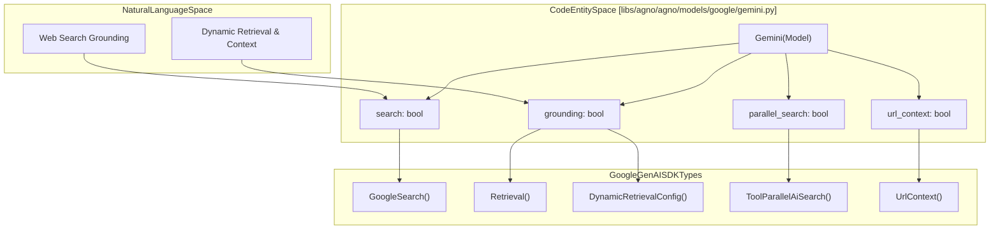
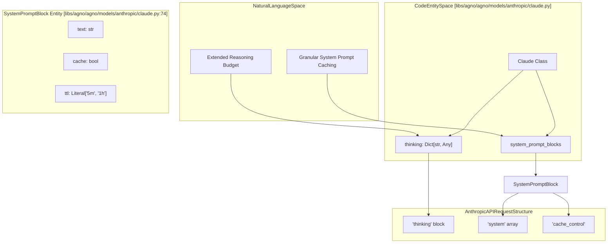
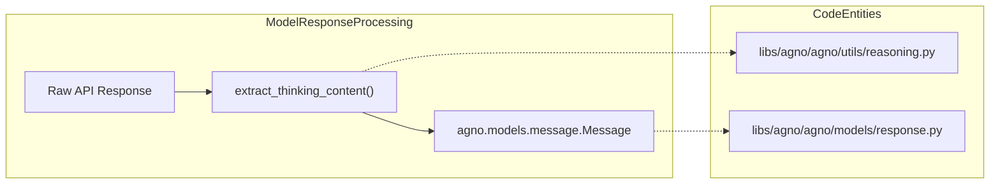
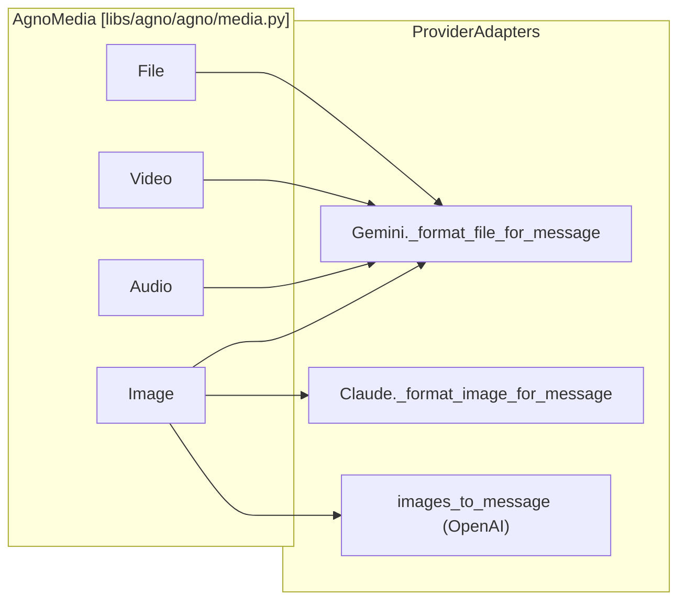

<!-- source: DeepWiki mcp.deepwiki.com · repo agno-agi/agno · page 10.4 Model-Specific Examples · fetched 2026-10-26 -->

# Model-Specific Examples

Relevant source files

The following files were used as context for generating this wiki page:

- [cookbook/90_models/anthropic/csv_input.py](cookbook/90_models/anthropic/csv_input.py)
- [cookbook/90_models/anthropic/markdown_input.py](cookbook/90_models/anthropic/markdown_input.py)
- [cookbook/90_models/anthropic/pydantic_tool_input.py](cookbook/90_models/anthropic/pydantic_tool_input.py)
- [cookbook/90_models/google/gemini_interactions/README.md](cookbook/90_models/google/gemini_interactions/README.md)
- [cookbook/90_models/google/gemini_interactions/TEST_LOG.md](cookbook/90_models/google/gemini_interactions/TEST_LOG.md)
- [cookbook/90_models/google/gemini_interactions/audio_understanding.py](cookbook/90_models/google/gemini_interactions/audio_understanding.py)
- [cookbook/90_models/google/gemini_interactions/basic.py](cookbook/90_models/google/gemini_interactions/basic.py)
- [cookbook/90_models/google/gemini_interactions/document_processing.py](cookbook/90_models/google/gemini_interactions/document_processing.py)
- [cookbook/90_models/google/gemini_interactions/image_understanding.py](cookbook/90_models/google/gemini_interactions/image_understanding.py)
- [cookbook/90_models/google/gemini_interactions/multi_turn.py](cookbook/90_models/google/gemini_interactions/multi_turn.py)
- [cookbook/90_models/google/gemini_interactions/search.py](cookbook/90_models/google/gemini_interactions/search.py)
- [cookbook/90_models/google/gemini_interactions/structured_output.py](cookbook/90_models/google/gemini_interactions/structured_output.py)
- [cookbook/90_models/google/gemini_interactions/thinking.py](cookbook/90_models/google/gemini_interactions/thinking.py)
- [cookbook/90_models/google/gemini_interactions/tool_use.py](cookbook/90_models/google/gemini_interactions/tool_use.py)
- [cookbook/90_models/google/gemini_interactions/video_understanding.py](cookbook/90_models/google/gemini_interactions/video_understanding.py)
- [cookbook/90_models/yapi/README.md](cookbook/90_models/yapi/README.md)
- [cookbook/90_models/yapi/TEST_LOG.md](cookbook/90_models/yapi/TEST_LOG.md)
- [cookbook/90_models/yapi/basic.py](cookbook/90_models/yapi/basic.py)
- [cookbook/90_models/yapi/tool_use.py](cookbook/90_models/yapi/tool_use.py)
- [libs/agno/agno/__init__.py](libs/agno/agno/__init__.py)
- [libs/agno/agno/models/anthropic/claude.py](libs/agno/agno/models/anthropic/claude.py)
- [libs/agno/agno/models/aws/bedrock.py](libs/agno/agno/models/aws/bedrock.py)
- [libs/agno/agno/models/aws/claude.py](libs/agno/agno/models/aws/claude.py)
- [libs/agno/agno/models/azure/ai_foundry.py](libs/agno/agno/models/azure/ai_foundry.py)
- [libs/agno/agno/models/azure/openai_chat.py](libs/agno/agno/models/azure/openai_chat.py)
- [libs/agno/agno/models/cohere/chat.py](libs/agno/agno/models/cohere/chat.py)
- [libs/agno/agno/models/google/gemini_interactions.py](libs/agno/agno/models/google/gemini_interactions.py)
- [libs/agno/agno/models/groq/groq.py](libs/agno/agno/models/groq/groq.py)
- [libs/agno/agno/models/huggingface/huggingface.py](libs/agno/agno/models/huggingface/huggingface.py)
- [libs/agno/agno/models/ibm/watsonx.py](libs/agno/agno/models/ibm/watsonx.py)
- [libs/agno/agno/models/meta/llama.py](libs/agno/agno/models/meta/llama.py)
- [libs/agno/agno/models/mistral/mistral.py](libs/agno/agno/models/mistral/mistral.py)
- [libs/agno/agno/models/ollama/chat.py](libs/agno/agno/models/ollama/chat.py)
- [libs/agno/agno/models/openai/chat.py](libs/agno/agno/models/openai/chat.py)
- [libs/agno/agno/models/openai/responses.py](libs/agno/agno/models/openai/responses.py)
- [libs/agno/agno/models/utils.py](libs/agno/agno/models/utils.py)
- [libs/agno/agno/models/vertexai/claude.py](libs/agno/agno/models/vertexai/claude.py)
- [libs/agno/agno/models/yapi/__init__.py](libs/agno/agno/models/yapi/__init__.py)
- [libs/agno/agno/models/yapi/yapi.py](libs/agno/agno/models/yapi/yapi.py)
- [libs/agno/agno/utils/models/claude.py](libs/agno/agno/utils/models/claude.py)
- [libs/agno/tests/integration/models/anthropic/test_format_tools.py](libs/agno/tests/integration/models/anthropic/test_format_tools.py)
- [libs/agno/tests/integration/models/huggingface/test_basic.py](libs/agno/tests/integration/models/huggingface/test_basic.py)
- [libs/agno/tests/integration/models/huggingface/test_tool_use.py](libs/agno/tests/integration/models/huggingface/test_tool_use.py)
- [libs/agno/tests/unit/models/anthropic/test_citation_suppression.py](libs/agno/tests/unit/models/anthropic/test_citation_suppression.py)
- [libs/agno/tests/unit/models/google/test_gemini_interactions.py](libs/agno/tests/unit/models/google/test_gemini_interactions.py)
- [libs/agno/tests/unit/models/test_client_caching.py](libs/agno/tests/unit/models/test_client_caching.py)
- [libs/agno/tests/unit/models/test_cross_model_tool_calls.py](libs/agno/tests/unit/models/test_cross_model_tool_calls.py)
- [libs/agno/tests/unit/models/test_mistral_request_params.py](libs/agno/tests/unit/models/test_mistral_request_params.py)
- [libs/agno/tests/unit/models/yapi/__init__.py](libs/agno/tests/unit/models/yapi/__init__.py)
- [libs/agno/tests/unit/models/yapi/test_yapi.py](libs/agno/tests/unit/models/yapi/test_yapi.py)
- [libs/agno/tests/unit/utils/test_claude.py](libs/agno/tests/unit/utils/test_claude.py)
- [libs/agno/tests/unit/utils/test_model_string.py](libs/agno/tests/unit/utils/test_model_string.py)

This page provides technical details and implementation patterns for provider-specific features within the Agno framework. While Agno provides a unified `Model` interface (`[libs/agno/agno/models/base.py]()`), certain providers offer unique capabilities—such as Claude's thinking mode and system prompt caching, Gemini's search grounding, and OpenAI's reasoning and responses APIs—that require specialized configuration and handling.

---

## 1. Gemini: Grounding and Multimodal Capabilities

The `Gemini` model class integrates with the `google-genai` SDK to provide support for Google's native features, including web search grounding, file search, and advanced multimodal handling `[libs/agno/agno/models/google/gemini.py:82-142]()`.

### Gemini Grounding and Search Architecture

**Sources:** `[libs/agno/agno/models/google/gemini.py:107-116]()`, `[libs/agno/agno/models/google/gemini.py:43-65]()`

### Implementation Details
*   **Search Grounding**: When `search=True` or `grounding=True` is set, the `Gemini` model initializes the corresponding `GoogleSearch` or `Retrieval` tools within the `google.genai` client `[libs/agno/agno/models/google/gemini.py:107-109]()`.
*   **Parallel Search**: Specifically for Vertex AI, `parallel_search` utilizes the `ToolParallelAiSearch` type to leverage grounding with public web data `[libs/agno/agno/models/google/gemini.py:114-121]()`.
*   **Multimodal Formatting**: The `_format_file_for_message` method handles Agno `File` objects by converting them into Gemini `Part` objects using `Part.from_bytes` for local content or `Part.from_uri` for GCS/HTTPS URIs `[libs/agno/agno/models/google/gemini.py:532-588]()`.
*   **Thinking Budget**: Gemini models support reasoning via `thinking_budget`, `include_thoughts`, and `thinking_level` parameters `[libs/agno/agno/models/google/gemini.py:139-141]()`.

Sources: `[libs/agno/agno/models/google/gemini.py:82-159]()`, `[libs/agno/tests/unit/models/google/test_gemini.py:94-162]()`

---

## 2. Claude: Thinking Mode, Skills, and Caching

Anthropic's Claude integration supports extended thinking (reasoning tokens), a granular caching system via system prompt blocks, and specialized skills like PDF/Excel handling `[libs/agno/agno/models/anthropic/claude.py:95-170]()`.

### Claude Thinking and Cache Implementation

**Sources:** `[libs/agno/agno/models/anthropic/claude.py:74-91]()`, `[libs/agno/agno/models/anthropic/claude.py:132-150]()`

### Advanced Features
*   **Thinking Mode**: Enabled via the `thinking` parameter, which accepts a dictionary defining reasoning budgets. The framework maintains a `NON_THINKING_MODELS` set to validate support `[libs/agno/agno/models/anthropic/claude.py:105-111]()`, `[libs/agno/agno/models/anthropic/claude.py:134-134]()`.
*   **Prompt Caching**: Beyond the model-level `cache_system_prompt`, Agno allows `system_prompt_blocks` which can be a list or a callable. Each `SystemPromptBlock` can independently trigger `cache_control` `[libs/agno/agno/models/anthropic/claude.py:140-149]()`.
*   **Skills**: Supports Anthropic-specific skills (e.g., `pptx`, `pdf`) via the `skills` parameter, which are injected into the request body `[libs/agno/agno/models/anthropic/claude.py:156-158]()`.
*   **Prefill and Trailing Messages**: Claude 4.6+ deprecates prefill. Agno uses `supports_prefill` to determine if a `trailing_user_message_content` (defaulting to "continue") should be appended when a conversation ends with an assistant message `[libs/agno/agno/utils/models/claude.py:42-64]()`, `[libs/agno/agno/models/anthropic/claude.py:165-169]()`.

Sources: `[libs/agno/agno/models/anthropic/claude.py:95-176]()`, `[libs/agno/agno/utils/models/claude.py:1-88]()`

---

## 3. OpenAI: Chat vs. Responses APIs

Agno provides two distinct implementations for OpenAI: `OpenAIChat` (`[libs/agno/agno/models/openai/chat.py:35]()`) for the standard completions API and `OpenAIResponses` (`[libs/agno/agno/models/openai/responses.py:32]()`) for the newer, stateful Responses API.

### OpenAI Model Differences

| Feature | OpenAIChat | OpenAIResponses |
|:---|:---|:---|
| **Primary Use** | Standard stateless completions | Stateful interaction with built-in tools |
| **Reasoning Support** | `reasoning_effort` parameter | `reasoning` dict (effort, summary) |
| **Structured Output** | `strict_output` via `response_format` | `strict_output` native support |
| **Background Mode** | Not Supported | Supported via `background=True` |
| **Tool Calling** | Standard Function calling | `max_tool_calls`, `parallel_tool_calls` |

**Sources:** `[libs/agno/agno/models/openai/chat.py:49-76]()`, `[libs/agno/agno/models/openai/responses.py:44-71]()`

### OpenAI Reasoning Models
Both `OpenAIChat` and `OpenAIResponses` support OpenAI's reasoning models (o1, o3, etc.).
*   `OpenAIChat` uses `reasoning_effort` and `verbosity` `[libs/agno/agno/models/openai/chat.py:51-52]()`.
*   `OpenAIResponses` provides a more granular `reasoning` configuration, including `reasoning_summary` `[libs/agno/agno/models/openai/responses.py:50-53]()`.
*   Agno automatically extracts thinking content from OpenAI responses using `extract_thinking_content` `[libs/agno/agno/models/openai/chat.py:21]()`.

Sources: `[libs/agno/agno/models/openai/chat.py:35-100]()`, `[libs/agno/agno/models/openai/responses.py:32-75]()`

---

## 4. DeepSeek: Thinking and Provider Parity

DeepSeek models are integrated via `OpenAILike` or dedicated provider wrappers (`[libs/agno/agno/models/utils.py:36]()`). Agno ensures thinking content is captured during both standard invocation and streaming across compatible reasoning endpoints.

### Thinking Content Extraction Flow

**Sources:** `[libs/agno/agno/utils/reasoning.py:1-50]()`, `[libs/agno/agno/models/response.py:1-30]()`

---

## 5. Unified Media Support

Agno uses the `agno.media` module to standardize multimodal inputs (`Image`, `Audio`, `Video`, `File`) across different model providers `[libs/agno/agno/media.py:1-11]()`.

### Provider Media Implementation Mapping

**Sources:** `[libs/agno/agno/models/google/gemini.py:532-588]()`, `[libs/agno/agno/utils/models/claude.py:128-130]()`, `[libs/agno/agno/utils/openai.py:20]()`

### Technical Constraints
*   **Gemini File Search**: Gemini can search across provided stores using `file_search_store_names` and `file_search_metadata_filter` `[libs/agno/agno/models/google/gemini.py:124-125]()`.
*   **Claude Citation Suppression**: When using structured outputs with Claude, Agno automatically suppresses citations because the Anthropic API rejects the combination of `citations` and `output_format` `[libs/agno/agno/models/anthropic/claude.py:160-163]()`.
*   **OpenAI Audio**: `OpenAIChat` supports native audio modalities via the `audio` and `modalities` parameters `[libs/agno/agno/models/openai/chat.py:60-63]()`.

Sources: `[libs/agno/agno/models/google/gemini.py:82-142]()`, `[libs/agno/agno/models/anthropic/claude.py:95-176]()`, `[libs/agno/agno/models/openai/chat.py:35-100]()`

---

