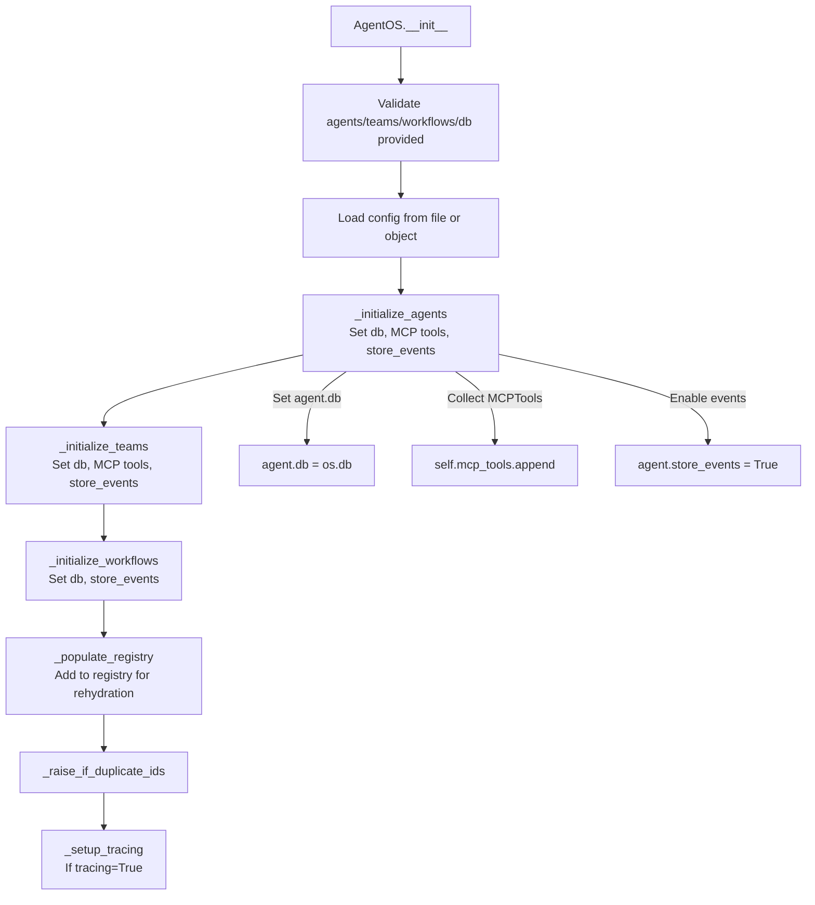
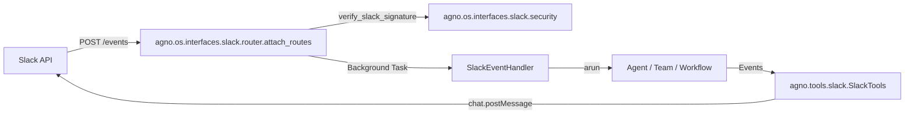
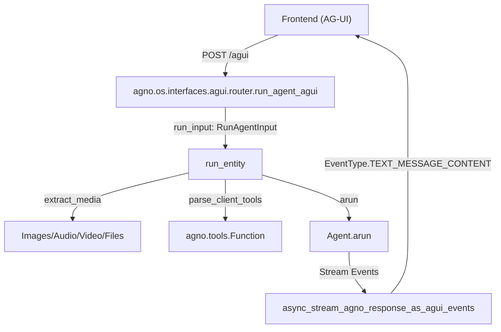
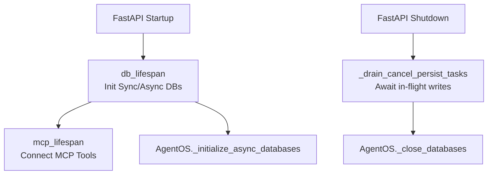

<!-- source: DeepWiki mcp.deepwiki.com · repo agno-agi/agno · page 10.6 AgentOS Deployment Examples · fetched 2026-10-26 -->

# AgentOS Deployment Examples

<details>
<summary>Relevant source files</summary>

The following files were used as context for generating this wiki page:

- [cookbook/05_agent_os/07_security/README.md](cookbook/05_agent_os/07_security/README.md)
- [cookbook/05_agent_os/07_security/TEST_LOG.md](cookbook/05_agent_os/07_security/TEST_LOG.md)
- [cookbook/05_agent_os/07_security/excluded_routes.py](cookbook/05_agent_os/07_security/excluded_routes.py)
- [cookbook/05_agent_os/14_mcp/README.md](cookbook/05_agent_os/14_mcp/README.md)
- [cookbook/05_agent_os/14_mcp/TEST_LOG.md](cookbook/05_agent_os/14_mcp/TEST_LOG.md)
- [cookbook/05_agent_os/14_mcp/server_identity.py](cookbook/05_agent_os/14_mcp/server_identity.py)
- [cookbook/05_agent_os/14_mcp/stateless.py](cookbook/05_agent_os/14_mcp/stateless.py)
- [cookbook/05_agent_os/14_mcp/toolkit_tools.py](cookbook/05_agent_os/14_mcp/toolkit_tools.py)
- [cookbook/05_agent_os/27_public_pages/mcp_domain.py](cookbook/05_agent_os/27_public_pages/mcp_domain.py)
- [cookbook/91_tools/mcp/protocol_mode.py](cookbook/91_tools/mcp/protocol_mode.py)
- [libs/agno/agno/os/app.py](libs/agno/agno/os/app.py)
- [libs/agno/agno/os/config.py](libs/agno/agno/os/config.py)
- [libs/agno/agno/os/mcp.py](libs/agno/agno/os/mcp.py)
- [libs/agno/agno/os/mcp_results.py](libs/agno/agno/os/mcp_results.py)
- [libs/agno/agno/os/middleware/mcp_routing.py](libs/agno/agno/os/middleware/mcp_routing.py)
- [libs/agno/agno/os/router.py](libs/agno/agno/os/router.py)
- [libs/agno/agno/os/routers/health.py](libs/agno/agno/os/routers/health.py)
- [libs/agno/agno/os/schema.py](libs/agno/agno/os/schema.py)
- [libs/agno/agno/os/utils.py](libs/agno/agno/os/utils.py)
- [libs/agno/agno/utils/schema.py](libs/agno/agno/utils/schema.py)
- [libs/agno/tests/integration/os/test_built_in_endpoints.py](libs/agno/tests/integration/os/test_built_in_endpoints.py)
- [libs/agno/tests/integration/os/test_custom_fastapi_app.py](libs/agno/tests/integration/os/test_custom_fastapi_app.py)
- [libs/agno/tests/unit/os/test_mcp_routing.py](libs/agno/tests/unit/os/test_mcp_routing.py)
- [libs/agno/tests/unit/os/test_mcp_run_results.py](libs/agno/tests/unit/os/test_mcp_run_results.py)
- [libs/agno/tests/unit/os/test_mcp_server.py](libs/agno/tests/unit/os/test_mcp_server.py)
- [libs/agno/tests/unit/os/test_mcp_surface_v2.py](libs/agno/tests/unit/os/test_mcp_surface_v2.py)

</details>


This page demonstrates practical deployment patterns for AgentOS, the FastAPI-based runtime that exposes agents, teams, and workflows via REST and WebSocket APIs. It covers production-grade deployment, specialized interfaces like Slack, AG-UI, and MCP, custom endpoints, authentication, WebSocket streaming, and lifecycle management required for stateful agentic systems.

---

## Basic AgentOS Deployment

The simplest AgentOS deployment creates an instance with agents and calls `get_app()` to retrieve the configured FastAPI application. This application includes pre-configured routes for running agents, managing sessions, and accessing memory.

### Minimal Deployment

```python
from agno import Agent, AgentOS
from agno.models.openai import OpenAIChat
from agno.db.sqlite import SqliteDb

# Create agent with database
agent = Agent(
    id="web-agent",
    name="Web Agent",
    model=OpenAIChat(id="gpt-4o"),
    db=SqliteDb(db_file="tmp/agents.db"),
)

# Create AgentOS instance
agent_os = AgentOS(
    name="My Agent System",
    agents=[agent],
)

# Get FastAPI app
app = agent_os.get_app()
```

**Sources:** [libs/agno/agno/os/app.py:192-340](), [libs/agno/agno/os/app.py:713-722]()

### AgentOS Initialization Flow

The `AgentOS` class (`libs/agno/agno/os/app.py`) manages the lifecycle of its components, including database auto-discovery and component registration in a central registry.

Title: "AgentOS Initialization and Component Registration"


**Sources:** [libs/agno/agno/os/app.py:223-340](), [libs/agno/agno/os/app.py:507-590]()

---

## Specialized Interfaces

AgentOS provides built-in "Interface" routers that map external events (Slack, AG-UI, MCP, etc.) to Agno agent runs. These are registered via the `interfaces` or `mcp` parameters in `AgentOS`.

### Slack Interface

The Slack interface handles events like `app_mention` and `assistant_thread_started`. It uses `SlackTools` for reading history and posting replies, while the `SlackEventHandler` manages the mapping between Slack threads and Agno sessions.

| Feature | Implementation |
| :--- | :--- |
| **Auth** | `verify_slack_signature` validates `X-Slack-Signature` using `signing_secret`. |
| **Threading** | `resolve_session_id` maps `channel_id` and `thread_ts` to a unique `session_id`. |
| **Event Filter** | `_IGNORED_SUBTYPES` prevents infinite loops by filtering `message_changed` and `message_replied`. |
| **HITL** | `HITLHandler` manages approval blocks (`ACTION_ROW_APPROVE`, `ACTION_ROW_REJECT`) and interactive elements. |

Title: "Slack Interface Event Flow"


**Sources:** [libs/agno/agno/os/interfaces/slack/router.py:129-170](), [libs/agno/agno/os/interfaces/slack/event_handler.py:56-68](), [libs/agno/agno/os/interfaces/slack/helpers.py:20-31](), [libs/agno/agno/os/interfaces/slack/slack.py:13-67]()

### AG-UI Interface (CopilotKit)

The `agui` interface provides a specialized streaming endpoint (`/agui`) designed for frontend integration. It handles complex message histories, media extraction, and session state snapshots.

Key features of the AG-UI integration:
* **State Management**: Uses `StreamState` to track tool call lifecycles and ensure events are emitted in the correct order for the frontend.
* **Input Extraction**: Functions like `extract_user_input`, `extract_media`, and `extract_context` map the `RunAgentInput` schema to Agno's internal `arun` parameters.
* **Resume Support**: `resume_paused_run` allows the frontend to execute external tools and send results back to the agent to continue a run.

Title: "AG-UI Data Flow"


**Sources:** [libs/agno/agno/os/interfaces/agui/router.py:40-125](), [libs/agno/agno/os/interfaces/agui/router.py:136-166](), [libs/agno/agno/os/interfaces/agui/stream.py:33-63](), [libs/agno/tests/unit/app/test_agui_app.py:156-180]()

### Model Context Protocol (MCP) Server

AgentOS can expose agents, teams, workflows, custom callables, and toolkits as an MCP server at `/mcp` using `MCPConfig` [libs/agno/agno/os/config.py:36-126] and `build_mcp_server` [libs/agno/tests/unit/os/test_mcp_server.py:37].

* **Default Tools**: Exposes core operator tools (`run_agent`, `run_team`, `run_workflow`, `continue_run`, `cancel_run`, `get_agentos_config`) and session tools (`get_sessions`, `get_session_runs`) [libs/agno/tests/unit/os/test_mcp_server.py:48-52].
* **Exposed Components**: Components can be registered directly or via `.as_tool(name=..., description=...)` to publish them under model-facing names [cookbook/05_agent_os/14_mcp/README.md:110-124].

**Sources:** [libs/agno/agno/os/config.py:36-126](), [libs/agno/agno/os/mcp.py:1-168](), [cookbook/05_agent_os/14_mcp/README.md:1-155]()

---

## Authentication and Security

AgentOS supports security keys, PATs, and JWT-based authorization via middleware like `JWTMiddleware` [libs/agno/tests/integration/os/test_custom_fastapi_app.py:15] and route-level dependency injection.

* **Slack Auth**: Performed via request signature verification in `verify_slack_signature`, allowing it to bypass central JWT auth by setting `authenticates_own_requests = True`.
* **AG-UI Auth**: Resolves user identity via `resolve_run_user_id` and performs a `assert_session_writable` check to prevent session hijacking.
* **WebSocket Auth**: Uses `validate_websocket_token` to verify tokens during the WebSocket handshake [libs/agno/agno/os/router.py:20].

**Sources:** [libs/agno/agno/os/router.py:15-26](), [libs/agno/agno/os/interfaces/slack/slack.py:16-18](), [libs/agno/agno/os/interfaces/agui/router.py:138-150](), [libs/agno/tests/integration/os/test_custom_fastapi_app.py:1-203]()

---

## Lifecycle Management and Custom FastAPI Apps

AgentOS uses a lifespan manager to ensure resources like database connections and background tasks are properly handled during application startup and shutdown. The `_drain_cancel_persist_tasks` function ensures in-flight database writes are completed before the pools close. Custom FastAPI applications (`base_app`) can be integrated while preserving custom CORS middleware and routing tables [libs/agno/tests/integration/os/test_custom_fastapi_app.py:39-129].

Title: "AgentOS Lifespan Management"


**Sources:** [libs/agno/agno/os/app.py:100-109](), [libs/agno/agno/os/app.py:137-167](), [libs/agno/agno/os/app.py:112-119](), [libs/agno/tests/integration/os/test_custom_fastapi_app.py:39-129]()

---

