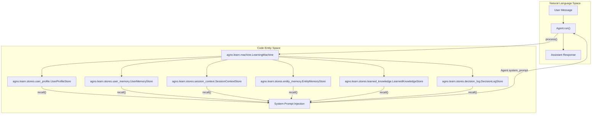
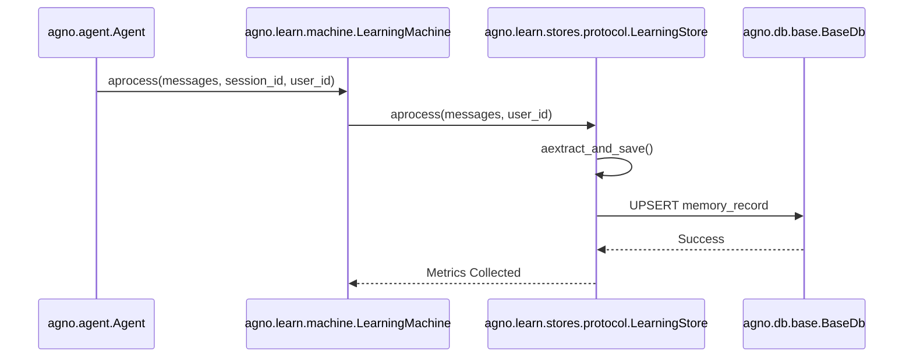

<!-- source: DeepWiki mcp.deepwiki.com · repo agno-agi/agno · page 10.7 Learning Machine Examples · fetched 2026-10-26 -->

# Learning Machine Examples

Relevant source files

The following files were used as context for generating this wiki page:

- [cookbook/08_learning/01_basics/6_extraction_limits.py](cookbook/08_learning/01_basics/6_extraction_limits.py)
- [cookbook/08_learning/10_demo/README.md](cookbook/08_learning/10_demo/README.md)
- [cookbook/08_learning/README.md](cookbook/08_learning/README.md)
- [cookbook/integrations/README.md](cookbook/integrations/README.md)
- [libs/agno/agno/learn/config.py](libs/agno/agno/learn/config.py)
- [libs/agno/agno/learn/machine.py](libs/agno/agno/learn/machine.py)
- [libs/agno/agno/learn/stores/entity_memory.py](libs/agno/agno/learn/stores/entity_memory.py)
- [libs/agno/agno/learn/stores/learned_knowledge.py](libs/agno/agno/learn/stores/learned_knowledge.py)
- [libs/agno/agno/learn/stores/session_context.py](libs/agno/agno/learn/stores/session_context.py)
- [libs/agno/agno/learn/stores/user_memory.py](libs/agno/agno/learn/stores/user_memory.py)
- [libs/agno/agno/learn/stores/user_profile.py](libs/agno/agno/learn/stores/user_profile.py)
- [libs/agno/tests/unit/learn/test_extraction_prompt_framing.py](libs/agno/tests/unit/learn/test_extraction_prompt_framing.py)
- [libs/agno/tests/unit/learn/test_session_context_store.py](libs/agno/tests/unit/learn/test_session_context_store.py)

This page documents the usage patterns and architecture of the `LearningMachine` in Agno, covering user profile extraction, persistent memory, session context, entity memory, learned knowledge, decision logs, and the maintenance Curator from `cookbook/08_learning` [cookbook/08_learning/README.md:1-17]().

## Learning Machine Architecture

The `LearningMachine` acts as an orchestrator for several specialized stores, each responsible for a different type of memory. It integrates directly with the `Agent` class, typically enabled via the `learning=True` shortcut, which initializes a default configuration with `user_profile` and `user_memory` enabled [libs/agno/agno/learn/machine.py:82-106]().

### Data Flow and Coordination

The following diagram illustrates how the `LearningMachine` processes incoming messages and coordinates between different `LearningStore` implementations.

**Learning Machine Execution Flow**

Sources: [libs/agno/agno/learn/machine.py:82-132](), [libs/agno/agno/learn/stores/session_context.py:58-77](), [libs/agno/agno/learn/stores/learned_knowledge.py:51-69]()

## Specialized Learning Stores

The `LearningMachine` coordinates multiple stores implementing the `LearningStore` protocol.

### 1. User Profile Extraction
The `UserProfileStore` handles structured data about the user. Unlike unstructured memories, these are concrete fields defined in a schema (e.g., `name`, `preferred_name`) [libs/agno/agno/learn/stores/user_profile.py:8-17]().

*   **Implementation**: Uses `UserProfileStore` [libs/agno/agno/learn/stores/user_profile.py:62-77]().
*   **Behavior**: Extracts facts that fit the defined schema and injects them into the system prompt to personalize future responses [libs/agno/agno/learn/stores/user_profile.py:184-206]().
*   **Modes**: Supports `ALWAYS` (automatic background extraction) and `AGENTIC` (agent calls `update_user_profile` tool) [libs/agno/agno/learn/stores/user_profile.py:25-28]().

Sources: [libs/agno/agno/learn/stores/user_profile.py:8-28](), [libs/agno/agno/learn/stores/user_profile.py:62-77](), [libs/agno/agno/learn/stores/user_profile.py:184-206]()

### 2. Persistent User Memory
The `UserMemoryStore` tracks unstructured observations that do not fit into a fixed profile schema.

*   **Implementation**: Uses `UserMemoryStore` [libs/agno/agno/learn/stores/user_memory.py:57-67]().
*   **Behavior**: Stores long-term memories like user preferences that persist across sessions [libs/agno/agno/learn/stores/user_memory.py:6-8]().
*   **Functionality**: Provides tools for the agent to `update_user_memory` during a conversation [libs/agno/agno/learn/stores/user_memory.py:21-24]().

Sources: [libs/agno/agno/learn/stores/user_memory.py:6-24](), [libs/agno/agno/learn/stores/user_memory.py:57-67]()

### 3. Session Context Tracking
The `SessionContextStore` maintains a snapshot of the current conversation state, including goals, plans, and progress [libs/agno/agno/learn/stores/session_context.py:6-12]().

*   **Implementation**: Uses `SessionContextStore` [libs/agno/agno/learn/stores/session_context.py:58-77]().
*   **Continuity**: It builds on the previous context rather than starting fresh, ensuring continuity even when message history is truncated [libs/agno/agno/learn/stores/session_context.py:69-72]().
*   **Planning**: Optional planning mode allows tracking specific goals and progress [libs/agno/agno/learn/stores/session_context.py:10-12]().

Sources: [libs/agno/agno/learn/stores/session_context.py:6-12](), [libs/agno/agno/learn/stores/session_context.py:58-77](), [libs/agno/agno/learn/stores/session_context.py:69-72]()

### 4. Entity Memory
The `EntityMemoryStore` tracks knowledge about external entities (companies, projects, systems) that are not the user [libs/agno/agno/learn/stores/entity_memory.py:6-12]().

*   **Implementation**: Uses `EntityMemoryStore` [libs/agno/agno/learn/stores/entity_memory.py:35-55]().
*   **Tools**: Provides four tools: `remember_about`, `link_entities`, `search_entities`, and `forget` [libs/agno/agno/learn/stores/entity_memory.py:14-19]().
*   **Normalization**: Uses `_slugify` to create stable entity IDs from display names [libs/agno/agno/learn/stores/entity_memory.py:73-98]().

Sources: [libs/agno/agno/learn/stores/entity_memory.py:6-19](), [libs/agno/agno/learn/stores/entity_memory.py:35-55](), [libs/agno/agno/learn/stores/entity_memory.py:73-98]()

### 5. Learned Knowledge
The `LearnedKnowledgeStore` stores reusable insights that apply globally or across specific namespaces [libs/agno/agno/learn/stores/learned_knowledge.py:6-11]().

*   **Implementation**: Uses `LearnedKnowledgeStore` [libs/agno/agno/learn/stores/learned_knowledge.py:51-69]().
*   **Retrieval**: Uses semantic search via a vector database to find relevant insights based on the current query [libs/agno/agno/learn/stores/learned_knowledge.py:107-135]().
*   **Scoping**: Supports `global`, `user`, or custom namespaces (e.g., "engineering") [libs/agno/agno/learn/stores/learned_knowledge.py:16-19]().

Sources: [libs/agno/agno/learn/stores/learned_knowledge.py:6-19](), [libs/agno/agno/learn/stores/learned_knowledge.py:51-69](), [libs/agno/agno/learn/stores/learned_knowledge.py:107-135]()

### 6. Decision Log
The `DecisionLogStore` records agent decisions with reasoning, context, and outcomes.

*   **Implementation**: Manages decision tracking and auditing.
*   **Mode**: `AGENTIC`-only; the agent explicitly logs decisions via tools.
*   **Auditing**: Useful for feedback loops and auditing past actions across sessions.

Sources: [cookbook/08_learning/README.md:1-17]()

## Memory Management and Extraction

The background extraction process is managed by the `LearningMachine` stores which process conversation messages to identify new information to persist [libs/agno/agno/learn/stores/user_memory.py:118-149]().

**Memory Management Process**

Sources: [libs/agno/agno/learn/machine.py:82-132](), [libs/agno/agno/learn/stores/user_memory.py:118-149](), [libs/agno/agno/learn/stores/session_context.py:128-162]()

### Extraction Limits
To prevent runaway loops where a model keeps requesting memory updates, each store implements `max_updates_per_run`. This can be set globally at the `LearningMachine` level or overridden per store [libs/agno/agno/learn/machine.py:124-125](), [cookbook/08_learning/README.md:213-217]().

Sources: [libs/agno/agno/learn/machine.py:124-125](), [cookbook/08_learning/README.md:213-217]()

## Memory Maintenance with Curator

The `Curator` is an internal component of the `LearningMachine` used for memory maintenance tasks [libs/agno/agno/learn/machine.py:29](). It is lazily initialized and handles background health checks and optimization of stored memories [libs/agno/agno/learn/machine.py:141]().

### Learning Modes
Learning stores support different modes of operation via `LearningMode` [libs/agno/agno/learn/config.py:36-48]():
*   **ALWAYS**: Automatic extraction after each response [libs/agno/agno/learn/config.py:39]().
*   **AGENTIC**: Agent decides when to learn via tools [libs/agno/agno/learn/config.py:40]().
*   **PROPOSE**: Agent proposes insights, requiring human confirmation (primarily for `learned_knowledge`) [libs/agno/agno/learn/config.py:41]().
*   **HITL**: Reserved for future use; unsupported by stores [libs/agno/agno/learn/config.py:42]().

Sources: [libs/agno/agno/learn/machine.py:29](), [libs/agno/agno/learn/machine.py:141](), [libs/agno/agno/learn/config.py:36-48]()

---

