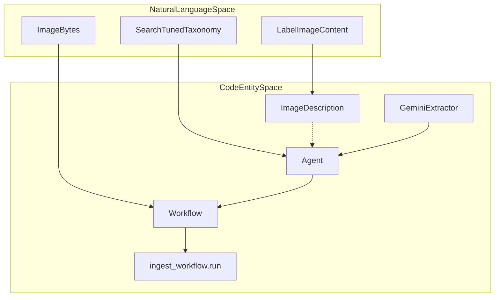
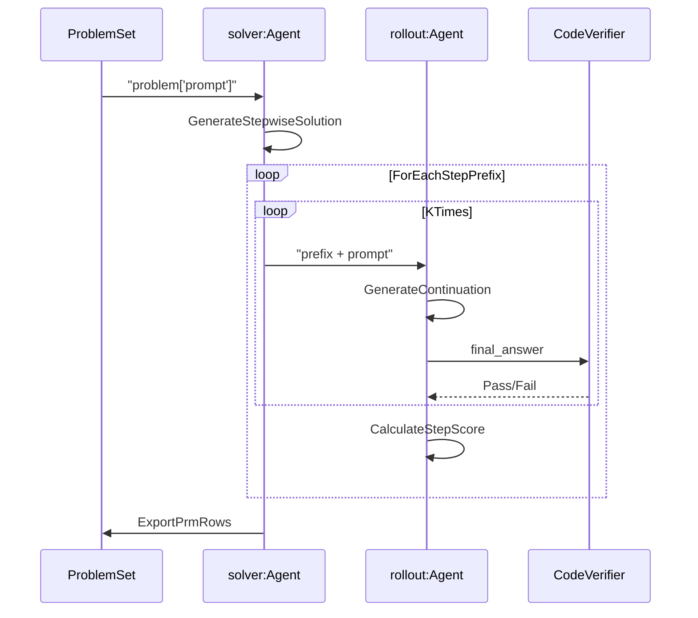

<!-- source: DeepWiki mcp.deepwiki.com · repo agno-agi/agno · page 10.8 Data Labeling Examples · fetched 2026-10-26 -->

# Data Age Labeling Examples

Relevant source files

The following files were used as context for generating this wiki page:

- [cookbook/data_labeling/image_search/.gitignore](cookbook/data_labeling/image_search/.gitignore)
- [cookbook/data_labeling/image_search/README.md](cookbook/data_labeling/image_search/README.md)
- [cookbook/data_labeling/image_search/TEST_LOG.md](cookbook/data_labeling/image_search/TEST_LOG.md)
- [cookbook/data_labeling/image_search/db.py](cookbook/data_labeling/image_search/db.py)
- [cookbook/data_labeling/image_search/generate_requirements.sh](cookbook/data_labeling/image_search/generate_requirements.sh)
- [cookbook/data_labeling/image_search/public/index.html](cookbook/data_labeling/image_search/public/index.html)
- [cookbook/data_labeling/image_search/requirements.in](cookbook/data_labeling/image_search/requirements.in)
- [cookbook/data_labeling/image_search/requirements.txt](cookbook/data_labeling/image_search/requirements.txt)
- [cookbook/data_labeling/image_search/run.py](cookbook/data_labeling/image_search/run.py)
- [cookbook/data_labeling/image_search/schemas.py](cookbook/data_labeling/image_search/schemas.py)
- [cookbook/data_labeling/image_search/settings.py](cookbook/data_labeling/image_search/settings.py)
- [cookbook/data_labeling/image_search/workflows/ingest.py](cookbook/data_labeling/image_search/workflows/ingest.py)
- [libs/agno/agno/learn/stores/decision_log.py](libs/agno/agno/learn/stores/decision_log.py)
- [libs/agno/tests/unit/models/test_claude_request_params.py](libs/agno/tests/unit/models/test_claude_request_params.py)

The `data_labeling` cookbook provides a comprehensive suite of patterns for building high-quality labeled datasets using LLM-as-judge workflows, multimodal extractors, and scale-out production pipelines. These patterns span text, image, audio, and video classification, structured extraction, pairwise preference ranking, rejection sampling, inter-annotator agreement, safety labeling, and durable storage patterns.

## Architecture and Workflow Patterns

Data labeling in Agno typically follows a structured flow where an `Agent` acts as a labeler, constrained by a Pydantic `output_schema` to ensure machine-readable results.

### Core Labeling Flow
The fundamental pattern involves passing raw data (text, images, audio, or video) to an agent configured with a specific taxonomy or extraction schema.

1. **Input Modalities**: Supports text, images (classification/bounding boxes), audio (transcription/diarization), video (event extraction), and documents (multi-page PDF extraction) [cookbook/data_labeling/README.md:28-53]().
2. **Output Schemas**: Uses Pydantic `BaseModel` to define the shape of the label, such as `ImageDescription` or `Classification` [cookbook/data_labeling/image_search/schemas.py:15-68](), [cookbook/data_labeling/_26_scale_out/resumable.py:32-35]().
3. **Compositional Patterns**: Higher-order workflows like `llm_as_judge`, `quality_review` (labeler-reviewer-adjudicator), and `inter_annotator_agreement` can be layered on top of any modality [cookbook/data_labeling/README.md:55-58]().

### Natural Language to Code Entity Space: Labeling Pipeline
This diagram illustrates how a natural language labeling task is mapped to Agno code entities.

Sources: [cookbook/data_labeling/image_search/workflows/ingest.py:47-84](), [cookbook/data_labeling/image_search/schemas.py:15-68]()

### Image Search and Labeling Pipeline
In modern multimodal labeling pipelines, images are fetched, described via search-tuned schemas, embedded, and stored in a hybrid vector database like PgVector.

* **Extractor Agent Construction**: Each worker thread provisions a fresh `Agent` instance configured with a search-tuned instruction set and `output_schema=ImageDescription` [cookbook/data_labeling/image_search/workflows/ingest.py:78-84]().
* **Flattening and Ingestion**: The structured `ImageDescription` is flattened via `to_searchable_text()` into a rich semantic string, while raw structured fields and source URLs are stored as metadata in `Knowledge` [cookbook/data_labeling/image_search/schemas.py:70-84](), [cookbook/data_labeling/image_search/workflows/ingest.py:104-108]().
* **Hybrid Search Integration**: Leveraging `PgVector` with `SearchType.hybrid` combines dense cosine similarity with PostgreSQL full-text search (`to_tsvector`) for robust retrieval [cookbook/data_labeling/image_search/db.py:45-59]().

Sources: [cookbook/data_labeling/image_search/workflows/ingest.py:1-157](), [cookbook/data_labeling/image_search/schemas.py:1-84](), [cookbook/data_labeling/image_search/db.py:1-59]()

## Advanced Evaluation Patterns

### Pairwise Preference and Juries
For tasks like RLHF/DPO dataset generation, Agno implements "Jury" patterns where multiple model families vote on candidate responses.

* **Position Debiasing**: The system scores each pair in both orderings (A/B and B/A) to detect and neutralize lead-bias [cookbook/data_labeling/_05_text_pairwise_preference/dpo_jury.py:108-111]().
* **Self-Preference Recusal**: A juror (e.g., Claude) may recuse itself if the candidate response was generated by its own model family [cookbook/data_labeling/_05_text_pairwise_preference/dpo_jury.py:104-106]().
* **Calibration and Weighting**: Jurors are first tested against a "gold set." Those falling below an accuracy floor are dropped, while others receive accuracy-derived weights [cookbook/data_labeling/_05_text_pairwise_preference/README.md:16-20]().

### Rejection Sampling and Process Rewards
Rejection sampling generates $K$ candidates and keeps only those passing a verifier.

* **Outcome Verification**: A pure-code verifier checks the `final_answer` against a known gold standard. Only traces resulting in the correct answer are kept [cookbook/data_labeling/_21_rejection_sampling/README.md:22-26]().
* **Monte-Carlo (MC) Step Scoring**: Instead of just the final outcome, every step prefix is scored by running $K$ rollouts. The step's reward is the fraction of rollouts that still reach the gold answer [cookbook/data_labeling/_21_rejection_sampling/step_rewards.py:5-12]().

### Entity Interaction: Rejection Sampling Workflow
This diagram shows the interaction between the `solver` agent, the `rollout` agent, and the programmatic verifier.

Sources: [cookbook/data_labeling/_21_rejection_sampling/step_rewards.py:120-158](), [cookbook/data_labeling/_21_rejection_sampling/README.md:34-46]()

## Scale-Out and Production Patterns

When moving from individual examples to datasets with 100k+ rows, Agno provides a scale-out harness focusing on reliability and cost.

### Resumable Async Pipelines
The scale-out harness utilizes `asyncio.Semaphore` to bound concurrency and prevent rate-limiting while maintaining high throughput [cookbook/data_labeling/_26_scale_out/resumable.py:93-107]().

| Feature | Implementation | Purpose |
| :--- | :--- | :--- |
| **Async Fan-out** | `asyncio.gather` with `Semaphore(8)` | High throughput concurrency management [cookbook/data_labeling/_26_scale_out/README.md:18-19](). |
| **Checkpointing** | `JSONL` append/flush + `load_done_ids` | Makes interruption cheap; reruns skip already-labeled IDs [cookbook/data_labeling/_26_scale_out/resumable.py:97-103](). |
| **Cost Tracking** | `run.metrics` aggregation | Projects 100k-row costs and compares interactive vs. batch pricing [cookbook/data_labeling/_26_scale_out/with_cost_tracking.py:25-29](). |

### Token and Cost Accounting
Agno captures granular metrics for every labeling run, including `input_tokens`, `output_tokens`, and `reasoning_tokens`. In reasoning models, thinking tokens often dominate the cost [cookbook/data_labeling/_26_scale_out/README.md:26-30]().

Sources: [cookbook/data_labeling/_26_scale_out/README.md:1-59](), [cookbook/data_labeling/_26_scale_out/resumable.py:106-144]()

## Safety and Synthetic Data Curation

### Safety Labeling
Agents can be configured to classify prompts against a safety policy taxonomy (e.g., `privacy_sensitive`, `medical_boundary`, `phishing`). Ambiguous cases are flagged with an `escalate` bit for human review [cookbook/data_labeling/_27_safety_labeling/TEST_LOG.md:5-11]().

### Synthetic Data Generation
Beyond labeling existing data, Agno supports generating new training data:
* **Self-Instruct**: Generating SFT chat rows from seed topics [cookbook/data_labeling/README.md:62]().
* **Critique and Revision**: A "Constitutional AI" flow where a draft is critiqued against principles and revised, producing (chosen, rejected) pairs [cookbook/data_labeling/README.md:65]().
* **Tool Call Trajectories**: Generating multi-turn trajectories validated against real tool schemas [cookbook/data_labeling/README.md:67]().

Sources: [cookbook/data_labeling/README.md:60-72](), [cookbook/data_labeling/_27_safety_labeling/README.md:1-26]()

---

