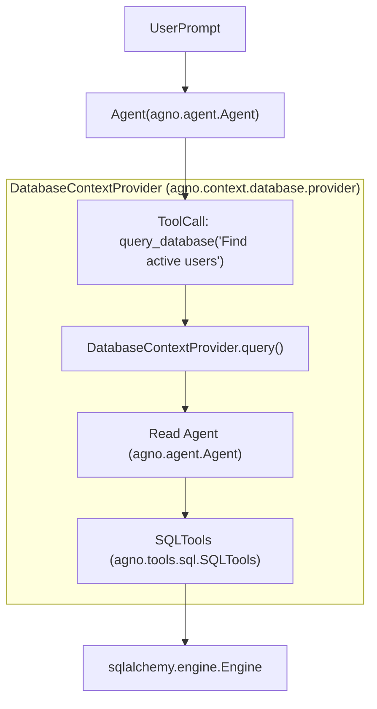
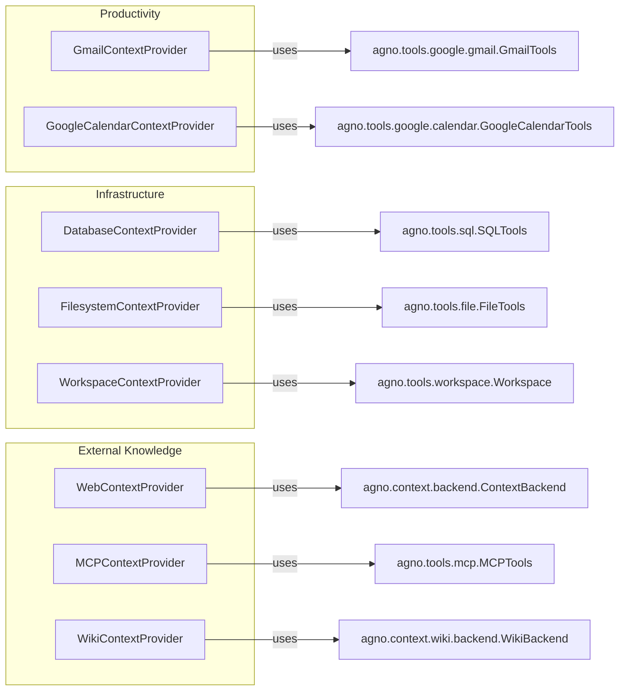

<!-- source: DeepWiki mcp.deepwiki.com · repo agno-agi/agno · page 11 Context Providers · fetched 2026-10-26 -->

# Context Providers

Relevant source files

The following files were used as context for generating this wiki page:

- [libs/agno/agno/context/calendar/provider.py](libs/agno/agno/context/calendar/provider.py)
- [libs/agno/agno/context/database/provider.py](libs/agno/agno/context/database/provider.py)
- [libs/agno/agno/context/fs/provider.py](libs/agno/agno/context/fs/provider.py)
- [libs/agno/agno/context/gdrive/provider.py](libs/agno/agno/context/gdrive/provider.py)
- [libs/agno/agno/context/gmail/provider.py](libs/agno/agno/context/gmail/provider.py)
- [libs/agno/agno/context/mcp/provider.py](libs/agno/agno/context/mcp/provider.py)
- [libs/agno/agno/context/provider.py](libs/agno/agno/context/provider.py)
- [libs/agno/agno/context/web/provider.py](libs/agno/agno/context/web/provider.py)
- [libs/agno/agno/context/wiki/provider.py](libs/agno/agno/context/wiki/provider.py)
- [libs/agno/agno/context/workspace/provider.py](libs/agno/agno/context/workspace/provider.py)
- [libs/agno/tests/unit/context/test_provider.py](libs/agno/tests/unit/context/test_provider.py)
- [libs/agno/tests/unit/context/test_wiki_provider.py](libs/agno/tests/unit/context/test_wiki_provider.py)

The `agno.context` subsystem provides a uniform API for plugging external information sources into agents as natural-language tools via `ContextProvider` [libs/agno/agno/context/provider.py:82-84](). While traditional tools expose raw function signatures, a `ContextProvider` abstracts complex data sources—such as filesystems, Slack workspaces, or databases—into a simplified query/update interface managed by specialized sub-agents [libs/agno/agno/context/provider.py:1-33]().

### The Context Abstraction

A `ContextProvider` acts as a bridge between the agent's natural language reasoning and the specific technical requirements of an external service. It encapsulates two primary capabilities:
1.  **Natural Language Access**: Methods like `query(question)` and `update(instruction)` (and their async counterparts `aquery`/`aupdate`) allow the agent to interact with the source using high-level intents [libs/agno/agno/context/provider.py:139-162]().
2.  **Tool Surface**: The `get_tools()` method generates the specific tool definitions that the calling agent sees, typically mapping to `query_<id>` and `update_<id>` [libs/agno/agno/context/provider.py:135-136]() [libs/agno/tests/unit/context/test_provider.py:103-107]().

#### Natural Language to Code Entity Space
The following diagram illustrates how a high-level agent request is routed through the `ContextProvider` architecture into specific code entities.

**Diagram: Context Provider Routing**

Sources: [libs/agno/agno/context/database/provider.py:36-71](), [libs/agno/agno/context/provider.py:139-144]()

---

## ContextProvider Architecture

The foundation of the system is the `ContextProvider` base class [libs/agno/agno/context/provider.py:82-84](). It manages connection lifecycles and defines how tools are presented to the primary agent via different `ContextMode` settings [libs/agno/agno/context/provider.py:15-23]():

*   **ContextMode.default**: Surfaces high-level `query` and `update` tools. These route requests to internal sub-agents managing underlying technical tools [libs/agno/agno/context/provider.py:15-18]().
*   **ContextMode.agent**: Surfaces only the `query` tool, providing a read-only natural language interface [libs/agno/agno/context/provider.py:19-20]().
*   **ContextMode.tools**: Surfaces the underlying raw tools directly to the primary agent, bypassing sub-agent abstraction [libs/agno/agno/context/provider.py:21-23]().

For details on implementing custom providers or understanding sub-agent wiring, see [ContextProvider Architecture](#11.1).

Sources: [libs/agno/agno/context/provider.py:82-138](), [libs/agno/context/mode.py:1-10]()

---

## Built-in Context Providers

Agno ships with a comprehensive suite of providers for common enterprise and developer data sources.

### Filesystem & Workspace
*   **FilesystemContextProvider**: Provides natural language access to a local directory tree using `FileTools` [libs/agno/agno/context/fs/provider.py:26-50]().
*   **WorkspaceContextProvider**: A specialized version of the filesystem provider that automatically excludes common noise like `.venvs`, `.git`, and build outputs to keep agent context clean [libs/agno/agno/context/workspace/provider.py:28-54]().

### Web & Search
*   **WebContextProvider**: Supports pluggable web search and fetch backends like `ExaBackend` and `ParallelBackend` [libs/agno/agno/context/web/provider.py:25-48]().

### Communication & Productivity
*   **SlackContextProvider**: Enables reading channel history, searching the workspace, and posting messages using dedicated sub-agents [libs/agno/agno/context/slack/provider.py:82-122]().
*   **Google Workspace**: Includes `GmailContextProvider` for email [libs/agno/agno/context/gmail/provider.py:82-122](), `GoogleCalendarContextProvider` for scheduling [libs/agno/agno/context/calendar/provider.py:74-115](), and `GoogleDriveContextProvider` for document management [libs/agno/agno/context/gdrive/provider.py:59-88]().

### Specialized Storage
*   **DatabaseContextProvider**: Connects to SQL databases via SQLAlchemy, providing separate read/write natural language tools [libs/agno/agno/context/database/provider.py:36-71]().
*   **WikiContextProvider**: Designed for knowledge bases, supporting backends for local filesystems (`FileSystemBackend`) and Git repositories (`GitBackend`) [libs/agno/agno/context/wiki/provider.py:41-79]().
*   **MCPContextProvider**: Directly exposes Model Context Protocol (MCP) servers as context sources, encapsulating tool catalogs [libs/agno/agno/context/mcp/provider.py:52-83]().

**Diagram: Built-in Provider Ecosystem**

Sources: [libs/agno/agno/context/gmail/provider.py:41-42](), [libs/agno/agno/context/calendar/provider.py:41-42](), [libs/agno/agno/context/database/provider.py:28-29](), [libs/agno/agno/context/fs/provider.py:20-21](), [libs/agno/agno/context/workspace/provider.py:22-23](), [libs/agno/agno/context/web/provider.py:15-16](), [libs/agno/agno/context/mcp/provider.py:43-44](), [libs/agno/agno/context/wiki/provider.py:31-35]()

For detailed configuration, constructor parameters, and cookbook examples for each provider, see [Built-in Context Providers](#11.2).

---

