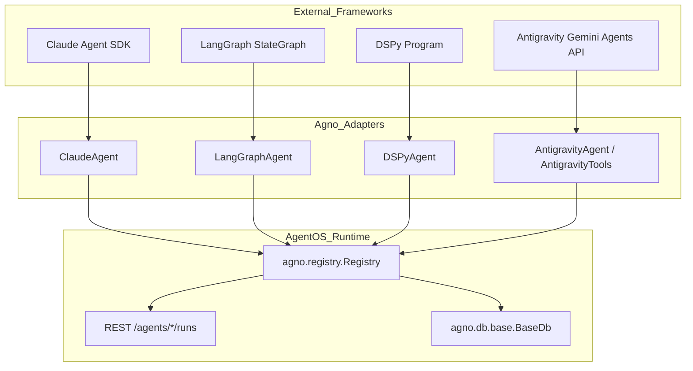
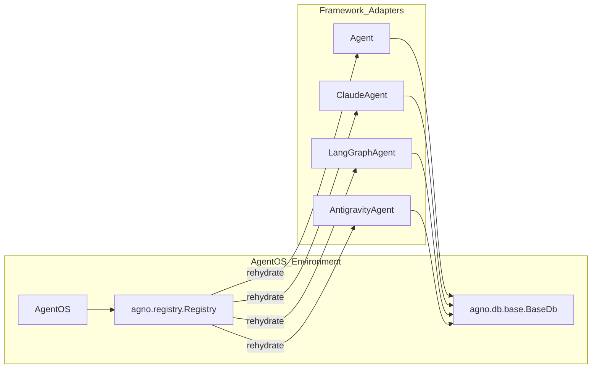

<!-- source: DeepWiki mcp.deepwiki.com · repo agno-agi/agno · page 12 Framework Integrations · fetched 2026-10-26 -->

# Framework Integrations

Relevant source files

The following files were used as context for generating this wiki page:

- [libs/agno/agno/agents/antigravity/agent.py](libs/agno/agno/agents/antigravity/agent.py)
- [libs/agno/agno/tools/airflow.py](libs/agno/agno/tools/airflow.py)
- [libs/agno/agno/tools/antigravity.py](libs/agno/agno/tools/antigravity.py)
- [libs/agno/agno/utils/yaml_io.py](libs/agno/agno/utils/yaml_io.py)
- [libs/agno/tests/unit/agents/test_antigravity.py](libs/agno/tests/unit/agents/test_antigravity.py)
- [libs/agno/tests/unit/conftest.py](libs/agno/tests/unit/conftest.py)
- [libs/agno/tests/unit/tools/test_airflow_tools.py](libs/agno/tests/unit/tools/test_airflow_tools.py)
- [libs/agno/tests/unit/tools/test_antigravity.py](libs/agno/tests/unit/tools/test_antigravity.py)
- [libs/agno/tests/unit/utils/test_yaml_io.py](libs/agno/tests/unit/utils/test_yaml_io.py)

The Agno framework provides a unified interface for deploying and managing agents built across different ecosystems. Through the use of adapter classes (`BaseExternalAgent`), AgentOS extends its production-grade features—such as session persistence, streaming, and API serving—to third-party frameworks including the **Claude Agent SDK**, **LangGraph**, **DSPy**, and Google's **Antigravity** (Gemini Agents API).

This integration allows developers to register external agents alongside native Agno agents, exposing them through the same standard REST API surface and monitoring them via the AgentOS Control Plane. The `Registry` class serves as the central hub for managing these heterogeneous components, ensuring they are resolvable by the AgentOS runtime.

### Integration Architecture

The following diagram illustrates how external framework entities are mapped to Agno code entities to be served by `AgentOS`.

**Framework Mapping to AgentOS**

Sources: [libs/agno/agno/agents/antigravity/agent.py:24-62](), [libs/agno/agno/tools/antigravity.py:37-43]()

---

## Claude Agent SDK Integration

The `ClaudeAgent` class acts as a wrapper for the Claude Agent SDK, enabling Anthropic's agentic capabilities within the Agno ecosystem. It integrates with `AgentOS` to provide a consistent execution environment for Anthropic-specific features such as extended thinking and Model Context Protocol (MCP) server configurations.

* **Tooling:** Supports both built-in SDK tools and custom tools defined via MCP [cookbook/91_tools/mcp/local_server/client.py:22-28]().
* **Execution Control:** Configurable via parameters like `max_turns`, `thinking`, and `permission_mode`.
* **Persistence:** Integrates with Agno database providers to maintain multi-turn chat history via standard session management.

For details, see [ClaudeAgent Adapter](#12.1).

Sources: [libs/agno/agno/agents/antigravity/agent.py:24-62]()

---

## LangGraph, DSPy and Antigravity Adapters

Agno provides robust adapters for bridging popular agent frameworks and managed APIs into AgentOS:

- **LangGraph**: The `LangGraphAgent` adapter allows compiled LangGraph state graphs to be treated as standard Agno agents, supporting checkpointing, state history inspection, and event translation.
- **DSPy**: The `DSPyAgent` adapter wraps DSPy programs to bring programmatic prompt optimization and structured reasoning into AgentOS.
- **Antigravity**: The `AntigravityAgent` and `AntigravityTools` adapters wrap Google's Gemini Agents API (`https://generativelanguage.googleapis.com/v1beta`), providing sandboxed Linux environment execution, session-scoped environment ID caching (`antigravity_env_id`), and custom agent registration.

For details, see [LangGraph, DSPy and Antigravity Adapters](#12.2).

Sources: [libs/agno/agno/agents/antigravity/agent.py:24-62](), [libs/agno/agno/tools/antigravity.py:37-43]()

---

## Multi-Framework Deployments

AgentOS supports heterogeneous agent environments. A single instance can manage a collection of agents where each member is built using a different framework but shares a common control plane. This is achieved by populating the `Registry` with components regardless of their origin.

**Unified API and Storage**
| Feature | Agno Native | Claude SDK | LangGraph | DSPy | Antigravity |
| :--- | :--- | :--- | :--- | :--- | :--- |
| **API Endpoint** | `/agents/{id}/runs` | `/agents/{id}/runs` | `/agents/{id}/runs` | `/agents/{id}/runs` | `/agents/{id}/runs` |
| **Persistence** | `AgentSession` | `AgentSession` | `AgentSession` | `AgentSession` | `AgentSession` |
| **Streaming** | SSE Supported | SSE Supported | SSE Supported | SSE Supported | SSE Supported |
| **Registry** | `Registry.agents` | `Registry.agents` | `Registry.agents` | `Registry.agents` | `Registry.agents` |

**Cross-Framework Communication Architecture**

Sources: [libs/agno/agno/agents/antigravity/agent.py:24-62](), [libs/agno/agno/tools/antigravity.py:37-43]()

---

## Remote Agent Integration

Framework integrations also extend to remote capabilities. Using `RemoteAgent` or `RemoteTeam`, Agno can interact with agents hosted on other AgentOS instances or frameworks that implement the Agno protocol.

* **Remote Protocol:** Ensures compatibility between local execution expectations and remote agent outputs using `RunOutput`.
* **Config Discovery:** Remote configurations are retrieved via standardized endpoints that return registered agents and models from the `Registry`.

Sources: [libs/agno/agno/agents/antigravity/agent.py:24-62](), [libs/agno/agno/tools/antigravity.py:37-43]()

---

