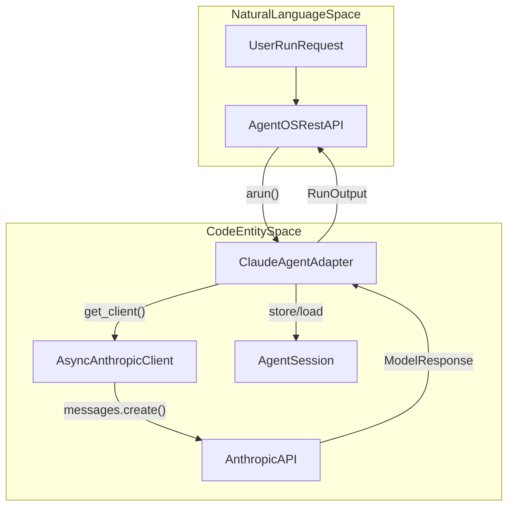
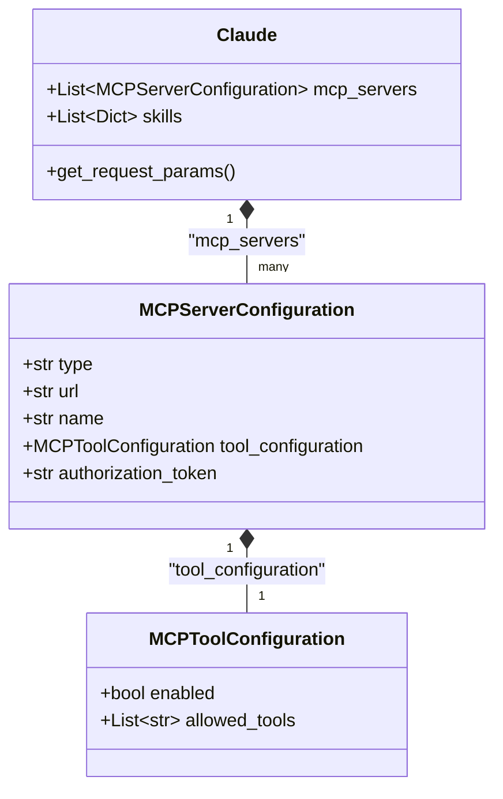
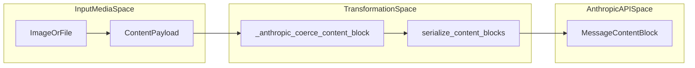

<!-- source: DeepWiki mcp.deepwiki.com · repo agno-agi/agno · page 12.1 ClaudeAgent Adapter · fetched 2026-10-26 -->

# ClaudeAgent Adapter

Relevant source files

The following files were used as context for generating this wiki page:

- [cookbook/90_models/anthropic/csv_input.py](cookbook/90_models/anthropic/csv_input.py)
- [cookbook/90_models/anthropic/markdown_input.py](cookbook/90_models/anthropic/markdown_input.py)
- [cookbook/90_models/anthropic/pydantic_tool_input.py](cookbook/90_models/anthropic/pydantic_tool_input.py)
- [libs/agno/agno/__init__.py](libs/agno/agno/__init__.py)
- [libs/agno/agno/agents/antigravity/agent.py](libs/agno/agno/agents/antigravity/agent.py)
- [libs/agno/agno/models/anthropic/claude.py](libs/agno/agno/models/anthropic/claude.py)
- [libs/agno/agno/models/aws/bedrock.py](libs/agno/agno/models/aws/bedrock.py)
- [libs/agno/agno/models/aws/claude.py](libs/agno/agno/models/aws/claude.py)
- [libs/agno/agno/models/azure/ai_foundry.py](libs/agno/agno/models/azure/ai_foundry.py)
- [libs/agno/agno/models/azure/openai_chat.py](libs/agno/agno/models/azure/openai_chat.py)
- [libs/agno/agno/models/cohere/chat.py](libs/agno/agno/models/cohere/chat.py)
- [libs/agno/agno/models/groq/groq.py](libs/agno/agno/models/groq/groq.py)
- [libs/agno/agno/models/huggingface/huggingface.py](libs/agno/agno/models/huggingface/huggingface.py)
- [libs/agno/agno/models/ibm/watsonx.py](libs/agno/agno/models/ibm/watsonx.py)
- [libs/agno/agno/models/meta/llama.py](libs/agno/agno/models/meta/llama.py)
- [libs/agno/agno/models/mistral/mistral.py](libs/agno/agno/models/mistral/mistral.py)
- [libs/agno/agno/models/ollama/chat.py](libs/agno/agno/models/ollama/chat.py)
- [libs/agno/agno/models/openai/chat.py](libs/agno/agno/models/openai/chat.py)
- [libs/agno/agno/models/openai/responses.py](libs/agno/agno/models/openai/responses.py)
- [libs/agno/agno/models/vertexai/claude.py](libs/agno/agno/models/vertexai/claude.py)
- [libs/agno/agno/tools/airflow.py](libs/agno/agno/tools/airflow.py)
- [libs/agno/agno/tools/antigravity.py](libs/agno/agno/tools/antigravity.py)
- [libs/agno/agno/utils/models/claude.py](libs/agno/agno/utils/models/claude.py)
- [libs/agno/agno/utils/yaml_io.py](libs/agno/agno/utils/yaml_io.py)
- [libs/agno/tests/integration/models/anthropic/test_format_tools.py](libs/agno/tests/integration/models/anthropic/test_format_tools.py)
- [libs/agno/tests/integration/models/huggingface/test_basic.py](libs/agno/tests/integration/models/huggingface/test_basic.py)
- [libs/agno/tests/integration/models/huggingface/test_tool_use.py](libs/agno/tests/integration/models/huggingface/test_tool_use.py)
- [libs/agno/tests/unit/agents/test_antigravity.py](libs/agno/tests/unit/agents/test_antigravity.py)
- [libs/agno/tests/unit/conftest.py](libs/agno/tests/unit/conftest.py)
- [libs/agno/tests/unit/models/anthropic/test_citation_suppression.py](libs/agno/tests/unit/models/anthropic/test_citation_suppression.py)
- [libs/agno/tests/unit/models/test_client_caching.py](libs/agno/tests/unit/models/test_client_caching.py)
- [libs/agno/tests/unit/models/test_cross_model_tool_calls.py](libs/agno/tests/unit/models/test_cross_model_tool_calls.py)
- [libs/agno/tests/unit/models/test_mistral_request_params.py](libs/agno/tests/unit/models/test_mistral_request_params.py)
- [libs/agno/tests/unit/tools/test_airflow_tools.py](libs/agno/tests/unit/tools/test_airflow_tools.py)
- [libs/agno/tests/unit/tools/test_antigravity.py](libs/agno/tests/unit/tools/test_antigravity.py)
- [libs/agno/tests/unit/utils/test_claude.py](libs/agno/tests/unit/utils/test_claude.py)
- [libs/agno/tests/unit/utils/test_yaml_io.py](libs/agno/tests/unit/utils/test_yaml_io.py)

The `ClaudeAgent` class is a specialized adapter within the Agno framework designed to wrap the **Claude Agent SDK** and Anthropic models (`Claude`). It allows developers to take agents built using Anthropic's official SDK or API patterns and serve them as production-grade services through the Agno **AgentOS** runtime. By using this adapter, Claude agents gain access to Agno's session management, persistent storage, and real-time streaming capabilities while maintaining their native tool-calling and MCP (Model Context Protocol) integration patterns.

## Overview and Implementation

The `ClaudeAgent` adapter acts as a bridge between the Agno `Agent` interface and the underlying Claude execution logic. It translates Agno's execution calls into the appropriate Claude SDK lifecycle events, allowing for both synchronous and streaming interactions.

The implementation relies heavily on the `Claude` model class defined in `libs/agno/agno/models/anthropic/claude.py`, which handles low-level communication with Anthropic's Messages API, including specialized features like prompt caching, betas, skills, and extended thinking [libs/agno/agno/models/anthropic/claude.py:95-160]().

### Data Flow Architecture

The following diagram illustrates how a request flows through the Agno `AgentOS` runtime components (`AgentOS`, `ClaudeAgent`, `Claude`), mapping natural language operations to concrete code entities.

**ClaudeAgent Adapter Request Flow**

Sources: [libs/agno/agno/models/anthropic/claude.py:95-130](), [libs/agno/agno/models/anthropic/claude.py:155-160]()

## Key Configuration Parameters

The `Claude` and `ClaudeAgent` adapters expose parameters controlling model execution, cache behavior, tool configurations, and experimental features.

| Parameter | Type | Description |
| :--- | :--- | :--- |
| `id` | `str` | The Claude model identifier (e.g., `claude-sonnet-4-5-20250929`) [libs/agno/agno/models/anthropic/claude.py:129](). |
| `max_tokens` | `Optional[int]` | Maximum output tokens for the response (default `8192`) [libs/agno/agno/models/anthropic/claude.py:134](). |
| `thinking` | `Optional[Dict[str, Any]]` | Configuration dictionary for extended thinking mode [libs/agno/agno/models/anthropic/claude.py:135](). |
| `mcp_servers` | `Optional[List[MCPServerConfiguration]]` | Configuration for external Model Context Protocol servers [libs/agno/agno/models/anthropic/claude.py:156](). |
| `betas` | `Optional[List[str]]` | Anthropic beta headers enabling experimental features [libs/agno/agno/models/anthropic/claude.py:154](). |
| `skills` | `Optional[List[Dict[str, str]]]` | Native Anthropic capabilities (e.g., `pptx`, `pdf`) [libs/agno/agno/models/anthropic/claude.py:157-159](). |

Sources: [libs/agno/agno/models/anthropic/claude.py:129-160](), [libs/agno/agno/utils/models/claude.py:67-80]()

## Tooling and MCP Integration

Claude agents leverage the **Model Context Protocol (MCP)** for discovery and execution of external tools. The adapter handles MCP server connections via `MCPServerConfiguration` and `MCPToolConfiguration` [libs/agno/agno/utils/models/claude.py:67-80]().

### MCP Configuration Mapping

The classes below configure external tool routing and permission scoping in `libs/agno/agno/utils/models/claude.py`.

**System-to-Code Mapping: MCP Tool Resolution**

Sources: [libs/agno/agno/models/anthropic/claude.py:156](), [libs/agno/agno/utils/models/claude.py:67-80]()

## Model Specific Capabilities

The adapter integrates directly with specialized Anthropic features:

1. **Thinking Mode**: Validated against `NON_THINKING_MODELS` to ensure compatibility with extended reasoning budgets [libs/agno/agno/models/anthropic/claude.py:106-112]().
2. **Prompt Caching**: Utilizes `SystemPromptBlock` to split system prompts into independently cacheable segments with per-block `ttl` controls [libs/agno/agno/models/anthropic/claude.py:75-93]().
3. **Multimodal Inputs**: Handles images and documents via formatting utilities [libs/agno/agno/utils/models/claude.py:5-6]() and helper functions [libs/agno/agno/utils/models/claude.py:110-153]().
4. **Structured Outputs**: Automatically suppresses document citations when structured output (`response_format`) is active because the Anthropic API rejects both parameters simultaneously [libs/agno/agno/models/anthropic/claude.py:161-164]().

### Media Handling Data Flow

Media objects are parsed and converted into Anthropic-compatible content blocks.

**Media Data Flow**

Sources: [libs/agno/agno/utils/models/claude.py:110-153](), [libs/agno/agno/models/anthropic/claude.py:13-14]()

## AgentOS and Session Integration

When running under Agno `AgentOS`, `ClaudeAgent` instances inherit robust session control:

- **Streaming Translation**: Translates Anthropic stream events (`BetaRawContentBlockDeltaEvent`, `MessageStopEvent`) into uniform Agno `ModelResponse` chunks [libs/agno/agno/models/anthropic/claude.py:41-56]().
- **Prefill Management**: Automatically inspects model versions using `supports_prefill()` to decide whether to append trailing user messages when conversations end with assistant turns on newer Claude models (`4.6+`) [libs/agno/agno/utils/models/claude.py:42-65]().

Sources: [libs/agno/agno/models/anthropic/claude.py:41-56](), [libs/agno/agno/utils/models/claude.py:42-65]()

---

