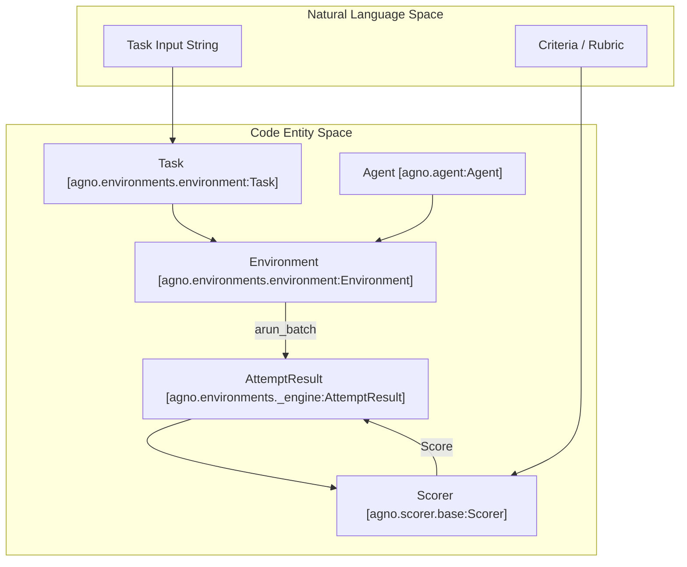
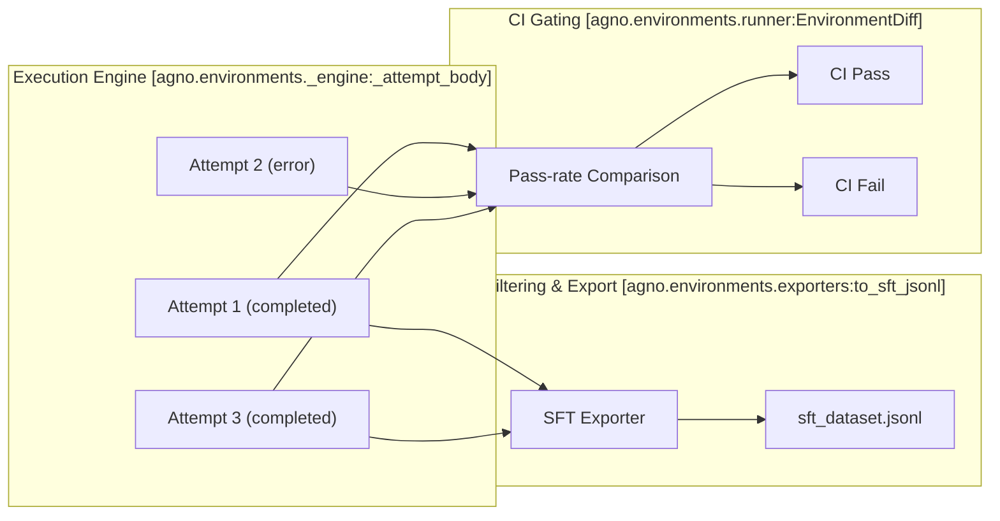

<!-- source: DeepWiki mcp.deepwiki.com · repo agno-agi/agno · page 13 Environments and Dataset Generation · fetched 2026-10-26 -->

# Environments and Dataset Generation

Relevant source files

The following files were used as context for generating this wiki page:

- [libs/agno/agno/environments/__init__.py](libs/agno/agno/environments/__init__.py)
- [libs/agno/agno/environments/_engine.py](libs/agno/agno/environments/_engine.py)
- [libs/agno/agno/eval/suite.py](libs/agno/agno/eval/suite.py)
- [libs/agno/agno/tools/mcp_toolbox.py](libs/agno/agno/tools/mcp_toolbox.py)
- [libs/agno/tests/unit/environments/__init__.py](libs/agno/tests/unit/environments/__init__.py)
- [libs/agno/tests/unit/environments/test_engine.py](libs/agno/tests/unit/environments/test_engine.py)
- [libs/agno/tests/unit/eval/test_suite.py](libs/agno/tests/unit/eval/test_suite.py)
- [libs/agno/tests/unit/tools/test_mcp_toolbox_lifecycle.py](libs/agno/tests/unit/tools/test_mcp_toolbox_lifecycle.py)

The **Environments** subsystem in Agno provides a structured framework for agent verification, reinforcement learning (RL) style evaluation, and dataset generation. It allows developers to move beyond single-turn testing by running agents multiple times against specific tasks to determine statistical reliability, identify "learning zones," and export successful trajectories for Supervised Fine-Tuning (SFT).

By wrapping an agent's interaction with a task into a repeatable rollout, Agno enables the systematic measurement of pass rates, the inspection of failure modes, and the creation of high-quality training data from passing runs.

### Core Workflow

1.  **Define Tasks**: Specify the prompts and expected outcomes using the `Task` dataclass [libs/agno/agno/environments/environment.py:13-13]().
2.  **Run Rollouts**: Execute the agent against these tasks $K$ times using `run_rollouts` or `arun_rollouts` [libs/agno/agno/environments/runner.py:15-15]().
3.  **Score Attempts**: Use built-in scorers (Code, LLM-as-judge, or Tool Call verification) to grade the agent's performance [libs/agno/agno/scorer/base.py:33-33]().
4.  **Analyze Results**: Inspect `EnvironmentRunResult` to find tasks where the agent is inconsistent (the "learning zone") [libs/agno/agno/environments/runner.py:15-15]().
5.  **Export Datasets**: Save successful interaction trajectories as SFT-ready JSONL files using `to_sft_jsonl` [libs/agno/agno/environments/exporters.py:14-14]().

## System Architecture

The environment system bridges the gap between raw agent execution and formal evaluation. It uses fingerprints to ensure reproducibility and provides a grid-based view of results across different models or agent configurations.

### Agent-Environment Interaction Space

**Sources:**
- `libs/agno/agno/environments/environment.py:13-13` [libs/agno/agno/environments/environment.py:13-13]()
- `libs/agno/agno/environments/_engine.py:48-64` [libs/agno/agno/environments/_engine.py:48-64]()
- `libs/agno/agno/scorer/base.py:33-33` [libs/agno/agno/scorer/base.py:33-33]()

## Environment and Task Architecture
The `Environment` class manages the lifecycle of an evaluation run. It utilizes `Task` definitions to prompt agents and tracks fingerprints to ensure that results are comparable across different versions of the codebase or model providers. The engine ensures attempt isolation by deep-copying agents and disabling response caching to prevent degenerate "replays" [libs/agno/agno/environments/_engine.py:75-102]().

For details, see [Environment and Task Architecture](#13.1).

**Sources:**
- `libs/agno/agno/environments/environment.py:13-13` [libs/agno/agno/environments/environment.py:13-13]()
- `libs/agno/agno/environments/_engine.py:11-45` [libs/agno/agno/environments/_engine.py:11-45]()

## Scorers
Scorers are the heart of the verification process, implementing the `ascore` method to evaluate `RunOutput` [libs/agno/agno/scorer/base.py:33-33](). Agno provides several built-in implementations:
*   **CodeScorer**: Validates outputs using Python logic (e.g., matching strings or custom functions) [libs/agno/agno/scorer/code.py:1-1]().
*   **JudgeScorer**: Uses an LLM-as-judge pattern to evaluate responses against free-text criteria with binary or numeric (1-10) modes [libs/agno/agno/scorer/judge.py:81-98]().
*   **ToolCallScorer**: Specifically verifies that the agent called the correct tools, with the correct arguments, and can optionally enforce strict "no additional tools" policies [libs/agno/agno/scorer/tools.py:1-1]().

For details, see [Scorers](#13.2).

**Sources:**
- `libs/agno/agno/scorer/judge.py:91-112` [libs/agno/agno/scorer/judge.py:91-112]()
- `libs/agno/agno/scorer/tools.py:1-1` [libs/agno/agno/scorer/tools.py:1-1]()
- `libs/agno/tests/unit/scorer/test_tool_call_scorer.py:71-84` [libs/agno/tests/unit/scorer/test_tool_call_scorer.py:71-84]()

## Dataset Export and CI Gating
Once rollouts are complete, Agno can export passing trajectories as SFT datasets. The `to_sft_jsonl` utility filters for successful attempts and formats them for model training [libs/agno/agno/environments/exporters.py:14-14](). Additionally, the `EnvironmentRunResult` can be used to compare current performance against baselines using `EnvironmentDiff` [libs/agno/agno/environments/runner.py:15-15](), enabling pass-rate floors to serve as CI gates.

For details, see [Dataset Export and CI Gating](#13.3).

### Dataset Generation Flow

**Sources:**
- `libs/agno/agno/environments/_engine.py:134-166` [libs/agno/agno/environments/_engine.py:134-166]()
- `libs/agno/agno/environments/exporters.py:14-14` [libs/agno/agno/environments/exporters.py:14-14]()
- `libs/agno/agno/environments/runner.py:15-15` [libs/agno/agno/environments/runner.py:15-15]()

---

