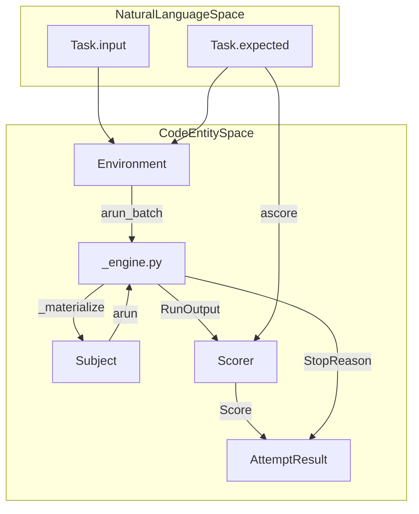
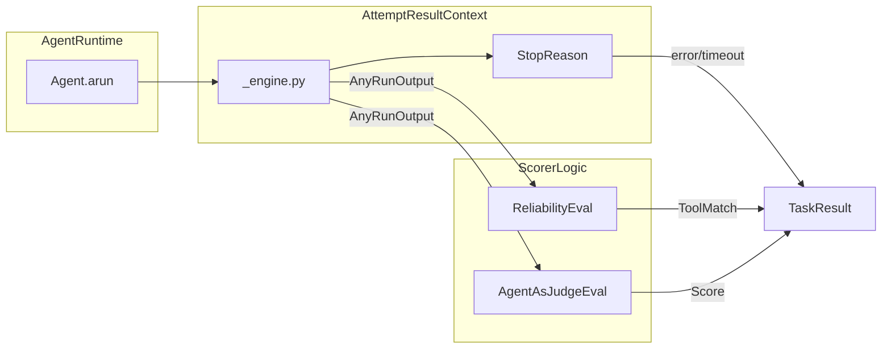

<!-- source: DeepWiki mcp.deepwiki.com · repo agno-agi/agno · page 13.1 Environment and Task Architecture · fetched 2026-10-26 -->

# Environment and Task Architecture

Relevant source files

The following files were used as context for generating this wiki page:

- [libs/agno/agno/environments/__init__.py](libs/agno/agno/environments/__init__.py)
- [libs/agno/agno/environments/_engine.py](libs/agno/agno/environments/_engine.py)
- [libs/agno/agno/eval/suite.py](libs/agno/agno/eval/suite.py)
- [libs/agno/agno/tools/mcp_toolbox.py](libs/agno/agno/tools/mcp_toolbox.py)
- [libs/agno/tests/unit/environments/__init__.py](libs/agno/tests/unit/environments/__init__.py)
- [libs/agno/tests/unit/environments/test_engine.py](libs/agno/tests/unit/environments/test_engine.py)
- [libs/agno/tests/unit/eval/test_suite.py](libs/agno/tests/unit/eval/test_suite.py)
- [libs/agno/tests/unit/tools/test_mcp_toolbox_lifecycle.py](libs/agno/tests/unit/tools/test_mcp_toolbox_lifecycle.py)

The Environment and Task architecture provides a structured framework for agent verification, dataset generation, and Reinforcement Learning (RL) style evaluation. It enables running agents or teams multiple times against specific tasks to measure reliability, accuracy, and performance across iterations.

Sources: [libs/agno/agno/environments/__init__.py:1-15]()

## Core Components

The architecture is built around primary entities including the `Environment` class, the `Task` dataclass, and rollout execution primitives. This system bridges the gap between natural language prompts and programmatic execution by treating agent interactions as "rollouts" within a controlled environment.

### Environment Class
The `Environment` class serves as the container for evaluation logic. It manages the lifecycle of runs, handles database persistence, and coordinates the scoring of agent outputs.

Key responsibilities include:
- Orchestrating synchronous and asynchronous rollouts via `run_rollouts` and `arun_rollouts` [libs/agno/agno/environments/__init__.py:15-31]().
- Managing reproducibility through environment and model fingerprints to detect configuration drift [libs/agno/agno/environments/__init__.py:8-16]().
- Interfacing with storage layers like `BaseDb` or `AsyncBaseDb` to store evaluation records.

### Task Dataclass
A `Task` represents a single unit of evaluation [libs/agno/agno/environments/environment.py:13](). It contains the input prompt, expected outputs, and specific configurations for the agent or team under test.

### RolloutResult and The Learning Zone
The results of multiple iterations are aggregated into structured rollout outputs. This structure provides a grid-like view of performance metrics across $k$ attempts.

A critical concept in this architecture is the **Learning Zone**. An agent is considered to be in the learning zone for a specific task when its pass rate is between 0 and 1 ($0 < pass\_rate < 1$). 
- **Pass Rate = 0**: The task is too difficult; the agent never succeeds.
- **Pass Rate = 1**: The task is solved; no further learning is required for this specific prompt.
- **Learning Zone**: The agent shows stochastic success, indicating that prompt engineering, fine-tuning, or few-shot examples could stabilize performance.

Sources: [libs/agno/agno/environments/environment.py:13](), [libs/agno/agno/environments/_engine.py:1-9](), [libs/agno/agno/environments/__init__.py:1-6]()

## The Rollout Engine

The private rollout engine (`agno.environments._engine`) is responsible for executing the subject (Agent or Team) isolated $K$ times per input [libs/agno/agno/environments/_engine.py:1-5]().

### Isolation and Materialization
To ensure each attempt is independent, the engine uses the `_materialize` rule [libs/agno/agno/environments/_engine.py:75]():
1. **Factories**: If the subject is a callable, it is called once per attempt to produce a fresh instance [libs/agno/agno/environments/_engine.py:93-94]().
2. **Deep Copy**: If a live subject is provided, it is `deep_copy`'d, sharing expensive components like models and databases by reference while isolating session-specific state [libs/agno/agno/environments/_engine.py:96-97]().
3. **Cache Disabling**: `cache_response` is disabled on the model for every attempt to ensure a sample rather than a replay [libs/agno/agno/environments/_engine.py:100-101]().

### Stop Reasons
Attempts are classified by a `StopReason` enum [libs/agno/agno/environments/_engine.py:35]():
- `completed`: The run finished and is ready for scoring [libs/agno/agno/environments/_engine.py:40]().
- `error`: The run raised an exception or yielded a `RunErrorEvent` [libs/agno/agno/environments/_engine.py:41]().
- `timeout`: The run exceeded `timeout_seconds` [libs/agno/agno/environments/_engine.py:42]().
- `paused`: The run hit a Human-in-the-Loop (HITL) requirement [libs/agno/agno/environments/_engine.py:44]().

**Task Execution and Scoring Flow**

Sources: [libs/agno/agno/environments/_engine.py:134-166](), [libs/agno/agno/environments/environment.py:13](), [libs/agno/agno/environments/runner.py:15]()

## Scoring Mechanisms

The architecture supports multiple `Scorer` implementations to grade attempts.

| Scorer Type | Implementation | Verification Logic |
| :--- | :--- | :--- |
| **Code Scorer** | `CodeScorer` | Programmatic verification (e.g., regex, equality) [libs/agno/agno/scorer/base.py:33](). |
| **Judge Scorer** | `JudgeScorer` | LLM-as-a-judge using rubrics and reasoning [libs/agno/agno/eval/suite.py:25](). |
| **Tool Call Scorer** | `ToolCallScorer` | Matches `ToolExecution` history against expected calls [libs/agno/agno/eval/reliability.py:26](). |

### Reliability and Tool Verification
Evaluations verify that the agent called the correct tools with valid arguments [libs/agno/agno/eval/reliability.py:80-97](). It matches against actual `ToolExecution` records where `tool_call_error` is absent [libs/agno/agno/eval/reliability.py:122-128]().

**Metric Association Diagram**

Sources: [libs/agno/agno/environments/_engine.py:48-63](), [libs/agno/agno/eval/suite.py:61-88](), [libs/agno/tests/unit/eval/test_suite.py:124-132]()

## Dataset Generation and SFT Export

A primary use case for Environments is generating Supervised Fine-Tuning (SFT) datasets. Passing trajectories (where the scorer returns `passed=True`) are exported as conversational JSONL files [libs/agno/agno/environments/exporters.py:14]().

- **`to_sft_jsonl`**: Sync exporter for `EnvironmentRunResult` [libs/agno/agno/environments/__init__.py:32]().
- **`ato_sft_jsonl`**: Async variant for streaming exports [libs/agno/agno/environments/__init__.py:30]().

This ensures that only high-quality, verified trajectories are used for model training, effectively turning the evaluation environment into a data production pipeline.

Sources: [libs/agno/agno/environments/__init__.py:1-6](), [libs/agno/agno/environments/exporters.py:14](), [libs/agno/agno/environments/runner.py:15]()

---

