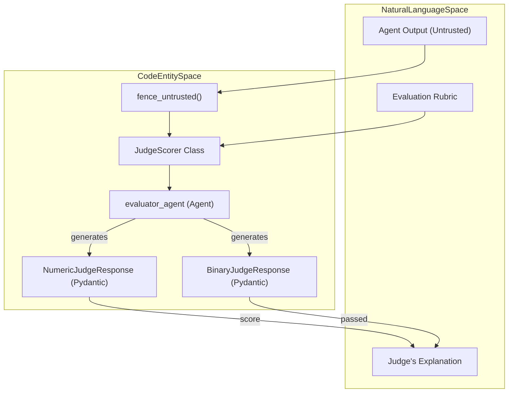
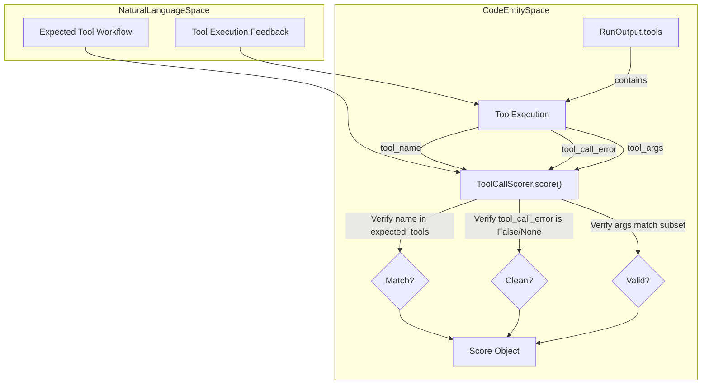

<!-- source: DeepWiki mcp.deepwiki.com · repo agno-agi/agno · page 13.2 Scorers · fetched 2026-10-26 -->

# Scorers

Relevant source files

The following files were used as context for generating this wiki page:

- [cookbook/90_models/openai/responses/README.md](cookbook/90_models/openai/responses/README.md)
- [cookbook/90_models/openai/responses/TEST_LOG.md](cookbook/90_models/openai/responses/TEST_LOG.md)
- [cookbook/90_models/openai/responses/background.py](cookbook/90_models/openai/responses/background.py)
- [cookbook/90_models/openai/responses/stored_responses_without_chaining.py](cookbook/90_models/openai/responses/stored_responses_without_chaining.py)
- [libs/agno/agno/environments/__init__.py](libs/agno/agno/environments/__init__.py)
- [libs/agno/agno/environments/_engine.py](libs/agno/agno/environments/_engine.py)
- [libs/agno/agno/eval/suite.py](libs/agno/agno/eval/suite.py)
- [libs/agno/agno/tools/mcp_toolbox.py](libs/agno/agno/tools/mcp_toolbox.py)
- [libs/agno/tests/unit/environments/__init__.py](libs/agno/tests/unit/environments/__init__.py)
- [libs/agno/tests/unit/environments/test_engine.py](libs/agno/tests/unit/environments/test_engine.py)
- [libs/agno/tests/unit/eval/test_suite.py](libs/agno/tests/unit/eval/test_suite.py)
- [libs/agno/tests/unit/models/openai/test_openai_responses_background.py](libs/agno/tests/unit/models/openai/test_openai_responses_background.py)
- [libs/agno/tests/unit/models/openai/test_openai_responses_chaining.py](libs/agno/tests/unit/models/openai/test_openai_responses_chaining.py)
- [libs/agno/tests/unit/models/openai/test_openai_responses_id_handling.py](libs/agno/tests/unit/models/openai/test_openai_responses_id_handling.py)
- [libs/agno/tests/unit/scorer/test_model_identity.py](libs/agno/tests/unit/scorer/test_model_identity.py)
- [libs/agno/tests/unit/tools/test_mcp_toolbox_lifecycle.py](libs/agno/tests/unit/tools/test_mcp_toolbox_lifecycle.py)

Scorers are the foundational components of the Agno evaluation system, used to verify the output and behavior of Agents, Teams, and Workflows. They bridge the gap between raw model outputs and structured metrics, providing automated ways to measure accuracy, reliability, and performance.

## Overview

The evaluation system uses specialized classes to score specific aspects of a run. These range from simple boolean checks to complex "LLM-as-a-judge" patterns and tool execution verification. The `Scorer` base class defines the interface for in-process scoring, requiring an `ascore` (async) or `score` (sync) method that returns a `Score` object [libs/agno/agno/scorer/base.py:10-30]().

### Core Evaluation Types
| Scorer Type | Purpose | Key Metric |
|:---|:---|:---|
| **CodeScorer** | Boolean or graded scoring using Python logic. | `Score.value` (0.0-1.0) |
| **JudgeScorer** | LLM-as-a-judge scoring based on text rubrics. | `Score.passed` / `Score.value` |
| **ToolCallScorer** | Verifies tool execution correctness and arguments. | Pass/Fail |

Sources: [libs/agno/agno/scorer/base.py:10-45]()

---

## CodeScorer

`CodeScorer` allows for deterministic evaluation using Python functions. It is often used for exact matching, regex validation, or custom logic that doesn't require an LLM.

### Implementation
It wraps a callable that accepts a `RunOutput` (or `TeamRunOutput`) and an optional `expected` value [libs/agno/agno/scorer/code.py:10-20](). The result is encapsulated in a `Score` object, which includes a numeric `value`, a `passed` boolean, and an optional `reason` [libs/agno/agno/scorer/base.py:35-45]().

Sources: [libs/agno/agno/scorer/code.py:10-35](), [libs/agno/agno/scorer/base.py:33-50]()

---

## JudgeScorer (LLM-as-a-Judge)

`JudgeScorer` implements the "LLM-as-a-judge" pattern. It uses an internal evaluator `Agent` to compare the output of a run against a free-text `criteria` and an optional `expected` reference answer [libs/agno/agno/scorer/judge.py:81-112]().

### Scoring Modes
*   **Binary Mode:** Returns a simple pass/fail verdict based on the criteria [libs/agno/agno/scorer/judge.py:24-29]().
*   **Numeric Mode:** Grades the output on a 1-10 scale. The `Score.value` is normalized to a 0.0-1.0 range using `(score - 1) / 9` [libs/agno/agno/scorer/judge.py:128-133](). A run passes if the raw score meets the `threshold` (default is 7) [libs/agno/agno/scorer/judge.py:97]().

### Security and Fencing
To prevent prompt injection from the content being judged, `JudgeScorer` uses a `fence_untrusted` utility. This wraps untrusted data (the run output) in XML-like tags with random nonces, ensuring the judge model treats the content as data rather than instructions [libs/agno/agno/scorer/judge.py:56-78](), [libs/agno/agno/scorer/_fence.py:5-15]().

### Entity Mapping: Judge Scoring

Sources: [libs/agno/agno/scorer/judge.py:81-145](), [libs/agno/agno/scorer/_fence.py:5-20]()

---

## ToolCallScorer

`ToolCallScorer` verifies that an agent called the correct tools with the correct arguments in the correct order.

### Key Verification Features
*   **Execution Matching:** Only clean executions satisfy expectations. If a tool call resulted in an error (`tool_call_error=True`), it is rejected [libs/agno/tests/unit/scorer/test_tool_call_scorer.py:65-68]().
*   **Argument Validation:** Supports partial argument matching. You can specify a subset of `arguments` that must exist and match exactly in the `ToolExecution` [libs/agno/tests/unit/scorer/test_tool_call_scorer.py:71-76]().
*   **HITL Support:** Correctly handles Human-in-the-Loop (HITL) scenarios, ensuring that only `confirmed` calls are counted as successful [libs/agno/tests/unit/scorer/test_tool_call_scorer.py:16-25]().
*   **Strictness:** The `allow_additional_tool_calls` flag (default `True`) determines if the presence of extra tool calls causes the `passed` status to be `False`, even if all expected calls were present [libs/agno/tests/unit/scorer/test_tool_call_scorer.py:100-109]().

### Entity Mapping: Tool Call Verification

Sources: [libs/agno/agno/scorer/tools.py:10-50](), [libs/agno/tests/unit/scorer/test_tool_call_scorer.py:1-150]()

---

## Rollout Engine Integration

Scorers are primarily executed via the `Environment` rollout engine. When running rollouts, the engine materializes the agent, executes the run, and then immediately applies the configured `Scorer` to the `RunOutput` [libs/agno/agno/environments/_engine.py:134-166]().

### Attempt Isolation
The engine ensures that each attempt is isolated by deep-copying the agent and disabling response caching on the model [libs/agno/agno/environments/_engine.py:75-102](). This guarantees that the scorer is evaluating a unique sample of the agent's behavior.

### Stop Reasons
An `AttemptResult` includes a `StopReason`, which informs whether the scorer was even able to run. Scorers only run on `completed` status; runs that end in `error`, `timeout`, or `cancelled` are marked as such and typically receive a `None` score [libs/agno/agno/environments/_engine.py:35-63]().

Sources: [libs/agno/agno/environments/_engine.py:1-166](), [libs/agno/agno/environments/environment.py:10-50]()

---

