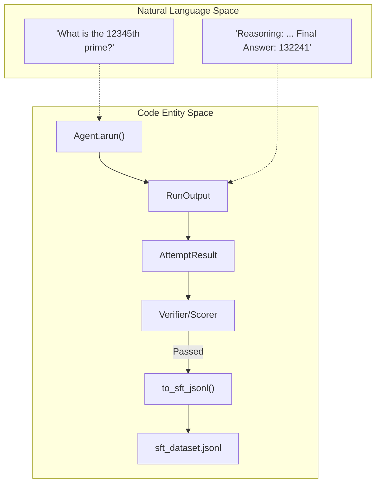
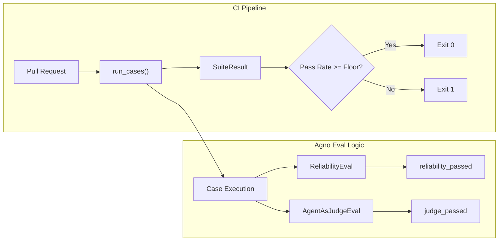

<!-- source: DeepWiki mcp.deepwiki.com · repo agno-agi/agno · page 13.3 Dataset Export and CI Gating · fetched 2026-10-26 -->

# Dataset Export and CI Gating

Relevant source files

The following files were used as context for generating this wiki page:

- [libs/agno/agno/api/evals.py](libs/agno/agno/api/evals.py)
- [libs/agno/agno/api/routes.py](libs/agno/agno/api/routes.py)
- [libs/agno/agno/api/schemas/evals.py](libs/agno/agno/api/schemas/evals.py)
- [libs/agno/agno/api/team.py](libs/agno/agno/api/team.py)
- [libs/agno/agno/environments/__init__.py](libs/agno/agno/environments/__init__.py)
- [libs/agno/agno/environments/_engine.py](libs/agno/agno/environments/_engine.py)
- [libs/agno/agno/eval/accuracy.py](libs/agno/agno/eval/accuracy.py)
- [libs/agno/agno/eval/performance.py](libs/agno/agno/eval/performance.py)
- [libs/agno/agno/eval/reliability.py](libs/agno/agno/eval/reliability.py)
- [libs/agno/agno/eval/suite.py](libs/agno/agno/eval/suite.py)
- [libs/agno/agno/eval/utils.py](libs/agno/agno/eval/utils.py)
- [libs/agno/agno/tools/mcp_toolbox.py](libs/agno/agno/tools/mcp_toolbox.py)
- [libs/agno/tests/integration/teams/test_memory_impact.py](libs/agno/tests/integration/teams/test_memory_impact.py)
- [libs/agno/tests/unit/environments/__init__.py](libs/agno/tests/unit/environments/__init__.py)
- [libs/agno/tests/unit/environments/test_engine.py](libs/agno/tests/unit/environments/test_engine.py)
- [libs/agno/tests/unit/eval/test_accuracy_eval.py](libs/agno/tests/unit/eval/test_accuracy_eval.py)
- [libs/agno/tests/unit/eval/test_performance_eval.py](libs/agno/tests/unit/eval/test_performance_eval.py)
- [libs/agno/tests/unit/eval/test_reliability_eval.py](libs/agno/tests/unit/eval/test_reliability_eval.py)
- [libs/agno/tests/unit/eval/test_suite.py](libs/agno/tests/unit/eval/test_suite.py)
- [libs/agno/tests/unit/tools/test_mcp_toolbox_lifecycle.py](libs/agno/tests/unit/tools/test_mcp_toolbox_lifecycle.py)

The Agno framework provides a robust infrastructure for verifying agent behavior, exporting high-quality interaction datasets for Supervised Fine-Tuning (SFT), and enforcing performance or accuracy floors within Continuous Integration (CI) pipelines. This system bridges the gap between experimental agent development and production-grade reliability by treating agent outputs as measurable data points.

## SFT Dataset Exportation

Agno enables the exportation of agent trajectories into standardized formats suitable for model training. The primary export target is conversational JSONL, which captures the full context of successful agent runs.

### Implementation and Data Flow

The exportation process involves filtering successful trajectories—often defined as those passing specific evaluation criteria—and formatting them for SFT trainers.

1.  **Trajectory Capture**: Every `Agent` or `Team` run generates a `RunOutput` [libs/agno/agno/eval/suite.py:28-28]() or `TeamRunOutput` [libs/agno/agno/eval/suite.py:31-31](). These objects contain the full message history and tool execution evidence.
2.  **Rejection Sampling**: The `agno.environments` subsystem uses a generation loop where a verifier or judge gates which rows enter the dataset [cookbook/data_labeling/_21_rejection_sampling/README.md:1-15](). For example, `basic.py` uses a pure-code verifier to keep only traces whose final answer matches a verified gold [cookbook/data_labeling/_21_rejection_sampling/README.md:22-26]().
3.  **Conversational JSONL**: The `to_sft_jsonl` and `ato_sft_jsonl` exporters [libs/agno/agno/environments/__init__.py:14-14]() map trajectories into conversational formats. Exported rows include provenance such as reasoning traces, judge scores, or pass rates [cookbook/data_labeling/_21_rejection_sampling/README.md:58-70]().

### Natural Language to Code Entity Space: Export Flow

Sources: [libs/agno/agno/environments/_engine.py:48-65](), [libs/agno/agno/environments/environment.py:1-20](), [cookbook/data_labeling/_21_rejection_sampling/README.md:22-33]()

## Evaluation Framework and Scorers

The core of the gating system is the `agno.eval` package and the `agno.environments` engine, which provide specialized classes to score agent performance.

### Key Scorer Classes

| Scorer Class | Purpose | Implementation Detail |
| :--- | :--- | :--- |
| `AgentAsJudgeEval` | LLM-as-a-judge scoring of responses. | Grades against a rubric in `BINARY` or `NUMERIC` mode [libs/agno/agno/eval/suite.py:52-58](). |
| `ReliabilityEval` | Verifies tool call correctness. | Inspects `ToolExecution` evidence to match expected calls [libs/agno/agno/eval/suite.py:87-89](). |
| `CodeScorer` | Programmatic verification. | Executes a Python function to compare `run.content` against `expected` [libs/agno/tests/unit/environments/test_engine.py:157-162](). |

### Rollout Engine
The `_engine.py` module handles isolated execution of agents for evaluation. It uses `_materialize` to deep-copy the agent and disable `cache_response` on the model, ensuring each attempt is a fresh sample rather than a cached replay [libs/agno/agno/environments/_engine.py:75-102]().

Sources: [libs/agno/agno/environments/_engine.py:12-65](), [libs/agno/agno/eval/suite.py:40-109](), [libs/agno/tests/unit/environments/test_engine.py:157-162]()

## CI Gating with Pass-Rate Floors

Agno allows developers to use evaluation suites as quality gates in CI/CD pipelines. The `SuiteResult` [libs/agno/agno/eval/suite.py:44-44]() provides a stable contract for CI consumers.

### Implementation of Gates
1.  **Case Assertions**: A `Case` defines inputs and required checks (criteria or tool calls) [libs/agno/agno/eval/suite.py:61-109](). If a check fails, the `CaseResult` captures the error [libs/agno/agno/eval/suite.py:130-145]().
2.  **Pass Rate Floors**: In `rl_prompt_selection.py`, prompts are filtered based on their `pass_rate` (e.g., `0 < pass_rate < 1` for identifying the "learning zone") [cookbook/data_labeling/_21_rejection_sampling/README.md:31-33]().
3.  **CLI Integration**: The `cli()` and `acli()` functions in `agno.eval.suite` provide a terminal interface for running these gates during development or in automated scripts [libs/agno/agno/eval/suite.py:45-48]().

### Evaluation to CI Pipeline Mapping

Sources: [libs/agno/agno/eval/suite.py:1-48](), [cookbook/data_labeling/_21_rejection_sampling/README.md:31-33]()

## Environment Comparison and Baselines

To detect regressions, Agno supports comparing `Environment` runs against baselines.

1.  **Environment Fingerprinting**: Reproducibility is tracked via fingerprints to ensure comparisons are valid across different runs [libs/agno/agno/environments/__init__.py:8-9]().
2.  **EnvironmentDiff**: The `EnvironmentDiff` class allows for structured comparison between two environment runs, highlighting changes in pass rates or scores [libs/agno/agno/environments/runner.py:15-15]().
3.  **Task Results**: The `TaskResult` captures attempts, durations, and scores for specific tasks, allowing for granular inspection of performance shifts [libs/agno/agno/environments/runner.py:15-15]().

Sources: [libs/agno/agno/environments/__init__.py:1-33](), [libs/agno/agno/environments/runner.py:1-20](), [libs/agno/agno/environments/_engine.py:48-65]()

---

