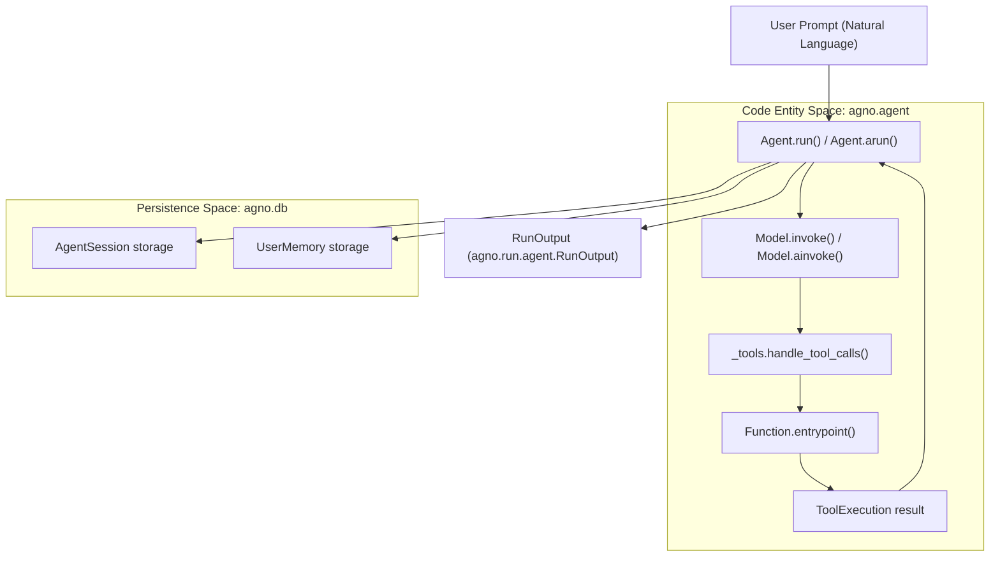
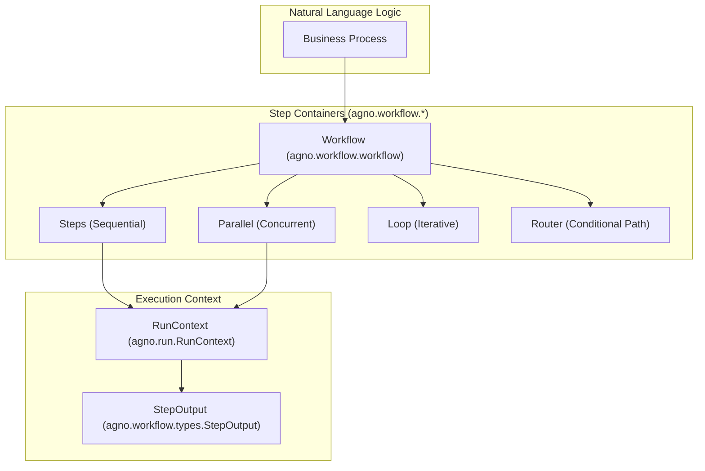

<!-- source: DeepWiki mcp.deepwiki.com · repo agno-agi/agno · page 14 Glossary · fetched 2026-10-26 -->

# Glossary

Relevant source files

The following files were used as context for generating this wiki page:

- [.github/pull_request_template.md](.github/pull_request_template.md)
- [.github/workflows/test_on_release.yml](.github/workflows/test_on_release.yml)
- [CONTRIBUTING.md](CONTRIBUTING.md)
- [README.md](README.md)
- [cookbook/05_agent_os/14_mcp/README.md](cookbook/05_agent_os/14_mcp/README.md)
- [cookbook/05_agent_os/14_mcp/TEST_LOG.md](cookbook/05_agent_os/14_mcp/TEST_LOG.md)
- [cookbook/05_agent_os/14_mcp/server_identity.py](cookbook/05_agent_os/14_mcp/server_identity.py)
- [cookbook/05_agent_os/14_mcp/stateless.py](cookbook/05_agent_os/14_mcp/stateless.py)
- [cookbook/05_agent_os/14_mcp/toolkit_tools.py](cookbook/05_agent_os/14_mcp/toolkit_tools.py)
- [cookbook/05_agent_os/27_public_pages/README.md](cookbook/05_agent_os/27_public_pages/README.md)
- [cookbook/05_agent_os/27_public_pages/TEST_LOG.md](cookbook/05_agent_os/27_public_pages/TEST_LOG.md)
- [cookbook/05_agent_os/27_public_pages/documentation_markdown.py](cookbook/05_agent_os/27_public_pages/documentation_markdown.py)
- [cookbook/05_agent_os/27_public_pages/mcp_domain.py](cookbook/05_agent_os/27_public_pages/mcp_domain.py)
- [cookbook/05_agent_os/27_public_pages/migrate_page_source.py](cookbook/05_agent_os/27_public_pages/migrate_page_source.py)
- [cookbook/05_agent_os/27_public_pages/page_tool_results.py](cookbook/05_agent_os/27_public_pages/page_tool_results.py)
- [cookbook/91_tools/mcp/protocol_mode.py](cookbook/91_tools/mcp/protocol_mode.py)
- [libs/agno/agno/agent/agent.py](libs/agno/agno/agent/agent.py)
- [libs/agno/agno/knowledge/knowledge.py](libs/agno/agno/knowledge/knowledge.py)
- [libs/agno/agno/knowledge/page/__init__.py](libs/agno/agno/knowledge/page/__init__.py)
- [libs/agno/agno/knowledge/page/_commands.py](libs/agno/agno/knowledge/page/_commands.py)
- [libs/agno/agno/knowledge/page/_coordinator.py](libs/agno/agno/knowledge/page/_coordinator.py)
- [libs/agno/agno/knowledge/page/filesystem.py](libs/agno/agno/knowledge/page/filesystem.py)
- [libs/agno/agno/knowledge/page/tools.py](libs/agno/agno/knowledge/page/tools.py)
- [libs/agno/agno/knowledge/page/types.py](libs/agno/agno/knowledge/page/types.py)
- [libs/agno/agno/knowledge/reader/utils/mdx.py](libs/agno/agno/knowledge/reader/utils/mdx.py)
- [libs/agno/agno/models/base.py](libs/agno/agno/models/base.py)
- [libs/agno/agno/models/message.py](libs/agno/agno/models/message.py)
- [libs/agno/agno/models/response.py](libs/agno/agno/models/response.py)
- [libs/agno/agno/os/app.py](libs/agno/agno/os/app.py)
- [libs/agno/agno/os/config.py](libs/agno/agno/os/config.py)
- [libs/agno/agno/os/mcp.py](libs/agno/agno/os/mcp.py)
- [libs/agno/agno/os/mcp_results.py](libs/agno/agno/os/mcp_results.py)
- [libs/agno/agno/os/middleware/mcp_routing.py](libs/agno/agno/os/middleware/mcp_routing.py)
- [libs/agno/agno/os/router.py](libs/agno/agno/os/router.py)
- [libs/agno/agno/os/schema.py](libs/agno/agno/os/schema.py)
- [libs/agno/agno/os/utils.py](libs/agno/agno/os/utils.py)
- [libs/agno/agno/run/agent.py](libs/agno/agno/run/agent.py)
- [libs/agno/agno/run/team.py](libs/agno/agno/run/team.py)
- [libs/agno/agno/team/team.py](libs/agno/agno/team/team.py)
- [libs/agno/agno/tools/reasoning.py](libs/agno/agno/tools/reasoning.py)
- [libs/agno/agno/utils/events.py](libs/agno/agno/utils/events.py)
- [libs/agno/agno/utils/schema.py](libs/agno/agno/utils/schema.py)
- [libs/agno/pyproject.toml](libs/agno/pyproject.toml)
- [libs/agno/tests/integration/agent/test_event_streaming.py](libs/agno/tests/integration/agent/test_event_streaming.py)
- [libs/agno/tests/integration/knowledge/conftest.py](libs/agno/tests/integration/knowledge/conftest.py)
- [libs/agno/tests/integration/knowledge/test_page_storage.py](libs/agno/tests/integration/knowledge/test_page_storage.py)
- [libs/agno/tests/integration/teams/test_event_streaming.py](libs/agno/tests/integration/teams/test_event_streaming.py)
- [libs/agno/tests/integration/test_basic.py](libs/agno/tests/integration/test_basic.py)
- [libs/agno/tests/integration/test_os_basic.py](libs/agno/tests/integration/test_os_basic.py)
- [libs/agno/tests/unit/knowledge/test_page_contract.py](libs/agno/tests/unit/knowledge/test_page_contract.py)
- [libs/agno/tests/unit/knowledge/test_page_tool_results.py](libs/agno/tests/unit/knowledge/test_page_tool_results.py)
- [libs/agno/tests/unit/models/test_message.py](libs/agno/tests/unit/models/test_message.py)
- [libs/agno/tests/unit/os/test_mcp_routing.py](libs/agno/tests/unit/os/test_mcp_routing.py)
- [libs/agno/tests/unit/os/test_mcp_run_results.py](libs/agno/tests/unit/os/test_mcp_run_results.py)
- [libs/agno/tests/unit/os/test_mcp_server.py](libs/agno/tests/unit/os/test_mcp_server.py)
- [libs/agno/tests/unit/os/test_mcp_surface_v2.py](libs/agno/tests/unit/os/test_mcp_surface_v2.py)
- [libs/agno/tests/unit/reader/test_mdx_normalize.py](libs/agno/tests/unit/reader/test_mdx_normalize.py)
- [libs/agno/tests/unit/run/test_run_input.py](libs/agno/tests/unit/run/test_run_input.py)
- [scripts/run_model_tests.sh](scripts/run_model_tests.sh)

This glossary defines codebase-specific terms, jargon, and domain concepts used within the Agno framework. It serves as a technical reference for engineers to understand the mapping between high-level concepts and their implementation in the code.

## 1. Core Architecture Terms

### AgentOS
The production runtime layer of Agno. It is a FastAPI-based application that serves agents, teams, and workflows as scalable REST and WebSocket endpoints.
*   **Implementation**: `AgentOS` class in [libs/agno/agno/os/app.py:19-19]().
*   **Key Function**: The OS manages component registration and API routing via routers like `get_agent_router` [libs/agno/agno/os/app.py:52-52]() and `get_workflow_router` [libs/agno/agno/os/app.py:71-71]().
*   **Lifespan Management**: Handles database initialization [libs/agno/agno/os/app.py:22-22](), telemetry emission [libs/agno/agno/os/app.py:122-134](), and background task draining [libs/agno/agno/os/app.py:137-166]() during the application lifecycle.

### Framework
The SDK layer used to define the logic of AI systems. It includes the base classes for Agents, Teams, Workflows, and their associated components like Tools and Knowledge.
*   **Implementation**: Located primarily in `libs/agno/agno/agent/`, `libs/agno/agno/team/`, and `libs/agno/agno/workflow/`.

### Control Plane
The management layer (hosted at `os.agno.com`) that connects to running `AgentOS` instances for monitoring, tracing, and human-in-the-loop interactions.
*   **Source**: [README.md:21-23]().

Sources:
[README.md:21-23]()
[libs/agno/agno/os/app.py:19-19]()
[libs/agno/agno/os/app.py:22-22]()
[libs/agno/agno/os/app.py:52-52]()
[libs/agno/agno/os/app.py:71-71]()
[libs/agno/agno/os/app.py:122-134]()
[libs/agno/agno/os/app.py:137-166]()

---

## 2. Execution Entities

### Agent
A stateful entity that combines a `Model` with `Tools`, `Memory`, and `Knowledge` to perform tasks.
*   **Implementation**: `Agent` class in [libs/agno/agno/agent/agent.py:74-74]().
*   **Data Flow**: The agent processes a `Message` list [libs/agno/agno/models/message.py:1-1](), invokes a `Model` [libs/agno/agno/agent/agent.py:77-77](), handles `ToolExecution` [libs/agno/agno/models/response.py:44-44](), and returns a `RunOutput` [libs/agno/agno/run/agent.py:60-60]().

### Team
A collaborative group of agents. It can operate in different modes like `route` (leader delegates to one member), `broadcast`, or `tasks`.
*   **Implementation**: `Team` class in [libs/agno/agno/team/team.py:81-81]().
*   **Orchestration**: Managed via `TeamMode` [libs/agno/agno/team/mode.py:1-1]() and flags like `delegate_to_all_members` [libs/agno/agno/team/team.py:118-118]().

### Workflow
A pipeline-based execution model for multi-step processes. Unlike Agents which are autonomous, Workflows follow defined `Steps`.
*   **Implementation**: `Workflow` class in [libs/agno/agno/workflow/workflow.py:194-206]().
*   **Step Types**: Includes `Step`, `Steps`, `Parallel`, `Loop`, `Condition`, and `Router` [libs/agno/agno/workflow/workflow.py:169-176]().

### Learning Machine
A specialized system that enables agents to extract and persist knowledge from interactions into various "stores" (User Profile, Entity Memory, etc.).
*   **Implementation**: `LearningMachine` class in [libs/agno/agno/agent/agent.py:43-43]().
*   **Integration**: Attached to Agents via the `learning_machine` attribute [libs/agno/agno/agent/agent.py:43-43]().

Sources:
[libs/agno/agno/agent/agent.py:43-43]()
[libs/agno/agno/agent/agent.py:74-74]()
[libs/agno/agno/agent/agent.py:77-77]()
[libs/agno/agno/models/message.py:1-1]()
[libs/agno/agno/models/response.py:44-44]()
[libs/agno/agno/run/agent.py:60-60]()
[libs/agno/agno/team/mode.py:1-1]()
[libs/agno/agno/team/team.py:81-81]()
[libs/agno/agno/team/team.py:118-118]()
[libs/agno/agno/workflow/workflow.py:169-176]()
[libs/agno/agno/workflow/workflow.py:194-206]()

---

## 3. Communication and Data Space

### RunOutput
The standardized response object returned after an execution. It contains the final content, metrics, and session information.
*   **Implementation**: `RunOutput` in [libs/agno/agno/run/agent.py:60-60](), `TeamRunOutput` in [libs/agno/agno/run/team.py:53-53](), and `WorkflowRunOutput` in [libs/agno/agno/run/workflow.py:106-106]().

### RunEvent
An event emitted during streaming execution (e.g., `RunStarted`, `ToolCallStarted`, `ModelResponseCompleted`).
*   **Implementation**: `RunEvent` base class in [libs/agno/agno/run/agent.py:59-59]() and `WorkflowRunEvent` in [libs/agno/agno/run/workflow.py:105-105]().

### Session
The persistence boundary for a conversation or process. Identified by a `session_id`.
*   **Implementation**: `AgentSession` [libs/agno/agno/session/agent.py:59-59](), `TeamSession` [libs/agno/agno/session/team.py:60-60](), and `WorkflowSession` [libs/agno/agno/session/workflow.py:110-110]().

### Knowledge Base
A retrieval-augmented generation (RAG) component that provides agents with external context from vector databases or remote files.
*   **Protocol**: `KnowledgeProtocol` [libs/agno/agno/agent/agent.py:40-40]().
*   **Implementation**: `Knowledge` class [libs/agno/agno/knowledge/knowledge.py:46-46]().

Sources:
[libs/agno/agno/agent/agent.py:40-40]()
[libs/agno/agno/knowledge/knowledge.py:46-46]()
[libs/agno/agno/run/agent.py:59-59]()
[libs/agno/agno/run/agent.py:60-60]()
[libs/agno/agno/run/team.py:53-53]()
[libs/agno/agno/run/workflow.py:105-105]()
[libs/agno/agno/run/workflow.py:106-106]()
[libs/agno/agno/session/agent.py:59-59]()
[libs/agno/agno/session/team.py:60-60]()
[libs/agno/agno/session/workflow.py:110-110]()

---

## 4. Technical Diagrams

### Natural Language to Code Entity Mapping: Agent Execution
This diagram bridges the gap between a user request and the specific code entities that handle the lifecycle of an Agent run.

Sources:
[libs/agno/agno/agent/agent.py:74-172]()
[libs/agno/agno/models/base.py:134-184]()
[libs/agno/agno/run/agent.py:58-62]()

### Workflow Pipeline Architecture
This diagram illustrates how a Workflow coordinates complex logic through various Step containers.

Sources:
[libs/agno/agno/workflow/workflow.py:169-176]()
[libs/agno/agno/workflow/step.py:181-203]()
[libs/agno/agno/workflow/types.py:141-141]()

---

## 5. Domain Specific Jargon

| Term | Definition | Code Pointer |
| :--- | :--- | :--- |
| **MCP** | Model Context Protocol. A standard for agents to connect to external tool servers. | [libs/agno/agno/os/mcp.py:1-1](), [libs/agno/agno/tools/function.py:31-31]() |
| **HITL** | Human-in-the-Loop. Execution patterns that pause for user approval or input. | [libs/agno/agno/workflow/step.py:68-68]() |
| **Agentic RAG** | A pattern where the agent decides which filters or search parameters to use for retrieval. | [libs/agno/agno/agent/agent.py:161-162]() |
| **Tool Call Limit** | Safety mechanism to prevent infinite loops in autonomous agent reasoning. | [libs/agno/agno/agent/agent.py:153-154]() |
| **Structured Output** | Forcing model responses into a specific Pydantic schema or JSON format. | [libs/agno/agno/models/base.py:149-151]() |
| **A2A** | Agent-to-Agent protocol. Standards for cross-OS agent communication. | [libs/agno/agno/os/app.py:75-75]() |
| **Checkpointing** | Persistence strategy for run state (e.g., after each tool batch). | [libs/agno/agno/agent/agent.py:138-144]() |
| **Fallback Models** | Secondary models used if the primary model fails. | [libs/agno/agno/agent/agent.py:78-81]() |
| **Result Offloading** | Managing large tool outputs by storing them externally rather than in context. | [libs/agno/agno/agent/agent.py:54-55]() |

Sources:
[libs/agno/agno/agent/agent.py:54-55]()
[libs/agno/agno/agent/agent.py:78-81]()
[libs/agno/agno/agent/agent.py:138-144]()
[libs/agno/agno/agent/agent.py:153-154]()
[libs/agno/agno/agent/agent.py:161-162]()
[libs/agno/agno/models/base.py:149-151]()
[libs/agno/agno/os/app.py:75-75]()
[libs/agno/agno/os/mcp.py:1-1]()
[libs/agno/agno/tools/function.py:31-31]()
[libs/agno/agno/workflow/step.py:68-68]()