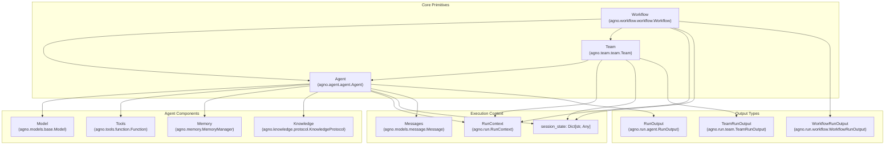
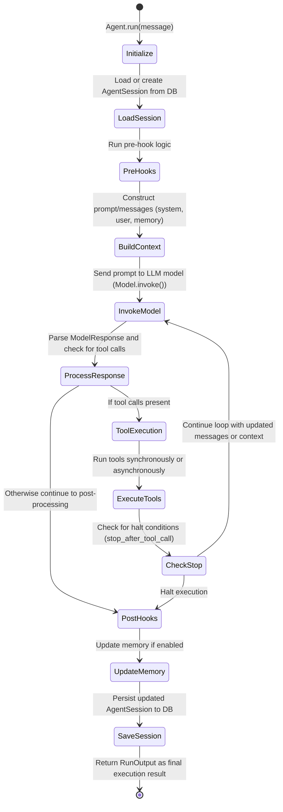
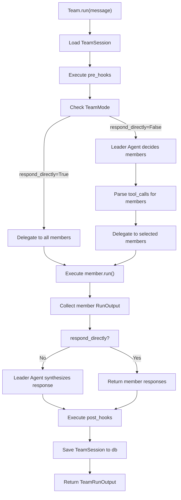
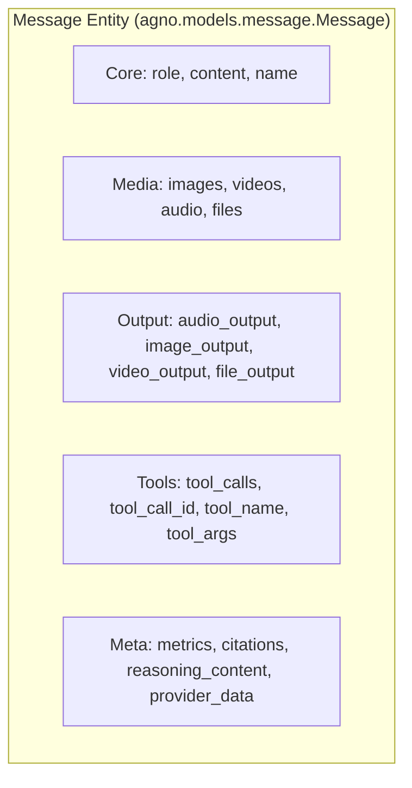

<!-- source: DeepWiki mcp.deepwiki.com · repo agno-agi/agno · page 2 Core Framework · fetched 2026-10-26 -->

# Core Framework

Relevant source files

The following files were used as context for generating this wiki page:

- [.github/workflows/test_on_release.yml](.github/workflows/test_on_release.yml)
- [libs/agno/agno/agent/agent.py](libs/agno/agno/agent/agent.py)
- [libs/agno/agno/models/base.py](libs/agno/agno/models/base.py)
- [libs/agno/agno/models/message.py](libs/agno/agno/models/message.py)
- [libs/agno/agno/models/response.py](libs/agno/agno/models/response.py)
- [libs/agno/agno/run/agent.py](libs/agno/agno/run/agent.py)
- [libs/agno/agno/run/team.py](libs/agno/agno/run/team.py)
- [libs/agno/agno/team/team.py](libs/agno/agno/team/team.py)
- [libs/agno/agno/utils/events.py](libs/agno/agno/utils/events.py)
- [libs/agno/pyproject.toml](libs/agno/pyproject.toml)
- [libs/agno/tests/integration/agent/test_event_streaming.py](libs/agno/tests/integration/agent/test_event_streaming.py)
- [libs/agno/tests/integration/teams/test_event_streaming.py](libs/agno/tests/integration/teams/test_event_streaming.py)
- [libs/agno/tests/integration/test_basic.py](libs/agno/tests/integration/test_basic.py)
- [libs/agno/tests/integration/test_os_basic.py](libs/agno/tests/integration/test_os_basic.py)
- [libs/agno/tests/unit/models/test_message.py](libs/agno/tests/unit/models/test_message.py)
- [libs/agno/tests/unit/run/test_run_input.py](libs/agno/tests/unit/run/test_run_input.py)
- [scripts/run_model_tests.sh](scripts/run_model_tests.sh)

## Purpose and Scope

The Core Framework is the foundational layer of the Agno SDK designed to provide composable building blocks and execution models that facilitate the construction of sophisticated AI systems. It offers core abstractions—Agents, Teams, and Workflows—that combine language models, tools, memory, and knowledge within a shared infrastructure. This infrastructure manages session state, message flows, event streaming, and persistent execution context, enabling reliable and observable AI agent orchestration at scale.

This page introduces the Core Framework overview at a high level. Each major component and concept has a dedicated child page covering detailed design, configuration, and usage:

- Agent System [#2.1]
- Team Orchestration [#2.2]
- Workflow System [#2.3]
- Run Output and Events [#2.4]
- Message and Media Handling [#2.5]
- Event Streaming System [#2.6]
- Session Management [#2.7]
- Memory and Learning Systems [#2.8]
- Result Offloading and FileSystem [#2.9]
- Reasoning and Skills [#2.10]

For runtime concerns, model provider integration, tooling, and knowledge management, see their respective sections in the wider documentation.

---

## Execution Primitives Overview

The Core Framework’s execution model centers on three main composable primitives:

- **Agent**: Encapsulates a single AI agent with a model, tools, memory, and optional knowledge bases.
- **Team**: Orchestrates a collection of Agents or nested Teams, coordinating their execution with configurable modes.
- **Workflow**: Manages multi-step orchestrations, combining Agents, Teams, and Callables in sequences, parallel tasks, conditionals, loops, or routers.

All primitives share a common core infrastructure centered around the `RunContext` which manages run metadata, state, and cancellation. They use session-based persistence to maintain and mutate `session_state` for long-lived interactions.

The outputs of all primitives conform to well-defined data classes (`RunOutput`, `TeamRunOutput`, `WorkflowRunOutput`) that encapsulate the final content, intermediate events, metrics, and extended media.

**Sources:**  
[libs/agno/agno/agent/agent.py:74-180](), [libs/agno/agno/team/team.py:81-180](), [libs/agno/agno/run/agent.py:38-57](), [libs/agno/agno/run/team.py:27-44]()

---

## Agent System

### Agent Class Overview

At the core, the `Agent` class ([libs/agno/agno/agent/agent.py:74-180]()) represents an executable AI agent combining several key attributes:

| Aspect               | Key Attributes                                                      | Description                             |
|----------------------|-------------------------------------------------------------------|---------------------------------------|
| **Model**            | `model: Optional[Model]`                                           | Primary LLM model instance             |
| **Fallbacks**        | `fallback_models`, `fallback_config`                              | Alternative models on failure          |
| **Identity**         | `id`, `name`, `user_id`                                           | Agent and user scoping identifiers     |
| **Session**          | `session_id`, `session_state`, `cache_session`                    | Session lifecycle and context state    |
| **Tools**            | `tools`                                                           | Callable functions used by the agent   |
| **Knowledge**        | `knowledge`, `knowledge_filters`                                  | Retrieval-augmented generation layers  |
| **Memory**           | `memory_manager`, `enable_agentic_memory`                         | Long-term memory management            |
| **History**          | `add_history_to_context`, `num_history_runs`                      | Prior interaction inclusion             |
| **Checkpointing**    | `checkpoint`                                                      | Run persistence strategy                |

### Agent Run Lifecycle

The agent’s execution typically follows these high-level stages:

**Core Agent methods:**

- `run()` — Synchronous interface  
- `arun()` — Asynchronous interface  
- Streaming variants: `run_stream()`, `arun_stream()` for reactive output  

For detailed usage, parameters, run cancellation, fallback models, and streaming output, see [Agent System](#2.1).

**Sources:**  
[libs/agno/agno/agent/agent.py:74-210](), [libs/agno/agno/models/response.py:113-162](), [libs/agno/agno/models/base.py:134-188]()

---

## Team Orchestration

### Team Class Overview

The `Team` class ([libs/agno/agno/team/team.py:81-180]()) manages a collection of members, which can be either `Agent` instances or nested `Team`s. Teams provide a higher level of orchestration with configurable coordination modes.

| Aspect            | Key Attributes                                                   | Description                                  |
|-------------------|-----------------------------------------------------------------|----------------------------------------------|
| **Members**       | `members: List[Union[Agent, Team]]`                            | Agents or nested teams that form the group   |
| **Leader Model**  | `model`, `fallback_models`, `fallback_config`                  | Model used by responsible leader/aggregator  |
| **Execution Mode**| `mode`, `respond_directly`, `delegate_to_all_members`          | Behavior of task delegation and response     |
| **Context Sharing**| `share_member_interactions`, `add_team_history_to_members`    | How interactions propagate across members    |
| **Session**       | `session_id`, `session_state`                                  | Team-scoped session persistence               |

### Team Execution Flow

Team execution can be summarized as:

Teams use the leader agent to coordinate member assignments, gather responses, and synthesize team output unless direct delegation mode is enabled.

For advanced team settings, member lifecycle management, multi-member delegation, and shared context patterns, see [Team Orchestration](#2.2).

**Sources:**  
[libs/agno/agno/team/team.py:81-180](), [libs/agno/agno/run/team.py:28-128]()

---

## Workflow System

### Workflow Class Overview

The `Workflow` class enables orchestrating multi-step processes combining Agents, Teams, and other callable steps with complex execution semantics like sequential steps, parallel execution, conditionals, loops, and routing.

Workflows:

- Manage cross-step dependencies, running steps conditionally or iteratively
- Propagate `session_state` across steps for persistent context
- Support HITL (Human-in-the-Loop) interactions with requires confirmation or user input
- Facilitate complex pipelines and meta-workflows

Steps can be composed as:

- **Step**: Individual unit of work (Agent, Team, or function)
- **Steps**: Sequential container of steps
- **Parallel**: Parallel execution of multiple steps
- **Loop**: Iterative execution
- **Condition**: Branching
- **Router**: Dynamic route selection based on inputs or context

For the rich Step composition API, context management, data passing, and HITL patterns, see [Workflow System](#2.3).

**Sources:**  
[libs/agno/agno/run/workflow.py:1-50](), [libs/agno/agno/models/base.py:49-49]()

---

## Run Output and Events

### RunOutput and Event Models

Every execution primitive returns a well-defined output object encapsulating the final and intermediate state:

| Primitive | Output Class | Description |
|-----------|--------------|-------------|
| Agent     | `RunOutput` ([libs/agno/agno/run/agent.py:201-248]()) | Includes final content, messages, metrics, references, and event stream |
| Team      | `TeamRunOutput` ([libs/agno/agno/run/team.py:186-231]()) | Member responses, team-synthesized content, detailed events |
| Workflow  | `WorkflowRunOutput` ([libs/agno/agno/run/workflow.py]) | Step-wise run outputs, combined results, and workflow state |

Run events stream granular updates for real-time observability and fine control:

- `RunStarted`, `RunCompleted`, `RunError`, `RunCancelled`
- `ToolCallStarted`, `ToolCallCompleted`, `ToolCallError`
- `ModelRequestStarted`, `ModelRequestCompleted`
- `ReasoningStarted`, `ReasoningStep`, `ReasoningCompleted`
- `SessionSummaryStarted`, `SessionSummaryCompleted`
- Custom domain or messaging events

For event types and how to consume event streams, see [Run Output and Events](#2.4).

**Sources:**  
[libs/agno/agno/run/agent.py:144-183](), [libs/agno/agno/run/team.py:131-172](), [libs/agno/agno/models/response.py:12-24]()

---

## Message and Media Handling

### Message Class

Core communication is done through the `Message` class ([libs/agno/agno/models/message.py:56-127]()) which supports:

- Roles: `system`, `user`, `assistant`, and `tool`
- Multimodal content: text, images, videos, audio, files
- Tool call metadata and results
- Reasoning and citations for RAG
- Provider data for API-specific tokens/usage

The media subsystem ([libs/agno/agno/media.py]()) abstracts file payloads and references, enabling seamless multimodal input/output flows.

For media format conversions, content embedding, and propagation through Agents, Teams, and Workflows, see [Message and Media Handling](#2.5).

**Sources:**  
[libs/agno/agno/models/message.py:56-127](), [libs/agno/agno/models/base.py:41-41]()

---

## Event Streaming System

The Core Framework supports sophisticated event streaming for live monitoring and incremental consumption of run output, crucial for UI responsiveness and control.

Event enums:

- Agent: `RunEvent` ([libs/agno/agno/run/agent.py:144-183]())
- Team: `TeamRunEvent` ([libs/agno/agno/run/team.py:131-172]())
- Workflow: likewise configurable

Common event categories:

- Lifecycle: `run_started`, `run_completed`, `run_cancelled`, `run_error`
- Model requests: `model_request_started`, `model_request_completed`
- Tool executions: `tool_call_started`, `tool_call_completed`, `tool_call_error`
- Reasoning: `reasoning_started`, `reasoning_step`, `reasoning_completed`
- Session summaries and checkpoints

Event streams support Server Sent Events (SSE) format, allowing real-time progress updates to clients.

For event emission, filtering, and consumption mechanisms, see [Event Streaming System](#2.6).

**Sources:**  
[libs/agno/agno/run/agent.py:144-183](), [libs/agno/agno/run/team.py:131-172](), [libs/agno/agno/models/response.py:12-24]()

---

## Session and Memory Systems

### Session Management

Sessions unify user interaction history, state persistence, and multi-run continuity:

- `AgentSession`, `TeamSession`, `WorkflowSession` provide scoped context stores
- Sessions are identified by `session_id` and optionally scoped by `user_id`
- Run history, session state, and summaries are persisted in pluggable databases via `BaseDb` interface ([libs/agno/agno/db/base.py:35-36]())

### Memory and Learning

- `MemoryManager` maintains user or entity-specific memories, queryable and injectable into context with history controls like `add_history_to_context` and `num_history_runs`
- LearningMachine subsystem enables agents to learn from every interaction, coordinating multiple memory and profile store types for enhanced personalization and capability growth

For detailed APIs and example usage, see [Session Management](#2.7) and [Memory and Learning Systems](#2.8).

**Sources:**  
[libs/agno/agno/agent/agent.py:121-154](), [libs/agno/agno/db/base.py:35-36](), [libs/agno/agno/memory/manager.py:1-50]()

---

This concludes the high-level overview of the Core Framework layer, providing the critical building blocks and infrastructure mechanisms enabling the construction, persistence, orchestration, and observability of Agents, Teams, and Workflows in the Agno SDK.

For deeper exploration of each topic, please consult the linked child pages.

---

