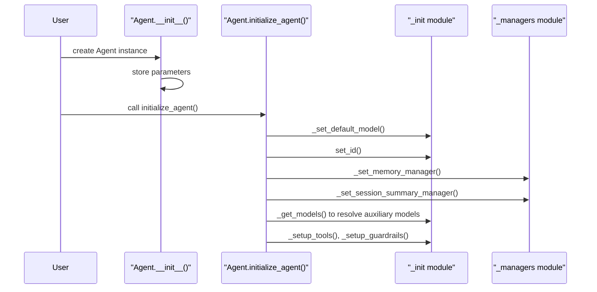
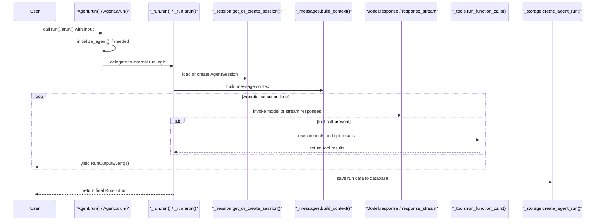

<!-- source: DeepWiki mcp.deepwiki.com · repo agno-agi/agno · page 2.1 Agent System · fetched 2026-10-26 -->

# Agent System

<details>
<summary>Relevant source files</summary>

The following files were used as context for generating this wiki page:

- [.github/workflows/test_on_release.yml](.github/workflows/test_on_release.yml)
- [libs/agno/agno/agent/_init.py](libs/agno/agno/agent/_init.py)
- [libs/agno/agno/agent/_tools.py](libs/agno/agno/agent/_tools.py)
- [libs/agno/agno/agent/agent.py](libs/agno/agno/agent/agent.py)
- [libs/agno/agno/models/base.py](libs/agno/agno/models/base.py)
- [libs/agno/agno/models/message.py](libs/agno/agno/models/message.py)
- [libs/agno/agno/models/response.py](libs/agno/agno/models/response.py)
- [libs/agno/agno/run/agent.py](libs/agno/agno/run/agent.py)
- [libs/agno/agno/run/team.py](libs/agno/agno/run/team.py)
- [libs/agno/agno/team/_init.py](libs/agno/agno/team/_init.py)
- [libs/agno/agno/team/_tools.py](libs/agno/agno/team/_tools.py)
- [libs/agno/agno/team/team.py](libs/agno/agno/team/team.py)
- [libs/agno/agno/tools/apify.py](libs/agno/agno/tools/apify.py)
- [libs/agno/agno/tools/dalle.py](libs/agno/agno/tools/dalle.py)
- [libs/agno/agno/utils/agent.py](libs/agno/agno/utils/agent.py)
- [libs/agno/agno/utils/events.py](libs/agno/agno/utils/events.py)
- [libs/agno/pyproject.toml](libs/agno/pyproject.toml)
- [libs/agno/tests/integration/agent/test_agent_convenience_functions.py](libs/agno/tests/integration/agent/test_agent_convenience_functions.py)
- [libs/agno/tests/integration/agent/test_event_streaming.py](libs/agno/tests/integration/agent/test_event_streaming.py)
- [libs/agno/tests/integration/teams/test_event_streaming.py](libs/agno/tests/integration/teams/test_event_streaming.py)
- [libs/agno/tests/integration/teams/test_team_convenience_functions.py](libs/agno/tests/integration/teams/test_team_convenience_functions.py)
- [libs/agno/tests/integration/test_basic.py](libs/agno/tests/integration/test_basic.py)
- [libs/agno/tests/integration/test_os_basic.py](libs/agno/tests/integration/test_os_basic.py)
- [libs/agno/tests/unit/agent/test_get_last_run_output_subclasses.py](libs/agno/tests/unit/agent/test_get_last_run_output_subclasses.py)
- [libs/agno/tests/unit/agent/test_team_tool_propagation.py](libs/agno/tests/unit/agent/test_team_tool_propagation.py)
- [libs/agno/tests/unit/models/test_message.py](libs/agno/tests/unit/models/test_message.py)
- [libs/agno/tests/unit/run/test_run_input.py](libs/agno/tests/unit/run/test_run_input.py)
- [libs/agno/tests/unit/team/test_get_tool_names.py](libs/agno/tests/unit/team/test_get_tool_names.py)
- [libs/agno/tests/unit/test_learning_machine.py](libs/agno/tests/unit/test_learning_machine.py)
- [libs/agno/tests/unit/tools/test_tool_schema_cache.py](libs/agno/tests/unit/tools/test_tool_schema_cache.py)
- [scripts/run_model_tests.sh](scripts/run_model_tests.sh)

</details>


## Purpose and Scope

This page documents the `Agent` class, which is the primary execution primitive in Agno for autonomous, tool-using LLM agents. An Agent wraps a language model with tools, memory, knowledge bases, and configurable execution settings to create a reusable AI component.

For multi-agent collaboration, see [Team Orchestration](#2.2). For deterministic step-based orchestration, see [Workflow System](#2.3). For message handling details, see [Message and Media Handling](#2.5).

**Sources:** [libs/agno/agno/agent/agent.py:73-430]()

---

## Agent Class Architecture

The `Agent` class is a dataclass defined at [libs/agno/agno/agent/agent.py:73-430]() with over 100 configuration attributes organized into logical groups.

**Agent Class Structure Diagram**

```mermaid
graph TB
    Agent["Agent<br/>@dataclass(init=False)<br/>libs/agno/agno/agent/agent.py:73"]
    
    subgraph "Core Dependencies"
        model["model: Optional[Model]<br/>Line 76"]
        fallback_models["fallback_models: Optional[List[Union[Model, str]]]<br/>Line 78"]
        fallback_config["fallback_config: Optional[FallbackConfig]<br/>Line 80"]
        db["db: Optional[Union[BaseDb, AsyncBaseDb]]<br/>Line 138"]
        knowledge["knowledge: Optional[KnowledgeProtocol/Callable]<br/>Line 159"]
    end
    
    subgraph "Execution Components"
        tools["tools: Optional[List[Union[Toolkit, Callable, Function, Dict]]]<br/>Line 180"]
        pre_hooks["pre_hooks: Optional[List[Union[Callable, BaseGuardrail, BaseEval]]]<br/>Line 278"]
        post_hooks["post_hooks: Optional[List[Union[Callable, BaseGuardrail, BaseEval]]]<br/>Line 280"]
        memory_manager["memory_manager: Optional[MemoryManager]<br/>Line 125"]
        session_summary_manager["session_summary_manager: Optional[SessionSummaryManager]<br/>Line 113"]
        guardrails["guardrails: Optional[List[BaseGuardrail]]<br/>Line 268"]
        skills["skills: Optional[Skills]<br/>Line 284"]
    end
    
    subgraph "State Management"
        session_id["session_id: Optional[str]<br/>Line 93"]
        session_state["session_state: Optional[Dict]<br/>Line 94"]
        add_session_state_to_context["add_session_state_to_context: bool<br/>Line 96"]
        enable_agentic_state["enable_agentic_state: bool<br/>Line 98"]
        overwrite_db_session_state["overwrite_db_session_state: bool<br/>Line 100"]
        cache_session["cache_session: bool<br/>Line 102"]
    end
    
    subgraph "Memory and Learning"
        enable_agentic_memory["enable_agentic_memory: bool<br/>Line 130"]
        update_memory_on_run["update_memory_on_run: bool<br/>Line 131"]
        add_memories_to_context["add_memories_to_context: Optional[bool]<br/>Line 134"]
    end

    subgraph "Run History and Output"
        add_history_to_context["add_history_to_context: bool<br/>Line 149"]
        num_history_runs["num_history_runs: Optional[int]<br/>Line 151"]
        output_schema["output_schema: Optional[Type[BaseModel]]<br/>Line 291"]
        structured_outputs["structured_outputs: bool<br/>Line 304"]
        parse_response["parse_response: bool<br/>Line 302"]
        use_json_mode["use_json_mode: bool<br/>Line 306"]
    end
    
    subgraph "Execution Options"
        stream["stream: bool<br/>Line 319"]
        stream_events["stream_events: bool<br/>Line 321"]
        store_events["store_events: bool<br/>Line 324"]
        events_to_skip["events_to_skip: Optional[Set[str]]<br/>Line 326"]
        checkpoint["checkpoint: Optional[Literal['runs', 'tool-batch', 'tools']]<br/>Line 144"]
    end
    
    subgraph "Other"
        user_id["user_id: Optional[str]<br/>Line 89"]
        name["name: Optional[str]<br/>Line 82"]
        id_field["id: Optional[str]<br/>Line 85"]
        description["description: Optional[str]<br/>Line 281"]
        instructions["instructions: Optional[Union[str, List[str], Callable]]<br/>Line 282"]
    end
    
    Agent --> model
    Agent --> fallback_models
    Agent --> fallback_config
    Agent --> db
    Agent --> knowledge
    Agent --> tools
    Agent --> pre_hooks
    Agent --> post_hooks
    Agent --> memory_manager
    Agent --> session_summary_manager
    Agent --> guardrails
    Agent --> skills
    Agent --> session_id
    Agent --> session_state
    Agent --> add_session_state_to_context
    Agent --> enable_agentic_state
    Agent --> overwrite_db_session_state
    Agent --> cache_session
    Agent --> enable_agentic_memory
    Agent --> update_memory_on_run
    Agent --> add_memories_to_context
    Agent --> add_history_to_context
    Agent --> num_history_runs
    Agent --> output_schema
    Agent --> structured_outputs
    Agent --> parse_response
    Agent --> use_json_mode
    Agent --> stream
    Agent --> stream_events
    Agent --> store_events
    Agent --> events_to_skip
    Agent --> checkpoint
    Agent --> user_id
    Agent --> name
    Agent --> id_field
    Agent --> description
    Agent --> instructions
```



The class provides a comprehensive structure to manage model invocation, tool integrations, session and memory state, fallback models, knowledge integration, and output formatting.

**Sources:** [libs/agno/agno/agent/agent.py:73-430]()

---

## Initialization and Configuration

### Basic Initialization

The `Agent` class is initialized with multiple optional parameters to set up models, tools, session state, memory, knowledge, guardrails, and other configurations.

```python
from agno.agent import Agent
from agno.models.openai import OpenAIChat

agent = Agent(
    model=OpenAIChat(id="gpt-4o"),
    name="My Agent",
    description="An agent that helps with tasks",
    instructions=["Be helpful", "Be concise"],
    tools=[...],  # List of tools or toolkits
    memory_manager=MemoryManager(...),
    knowledge=MyKnowledgeBase(),
    fallback_models=[OpenAIChat(id="gpt-4o-mini")],
    output_schema=MyResponseSchema,
)
```

The constructor only sets attributes; actual resource resolution and component wiring occur lazily when `initialize_agent()` is called prior to the first run.

The `initialize_agent()` method performs these key steps:

- Sets default model if none provided.
- Generates a unique `id` if not set.
- Resolves and initializes memory managers, session summary managers.
- Resolves auxiliary models (`reasoning_model`, `parser_model`, `output_model`).
- Processes tools, guardrails, skills, and learning components.
- Sets up checkpoint policy and telemetry configuration.

This method is annotated at [libs/agno/agno/agent/agent.py:720-810]().



**Sources:** [libs/agno/agno/agent/agent.py:433-692](), [libs/agno/agno/agent/agent.py:720-810](), [libs/agno/agno/agent/_init.py]()

### Model Configuration and Fallbacks

The primary model is expected to be an instance of `Model` or a recognized model string resolved to one. `fallback_models` allows specifying a prioritized list of models to retry on failure.

Fallback configuration (`fallback_config`) allows advanced routing for specific error types during model invocation.

Model retry behavior is supported by the base `Model` class, which implements retries and optional retry with guidance instructions to recover from common provider errors.

Example usage:

```python
agent = Agent(
    model=OpenAIChat(id="gpt-4o"),
    fallback_models=[OpenAIChat(id="gpt-4o-mini"), "anthropic:claude-3-haiku"],
    fallback_config=my_fallback_config,
)
```

If the main model invocation fails, Agno tries fallback models in order, optionally applying error-specific fallback routing.

**Sources:** [libs/agno/agno/agent/agent.py:76-81](), [libs/agno/agno/agent/_init.py](), [libs/agno/agno/models/base.py:176-187]()

---

## Execution Lifecycle

### Run Methods

The Agent class supports both synchronous and asynchronous execution, with streaming support.

Methods:

- `run()` – synchronous invocation
- `arun()` – asynchronous invocation

Both accept arguments such as:

- The input prompt (`message`)
- Flags for streaming (`stream`), streaming events (`stream_events`)
- Configuration for output schema parsing
- Session and user context management
- Cancellation token and telemetry flags

The methods return either a `RunOutput` or an `AsyncIterator[RunOutputEvent]` depending on input flags.

**Usage example:**

```python
# Synchronous call
output = agent.run("Hello!")

# Asynchronous call with streaming
async for event in agent.arun("Hello!", stream=True, stream_events=True):
    print(event)
```

Both `run()` and `arun()` delegate to internal implementations in `agno.agent._run` ([libs/agno/agno/agent/_run.py]()) for detailed execution logic handling:

- Session management
- Context construction
- Model invocation
- Tool call execution
- Streaming event generation
- Result capturing and persistence

**Sources:** [libs/agno/agno/agent/agent.py:892-1113](), [libs/agno/agno/agent/agent.py:1115-1336](), [libs/agno/agno/agent/_run.py]()

### Execution Flow Diagram

**Agent.run() Execution Flow**



This flow enables rich streaming of intermediate outputs and supports advanced features like Human-in-the-Loop pauses, tool calls, reasoning steps, and error handling.

**Sources:** [libs/agno/agno/agent/agent.py:892-1113](), [libs/agno/agno/agent/_run.py](), [libs/agno/agno/agent/_session.py](), [libs/agno/agno/agent/_messages.py](), [libs/agno/agno/agent/_tools.py](), [libs/agno/agno/agent/_storage.py]()

---

## Tool Integration

### Tool Registration

Agents can be supplied with tools as:

- Decorated Python functions (`@tool`)
- `Function` instances
- `Toolkit` objects containing multiple functions or tools
- Raw callable or dictionary representations

The `agno.tools.decorator.tool` decorator (see `libs/agno/agno/tools/decorator.py:87-147`()) creates `Function` objects that the agent tool system recognizes.

At runtime, the internal `_tools.get_tools()` method resolves and combines:

- Agent tools
- Tools provided by knowledge or memory systems
- Default and built-in tools for session or context management
- Client-provided tools injected at run time

It validates that no asynchronous tools are used with synchronous `run()` calls, raising exceptions to enforce mode consistency.

Example adding a custom tool:

```python
from agno.tools.decorator import tool

@tool
def search_custom_db(query: str) -> str:
    """Search in the custom database"""
    return "Results for " + query

agent = Agent(tools=[search_custom_db])
```

**Sources:** [libs/agno/agno/agent/_tools.py:130-179](), [libs/agno/agno/tools/decorator.py:87-147]()

### Tool Execution and Human-in-the-Loop (HITL)

Tool calls executed during the run may require various user interactions:

- Confirmation (`requires_confirmation`)
- User input (`requires_user_input`)
- External execution (`external_execution_required`)

These fields are managed via the `ToolExecution` data class defined at [libs/agno/agno/models/response.py:27-110]().

During a run, if a tool's execution requires user interaction, the agent run pauses and emits a `RunPaused` event with the tool state. The run can later be continued upon receiving confirmation or input.

This mechanism supports interactive workflows where the agent can pause for approvals, additional data, or auditing before resuming execution.

**Sources:** [libs/agno/agno/models/response.py:27-110]()

---

## Memory and Checkpointing

### Memory Systems

The Agent manages memory at multiple levels:

- **Chat History:** Added to context if `add_history_to_context` is enabled [libs/agno/agno/agent/agent.py:148]().
- **User Memories:** Managed through a `MemoryManager` instance, configurable via `memory_manager` attribute [libs/agno/agno/agent/agent.py:124-130]().
- **Agentic Memory Tools:** If `enable_agentic_memory` is True, the agent receives tools enabling it to update its own memory during runs.

These systems enable recall of past interactions and context augmentation for more coherent behavior.

### Checkpointing

 checkpointing controls how frequently the agent run state is persisted to durable storage:

- `"runs"` (default): writes only at terminal states.
- `"tool-batch"`: writes after each model turn, enabling resumable runs with fine granularity. Useful for interrupted executions or Human-in-the-Loop flows.
- `"tools"`: reserved for future enhancements; not supported currently.

Checkpointing is configured via the `checkpoint` attribute on the `Agent` [libs/agno/agno/agent/agent.py:143-146]().

**Sources:** [libs/agno/agno/agent/agent.py:123-148](), [libs/agno/agno/agent/agent.py:143-146]()

---

## Knowledge Integration (RAG)

Agents can integrate with a knowledge base conforming to `KnowledgeProtocol`. This enables Retrieval Augmented Generation (RAG) capabilities.

Key config parameters:

- `knowledge`: The knowledge base or a callable producing one [libs/agno/agno/agent/agent.py:158-159]().

- `knowledge_filters`: Criteria used to filter retrieved documents [libs/agno/agno/agent/agent.py:161-162]().

- `enable_agentic_knowledge_filters`: Allows the agent to modify knowledge filters dynamically [libs/agno/agno/agent/agent.py:163-164]().

- `add_knowledge_to_context`: Injects retrieved knowledge directly into agent context [libs/agno/agno/agent/agent.py:165]().

- `knowledge_retriever`: A user-supplied custom function to retrieve knowledge instead of the default search [libs/agno/agno/agent/agent.py:167-170]().

This flexible design lets agents consult large external data stores and incorporate relevant information on demand.

**Sources:** [libs/agno/agno/agent/agent.py:157-170]()

---

## Structured Outputs

The Agent supports strict structured output formats for predictable API integrations:

- `output_schema`: A Pydantic model class describing the expected output format [libs/agno/agno/agent/agent.py:291]().

- `structured_outputs`: Enables structured output parsing [libs/agno/agno/agent/agent.py:304]().

- `parse_response`: If True, parses the raw model response to the output schema [libs/agno/agno/agent/agent.py:302]().

- `use_json_mode`: Switches parsing modes for stricter JSON-encoded outputs [libs/agno/agno/agent/agent.py:306]().

In case the primary model cannot parse the output correctly, a `parser_model` can be specified to post-process and validate responses [libs/agno/agno/agent/agent.py:293-297]().

**Sources:** [libs/agno/agno/agent/agent.py:291-310]()

---

## Event Streaming

Agno supports streaming model output and execution state via incremental events, facilitating real-time consumption and observability.

Common run events include:

| Event Name           | Event Class (Agent) | Description                                  |
|----------------------|---------------------|----------------------------------------------|
| `RunStarted`         | `RunEvent`          | Signals start of execution                     |
| `RunContent`         | `RunContentEvent`   | Delta chunk in streamed content                |
| `ToolCallStarted`    | `RunEvent`          | Start of a tool call action                     |
| `RunPaused`          | `RunEvent`          | Pausing for Human-in-the-Loop or input         |
| `RunCompleted`       | `RunEvent`          | Run successfully finished                       |

These events propagate to clients and can be streamed or batched, controlled by `stream` and `stream_events` agent parameters.

Supporting classes and enums are defined in:

- `agno.models.response.ModelResponseEvent` [libs/agno/agno/models/response.py:12-23]()

- `agno.run.agent.RunEvent` and related events [libs/agno/agno/run/agent.py:144-173]()

**Sources:** [libs/agno/agno/models/response.py:12-23](), [libs/agno/agno/run/agent.py:144-173]()

---

## Result Offloading

The `Agent` may use a `ResultStore` to offload large tool call results from memory to durable backend storage, controlled by `offload_tool_results` and related parameters (not exhaustively detailed here).

Offloading enables more efficient memory usage and supports scalable deployments. Result stores are integrated at the tool execution layer.

**Sources:** [libs/agno/agno/agent/_tools.py:50-70]()

---

## Run Cancellation

Agent executions support cancellation via `cancel_run(run_id: str)` method, allowing external interruption of long-running or streaming runs.

Cancellation interacts with run state persistence and streaming event flows to cleanly halt and notify consumers.

**Sources:** [libs/agno/agno/agent/agent.py:780-800]()

---

## Agent Class Reference

### Public Methods

| Method           | Lines      | Signature                                            | Description                          |
|------------------|------------|-----------------------------------------------------|------------------------------------|
| `run`            | 892-1113   | `(message, stream=False, ...) -> RunOutput`         | Synchronous run                    |
| `arun`           | 1115-1336  | `async (message, stream=False, ...) -> RunOutput`   | Asynchronous run                   |
| `initialize_agent`| 720-810    | `(debug_mode=None) -> None`                          | Initialize internal components     |
| `get_tools`      | 752-791    | `(...) -> List[Union[Toolkit, Callable, Function]]` | Resolve list of usable tools       |
| `cancel_run`      | 780-800    | `(run_id: str) -> bool`                              | Cancel an ongoing run              |

Additional utility and internal methods support session state, knowledge search, memory management, and guardrail enforcement.

**Sources:** [libs/agno/agno/agent/agent.py:720-1336]()

---

# Bridging Natural Language Concepts to Code Entities

```mermaid
flowchart TB
  subgraph "Natural Language Concepts"
    noc1["Agent"]
    noc2["Model"]
    noc3["Tools"]
    noc4["Memory"]
    noc5["Knowledge"]
    noc6["Guardrails"]
    noc7["Run Output"]
    noc8["Fallback Models"]
    noc9["Checkpointing"]
    noc10["Streaming"]
    noc11["Session Management"]
    noc12["Run Cancellation"]
  end

  subgraph "Code Entities"
    ce1["Agent (libs/agno/agno/agent/agent.py:73)"]
    ce2["Model (libs/agno/agno/models/base.py:134)"]
    ce3["_tools.get_tools (libs/agno/agno/agent/_tools.py:131)"]
    ce4["MemoryManager (libs/agno/agno/memory/__init__.py)"]
    ce5["KnowledgeProtocol (libs/agno/agno/knowledge/protocol.py:40)"]
    ce6["BaseGuardrail (libs/agno/agno/guardrails/base.py:39)"]
    ce7["RunOutput & RunOutputEvent (libs/agno/agno/run/agent.py:58)"]
    ce8["FallbackConfig (libs/agno/agno/models/fallback.py:50)"]
    ce9["Checkpoint settings (Agent.checkpoint, libs/agno/agno/agent/agent.py:144)"]
    ce10["Streaming flags (Agent.stream_events, libs/agno/agno/agent/agent.py:321)"]
    ce11["AgentSession (libs/agno/agno/session/agent_session.py)"]
    ce12["Agent.cancel_run (libs/agno/agno/agent/agent.py:780)"]
  end

  noc1 --> ce1
  noc2 --> ce2
  noc3 --> ce3
  noc4 --> ce4
  noc5 --> ce5
  noc6 --> ce6
  noc7 --> ce7
  noc8 --> ce8
  noc9 --> ce9
  noc10 --> ce10
  noc11 --> ce11
  noc12 --> ce12
```



This diagram maps key conceptual elements of the Agent system to their main implementation points in the codebase, aiding navigation and understanding.

**Sources:** [libs/agno/agno/agent/agent.py:73-430](), [libs/agno/agno/models/base.py:134](), [libs/agno/agno/agent/_tools.py:131](), [libs/agno/agno/knowledge/protocol.py](), [libs/agno/agno/guardrails/base.py](), [libs/agno/agno/run/agent.py:58](), [libs/agno/agno/models/fallback.py](), [libs/agno/agno/session/agent_session.py]()

---

# Summary

The `Agent` class is the fundamental unit in Agno for building autonomous AI agents. It encapsulates:

- Model combinations with fallbacks and parsing
- Tool usage with runtime discovery and execution management
- Memory and knowledge integration for learning and grounding
- Guardrails and evaluation hooks for control and safety
- Session and context management with durable persistence
- Streaming of output and events for responsive interaction
- Checkpointing and cancellation to support robust operations

Together, these features provide a powerful and flexible abstraction for scalable, robust AI agent systems.

**Sources:** [libs/agno/agno/agent/agent.py:73-1336](), [libs/agno/agno/models/base.py](), [libs/agno/agno/agent/_tools.py](), [libs/agno/agno/models/response.py](), [libs/agno/agno/run/agent.py](), [libs/agno/agno/agent/_run.py](), [libs/agno/agno/agent/_init.py]()

---

