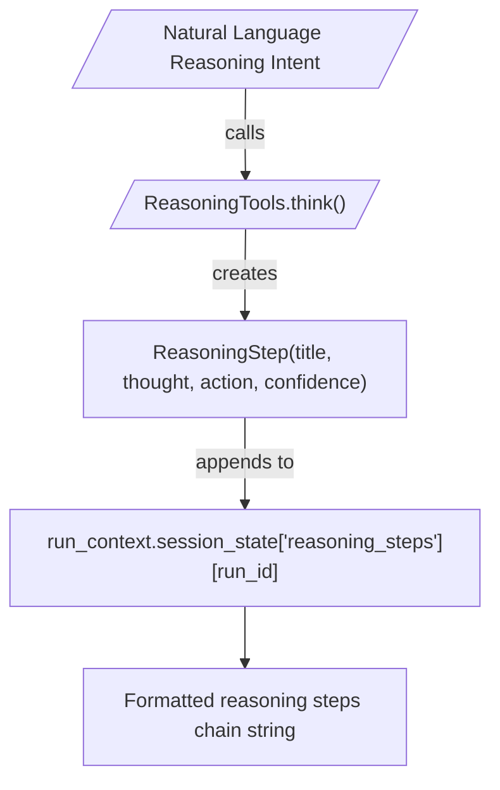
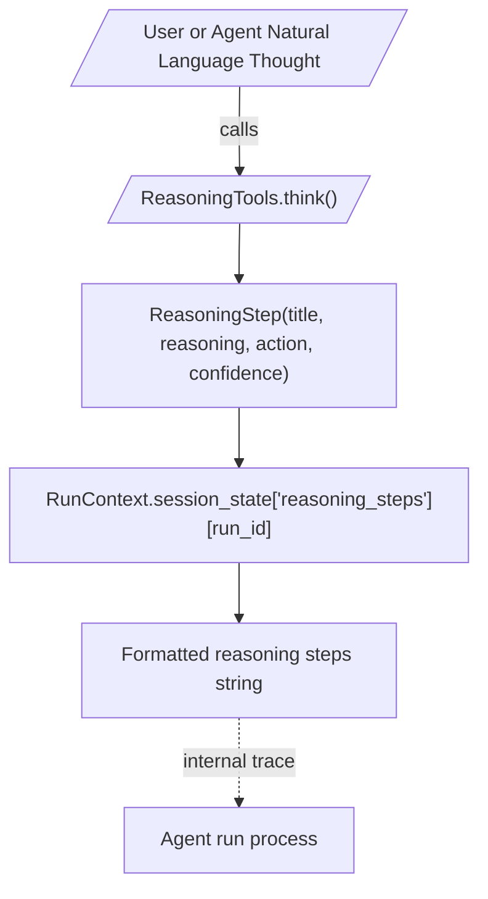
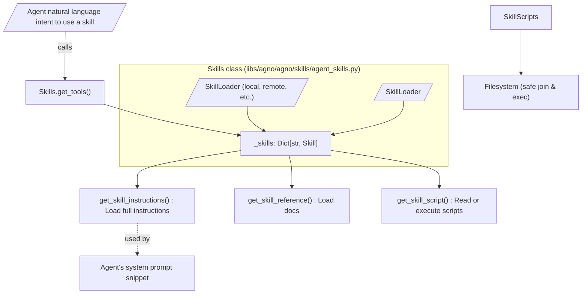

<!-- source: DeepWiki mcp.deepwiki.com · repo agno-agi/agno · page 2.10 Reasoning and Skills · fetched 2026-10-26 -->

# Reasoning and Skills

<details>
<summary>Relevant source files</summary>

The following files were used as context for generating this wiki page:

- [.github/pull_request_template.md](.github/pull_request_template.md)
- [CONTRIBUTING.md](CONTRIBUTING.md)
- [README.md](README.md)
- [cookbook/02_agents/08_guardrails/README.md](cookbook/02_agents/08_guardrails/README.md)
- [cookbook/02_agents/08_guardrails/deepkeep_ai_firewall.py](cookbook/02_agents/08_guardrails/deepkeep_ai_firewall.py)
- [cookbook/02_agents/README.md](cookbook/02_agents/README.md)
- [libs/agno/agno/reasoning/anthropic.py](libs/agno/agno/reasoning/anthropic.py)
- [libs/agno/agno/reasoning/azure_ai_foundry.py](libs/agno/agno/reasoning/azure_ai_foundry.py)
- [libs/agno/agno/reasoning/deepseek.py](libs/agno/agno/reasoning/deepseek.py)
- [libs/agno/agno/reasoning/gemini.py](libs/agno/agno/reasoning/gemini.py)
- [libs/agno/agno/reasoning/groq.py](libs/agno/agno/reasoning/groq.py)
- [libs/agno/agno/reasoning/manager.py](libs/agno/agno/reasoning/manager.py)
- [libs/agno/agno/reasoning/moonshot.py](libs/agno/agno/reasoning/moonshot.py)
- [libs/agno/agno/reasoning/ollama.py](libs/agno/agno/reasoning/ollama.py)
- [libs/agno/agno/reasoning/openai.py](libs/agno/agno/reasoning/openai.py)
- [libs/agno/agno/reasoning/openrouter.py](libs/agno/agno/reasoning/openrouter.py)
- [libs/agno/agno/skills/agent_skills.py](libs/agno/agno/skills/agent_skills.py)
- [libs/agno/agno/skills/utils.py](libs/agno/agno/skills/utils.py)
- [libs/agno/agno/tools/reasoning.py](libs/agno/agno/tools/reasoning.py)
- [libs/agno/agno/utils/path_safety.py](libs/agno/agno/utils/path_safety.py)
- [libs/agno/tests/integration/models/deepseek/test_reasoning_streaming.py](libs/agno/tests/integration/models/deepseek/test_reasoning_streaming.py)
- [libs/agno/tests/unit/reasoning/test_reasoning_api_checkers.py](libs/agno/tests/unit/reasoning/test_reasoning_api_checkers.py)
- [libs/agno/tests/unit/reasoning/test_reasoning_checkers.py](libs/agno/tests/unit/reasoning/test_reasoning_checkers.py)
- [libs/agno/tests/unit/skills/test_agent_skills.py](libs/agno/tests/unit/skills/test_agent_skills.py)

</details>


This page documents the **reasoning subsystem** and **agent skills** within the Agno framework. Reasoning enables agents to perform stepwise, introspective, and provider-specific logical thought processes, while skills package reusable domain expertise and capabilities as callable tools. This documentation details the implementation, data flow, key classes and functions, and shows how these components bridge natural language reasoning and code entities.


---

## 1. Reasoning Subsystem

The reasoning subsystem in Agno encapsulates step-by-step logical workflows executed by agents using reasoning tools and provider-specific adapters. The core abstraction revolves around recording multiple reasoning steps, feeding them into an agent or external models, and managing the reasoning process both synchronously and asynchronously.

### 1.1 Components Overview

- **`ReasoningTools` Toolkit**:  
  A toolset providing reusable functions to express reasoning steps as internal thoughts (`think`) or analysis (`analyze`) along with metadata such as confidence and next actions. It captures these steps in the agent's session state and outputs a formatted reasoning trace. This toolkit extends the base `Toolkit` class and exposes tools for incremental reasoning within a run.

- **`ReasoningStep`**:  
  A structured Pydantic model (defined in `agno/reasoning/step.py`) representing one reasoning passage, including title, thought, action, result, next action (continue, validate, finalize), and confidence score.

- **Per-Provider Reasoning Adapters (`agno/reasoning/`)**:  
  Contains provider-specific functions and model checkers to support native reasoning capabilities for models from OpenAI, Gemini, DeepSeek, Anthropic, Azure AI Foundry, Ollama, Groq, Vertex AI, and others. They provide:  
  - Functions to detect if a given model supports reasoning natively  
  - Functions to call the provider model to get reasoning output in the expected format  
  - Streaming variants to incrementally receive reasoning content  

- **`reasoning manager`** (likely in `libs/agno/agno/reasoning/manager.py`) _(not detailed)_ is responsible for orchestrating reasoning calls, selecting appropriate provider adapters, and integrating results back to the agent workflow.

### 1.2 ReasoningTools (Step-by-Step Reasoning)

Located in `libs/agno/agno/tools/reasoning.py`, the `ReasoningTools` class inherits from `Toolkit` and provides two main tools: `think` and `analyze`.

- **Constructor and Configuration**  
  The constructor allows enabling/disabling `think` and `analyze` tools and optionally adding few-shot instruction examples. If no explicit instructions are provided, a default XML-like block with reasoning instructions and optional few-shot examples is initialized as the toolkit's instructions.

- **think** method  
  Called with parameters: `title`, `thought` (the detailed reasoning), optional `action` and `confidence`.  
  - It wraps the input parameters into a new `ReasoningStep` instance with `next_action` set to `CONTINUE`.  
  - This step is appended to the current agent run's session state under `"reasoning_steps"[run_id]`.  
  - Returns a formatted string enumerating all prior reasoning steps in the current run, including their titles, content, actions, and confidences.  
  - If any exception occurs during recording, an error message is returned.  

- **analyze** method  
  Called with parameters: `title`, `result` (from prior action), `analysis`, `next_action` string (mapped to enum), and `confidence`.  
  - Creates a `ReasoningStep` with these details and appends it similarly to session state.  
  - Returns the complete list of reasoning steps as a string.  
  - Enables expressing post-action analysis and guiding subsequent workflow decisions (i.e., continue, validate, finalize).  

#### Session State and Data Flow

- The reasoning steps are stored in the run's `RunContext.session_state` dictionary keyed by run ID.  
- Each step is serialized to JSON for persistence in memory or storage.  
- The cumulative steps provide a traceable chain of thought visible to the agent internally but hidden from end users.  



### 1.3 Per-Provider Reasoning Model Adapters

Agno supports native reasoning models from multiple AI providers via dedicated adapter modules under `libs/agno/agno/reasoning/`. Each adapter exposes pattern-consistent functions:

- **Reasoning Model Checker** (e.g., `is_openai_reasoning_model`)  
  These functions identify if a given model instance supports native reasoning features by checking model class names, model IDs, or configuration parameters.

- **Synchronous Reasoning Function** (e.g., `get_openai_reasoning`)  
  Accepts the reasoning agent (an `Agent` instance wrapped for reasoning usage) and a list of `Message` objects as input. Runs the agent's reasoning steps and returns a `Message` containing the reasoning output content wrapped with `<thinking>` tags.

- **Asynchronous Counters** (`aget_*`) and **Streaming Variants** (`get_*_reasoning_stream`)  
  Provide async call and incremental streaming outputs for reasoning content.

#### Example Providers and Checks

- **OpenAI Reasoning Adapter (`openai.py`)**  
  Checks models by class name being one of `OpenAIChat`, `OpenAIResponses`, `AzureOpenAI`, with model ID patterns such as `"o1"`, `"o3"`, `"o4"`, `"gpt-5"`, `"deepseek"` etc.  
  Provides `get_openai_reasoning`, `aget_openai_reasoning`, and streaming versions that yield reasoning deltas or a final `Message`.

- **Gemini Reasoning Adapter (`gemini.py`)**  
  Checks Gemini models for thinking features via API call or fallback to string checks on version, and invokes reasoning accordingly.

- **DeepSeek Reasoning Adapter (`deepseek.py`)**, **Azure AI Foundry (`azure_ai_foundry.py`)**, **Anthropic (`anthropic.py`)**, **Ollama (`ollama.py`)** follow similar patterns.

### 1.4 Reasoning Step Model

The `ReasoningStep` is a Pydantic model that captures structured reasoning step data. It includes:

- `title` (str): Summary title for the step  
- `reasoning` (str): The free-text reasoning content  
- `action` (Optional[str]): Planned action from this step  
- `result` (Optional[str]): Outcome of the action (used mostly in analysis)  
- `next_action` (enum): One of `CONTINUE`, `VALIDATE`, or `FINAL_ANSWER` dictating next workflow move  
- `confidence` (float): Confidence score (0.0 to 1.0)

Steps are serialized/deserialized to JSON for storage in session state.

---

## 2. Agent Skills

The skills subsystem packages reusable domain expertise, instructions, reference docs, and executable scripts as named skills, which agents can query progressively and leverage programmatically.

### 2.1 Skills Orchestrator Class

The main orchestrator is the `Skills` class defined in `libs/agno/agno/skills/agent_skills.py`. Its responsibilities are:

- Loading skills from different sources using pluggable `SkillLoader` instances.  
- Maintaining a dict of skill name → `Skill` object mappings.  
- Providing accessors to get individual or all loaded skills.  
- Generating system prompt snippets describing available skills metadata for agents.  
- Exposing tooling functions as `Function` instances that agents invoke to interact with skills.

#### Initialization and Loading

- Initialized with a list of `SkillLoader` instances, each capable of loading skills from a source (local filesystem, database, network, etc.).  
- The constructor eagerly loads all skills from all loaders into `_skills` dictionary.
- On reload, it clears current skills and reloads from loaders.

#### Access Methods

- `get_skill(name: str) -> Optional[Skill]`  
  Returns `Skill` by name or None.
  
- `get_all_skills() -> List[Skill]`  
  Returns list of all loaded `Skill` objects.
  
- `get_skill_names() -> List[str]`  
  Returns names of loaded skills.

### 2.2 System Prompt Snippet Generation

The method `get_system_prompt_snippet()` returns an XML-formatted multi-line string summarizing currently loaded skills. The format:

```xml
<skills_system>

## What are Skills?
Skills are packages of domain expertise that extend your capabilities. Each skill contains:
- **Instructions**: Detailed guidance on when and how to apply the skill
- **Scripts**: Executable code templates you can use or adapt
- **References**: Supporting documentation (guides, cheatsheets, examples)

## IMPORTANT: How to Use Skills
**Skill names are NOT callable functions.** You cannot call a skill directly by name.
Instead, you MUST use skill access tools:
1. `get_skill_instructions(skill_name)` - Load full instructions
2. `get_skill_reference(skill_name, reference_path)` - Access documentation
3. `get_skill_script(skill_name, script_path, execute=False)` - Read or run scripts

...

## Available Skills
<skill>
  <name>skill-name</name>
  <description>Skill description</description>
  <scripts>script1, script2</scripts>
  <references>doc1, doc2</references>
</skill>

</skills_system>
```

This snippet informs the agent about skill metadata without loading full instructions, enabling progressive discovery.

### 2.3 Skill Access Tools

The `Skills` class exposes three main tools as `Function` instances agents can call:

- `get_skill_instructions(skill_name: str) -> str`  
  Returns the full instructions of the named skill for detailed guidance.

- `get_skill_reference(skill_name: str, reference_path: str) -> str`  
  Fetches a specific documentation file content for a skill.

- `get_skill_script(skill_name: str, script_path: str, execute: bool = False) -> str`  
  Reads or runs executable scripts inside a skill package and returns the output or script content.

Agents use these tools in a progressive manner — first browsing metadata, then loading instructions or references, and finally leveraging scripts if needed.

### 2.4 Skill Loading and Validation

Skills are composed and validated by loaders subclassing `SkillLoader`. Validation errors raise `SkillValidationError`. On duplicate skill names, the newer one overwrites and logs a warning.

### 2.5 Safety and Path Security

To guard against malicious or erroneous paths, file-system access for reading or executing scripts uses safe path join utilities to prevent directory traversal and unauthorized access.

---

## 3. Data Flow and Integration

### 3.1 Reasoning Session Data Flow

1. Agent triggers a reasoning step by calling `think()` or `analyze()` from `ReasoningTools`.  
2. The `ReasoningStep` object is created and appended to session state under the corresponding run's ID.  
3. The reasoning steps accumulate and can be retrieved to present the reasoning chain internally.  
4. When using a reasoning model adapter, the agent composes messages including reasoning steps and runs the model as a nested agent run.  
5. The provider-specific adapter parses the model's output (including streaming) and wraps the raw reasoning content in standardized `<thinking>` tags for consistency.

### 3.2 Skills Tooling Data Flow

1. The `Skills` orchestrator loads skill packages at startup or on reload.  
2. Agents may call skill access tools (e.g., `get_skill_instructions`) passing skill names or paths.  
3. The tools fetch requested data or run scripts safely and return results back to the agent for downstream usage.  
4. The system prompt snippet with skill metadata is injected into agent prompts as hints for usage or discovery.

---

## 4. Mermaid Diagrams: Bridging Natural Language to Code

### Diagram 1: Reasoning Subsystem - From Natural Language Thought to Internal Session State



### Diagram 2: Skills Subsystem - From Skill Usage Intent to Skill Access Tools and Skill Packages



---

## 5. Key Classes and Functions Summary

| Name/Entity             | Role/Description                                                                                      | Location                                         |
|------------------------|----------------------------------------------------------------------------------------------------|-------------------------------------------------|
| `ReasoningTools`       | Toolkit providing `think` and `analyze` tools to record reasoning steps in the agent's session.    | `libs/agno/agno/tools/reasoning.py` (lines 10-171) |
| `ReasoningStep`        | Pydantic model representing one reasoning step with title, thought, action, result, etc.            | `libs/agno/agno/reasoning/step.py` (not shown completely) |
| `is_openai_reasoning_model` | Checks if a model is a native reasoning model from OpenAI or similar variants using class and model ID patterns. | `libs/agno/agno/reasoning/openai.py` (lines 14-40) |
| `get_openai_reasoning` | Calls the given reasoning agent with messages and extracts reasoning content wrapped in `<thinking>` tags. | `libs/agno/agno/reasoning/openai.py` (lines 43-79)  |
| `Skills`               | Orchestrator class to load skills, provide accessors, system prompt snippets, and expose skill access tools. | `libs/agno/agno/skills/agent_skills.py` (lines 16-170+) |
| `get_system_prompt_snippet` | Generates an XML-like descriptive snippet summarizing all loaded skills for inclusion in agent prompts.   | `libs/agno/agno/skills/agent_skills.py` (lines 90-148) |
| `get_tools()` (Skills) | Returns a list of callable `Function` objects exposing skill access methods to agents.             | `libs/agno/agno/skills/agent_skills.py` (lines 150-...)|

---

## 6. Summary

The Agno reasoning subsystem enables logical, stepwise problem solving by logging reasoning steps in structured ways, either through internal scratchpad tools (`think`, `analyze`) or via provider-supported native reasoning models. This makes agent thought processes transparent and manageable.

The agent skills subsystem packages domain knowledge into named skills that can be progressively discovered, accessed for instructions and references, or directly used via script execution. This modular capability packaging enhances agent versatility and reusability.

---

Sources:  
- `libs/agno/agno/tools/reasoning.py:10-171`  
- `libs/agno/agno/reasoning/openai.py:14-175`  
- `libs/agno/agno/reasoning/gemini.py:13-177`  
- `libs/agno/agno/reasoning/deepseek.py:13-188`  
- `libs/agno/agno/reasoning/azure_ai_foundry.py:13-176`  
- `libs/agno/agno/skills/agent_skills.py:16-170`  
- Unit tests over `agno/agno/reasoning` and `agno/skills/agent_skills` (briefly referenced)

---

