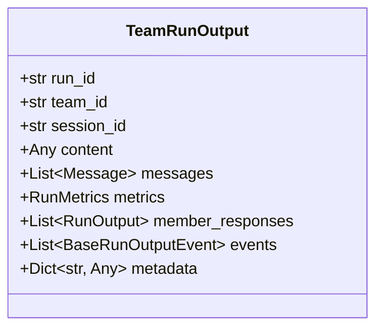
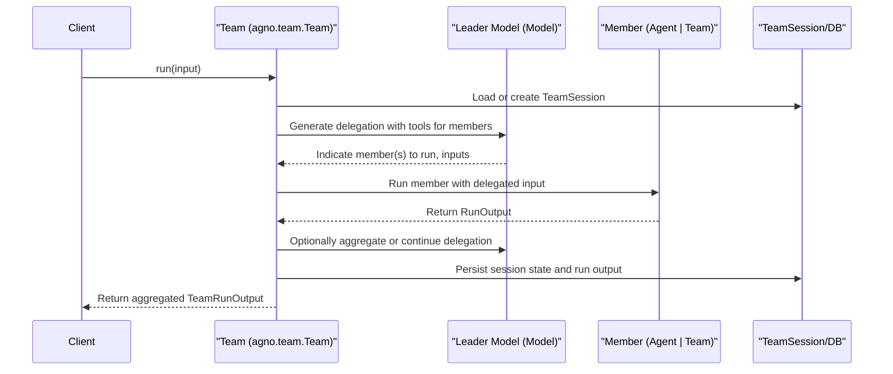

<!-- source: DeepWiki mcp.deepwiki.com · repo agno-agi/agno · page 2.2 Team Orchestration · fetched 2026-10-26 -->

# Team Orchestration

<details>
<summary>Relevant source files</summary>

The following files were used as context for generating this wiki page:

- [cookbook/91_tools/tavily_tools_advanced.py](cookbook/91_tools/tavily_tools_advanced.py)
- [libs/agno/agno/agent/_run.py](libs/agno/agno/agent/_run.py)
- [libs/agno/agno/agent/_utils.py](libs/agno/agno/agent/_utils.py)
- [libs/agno/agno/run/base.py](libs/agno/agno/run/base.py)
- [libs/agno/agno/team/_run.py](libs/agno/agno/team/_run.py)
- [libs/agno/agno/team/_utils.py](libs/agno/agno/team/_utils.py)
- [libs/agno/agno/tools/tavily.py](libs/agno/agno/tools/tavily.py)
- [libs/agno/tests/integration/knowledge/test_pptx_knowledge.py](libs/agno/tests/integration/knowledge/test_pptx_knowledge.py)
- [libs/agno/tests/integration/teams/test_team_delegation.py](libs/agno/tests/integration/teams/test_team_delegation.py)
- [libs/agno/tests/integration/workflows/test_workflow_metrics.py](libs/agno/tests/integration/workflows/test_workflow_metrics.py)
- [libs/agno/tests/unit/agent/test_callable_resources.py](libs/agno/tests/unit/agent/test_callable_resources.py)
- [libs/agno/tests/unit/agent/test_run_regressions.py](libs/agno/tests/unit/agent/test_run_regressions.py)
- [libs/agno/tests/unit/memory/test_memory_manager_async.py](libs/agno/tests/unit/memory/test_memory_manager_async.py)
- [libs/agno/tests/unit/os/test_per_request_isolation.py](libs/agno/tests/unit/os/test_per_request_isolation.py)
- [libs/agno/tests/unit/run/test_run_events.py](libs/agno/tests/unit/run/test_run_events.py)
- [libs/agno/tests/unit/team/test_callable_resources.py](libs/agno/tests/unit/team/test_callable_resources.py)
- [libs/agno/tests/unit/team/test_delegate_closure_bug.py](libs/agno/tests/unit/team/test_delegate_closure_bug.py)
- [libs/agno/tests/unit/tools/test_tavily.py](libs/agno/tests/unit/tools/test_tavily.py)

</details>


Team Orchestration in Agno enables building complex multi-agent collaborations by managing multiple `Agent` or nested `Team` members within a single `Team` instance. The Team serves as a coordinator that delegates input, aggregates outputs, controls coordination modes, and manages shared context/state to facilitate scalable AI agent systems.

This page explains the structure and implementation of the `Team` class, its coordination modes (including `route` and `delegate_to_all_members`), member lifecycle and management, team-level output schema design, and shared context/state management patterns.

For detailed information on the individual `Agent` class and its run lifecycle, refer to **2.1 Agent System**. For orchestrating workflows consisting of multiple agents and steps, see **2.3 Workflow System**.

---

## Team Class Structure and Member Management

The `Team` class is the core abstraction for multi-agent coordination. It maintains:

- A collection of `members`, each of which is either an `Agent` or another `Team`. Members can be statically defined or dynamically generated via a callable factory.  
- An optional team-level `model` that serves as the team leader/coordinator. This model can route tasks, choose delegation strategies, and aggregate member responses.
- Metadata, configuration flags, session state, knowledge, and persistent storage access.

### Member List and Initialization

The team constructor accepts members as a list or callable returning a list. During initialization, if members are agents, their `team_id` is automatically set. The team ID is auto-generated as a UUID if none is provided.

```python
from agno.team import Team
from agno.agent import Agent
from agno.models.openai import OpenAIChat

team = Team(
    members=[
        Agent(name="researcher", model=OpenAIChat(id="gpt-4o")),
        Agent(name="writer", model=OpenAIChat(id="gpt-4o")),
    ],
    model=OpenAIChat(id="gpt-4o"),  # Optional coordinator model
    name="content_team",
)
```

Key initialization parameters:

| Parameter  | Type                            | Description                                                  |
|------------|---------------------------------|--------------------------------------------------------------|
| `members`  | `Union[List[Agent|Team], Callable]` | Static list or factory returning agents/teams [team.py:86]()|
| `model`    | `Optional[Model]`               | Team-level coordinator model [team.py:89]()                  |
| `mode`     | `Optional[TeamMode]`            | Coordination mode e.g., `route`, `tasks` [team.py:113]()     |
| `respond_directly` | `bool`                 | Whether to directly return member responses [team.py:116]()  |
| `delegate_to_all_members` | `bool`           | Broadcast task to all members [team.py:118]()                |
| `determine_input_for_members` | `bool`          | Whether the team leader chooses member inputs [team.py:120]()|
| `name`     | `Optional[str]`                 | Human-readable team identifier [team.py:99]()                |
| `id`       | `Optional[str]`                 | Unique team UUID, autogenerated if not provided [team.py:97]()|

If `members` is a callable factory, it can dynamically generate member lists based on the `RunContext` (e.g., user ID) during each run invocation.

---

## Coordination Modes

The Team class supports various coordination modes dictating how it delegates incoming tasks to members and handles aggregation.

### 1. Route Mode (Default)

This is the default mode where the team leader model selects which member(s) to invoke for the given input. The team creates an internal tool representation of its members, exposes them as callable tools to the leader model, and routes the input accordingly.

| Parameter                  | Default | Description                                              |
|----------------------------|---------|----------------------------------------------------------|
| `determine_input_for_members` | `True`  | Leader model generates input for each member            |
| `respond_directly`           | `False` | Return aggregated content rather than direct member outputs|

Operations in this mode include running the leader model with internal tools for members, routing input per member, collecting responses, and optionally aggregating them to produce a combined team response.

### 2. Delegate to All Members

Setting `delegate_to_all_members=True` causes the team leader to broadcast the task to all members simultaneously without input determination or routing decisions. Member results are collected and aggregated according to team instructions.

This mode enables true collaboration where every member contributes independently to the task.

### 3. Tasks Mode (Autonomous Loops)

A more advanced coordination mode involves the team managing iterative autonomous task loops up to a max iteration count (`max_iterations`, default 10). This facilitates complex autonomous multi-turn agentic workflows internally managed by the team.

---

## Member Management Patterns

### Member Identity and Factories

Members can be defined statically or created dynamically per run via callable factories that take `RunContext` parameters, supporting advanced scenarios like routing based on user identity or session state.

Inside a `Team` instance, each member agent inherits the parent team's `team_id` for consistent identification.

### Member Runs and Cancellation

Canceling a team run automatically cascades cancellation requests to all active member runs spawned by the team, ensuring coordinated aborting of asynchronous executions.

---

## Shared Context and Session State

Teams maintain shared context to coordinate member interactions effectively.

### Session State

The team stores a dictionary-like `session_state` that persists run-to-run in the underlying database. It can be configured with:

| Parameter              | Default | Description                                                       |
|------------------------|---------|-------------------------------------------------------------------|
| `add_session_state_to_context` | `True`  | Injects session state into members' prompt context               |
| `enable_agentic_state`  | `True`  | Enables tools to update shared session state dynamically          |
| `overwrite_db_session_state` | `False` | Whether to fully overwrite DB state instead of merging (default merges)|

### History Sharing

Teams can share historical conversation context and members' inputs/outputs using these flags:

| Parameter                 | Default | Description                                                   |
|---------------------------|---------|---------------------------------------------------------------|
| `add_team_history_to_members` | `False` | Sends team-level past runs context to members                |
| `num_team_history_runs`    | `3`     | How many past team runs to include in member context          |
| `share_member_interactions` | `False` | Shares member IO within the current run to all other members  |

This mechanism allows members to have a consistent contextual understanding leveraging prior work and ongoing interactions.

---

## Team-Level Output Schema

The output of a `Team` run is represented by the `TeamRunOutput` class, which extends basic run output with fields to store aggregated content, member responses, events, and metadata.

### TeamRunOutput Data Model



- `run_id`, `team_id`, `session_id`: Identifiers of the team run and session.
- `content`: Aggregated textual or structured content result.
- `messages`: Message history (chat-like objects).
- `metrics`: Aggregated run and member metrics.
- `member_responses`: List of individual `RunOutput` from members.
- `events`: Streamed or recorded team-level run events.
- `metadata`: Optional team-level metadata dictionary.

This class (defined in the `agno.run.team` module) encapsulates the aggregate state of the collaborative execution [libs/agno/agno/run/team.py:53]().

---

## TeamRunEvent Streaming and Event Types

When streaming mode (`stream_events=True`) is enabled, the Team emits rich run events derived from underlying models and member runs:

- **Tool call started:** Represents the start of a tool call or delegation trigger.
- **Assistant response:** Final response content by the team leader or members.
- **Model request completed:** Marks the conclusion of a model's API call.

These events implement the `BaseRunOutputEvent` protocol with extended fields for tools, images, audio, citations, and other multimodal content pointers, enabling full observability and rich UI integrations [libs/agno/agno/models/response.py:12-23](), [libs/agno/agno/run/team.py:52-55]().

---

## Coordination Flow Implementation

The overall control flow for a team run is as follows:



1. The team session is instantiated/loading from a DB session keyed by `session_id` and `user_id`.
2. If the team has a coordinator model (`model`), it generates delegation decisions, possibly including member-specific inputs.
3. For each selected member, the team runs the member synchronously or asynchronously, collecting `RunOutput`.
4. The team optionally aggregates or composes member messages/responses to form the final output.
5. The session state and run outputs are persisted.
6. The aggregated `TeamRunOutput` is returned or streamed incrementally.

This sequence is orchestrated primarily in the `run_dispatch`, `_arun`, and `_run` methods in the `agno.team._run` module [libs/agno/agno/team/_run.py:1-224]() and `Team.run` method [libs/agno/agno/team/team.py:81-177]().

---

# Summary

The `Team` class is a powerful abstraction for orchestrating multi-agent workflows in Agno. Its key features include:

- Flexible member management with both static and dynamic membership.
- Coordination modes to route tasks selectively or delegate concurrently to all members.
- Rich shared context patterns via session state and history propagation.
- Team-level output schemas encapsulating member responses and aggregated content.
- Streaming event generation facilitating observability.

This framework enables scalable AI agent collaboration patterns for advanced use cases in multi-agent and multi-model systems.

---

**Sources:**

- [libs/agno/agno/team/team.py:81-177]()
- [libs/agno/agno/team/_run.py:1-224]()
- [libs/agno/agno/run/team.py:45-90]()
- [libs/agno/agno/models/response.py:12-23]()
- [libs/agno/agno/team/_utils.py:1-104]()
- [libs/agno/agno/run/base.py:1-169]()

---

