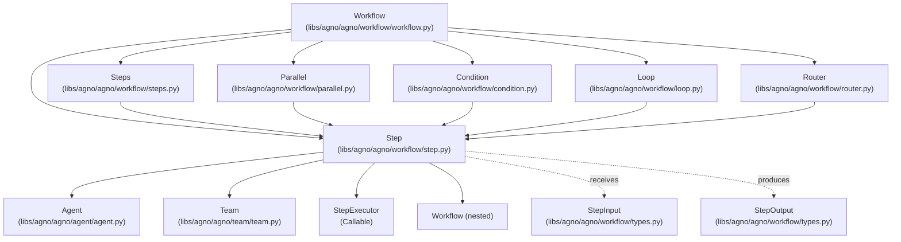
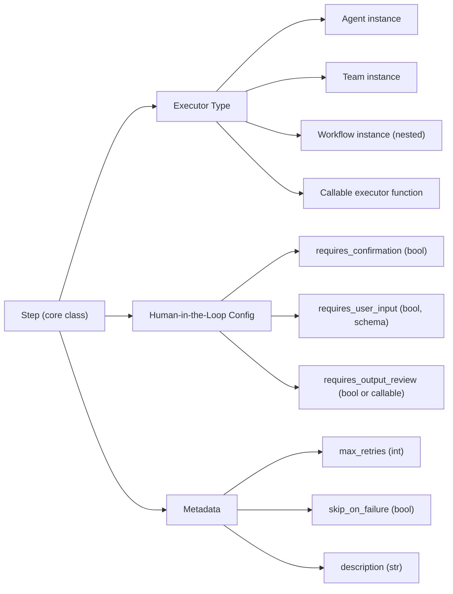
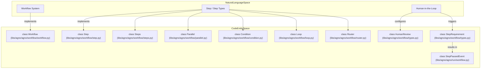

<!-- source: DeepWiki mcp.deepwiki.com · repo agno-agi/agno · page 2.3 Workflow System · fetched 2026-10-26 -->

# Workflow System

Relevant source files

The following files were used as context for generating this wiki page:

- [cookbook/04_workflows/03_loop_execution/loop_iterative_accumulation.py](cookbook/04_workflows/03_loop_execution/loop_iterative_accumulation.py)
- [cookbook/04_workflows/08_human_in_the_loop/condition/02_condition_on_error.py](cookbook/04_workflows/08_human_in_the_loop/condition/02_condition_on_error.py)
- [libs/agno/agno/os/middleware/jwt.py](libs/agno/agno/os/middleware/jwt.py)
- [libs/agno/agno/run/workflow.py](libs/agno/agno/run/workflow.py)
- [libs/agno/agno/workflow/condition.py](libs/agno/agno/workflow/condition.py)
- [libs/agno/agno/workflow/loop.py](libs/agno/agno/workflow/loop.py)
- [libs/agno/agno/workflow/parallel.py](libs/agno/agno/workflow/parallel.py)
- [libs/agno/agno/workflow/router.py](libs/agno/agno/workflow/router.py)
- [libs/agno/agno/workflow/step.py](libs/agno/agno/workflow/step.py)
- [libs/agno/agno/workflow/steps.py](libs/agno/agno/workflow/steps.py)
- [libs/agno/agno/workflow/types.py](libs/agno/agno/workflow/types.py)
- [libs/agno/agno/workflow/workflow.py](libs/agno/agno/workflow/workflow.py)
- [libs/agno/tests/integration/os/test_jwt_middleware.py](libs/agno/tests/integration/os/test_jwt_middleware.py)
- [libs/agno/tests/integration/workflows/test_condition_steps.py](libs/agno/tests/integration/workflows/test_condition_steps.py)
- [libs/agno/tests/integration/workflows/test_loop_steps.py](libs/agno/tests/integration/workflows/test_loop_steps.py)
- [libs/agno/tests/integration/workflows/test_parallel_steps.py](libs/agno/tests/integration/workflows/test_parallel_steps.py)
- [libs/agno/tests/integration/workflows/test_router_steps.py](libs/agno/tests/integration/workflows/test_router_steps.py)
- [libs/agno/tests/integration/workflows/test_steps.py](libs/agno/tests/integration/workflows/test_steps.py)
- [libs/agno/tests/unit/workflow/test_executor_hitl.py](libs/agno/tests/unit/workflow/test_executor_hitl.py)
- [libs/agno/tests/unit/workflow/test_parallel_run_context_isolation.py](libs/agno/tests/unit/workflow/test_parallel_run_context_isolation.py)
- [libs/agno/tests/unit/workflow/test_previous_content_values.py](libs/agno/tests/unit/workflow/test_previous_content_values.py)

## Purpose and Scope

The Workflow System orchestrates multi-step processes by composing various step types such as Agents, Teams, nested Workflows, and callables into flexible pipelines that support sequential, parallel, conditional, looped, and routed execution. It manages step dependencies, metadata, input/output data flow, human-in-the-loop (HITL) interactions, and persistent run/session state.

This page presents an architectural overview, focusing on the `Workflow` class core concepts including step composition, dependencies, metadata handling, and run parameters that enable complex workflows. Detailed step semantics and execution mechanics are covered in child pages:

- See [Workflow Step Types](#2.3.1) for specific step containers and execution behaviors
- See [Step Execution and Context](#2.3.2) for run context, input/output chaining, dependency injection, and session state propagation
- See [Human-in-the-Loop (HITL) Workflows](#2.3.3) for manual intervention, route selection, and approval pattern details

**Sources:** [libs/agno/agno/workflow/workflow.py:193-205](), [libs/agno/agno/workflow/step.py:180-192]()

---

## Workflow Architecture

### Component Hierarchy and Step Composition

The `Workflow` class orchestrates execution over a set of composable steps. Workflows can nest other workflows and containers to form complex graphs. The core step types include:

- `Step`: basic unit wrapping an executor (Agent, Team, nested Workflow, or callable)
- `Steps`: sequential pipeline of steps
- `Parallel`: concurrent execution of steps
- `Condition`: branching logic (`if`/`else`)
- `Loop`: iterative step repetition with end condition
- `Router`: dynamic step selection or user-driven route selection

These are composable and nestable containers forming the workflow DAG.

**Workflow container classes and their composition define the structure for orchestrating multi-step executions by nesting and combining steps.**  

**Sources:** [libs/agno/agno/workflow/workflow.py:168-175](), [libs/agno/agno/workflow/step.py:180-192](), [libs/agno/agno/workflow/types.py:65-107]()

---

## Core Step Types Overview

The Workflow System defines various step types that provide primitives for task orchestration:

| Step Type | Source File | Description | Key Configuration Parameters |
|-----------|-------------|-------------|------------------------------|
| `Step` | `step.py` | Fundamental execution unit wrapping a single executor (Agent/Team/Callable/Workflow) with retry, failures, HITL options | `agent`, `team`, `executor`, `workflow`, `max_retries`, `skip_on_failure` |
| `Steps` | `steps.py` | Sequential pipeline of steps executed one after another | `steps` (list), `requires_confirmation` |
| `Parallel` | `parallel.py` | Executes multiple steps concurrently with merged session state | Variadic `steps`, supports context propagation |
| `Condition` | `condition.py` | Conditional branching step with if and optional else branches | `evaluator` (callable, bool, or CEL expression), `steps`, `else_steps` |
| `Loop` | `loop.py` | Executes steps repeatedly until end condition or max iterations reached | `steps`, `max_iterations`, `end_condition` (CEL or function), `forward_iteration_output` |
| `Router` | `router.py` | Dynamically selects which step(s) to execute based on input or user selection | `choices` (steps), `selector` (function or CEL), HITL route selection options |

### Step - Basic Unit of Execution

The `Step` class wraps a single execution unit. It can be:

- An `Agent` instance for AI model-driven processing
- A `Team` instance for multi-agent coordination
- A nested `Workflow` for subflows
- A standalone callable executor

It supports retry policies (`max_retries`), error handling (`skip_on_failure`), and Human-in-the-Loop controls like confirmation, user input, and output review.

This step abstraction allows uniform handling of various work executors integrated into workflows. 

**Sources:** [libs/agno/agno/workflow/step.py:180-203](), [libs/agno/agno/workflow/types.py:65-107]()

### Steps - Sequential Execution Container

The `Steps` container executes a list of steps sequentially, one after another. It supports pre-execution confirmation via HITL (HumanReview configuration). This is useful for modeling pipelines where steps depend on predecessor outputs.

For usage details, configuration, and execution semantics, see [Workflow Step Types](#2.3.1).

**Sources:** [libs/agno/agno/workflow/steps.py:40-60]()

### Parallel - Concurrent Execution Container

The `Parallel` container concurrently executes multiple independent steps. It supports flexible argument signatures and asynchronously merges results. `session_state` is copied for child steps and merged on completion with special merging logic to avoid data races.

Parallel execution enables faster workflows by leveraging concurrency where step dependencies allow.

For full execution details, context handling, and state merging, see [Workflow Step Types](#2.3.1).

**Sources:** [libs/agno/agno/workflow/parallel.py:47-61]()

### Condition - Branching Logic Container

The `Condition` container enables if/else branching within workflows. The conditional evaluator can be:

- A Python callable returning `bool`
- A literal `bool`
- A CEL (Common Expression Language) expression string

CEL expressions have access to rich workflow data including input, previous step outputs, and session state, allowing expressive automation conditions. 

Supports pre-execution user confirmation and error handling via `HumanReview`.

For complete branching semantics, options, and usage, see [Workflow Step Types](#2.3.1).

**Sources:** [libs/agno/agno/workflow/condition.py:55-94]()

### Loop - Iterative Execution Container

The `Loop` container repeats a set of steps multiple times up to `max_iterations` or until an `end_condition` is met.

- `end_condition` can be a callable or CEL expression evaluated after each iteration
- Supports forwarding iteration output as input to the next iteration
- Pre-execution confirmation and per-iteration reviews with HITL support

Designed for retry, iterative refinement, or batched processing tasks.

For advanced loop behavior and configuration, see [Workflow Step Types](#2.3.1).

**Sources:** [libs/agno/agno/workflow/loop.py:43-83]()

### Router - Dynamic Step Selection Container

The `Router` container dynamically selects one or more routes (steps) to execute based on workflow input or previous context.

- Programmatic selectors allow a callable or CEL expression return step names
- Human-in-the-loop mode pauses to let users pick routes interactively
- Supports multiple route selection, input collection, and output review via HITL

Enables branching logic based on runtime data or user control.

For detailed semantics and configuration options, see [Workflow Step Types](#2.3.1).

**Sources:** [libs/agno/agno/workflow/router.py:50-83]()

---

## Data Flow, Dependencies, and Metadata

### Step Input and Output

Data flows through workflows by passing `StepInput` objects into each step and collecting `StepOutput` results. These encapsulate:

| Concept | Definition |
|---------|------------|
| `StepInput` | Contains the initial workflow input, previous step content, steps outputs mapping, and runtime metadata. |
| `StepOutput` | Contains step execution results including content, success/failure flags, possible pause states (for HITL), and any nested steps outputs. |

This standardized input/output model enables chaining, conditional branching, and recursive execution of nested workflows.

**Sources:** [libs/agno/agno/workflow/types.py:70-71](), [libs/agno/agno/workflow/step.py:180-203]()

### Workflow Metadata and Run Parameters

Workflows carry metadata such as:

- `name`, `description`
- `workflow_id`
- Session and run identifiers (`session_id`, `run_id`)
- Configuration for run options: retries, timeouts, HITL parameters, error handling behavior, streaming flags

Run parameters flow into execution to influence step selection, data input, and output formatting.

---

## Workflow Execution and Orchestration

The `Workflow` class encapsulates the orchestration logic to execute multi-step pipelines, manage step dependencies, handle retries and errors, and manage streaming of events.

- Supports both synchronous and asynchronous execution (`run()`, `arun()`)
- Emits rich event streams (`WorkflowStartedEvent`, `StepStartedEvent`, `StepPausedEvent`, `WorkflowCompletedEvent`)
- Enforces nesting depth limits for safe recursion (`_MAX_NESTED_WORKFLOW_DEPTH`)
- Manages cancellation and clean-up hooks gracefully
- Handles passing of session state and context propagation through nested steps

Event streaming enables observability and interactive workflows, particularly for Human-in-the-Loop patterns.

**Workflow class coordinates step execution and integrates with HITL mechanisms through HumanReview and StepRequirement metadata.**

**Sources:** [libs/agno/agno/workflow/workflow.py:80-119](), [libs/agno/agno/workflow/types.py:65-107](), [libs/agno/agno/run/workflow.py:39-81]()

---

## Human-in-the-Loop Integration

Human-in-the-loop workflows are enabled by the `HumanReview` dataclass which configures pause conditions at multiple levels:

- Pre-execution confirmation (`requires_confirmation`)
- User input collection (`requires_user_input` with schema)
- Post-execution output review (`requires_output_review`)
- Routing selection and per-iteration reviews in loops

When a step or workflow hits a pause point, a `StepRequirement` object is emitted alongside a `StepPausedEvent`, storing full context for resuming the run. The system persists workflow sessions (`WorkflowSession`), allowing paused workflows to be resumed asynchronously.

This enables approval workflows, manual decisions, and interactive user negotiation within automated pipelines.

For implementation details of HITL execution states, workflows, and route selection, see [Human-in-the-Loop (HITL) Workflows](#2.3.3).

**Sources:** [libs/agno/agno/workflow/types.py:64-159](), [libs/agno/agno/run/workflow.py:53-84](), [libs/agno/agno/workflow/utils.py:150-164]()

---

## Session Persistence and State Management

Workflows track execution state and results using persistent sessions:

- `WorkflowSession` stores active workflow state, run history, saved paused execution data, and accumulated workflow data
- Each step has a unique `step_id` for traceability and for identifying pause/resume boundaries
- Session state is stored in a database backend and passed into executions for continuity
- Child step executions within containers like `Parallel` receive isolated context copies and merge changes back upon completion to prevent race conditions

This persistent state model ensures reliability and recoverability for long-running or interactive workflows.

**Sources:** [libs/agno/agno/session/workflow.py:110](), [libs/agno/agno/workflow/workflow.py:39-42]()

---

# Summary

The `Workflow` system in Agno serves as a powerful orchestration layer to build AI agent pipelines combining multi-step sequences, parallel branches, conditionals, loops, dynamic routing, and human-in-the-loop interventions. Steps are composable containers that execute agents, teams, or arbitrary logic while managing input/output data flow, retries, error handling, and rich metadata. Workflows manage execution context, session persistence, event streaming, and interactive pauses for user approvals or inputs.

For detailed usage, configuration, and execution semantics of each step type and context propagation, refer to the child pages:

- [Workflow Step Types](#2.3.1)  
- [Step Execution and Context](#2.3.2)  
- [Human-in-the-Loop (HITL) Workflows](#2.3.3)  

---

**Sources:**  
- [libs/agno/agno/workflow/workflow.py:1-219]()  
- [libs/agno/agno/workflow/step.py:1-201]()  
- [libs/agno/agno/workflow/types.py:1-172]()  
- [libs/agno/agno/workflow/parallel.py:1-170]()  
- [libs/agno/agno/workflow/condition.py:1-173]()  
- [libs/agno/agno/workflow/loop.py:1-180]()  
- [libs/agno/agno/workflow/router.py:1-171]()  
- [libs/agno/agno/workflow/steps.py:1-178]()  
- [libs/agno/agno/run/workflow.py:1-172]()  
- [libs/agno/agno/session/workflow.py:1-70]()  
- [libs/agno/agno/workflow/utils.py:100-164]()

---

