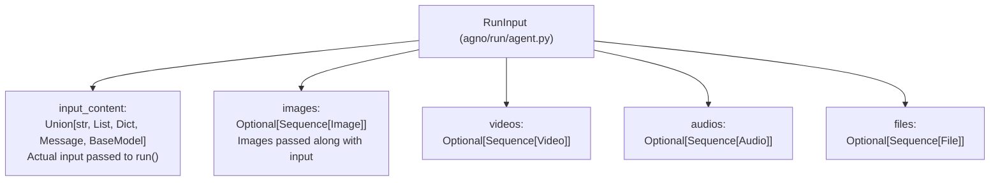
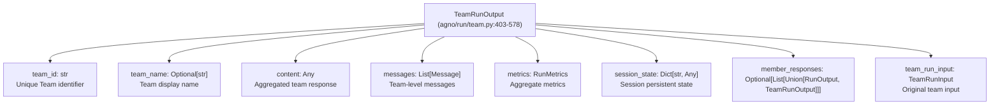
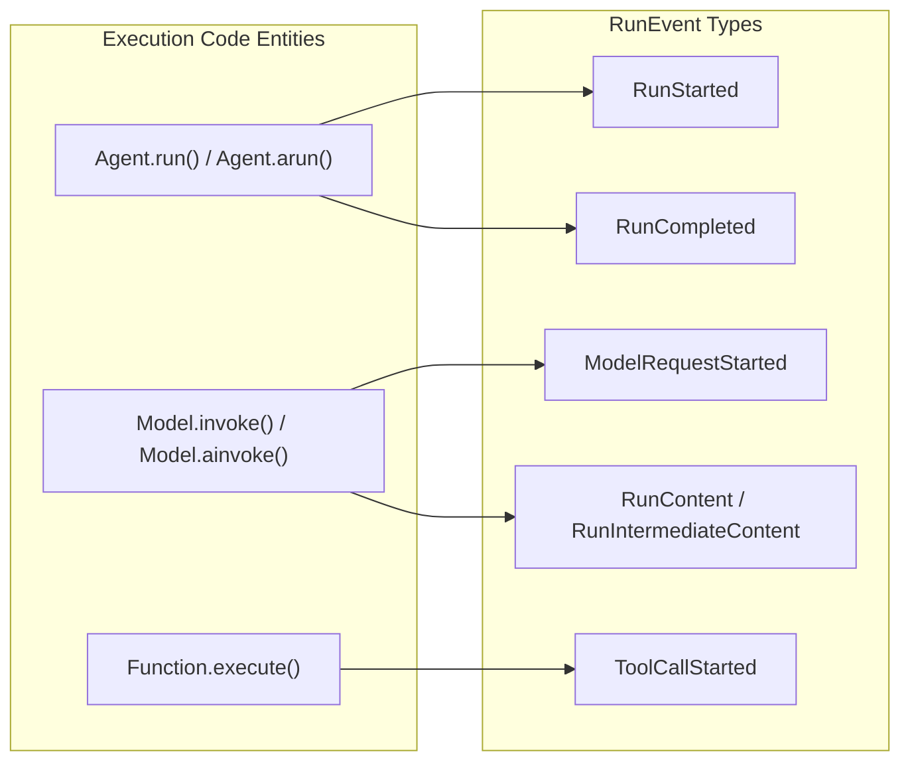
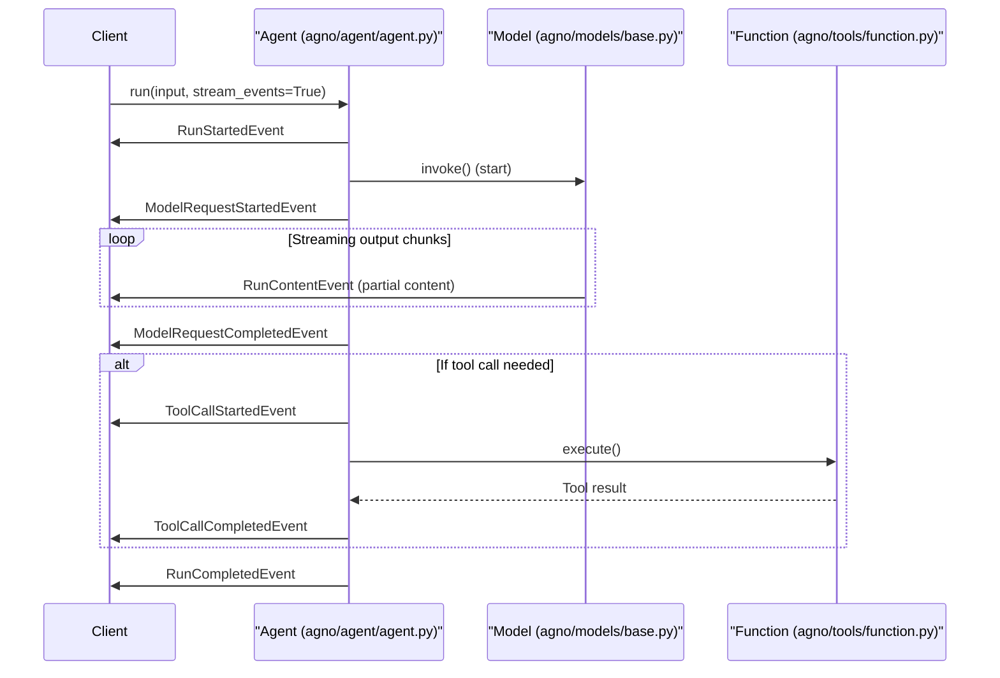
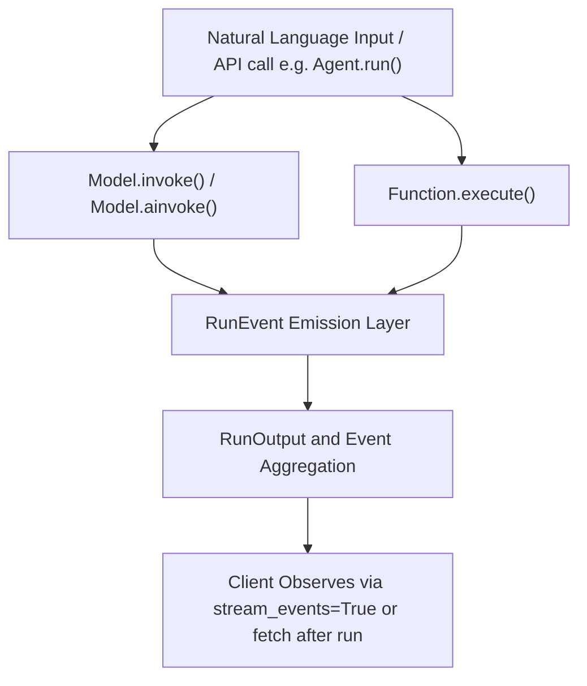
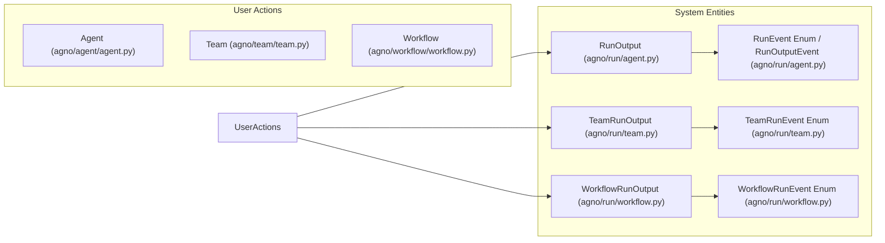

<!-- source: DeepWiki mcp.deepwiki.com · repo agno-agi/agno · page 2.4 Run Output and Events · fetched 2026-10-26 -->

# Run Output and Events

<details>
<summary>Relevant source files</summary>

The following files were used as context for generating this wiki page:

- [cookbook/91_tools/tavily_tools_advanced.py](cookbook/91_tools/tavily_tools_advanced.py)
- [libs/agno/agno/agent/_run.py](libs/agno/agno/agent/_run.py)
- [libs/agno/agno/run/base.py](libs/agno/agno/run/base.py)
- [libs/agno/agno/run/cancel.py](libs/agno/agno/run/cancel.py)
- [libs/agno/agno/run/cancellation_management/base.py](libs/agno/agno/run/cancellation_management/base.py)
- [libs/agno/agno/run/cancellation_management/in_memory_cancellation_manager.py](libs/agno/agno/run/cancellation_management/in_memory_cancellation_manager.py)
- [libs/agno/agno/run/cancellation_management/redis_cancellation_manager.py](libs/agno/agno/run/cancellation_management/redis_cancellation_manager.py)
- [libs/agno/agno/team/_run.py](libs/agno/agno/team/_run.py)
- [libs/agno/agno/tools/tavily.py](libs/agno/agno/tools/tavily.py)
- [libs/agno/agno/utils/response.py](libs/agno/agno/utils/response.py)
- [libs/agno/tests/integration/agent/test_agent_run_cancellation.py](libs/agno/tests/integration/agent/test_agent_run_cancellation.py)
- [libs/agno/tests/integration/knowledge/test_pptx_knowledge.py](libs/agno/tests/integration/knowledge/test_pptx_knowledge.py)
- [libs/agno/tests/integration/teams/test_team_delegation.py](libs/agno/tests/integration/teams/test_team_delegation.py)
- [libs/agno/tests/integration/workflows/test_workflow_metrics.py](libs/agno/tests/integration/workflows/test_workflow_metrics.py)
- [libs/agno/tests/unit/agent/test_run_regressions.py](libs/agno/tests/unit/agent/test_run_regressions.py)
- [libs/agno/tests/unit/memory/test_memory_manager_async.py](libs/agno/tests/unit/memory/test_memory_manager_async.py)
- [libs/agno/tests/unit/run/test_run_events.py](libs/agno/tests/unit/run/test_run_events.py)
- [libs/agno/tests/unit/team/test_delegate_closure_bug.py](libs/agno/tests/unit/team/test_delegate_closure_bug.py)
- [libs/agno/tests/unit/tools/test_tavily.py](libs/agno/tests/unit/tools/test_tavily.py)
- [libs/agno/tests/unit/utils/test_response.py](libs/agno/tests/unit/utils/test_response.py)

</details>


## Purpose and Scope

This document describes the internal structures and system for capturing the output and events produced during the execution of Agents, Teams, and Workflows in Agno. It covers the design and composition of `RunOutput` and similar output data structures, the various `RunEvent` types emitted to represent execution state and progress, how events are streamed and stored, and how users can consume and observe these events efficiently during and after execution.

---

## RunOutput Structure

At the core of Agno's execution model is the `RunOutput` data structure, defined primarily in the agent context (`agno/run/agent.py`). This structure encapsulates the end result of an agent execution, including response content, message history, execution metadata, token metrics, tool invocation data, media outputs, and optionally a rich event trace that captures every meaningful state change during the run.

### Key Entities and Relationships in RunOutput

```mermaid
graph TB
    subgraph "Code Entity Space"
        RunOutput["RunOutput (agno/run/agent.py)"]
        RunInput["RunInput (agno/run/agent.py)"]
        Message["Message (agno/models/message.py)"]
        RunMetrics["RunMetrics (agno/metrics.py)"]
        ToolExecution["ToolExecution (agno/models/response.py)"]
        RunEvent["RunOutputEvent / RunEvent (agno/run/agent.py)"]
        BaseModel["BaseModel (Pydantic)"]
    end

    subgraph "Natural Language / Domain Space"
        ExecutionResult["Execution Result Content"]
        ConversationHistory["Conversation Messages"]
        PerformanceStats["Token Usage & Timing Metrics"]
        ToolCallHistory["Tools Called and their Results"]
        StructuredOutput["Deserialized Structured Output"]
        ExecutionEvents["Execution Event Stream"]
    end

    RunOutput -- "captures overall" --> ExecutionResult
    RunOutput -- "includes" --> ConversationHistory
    RunOutput -- "tracks" --> PerformanceStats
    RunOutput -- "records" --> ToolCallHistory
    RunOutput -- "optionally" --> ExecutionEvents
    RunOutput -- "exposes input as" --> RunInput
    RunOutput -- "may include" --> StructuredOutput
```



The `RunOutput` includes unique IDs (`run_id`, `session_id`, `user_id`), execution status (`RunStatus`), and session state dictionary for persistent session context across runs.

### Important RunOutput Fields

| Field Name | Type | Description |
|------------|------|-------------|
| `run_id` | `str` | Unique identifier for the run (UUID) |
| `session_id` | `Optional[str]` | ID for the user session maintaining conversation state |
| `user_id` | `Optional[str]` | Identifier for the user who initiated the run |
| `agent_id` | `str` | Identifier of the Agent that created this output |
| `content` | `Any` | Main output content (string, object, or model response) |
| `messages` | `List[Message]` | Full conversation/message list for this run |
| `metrics` | `RunMetrics` | Execution performance metrics (tokens, duration) |
| `tools` | `List[ToolExecution]` | Tool calls made during run with args/results |
| `status` | `RunStatus` | Final run status (success, cancelled, failed, etc.) |
| `events` | `Optional[List[RunOutputEvent]]` | Optional list of run events for observability |
| `parsed_output` | `Optional[BaseModel]` | Optional structured output parsed using output_schema |
| `reasoning_content` | `Optional[str]` | Reasoning/thinking text generated by models |
| `session_state` | `Dict[str, Any]` | Persistent state across runs in a session |
| Media fields (`images`, `videos`, `audios`, `files`) | Lists of media types | Media artifacts generated, e.g. images and files |
| `response_audio` | `Optional[Audio]` | Audio output from model responses (e.g., GPT-4o voice) |

**Sources:** [libs/agno/agno/run/agent.py:269-459](), [libs/agno/agno/models/message.py:55-126](), [libs/agno/agno/run/agent.py:143-182](), [libs/agno/tests/unit/run/test_run_events.py:126-143]()

---

## RunInput Structure

`RunInput` records the raw and auxiliary inputs submitted to the run, preserving the exact input content and media passed by the user or caller.



This enables runs to reflect exactly the caller's input, including multimodal content, for accurate playback or auditing.

**Sources:** [libs/agno/agno/run/agent.py:38-141](), [libs/agno/agno/media.py:1-131]()

---

## TeamRunOutput Structure

For team executions, Agno defines `TeamRunOutput` which extends the notion of run output to coordinate multiple agent members and aggregate their responses, while retaining team and delegation metadata.

### TeamRunOutput Relationships



This model allows representing the team's leader response with the underlying member runs embedded for inspection or downstream processing.

**Sources:** [libs/agno/agno/run/team.py:403-578](), [libs/agno/agno/run/team.py:27-128]()

---

## WorkflowRunOutput Structure

Workflows orchestrate multi-step computations and collect outputs from steps, maintaining detailed metrics and step results.

| Field       | Type                      | Description                                            |
|-------------|---------------------------|--------------------------------------------------------|
| `run_id`    | `str`                     | Unique workflow run ID                                 |
| `workflow_id`| `str`                    | Workflow identifier                                   |
| `status`    | `RunStatus`               | Workflow-level status                                 |
| `step_results` | `List[StepOutput]`       | Ordered outputs from each executed workflow step     |
| `nested_depth` | `int`                   | Nesting level (zero for top-level workflows)         |
| `events`    | `List[BaseWorkflowRunOutputEvent]` | Event stream specific to workflow execution     |
| `metrics`   | `WorkflowMetrics`         | Aggregated token usage and timing metrics             |

The `WorkflowRunOutput` inherits from `BaseRunOutputEvent` which includes standardized serialization logic.

**Sources:** [libs/agno/agno/run/workflow.py:85-170](), [libs/agno/agno/run/workflow.py:196-248](), [libs/agno/tests/integration/workflows/test_workflow_metrics.py:90-110]()

---

## Event System Overview

Agno features a highly detailed event system, emitting rich lifecycle events during runs for Agents, Teams, and Workflows. These events furnish detailed observability into the run progress, states, and intermediate data, enabling responsive UIs, debugging, and audit trails.

### Event Base and Indexing

Events derive from `BaseRunOutputEvent` ( dataclass in `agno/run/base.py`) featuring:

- Monotonically increasing `event_index` stamped by the stream during emission to ensure ordered replay and synchronization.
- Deep serialization to dict/JSON supporting nested media, references, and structured components.
- Fields are selectively nullified in shallow copies during serialization to optimize payload sizes.

### Agent RunEvent Types

The `RunEvent` enumeration breaks down run lifecycle into discrete event types:

| Category            | Event Name              | Description                                  |
|---------------------|-------------------------|----------------------------------------------|
| **Lifecycle**       | `RunStarted`, `RunCompleted`, `RunCancelled`, `RunError` | Start/end/cancellation/error lifecycle events |
| **Streaming Content**| `RunContent`, `RunIntermediateContent`, `RunContentCompleted` | Response streaming chunks and their finalization |
| **Tool Execution**  | `ToolCallStarted`, `ToolCallCompleted`, `ToolCallError` | Tool/function invocation and results          |
| **Model Interaction**| `ModelRequestStarted`, `ModelRequestCompleted` | Boundaries around LLM API calls               |
| **Reasoning**       | `ReasoningStarted`, `ReasoningStep`, `ReasoningCompleted` | Steps and phases for reasoning-style models  |
| **Human-in-the-Loop**| `RunPaused`, `RunContinued` | Pausing and resuming runs for user input/approval |
| **Memory Updates**  | `MemoryUpdateStarted`, `MemoryUpdateCompleted` | Lifecycle of memory extraction and persistence |

These events allow clients to monitor execution progress, display intermediate content, trace tool use, and integrate human approval workflows.

**Sources:** [libs/agno/agno/run/agent.py:143-182](), [libs/agno/agno/utils/events.py:7-45]()

### Team RunEvent Types

Team runs emit analogous event types, often prefixed with `TeamRun` or `TeamToolCall` to distinguish team-wide runs and member delegations.

**Sources:** [libs/agno/agno/run/team.py:131-165](), [libs/agno/agno/utils/events.py:90-98]()

### Workflow RunEvent Types

Workflow event types include step lifecycle events and execution control containers:

| Event                  | Description                                |
|------------------------|--------------------------------------------|
| `WorkflowStarted`      | Workflow entrypoint invoked                |
| `StepStarted`/`StepCompleted` | Execution boundaries for individual steps |
| `LoopExecutionStarted`  | Entering a loop container                  |
| `ParallelExecutionStarted`| Entering parallel execution container    |
| `ConditionExecutionStarted`| Conditional branch container start       |
| `RouterExecutionStarted`| Router branching container start           |
| `WorkflowPaused`       | Pauses requiring user interaction          |

**Sources:** [libs/agno/agno/run/workflow.py:39-82]()

---

## Event Mapping: From Execution to Emitted Events



This diagram illustrates how natural API method calls relate to event emissions enabling observability.

**Sources:** [libs/agno/agno/run/agent.py:143-182](), [libs/agno/agno/utils/events.py:101-109](), [libs/agno/agno/utils/events.py:138-167]()

---

## Event Lifecycle and Execution Flow

During a typical agent run (especially with `stream_events=True`), the lifecycle proceeds with key event emissions:



This sequence highlights the interplay of core components emitting events for fine-grained progress.

**Sources:** [libs/agno/agno/run/agent.py:143-182](), [libs/agno/agno/utils/events.py:101-167](), [libs/agno/tests/integration/agent/test_event_streaming.py:53-116]()

---

## Consuming Events for Observability

### Streaming Event Consumption

When running an agent or team with the `stream_events=True` parameter, the caller receives an iterable or async iterable yielding `RunOutput` objects representing incremental events.

Example usage:

```python
for event in agent.run("Hello, world!", stream_events=True):
    if event.event == RunEvent.run_started:
        print(f"Run {event.run_id} started")
    elif event.event == RunEvent.tool_call_started:
        print(f"Invoking tool: {event.tool.tool_name}")
    elif event.event == RunEvent.run_content:
        print(event.content, end="", flush=True)
    elif event.event == RunEvent.run_completed:
        print("Run completed")
```

This streaming model supports live updates, progress bars, and partial result display in UI components.

### Event Persistence and Post-execution Access

Setting `store_events=True` on the Agent or Team causes all emitted events to be persisted in the database associated with the run session. Later retrieval includes the full event list in the final `RunOutput.events` attribute.

| Parameter    | Default  | Effect                                         |
|--------------|----------|------------------------------------------------|
| `stream_events` | False    | Yields events live during run execution       |
| `store_events`  | False    | Persists all events to DB and appends to `events` in final output |

Persisted events facilitate audit trails, replay, debugging, and integration with third-party observability platforms.

---

## State Access Within Tools

Tools executed during a run can receive a `RunContext` argument that exposes:

- The current session state dictionary (`session_state`), enabling tools to read or modify persistent data across runs.
- A shallow copy of the current messages list (`messages`), allowing tools to inspect conversation history without mutating it.
- Access to other runtime-resolved resources like tools, knowledge managers, or members.

This supports highly stateful tool executions integrated tightly into the agent workflow.

**Sources:** [libs/agno/agno/run/base.py:16-41](), [libs/agno/agno/run/agent.py:14-15]()

---

## Best Practices for Event Consumption

- **Filtering Events:** To avoid overwhelming storage or UI updates, use the `events_to_skip` parameter on the agent to omit noisy events like `RunContent`.
- **Error Monitoring:** Listen to `RunError` and `ToolCallError` events to implement custom retry logic or raise immediate alerts.
- **Structured Logging:** Integrate `ModelRequestCompleted` events into observability backend metrics to gather token usage statistics and latencies per model API call.
- **Human-in-the-Loop (HITL) Integration:** Monitor `RunPaused` and `RunContinued` events to build approval UIs that enable users to input or confirm actions before execution proceeds.
- **Metrics Analysis:** Use `RunMetrics` and workflow-level `WorkflowMetrics` emitted in completion events to identify bottlenecks and optimize latency or cost.

---

# Summary Diagram: From Natural Language Input to RunOutput and Events



---

# Summary Diagram: Code Entities Bridging User Actions to System Events



---

# References

- `RunOutput` and `RunOutputEvent` dataclasses: [libs/agno/agno/run/agent.py:269-459]()
- `TeamRunOutput` and team events: [libs/agno/agno/run/team.py:400-580]()
- `WorkflowRunOutput` and events: [libs/agno/agno/run/workflow.py:85-248]()
- Event serialization and base classes: [libs/agno/agno/run/base.py:16-169]()
- Event creation and handling helpers: [libs/agno/agno/utils/events.py:5-120]()
- Event streaming tests: [libs/agno/tests/integration/agent/test_event_streaming.py:10-120]()
- Cancellation and event emission on cancellation: [libs/agno/tests/integration/agent/test_agent_run_cancellation.py:20-180]()

---

This concludes the detailed technical overview of run output and events in Agno. It enables developers and integrators to understand the underlying event architecture, how to consume outputs and incremental events, and how to extend or integrate with Agno's observability and runtime systems.

---

