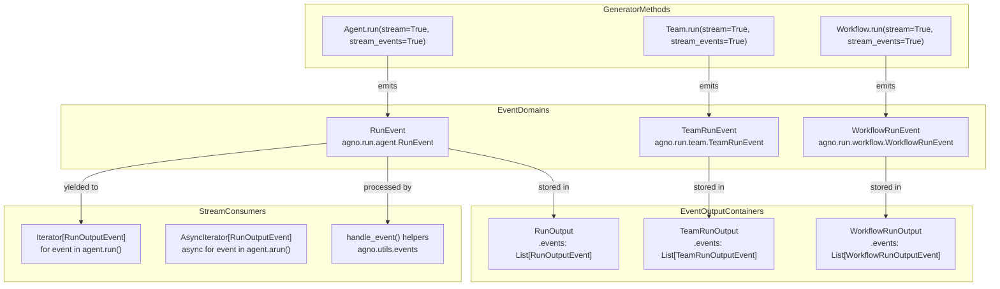
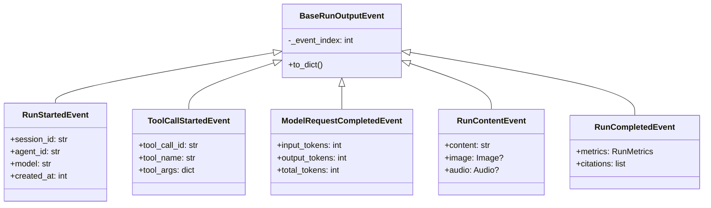
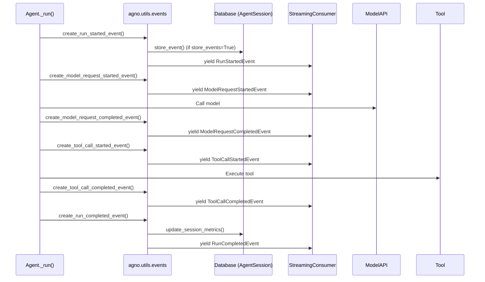

<!-- source: DeepWiki mcp.deepwiki.com · repo agno-agi/agno · page 2.6 Event Streaming System · fetched 2026-10-26 -->

# Event Streaming System

<details>
<summary>Relevant source files</summary>

The following files were used as context for generating this wiki page:

- [.github/workflows/test_on_release.yml](.github/workflows/test_on_release.yml)
- [libs/agno/agno/agent/agent.py](libs/agno/agno/agent/agent.py)
- [libs/agno/agno/models/base.py](libs/agno/agno/models/base.py)
- [libs/agno/agno/models/message.py](libs/agno/agno/models/message.py)
- [libs/agno/agno/models/response.py](libs/agno/agno/models/response.py)
- [libs/agno/agno/run/agent.py](libs/agno/agno/run/agent.py)
- [libs/agno/agno/run/team.py](libs/agno/agno/run/team.py)
- [libs/agno/agno/team/team.py](libs/agno/agno/team/team.py)
- [libs/agno/agno/utils/events.py](libs/agno/agno/utils/events.py)
- [libs/agno/agno/utils/print_response/agent.py](libs/agno/agno/utils/print_response/agent.py)
- [libs/agno/agno/utils/print_response/team.py](libs/agno/agno/utils/print_response/team.py)
- [libs/agno/pyproject.toml](libs/agno/pyproject.toml)
- [libs/agno/tests/integration/agent/test_event_streaming.py](libs/agno/tests/integration/agent/test_event_streaming.py)
- [libs/agno/tests/integration/teams/test_event_streaming.py](libs/agno/tests/integration/teams/test_event_streaming.py)
- [libs/agno/tests/integration/test_basic.py](libs/agno/tests/integration/test_basic.py)
- [libs/agno/tests/integration/test_os_basic.py](libs/agno/tests/integration/test_os_basic.py)
- [libs/agno/tests/unit/models/test_message.py](libs/agno/tests/unit/models/test_message.py)
- [libs/agno/tests/unit/run/test_run_input.py](libs/agno/tests/unit/run/test_run_input.py)
- [scripts/run_model_tests.sh](scripts/run_model_tests.sh)

</details>


## Purpose and Scope

The Event Streaming System in Agno provides granular, real-time event emission during the execution of Agents, Teams, and Workflows. These events enable real-time observability into run progress, including model calls, tool invocations, reasoning steps, session interactions, and error handling. This system supports both synchronous and asynchronous streaming runs, optionally persisting events for auditing and analysis.

This page covers the usage and implementation details of the `stream_events` parameter that governs event streaming, the `RunEvent` enums for agent-level events (e.g., `RunStarted`, `ToolCallStarted`, `ModelRequestCompleted`), the Server-Sent Events (SSE) format used for event transport, and how events enable real-time progress tracking.

## Event Architecture Overview

The event streaming system is organized as event domains with corresponding event enums and output classes, tightly integrated with the entity execution methods.



**Sources:** [libs/agno/agno/run/agent.py:144-181](), [libs/agno/agno/run/team.py:131-172](), [libs/agno/agno/run/workflow.py:39-83](), [libs/agno/agno/utils/events.py:1-105]()

## The `stream_events` Parameter

The primary way to enable detailed event streaming is by setting the `stream_events` parameter to `True` when calling the `run()` or `arun()` methods on Agents, Teams, or Workflows. Its behavior is:

- `stream=False, stream_events=False`: Return a single final response without intermediate output.
- `stream=True, stream_events=False`: Stream incremental content chunks (`run_content`) only.
- **`stream_events=True`**: Stream detailed intermediate events such as model requests, tool calls, reasoning steps, and metadata events in addition to content chunks.

For example, in the `Agent` class:

```python
agent.run("Input text", stream=True, stream_events=True)
```

returns an iterator yielding `RunOutputEvent` dataclasses for each event, providing clients full observability of the run lifecycle. Similar support exists on the `Team` and `Workflow` classes.

**Persistence:** When `store_events=True` is set alongside `stream_events=True`, events are also recorded persistently on the server (e.g., within `AgentSession`, `TeamSession`) allowing later retrieval and playback.

**Sources:** [libs/agno/tests/integration/agent/test_event_streaming.py:23-74]()

## Detailed Agent RunEvent Types

The `RunEvent` enum enumerates all possible event types for Agent run executions, with key types including:

| Event                          | Description                                       | Emission Point                                       |
|-------------------------------|-------------------------------------------------|-----------------------------------------------------|
| `run_started`                  | Start of the run                                 | Beginning of an Agent run                            |
| `run_content`                 | Incremental content deltas                        | Each model stream chunk                              |
| `run_content_completed`       | Finalization of streamed content                 | End of model content generation                      |
| `run_completed`               | Completed run with metrics                        | Run finishes normally                                |
| `run_error`                   | Run failure with error info                       | Exception thrown                                     |
| `run_cancelled`               | Run was cancelled                                 | Run cancellation triggered                           |
| `tool_call_started`           | Tool invocation started                           | Before tool execution                                |
| `tool_call_completed`         | Tool execution completed                          | After tool returns                                   |
| `tool_call_error`             | Tool execution error                              | Tool raised error or exception                       |
| `reasoning_started`           | Reasoning process started                         | Begin reasoning steps                                |
| `reasoning_step`              | Individual reasoning step                         | As reasoning progresses                              |
| `reasoning_content_delta`     | Incremental reasoning content                     | Streaming partial reasoning data                     |
| `reasoning_completed`         | Reasoning finished                                | End of reasoning process                             |
| `model_request_started`       | Model API request initiated                       | Before calling the language model API               |
| `model_request_completed`     | Model API request completed                       | After receiving the model response                   |
| `memory_update_started`       | Memory update task started                        | Before updating user memory                          |
| `memory_update_completed`     | Memory update finished                            | After user memory update                             |
| `run_paused`                  | Run paused for human-in-the-loop                  | Hit user approval, input, or external execution     |
| `run_continued`               | Run continued after pause                         | Resuming stream after human input                    |
| `pre_hook_started`/`completed`| User-defined pre-run hooks started/completed    | Executing pre-run hooks                              |
| `post_hook_started`/`completed`| User-defined post-run hooks started/completed  | Executing post-run hooks                             |
| `session_summary_started`/`completed` | Session summary creation started/completed | Background session summary task                     |

These events carry typified data class wrappers, often inheriting from `BaseRunOutputEvent`, containing relevant metadata: IDs, names, timestamps, content, tool call args, metrics, media, and references.

**Sources:** [libs/agno/agno/run/agent.py:144-192](), [libs/agno/agno/run/agent.py:220-450](), [libs/agno/agno/utils/events.py:1-45]()

## Event Class and Serialization Details

All events inherit from `BaseRunOutputEvent` which supports safe JSON serialization for streaming over HTTP/SSE.

Key points:

- Each event carries an `event_index` - a monotonic sequence number applied at publish time useful for client reconnection and resume scenarios.
- Complex fields like media (`Image`, `Audio`, etc.) are serialized carefully.
- To avoid cycles during nested dataclasses conversion (`asdict()`), `to_dict()` temporarily removes "deep" attributes like `run_output` or `step_requirements` and serializes them individually.
- The serialized event dicts are then encoded as JSON strings and sent to HTTP clients via the SSE protocol.

**Serialization Flow**



**Sources:** [libs/agno/agno/run/agent.py:188-266](), [libs/agno/agno/run/agent.py:328-364](), [libs/agno/tests/unit/run/test_run_events.py:183-202]()

## Server-Sent Events (SSE) Format for HTTP Streaming

The system offers HTTP streaming of events using SSE (Server-Sent Events) conforming to the standard format:

- Each event is sent as a JSON payload encoded in an SSE stream.
- The `to_dict()` implementation on events ensures stable, cycle-safe JSON.
- Events are serialized and prefixed with `data: ` and suffixed with two newlines per SSE standards.
- Clients receive a continuous event stream suitable for live updating UIs or other real-time interfaces.

This mechanism supports consumption from frontend clients or other services needing live feedback on agent/team/workflow progress.

**Sources:** [libs/agno/agno/run/base.py:79-113](), [libs/agno/agno/run/workflow.py:102-170]()

## Event Flow in Agent Execution

During an agent run with `stream_events=True`, events are generated at key points:

1. **Run Start:** `RunStartedEvent` created and yielded immediately.
2. **Model Invocation:** `ModelRequestStartedEvent` at request start, followed by `ModelRequestCompletedEvent` at response end.
3. **Tool Execution:** `ToolCallStartedEvent` and `ToolCallCompletedEvent` for each tool call.
4. **Reasoning Steps:** Reasoning-related events stream intermediate thought process data.
5. **Run Content:** `RunContentEvent` streams partial generated content.
6. **Run Completion:** `RunCompletedEvent` with final results, metrics, and citations.
7. **Background tasks:** User memory update, session summaries emit `started` and `completed` events around async processing.

Clients can consume these events for full visibility into the run lifecycle. The event loop in Agno’s `Agent._run()` and helpers in `agno.utils.events.handle_event()` manage creation, yielding, and optional persistence of these events.



**Sources:** [libs/agno/agno/utils/events.py:90-140](), [libs/agno/agno/utils/agent.py:86-150]()

## RunEvent Types for Real-time Progress Tracking

The granularity of event types allows client applications or monitoring UIs to provide rich real-time insights:

- Display "Run Started" and unique run IDs to track each execution.
- Show live content to users as it's generated (`run_content` events).
- Visual indicators of tool usage based on `ToolCallStartedEvent` and `ToolCallCompletedEvent`, including tool inputs and outputs.
- Reasoning progress and intermediate thoughts stream live with `reasoning_step` and `reasoning_content_delta`.
- Model API metrics and token counts via `ModelRequestCompletedEvent`.
- Detect user interaction needs via `run_paused`.
- Show progress updates with background tasks such as session summaries or memory updates.
- Robust error reporting and cancellation handling.

Tools can also emit `CustomEvent` subclass instances to enrich this stream with domain-specific signals, which are caught in the agent run loop and emitted as events.

**Sources:** [libs/agno/agno/run/agent.py:140-190](), [libs/agno/tests/integration/agent/test_event_streaming.py:171-190]()

## Persistence of Events

When `store_events=True` is set, intermediate events are saved in the session’s run history (`AgentSession.runs` or equivalents). Each stored event keeps an `event_index`. Clients can resynchronize on reconnect by specifying the last event index seen.

Stored events contain:

- Event metadata and timestamps
- Content deltas, media, tool call results
- Metrics and diagnostics

This persistence supports replay, analysis, auditing, and UI re-hydration on reconnect or reloading.

The main containers for stored events are:

- `RunOutput` for Agent runs
- `TeamRunOutput` for Team runs
- `WorkflowRunOutput` for Workflow runs

**Sources:** [libs/agno/agno/run/agent.py:734-780](), [libs/agno/agno/run/team.py:848-898](), [libs/agno/agno/run/base.py:47-57]()

## Summary Diagram of Event Types and Streaming Integration

```mermaid
graph LR
    subgraph AgentRun
        RunMethod[Agent.run(stream=True, stream_events=True)]
        RunOutput[RunOutput(events: List[RunOutputEvent])]
        Iterator["Iterator[RunOutputEvent]"]
        DB["AgentSession & DB Storage"]
    end

    subgraph EventTypes
        RunStarted["RunStartedEvent"]
        ModelStarted["ModelRequestStartedEvent"]
        ModelCompleted["ModelRequestCompletedEvent"]
        ToolStarted["ToolCallStartedEvent"]
        ToolCompleted["ToolCallCompletedEvent"]
        RunContent["RunContentEvent"]
        RunCompleted["RunCompletedEvent"]
        RunPaused["RunPausedEvent"]
    end

    RunMethod -->|yields events| Iterator
    Iterator -->|consume| Client["Client/UI"]
    RunMethod -->|store if store_events=True| DB
    DB -->|retrieve stored events| Client

    Iterator --> RunStarted
    Iterator --> ModelStarted
    Iterator --> ModelCompleted
    Iterator --> ToolStarted
    Iterator --> ToolCompleted
    Iterator --> RunContent
    Iterator --> RunPaused
    Iterator --> RunCompleted
```

**Sources:** [libs/agno/agno/run/agent.py:144-192](), [libs/agno/agno/utils/events.py:1-105](), [libs/agno/tests/integration/agent/test_event_streaming.py:23-170]()

---

This concludes the detailed technical documentation of Agno's Event Streaming System, covering the `stream_events` parameter, event enums and classes, SSE format, and real-time tracking capabilities.

# References

- Agent run event definitions: [libs/agno/agno/run/agent.py:144-192,220-450]()
- Team run event definitions: [libs/agno/agno/run/team.py:131-172]()
- Workflow run event definitions: [libs/agno/agno/run/workflow.py:39-83]()
- Event utilities and helpers: [libs/agno/agno/utils/events.py:1-105]()
- Run event streaming tests: [libs/agno/tests/integration/agent/test_event_streaming.py:16-176]()
- Event streaming persistence: [libs/agno/agno/run/base.py:47-57](), [libs/agno/agno/run/agent.py:734-780]()

---

