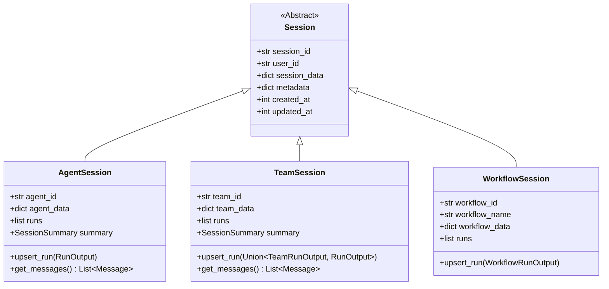
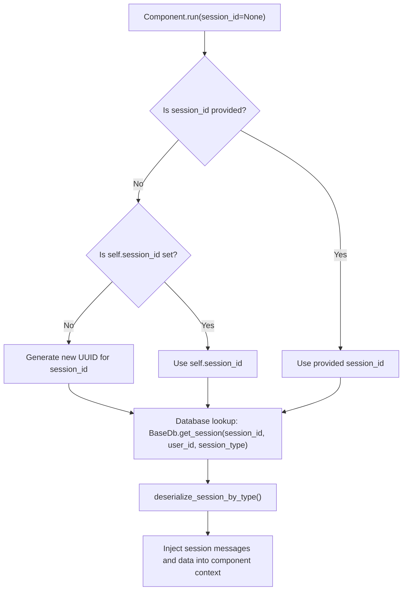
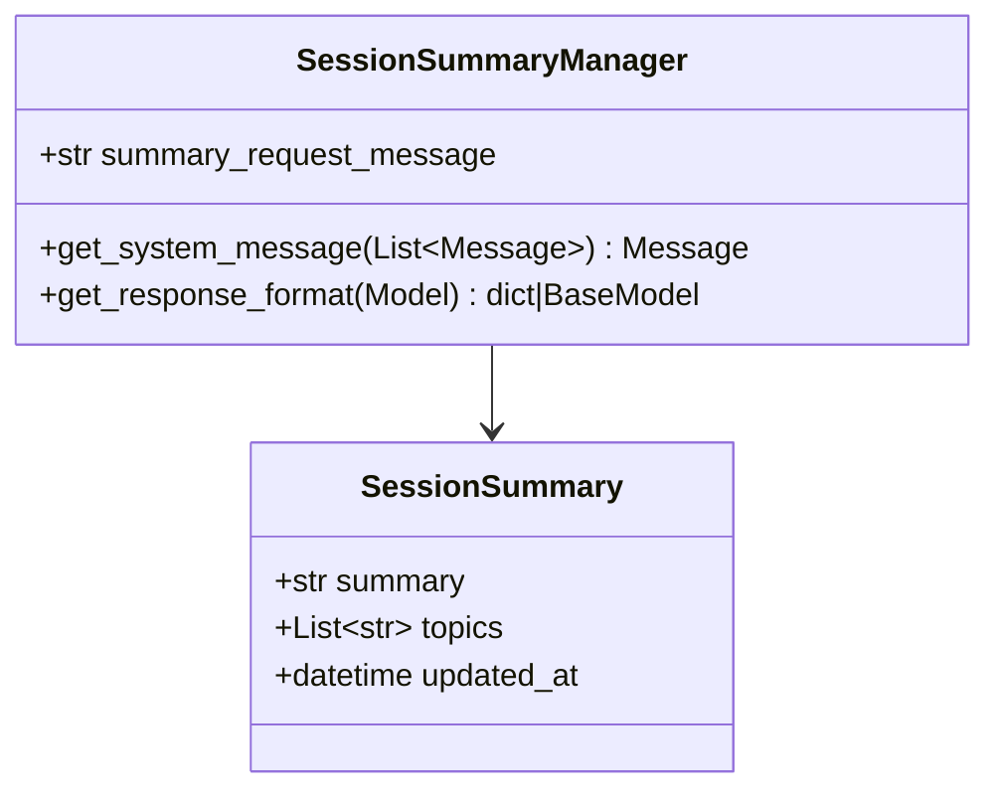
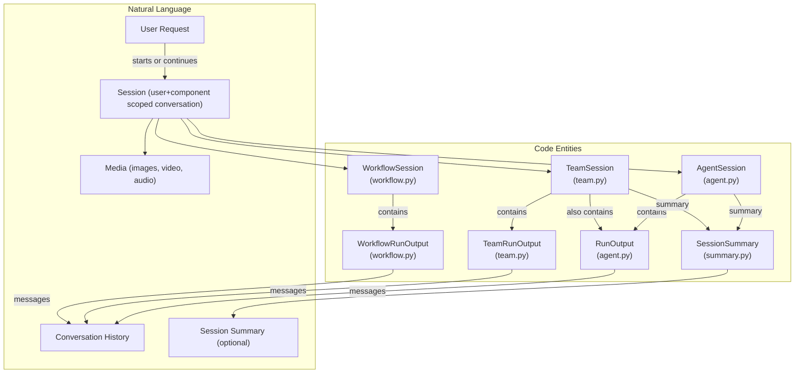
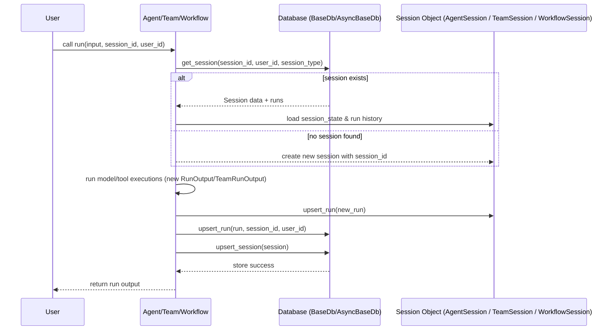

<!-- source: DeepWiki mcp.deepwiki.com · repo agno-agi/agno · page 2.7 Session Management · fetched 2026-10-26 -->

# Session Management

Relevant source files

The following files were used as context for generating this wiki page:

- [cookbook/02_agents/05_state_and_session/README.md](cookbook/02_agents/05_state_and_session/README.md)
- [cookbook/02_agents/05_state_and_session/last_n_session_messages.py](cookbook/02_agents/05_state_and_session/last_n_session_messages.py)
- [cookbook/03_teams/07_session/README.md](cookbook/03_teams/07_session/README.md)
- [cookbook/03_teams/07_session/TEST_LOG.md](cookbook/03_teams/07_session/TEST_LOG.md)
- [cookbook/03_teams/07_session/nested_team_deep_history.py](cookbook/03_teams/07_session/nested_team_deep_history.py)
- [cookbook/03_teams/07_session/nested_team_history.py](cookbook/03_teams/07_session/nested_team_history.py)
- [cookbook/03_teams/07_session/nested_team_history_to_members.py](cookbook/03_teams/07_session/nested_team_history_to_members.py)
- [cookbook/06_storage/04_session_summary_limits.py](cookbook/06_storage/04_session_summary_limits.py)
- [libs/agno/agno/agent/_default_tools.py](libs/agno/agno/agent/_default_tools.py)
- [libs/agno/agno/session/agent.py](libs/agno/agno/session/agent.py)
- [libs/agno/agno/session/summary.py](libs/agno/agno/session/summary.py)
- [libs/agno/agno/session/team.py](libs/agno/agno/session/team.py)
- [libs/agno/agno/session/workflow.py](libs/agno/agno/session/workflow.py)
- [libs/agno/agno/team/_default_tools.py](libs/agno/agno/team/_default_tools.py)
- [libs/agno/agno/team/_task_tools.py](libs/agno/agno/team/_task_tools.py)
- [libs/agno/agno/tools/sql.py](libs/agno/agno/tools/sql.py)
- [libs/agno/tests/integration/managers/test_session_summary_manager.py](libs/agno/tests/integration/managers/test_session_summary_manager.py)
- [libs/agno/tests/integration/session/test_agent_session.py](libs/agno/tests/integration/session/test_agent_session.py)
- [libs/agno/tests/integration/session/test_share_sessions.py](libs/agno/tests/integration/session/test_share_sessions.py)
- [libs/agno/tests/integration/session/test_team_session.py](libs/agno/tests/integration/session/test_team_session.py)
- [libs/agno/tests/integration/teams/human_in_the_loop/test_continue_run_history_context.py](libs/agno/tests/integration/teams/human_in_the_loop/test_continue_run_history_context.py)
- [libs/agno/tests/integration/teams/test_history.py](libs/agno/tests/integration/teams/test_history.py)
- [libs/agno/tests/integration/teams/test_member_dedup.py](libs/agno/tests/integration/teams/test_member_dedup.py)
- [libs/agno/tests/unit/agent/test_knowledge_retriever_tool_priority.py](libs/agno/tests/unit/agent/test_knowledge_retriever_tool_priority.py)
- [libs/agno/tests/unit/team/test_basic.py](libs/agno/tests/unit/team/test_basic.py)
- [libs/agno/tests/unit/team/test_get_messages_dedup.py](libs/agno/tests/unit/team/test_get_messages_dedup.py)
- [libs/agno/tests/unit/workflow/test_workflow_session.py](libs/agno/tests/unit/workflow/test_workflow_session.py)

This page covers the session model used by Agents, Teams, and Workflows in Agno: how sessions are identified, what data they store, how they are loaded and persisted across runs, and how session state is exposed to components at runtime.

For the storage backends that persist sessions (table schemas, CRUD operations, pagination), see [5.5](). For memory that learns from past interactions (user profiles, long-term facts), see [2.8](). For the AgentOS REST API routes that expose sessions to external clients, see [7.2]().

---

## What Is a Session?

A **session** is a named conversation thread associated with a specific component (Agent, Team, or Workflow) and an optional user. It provides:

- **Identity continuity** — the same `session_id` groups multiple runs into one thread.
- **State persistence** — `session_data` (storing `session_state` and media) survives across runs.
- **History access** — prior messages are reloaded and injected into the model context.
- **Metrics tracking** — cumulative token usage and performance data per thread.
- **Summaries** — optionally auto-generated summaries of the conversation via `SessionSummaryManager`.

Sessions are stored in user-owned databases via the `db` parameter on each component. If no `db` is attached, session data is not persisted between process restarts.

---

## Session Types

Three session classes correspond to the three component types. These classes define the schema for data serialized to the database.

| Class          | Used by | Primary key fields        |
|----------------|---------|---------------------------|
| `AgentSession` | `Agent` | `session_id`, `agent_id`  |
| `TeamSession`  | `Team`  | `session_id`, `team_id`   |
| `WorkflowSession` | `Workflow` | `session_id`, `workflow_id` |

All three share the same database table (configured via `session_table` on the db backend) but use different `SessionType` enums for resolution.

**Session Class Space to Code Entity Space:**

Sources:  
[libs/agno/agno/session/agent.py:16-45](),  
[libs/agno/agno/session/team.py:18-45](),  
[libs/agno/agno/session/workflow.py:18-44](),  
[libs/agno/agno/db/base.py:29-29]()

---

## Session Identity and Scoping

Every session is uniquely identified by a combination of identifiers that allow for multi-tenant and multi-component isolation.

| Field       | Description                                                                                     |
|-------------|-------------------------------------------------------------------------------------------------|
| `session_id`| UUID string. Auto-generated per run if not provided. Passed to `run()` or set on the component |
| `user_id`   | Optional string. Scopes the session to a specific user. Most DB backends index on `(session_id, user_id)` |

Database lookups filter by both fields when `user_id` is set, ensuring user isolation. In the AgentOS runtime, `enforce_owner_on_entity` middleware verifies user access based on JWT scopes.

**Session Resolution Logic (Code Flow):**

Sources:  
[libs/agno/agno/session/agent.py:20-27](),  
[libs/agno/agno/session/team.py:22-29](),  
[libs/agno/agno/os/middleware/user_scope.py:15-18](),  
[libs/agno/agno/db/utils.py:10-10]()

---

## Session Data and Persistence

### AgentSession

The `AgentSession` class stores session data for an individual `Agent`. Key fields include:

- `agent_id`: Agent identifier.
- `team_id`: Optional team associated.
- `user_id`: The user interacting with this Agent.
- `workflow_id`: Optional workflow context.
- `agent_data`: Metadata about agent like name and model.
- `session_data`: Arbitrary session state including multimodal content.
- `runs`: List of `RunOutput` or `TeamRunOutput` for history.
- `summary`: Optional `SessionSummary` object summarizing conversation.
- Timestamps for creation and update.

`upsert_run()` appends or updates runs, stripping volatile timing info before storage.

Sources: [libs/agno/agno/session/agent.py:16-45](), [libs/agno/agno/session/agent.py:99-122]()

---

### TeamSession

The `TeamSession` class handles state for a `Team` component:

- `team_id`: Team identifier.
- `user_id`: User interacting with the team.
- `workflow_id`: Optionally links to a workflow.
- `team_data`: Metadata about the team like agents, models.
- `session_data`: Session-level state with media.
- `runs`: List of `TeamRunOutput` or individual runs (`RunOutput`) for agents.
- `summary`: Optional summary.
- Creation and update timestamps.

`upsert_run()` similarly merges or appends runs, removing per-message timers before adding runs into session history.

The team session also handles nuanced filtering and deduplication of messages for team members, ensuring no message duplication occurs when member runs are duplicated in nested storage structures.

Sources: [libs/agno/agno/session/team.py:18-45](), [libs/agno/agno/session/team.py:103-128](), [libs/agno/tests/unit/team/test_get_messages_dedup.py:111-142]()

---

### WorkflowSession

Sessions for `Workflow` support the orchestration of pipeline workflows:

- `workflow_id` and `workflow_name`
- `user_id` for user scoping.
- `runs` containing `WorkflowRunOutput` per execution.
- `session_data`: Arbitrary workflow session state.
- `workflow_data`: Static metadata/configuration about the workflow.
- `metadata`: Additional workflow session info.
- Created and updated timestamps.

Runs are stored and updated via `upsert_run()`, which upserts the workflow run outputs similarly to agent/team sessions.

Sources: [libs/agno/agno/session/workflow.py:18-44](), [libs/agno/agno/session/workflow.py:143-160]()

---

### Lifecycle and Upserting

The session lifecycle revolves around:

1. **Session Initialization:**  
   When `run()` is called with or without a `session_id`, the component resolves or creates a session.
2. **Session Loading:**  
   The session is loaded from database, deserializing runs and session data.
3. **Run Execution:**  
   New runs (agent/team/workflow executions) are created as part of the session.
4. **Run Upsert:**  
   After completion or at checkpoint points, `upsert_run()` adds or updates the run in the session's `runs` list.
5. **Session Persistence:**  
   The whole session, including runs and summary, is persisted via `upsert_session()` by the DB backend.

`upsert_run()` carefully removes transient metrics like message timers before storing runs to avoid persisting runtime state.

`queue_attempt` fields are preserved if set on existing runs to maintain generation stamps across successive saves.

Sources:  
[libs/agno/agno/session/agent.py:99-122](),  
[libs/agno/agno/session/team.py:103-128](),  
[libs/agno/agno/session/workflow.py:143-160](),  
[libs/agno/agno/db/base.py:29-29]()

---

## Session Summaries

Sessions often grow large and can degrade prompt performance. Agno provides a *session summary* facility to condense session history.

- `SessionSummary` is a dataclass storing the summary text, topics, and update timestamp.
- `SessionSummaryManager` manages generation of summaries using LLMs with a prompt describing the task of summarization.

Summary generation flow:

1. The component (Agent or Team) prepares past conversation messages by calling `session.get_messages()`.
2. `SessionSummaryManager` uses a specialized prompt injecting the conversation messages.
3. The LLM generates a `SessionSummaryResponse` which contains a concise summary and optional topics discussed.
4. The summary is saved onto the session (e.g. `AgentSession.summary`) and persisted during the next session update.

**Summary Model and prompt example:**

Sources: [libs/agno/agno/session/summary.py:23-102](), [libs/agno/agno/session/agent.py:40-40](), [libs/agno/agno/session/team.py:40-40]()

---

## Shared Sessions (Agent-Team Interoperability)

Agno supports sharing a single `session_id` between different component types to enable continued conversations:

- For example, an Agent session can be continued by a Team using the same `session_id`.
- Team sessions can deserialize embedded agent runs and vice versa.

**Key implementation points:**

- `TeamSession.from_dict()` inspects each run during deserialization. Runs containing `agent_id` are deserialized as `RunOutput`; runs with `team_id` as `TeamRunOutput` [libs/agno/agno/session/team.py:74-82]().
- Conversely, `AgentSession.from_dict()` handles embedded `TeamRunOutput` runs so Agents can continue team sessions [libs/agno/agno/session/agent.py:69-96]().
- `get_messages()` on session objects applies filters (e.g., `last_n_runs`, skipping system roles, or skipping member messages) to selectively extract the relevant message history for context injection.

### Team Session Message Filtering and Deduplication

In team sessions, each run may embed member runs in `member_responses` and there may also be standalone member runs. To avoid duplicating messages when forming the team history:

- `TeamSession.get_messages()` implements deduplication logic for member runs appearing in both places.
- It allows filtering by member IDs and skips messages according to specified statuses and roles.
- This reduces duplicate tool call IDs and message repetition during model context setup.

Sources:  
[libs/agno/agno/session/agent.py:141-164](),  
[libs/agno/agno/session/team.py:130-155](),  
[libs/agno/agno/session/team.py:74-82](),  
[libs/agno/tests/unit/team/test_get_messages_dedup.py:111-142]()

---

# Summary Diagram: Natural Language "Session" to Code Entities

---

# Summary Diagram: Session Persistence and Runtime Flow

---

This page documents session lifecycle, data models, scoping rules, and persistence patterns to support robust memory, history context injection, and continuous interaction experiences in Agno’s AI agent framework.

Sources (all):  
[libs/agno/agno/session/agent.py:1-168](),  
[libs/agno/agno/session/team.py:1-169](),  
[libs/agno/agno/session/workflow.py:1-173](),  
[libs/agno/agno/session/summary.py:1-169](),  
[libs/agno/agno/db/base.py:29-29](),  
[libs/agno/agno/db/utils.py:10-10](),  
[libs/agno/agno/os/middleware/user_scope.py:15-18](),  
[libs/agno/tests/unit/team/test_get_messages_dedup.py:111-142]()

---

