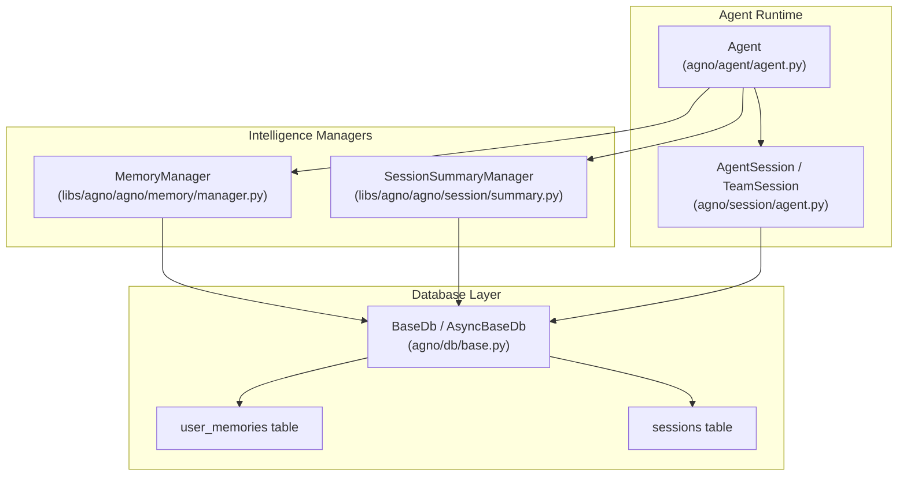
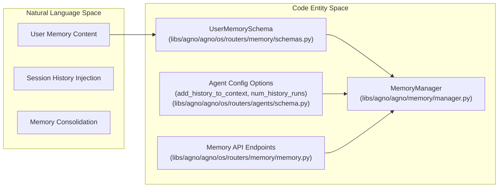

<!-- source: DeepWiki mcp.deepwiki.com · repo agno-agi/agno · page 2.8 Memory and Learning Systems · fetched 2026-10-26 -->

# Memory and Learning Systems

<details>
<summary>Relevant source files</summary>

The following files were used as context for generating this wiki page:

- [libs/agno/agno/memory/manager.py](libs/agno/agno/memory/manager.py)
- [libs/agno/agno/os/routers/agents/schema.py](libs/agno/agno/os/routers/agents/schema.py)
- [libs/agno/agno/os/routers/memory/memory.py](libs/agno/agno/os/routers/memory/memory.py)
- [libs/agno/agno/os/routers/memory/schemas.py](libs/agno/agno/os/routers/memory/schemas.py)
- [libs/agno/agno/os/routers/teams/schema.py](libs/agno/agno/os/routers/teams/schema.py)
- [libs/agno/agno/os/routers/workflows/schema.py](libs/agno/agno/os/routers/workflows/schema.py)
- [libs/agno/tests/unit/memory/test_search_user_memories_defaults.py](libs/agno/tests/unit/memory/test_search_user_memories_defaults.py)
- [libs/agno/tests/unit/os/test_knowledge_filters_serialization.py](libs/agno/tests/unit/os/test_knowledge_filters_serialization.py)
- [libs/agno/tests/unit/os/test_schemas.py](libs/agno/tests/unit/os/test_schemas.py)

</details>


This document covers the memory and learning capabilities in Agno that enable agents to accumulate intelligence over time. The framework distinguishes between **User Memory** (storing user-specific unstructured information), **Session Management** (tracking conversation history), and **Learning** (extracting structured insights via the Learning system).

---

## Overview and Purpose

Agno provides three distinct layers of persistent intelligence:

1.  **User Memories**: Personal information about individual users (preferences, facts, context) stored in the `user_memories` table [libs/agno/agno/db/schemas/__init__.py:4]().
2.  **Session Summaries**: Concise representations of past conversations to maintain context without exceeding token limits [libs/agno/agno/session/summary.py:23-44]().
3.  **History Injection**: Configurable mechanisms to include past runs in the current context using `num_history_runs` and `add_history_to_context` [libs/agno/agno/os/routers/agents/schema.py:91-92]().

This page details the implementation and usage of the **UserMemory** system, memory context injection parameters (`add_history_to_context`, `num_history_runs`), memory persistence APIs, and the role of the `MemoryManager` in enabling agents to learn from prior interactions.

---

## System Architecture

### Component Relationships and Data Flow



**Sources**: [libs/agno/agno/memory/manager.py:46-75](), [libs/agno/agno/session/summary.py:63-95](), [libs/agno/agno/session/agent.py:15-44](), [libs/agno/agno/session/team.py:16-44]()

---

## Memory Management: UserMemory and MemoryManager

### UserMemory Schema

The `UserMemory` class represents a persistent record of a user-specific memory fragment. It includes these primary attributes:
- `memory_id`: Unique ID of the memory
- `memory`: The textual content of the memory (possibly JSON serialized)
- `topics`: Optional tags or categories for the memory
- `user_id`: The user who owns the memory
- Optional associations with `agent_id` or `team_id`
- `updated_at`: Timestamp of the last update

`UserMemorySchema` (Pydantic model) provides validation and deserialization logic including handling migrated or nested content formats to keep compatibility [libs/agno/agno/os/routers/memory/schemas.py:15-51]().

```python
class UserMemorySchema(BaseModel):
    memory_id: str
    memory: str
    topics: Optional[List[str]]
    agent_id: Optional[str]
    team_id: Optional[str]
    user_id: Optional[str]
    updated_at: Optional[datetime]

    @classmethod
    def from_dict(cls, memory_dict: Dict[str, Any]) -> Optional["UserMemorySchema"]:
        ...
```

This schema supports API data flow for memory creation, retrieval, and management.

### MemoryManager Class

The central in-framework class for managing user memories is `MemoryManager`. It handles all memory-related operations including:
- Reading and writing memories to/from a configured database (`BaseDb` or `AsyncBaseDb`)
- Searching user memories by user ID, optionally applying semantic or temporal filters
- Optimizing memories by consolidating and reducing token usage
- Debugging and logging controls

Important attributes and flags are:
- `model`: The language model used internally for memory extraction or optimization. Defaults to `OpenAIChat` "gpt-4o" [libs/agno/agno/memory/manager.py:50-123]()
- `db`: The database instance for persistence [libs/agno/agno/memory/manager.py:72-73]()
- Controls for memory lifecycle operations:
  - `add_memories`
  - `update_memories`
  - `delete_memories`
  - `clear_memories`
- `system_message`, `memory_capture_instructions`, and `additional_instructions`: Strings optionally configuring LLM prompts for memory extraction [libs/agno/agno/memory/manager.py:52-57]()

#### Key Methods

- Initialization constructs a `MemoryManager` given model, DB, and flags [libs/agno/agno/memory/manager.py:77-113]()
- `read_from_db(user_id: Optional[str])`: Synchronous method to fetch user memories from DB, returning a mapping of user_id to list of `UserMemory` objects [libs/agno/agno/memory/manager.py:125-139]()
- `aread_from_db(user_id: Optional[str])`: Async version for memory fetching [libs/agno/agno/memory/manager.py:140-161]()
- `set_log_level`: Sets logging verbosity based on debug flags/environment variables [libs/agno/agno/memory/manager.py:163-168]()
- `get_user_memories(user_id: Optional[str])`: Returns a list of memories for the given user, fetching fresh from DB as needed [libs/agno/agno/memory/manager.py:174-182]()

The `MemoryManager` may be integrated with agent execution pipelines to automatically extract new memories or retrieve relevant prior information as context.

---

## Session History and Context Injection

Agno agents maintain session-level persistence scoped by `AgentSession` or `TeamSession`. These sessions contain conversation history as sequences of runs and messages.

### Context Injection Parameters

Two primary configuration parameters control history injection into the model context:

| Parameter              | Description                                                   | Default/Behavior                                 | Location                                 |
|------------------------|---------------------------------------------------------------|-------------------------------------------------|------------------------------------------|
| `add_history_to_context` | When true, past session history is included in the prompt context | Default false; disables history injection by default | Agent configuration [libs/agno/agno/os/routers/agents/schema.py:91]() |
| `num_history_runs`       | Number of past runs to include in the context                  | Default 3 runs                                    | Agent configuration [libs/agno/agno/os/routers/agents/schema.py:92]() |

When enabled, the agent runtime includes previous conversational runs (up to `num_history_runs`) from the same session as additional context during generation. This enables the agent to "remember" prior dialogue parts without external querying.

---

## Memory Persistence and API Surface in AgentOS

AgentOS exposes REST endpoints to manage user memories.

### Create Memory Endpoint

- Path: `/memories`
- Method: POST
- Payload: `UserMemoryCreateSchema` (includes `memory`, `user_id`, and optional `topics`)
- On success: returns `UserMemorySchema`
- Uses database scoped by user token or explicitly by query parameters
- Supports both synchronous and asynchronous DB implementations
- Errors handled for missing user ID or DB failures

### Delete Memory Endpoint

- Path: `/memories/{memory_id}`
- Method: DELETE
- Deletes a specific memory by ID and optionally by user scope

### Optimize Memories Endpoint

- Path: `/memories/optimize`
- Method: POST
- Accepts a `OptimizeMemoriesRequest` containing a user ID, optional model, and apply flag
- Returns `OptimizeMemoriesResponse`, summarizing token savings and memory counts before/after optimization

These APIs are defined in `libs/agno/agno/os/routers/memory/memory.py` and related schemas live in `libs/agno/agno/os/routers/memory/schemas.py`.

---

## Agents Learning from Past Interactions via MemoryManager

Agents leverage the `MemoryManager` as their primary interface to persistent user memories:

- After conversation runs, agents can **capture** salient facts and store them as new memories, guided by configurable LLM prompt instructions.
- During new runs, agents can **search** and **fetch** relevant memories to provide persistent personalized context.
- Agents may use memory optimization workflows to consolidate memories, ensuring memory size remains manageable.
- The `MemoryManager` class abstracts the complexities of syncing memory data with the database and extracting learned user preferences or facts.

### Diagram: Natural Language Concepts to Code Entities



---

## Summary Table of Key Memory API-Related Classes and Parameters

| Concept / Item                | Code Entity / Class                      | Description                                     | File Reference                            |
|------------------------------|----------------------------------------|-------------------------------------------------|------------------------------------------|
| Persistent user memory        | `UserMemory` (DB schema)                | Represents stored user facts and preferences    | `agno/db/schemas/__init__.py` line 4    |
| Memory data validation & API  | `UserMemorySchema`                      | Validates input/output for memory API            | `os/routers/memory/schemas.py:15-51`    |
| Memory management logic       | `MemoryManager`                         | Manages create, update, delete, search           | `agno/memory/manager.py:46-182`          |
| Agent context history flags   | `add_history_to_context`, `num_history_runs` | Control inclusion of session history in context | `os/routers/agents/schema.py:91-92`     |
| Memory REST API routes        | Create, Delete, Optimize endpoints     | Expose memory management over HTTP                | `os/routers/memory/memory.py:40-273`    |

---

# References

- MemoryManager class and methods: [libs/agno/agno/memory/manager.py:46-182]()
- UserMemorySchema and API schemas: [libs/agno/agno/os/routers/memory/schemas.py:15-103]()
- Memory REST API routing and handlers: [libs/agno/agno/os/routers/memory/memory.py:40-273]()
- Agent configuration flags for memory and history: [libs/agno/agno/os/routers/agents/schema.py:90-93]()
- Session and summary management system: [libs/agno/agno/session/summary.py:23-132]()

---

This concludes the detailed explanation of Agno's memory and learning systems including UserMemory, memory persistence, session history injection, and agent learning workflows via the MemoryManager.

---

