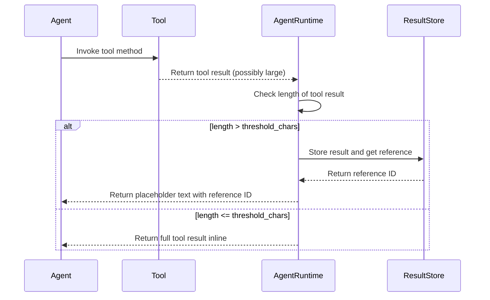
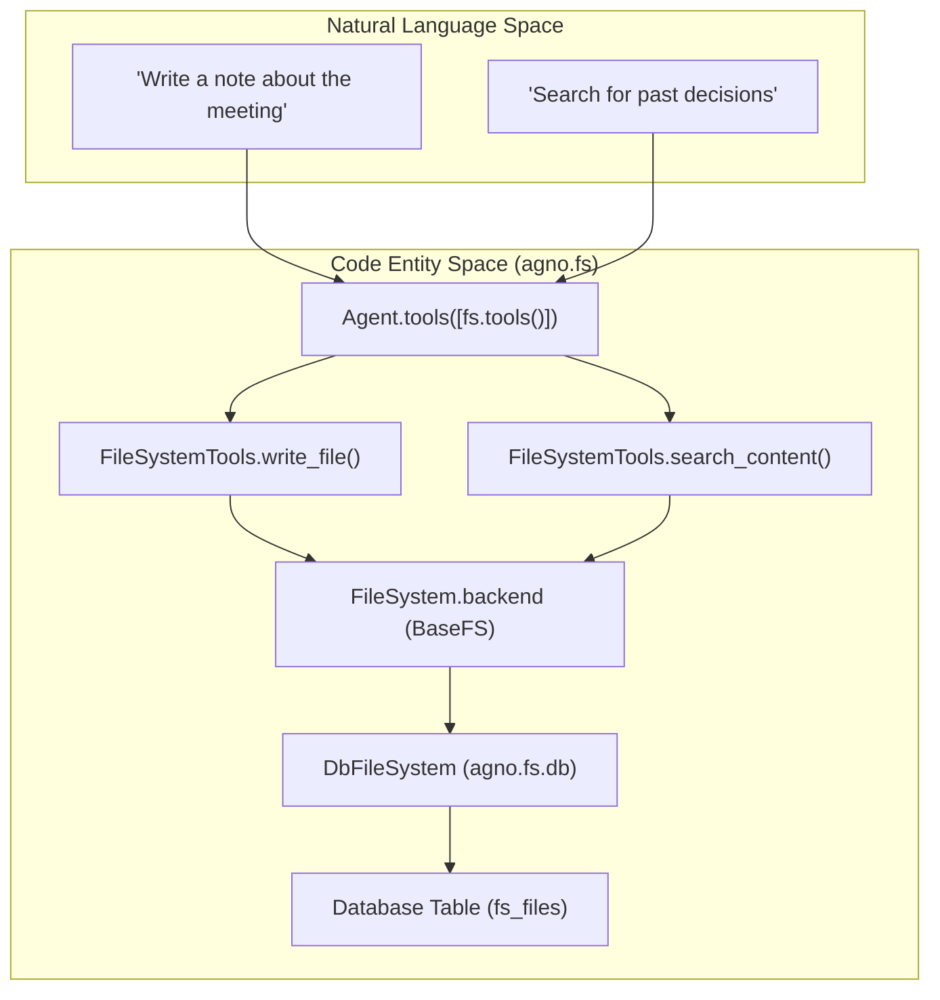
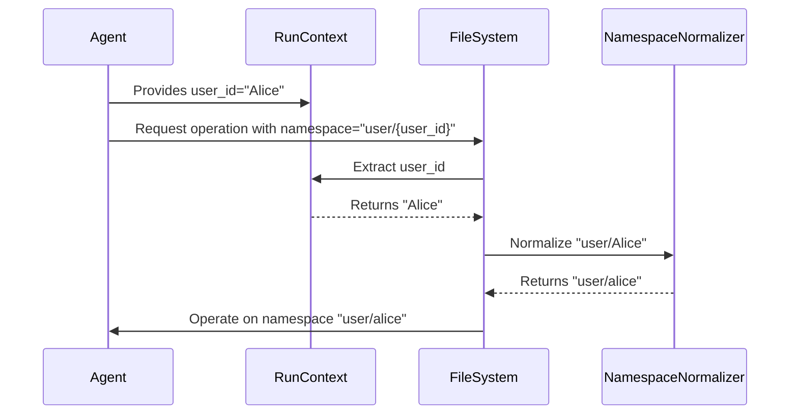
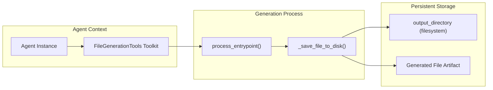

<!-- source: DeepWiki mcp.deepwiki.com · repo agno-agi/agno · page 2.9 Result Offloading and FileSystem · fetched 2026-10-26 -->

# Result Offloading and FileSystem

<details>
<summary>Relevant source files</summary>

The following files were used as context for generating this wiki page:

- [cookbook/01_demo/settings.py](cookbook/01_demo/settings.py)
- [cookbook/04_workflows/06_advanced_concepts/file_propagation/file_generation_workflow.py](cookbook/04_workflows/06_advanced_concepts/file_propagation/file_generation_workflow.py)
- [cookbook/05_agent_os/02_databases/gcs_media_storage.py](cookbook/05_agent_os/02_databases/gcs_media_storage.py)
- [cookbook/05_agent_os/02_databases/s3_media_storage.py](cookbook/05_agent_os/02_databases/s3_media_storage.py)
- [cookbook/06_storage/11_media_storage_file_generation.py](cookbook/06_storage/11_media_storage_file_generation.py)
- [cookbook/13_filesystem/02_durable_records/basic.py](cookbook/13_filesystem/02_durable_records/basic.py)
- [cookbook/13_filesystem/02_durable_records/radar_news_delta.py](cookbook/13_filesystem/02_durable_records/radar_news_delta.py)
- [cookbook/13_filesystem/04_namespaces/README.md](cookbook/13_filesystem/04_namespaces/README.md)
- [cookbook/13_filesystem/04_namespaces/TEST_LOG.md](cookbook/13_filesystem/04_namespaces/TEST_LOG.md)
- [cookbook/13_filesystem/04_namespaces/shared_namespace.py](cookbook/13_filesystem/04_namespaces/shared_namespace.py)
- [cookbook/91_tools/file_generation_tools.py](cookbook/91_tools/file_generation_tools.py)
- [libs/agno/agno/fs/fs.py](libs/agno/agno/fs/fs.py)
- [libs/agno/agno/fs/toolkit.py](libs/agno/agno/fs/toolkit.py)
- [libs/agno/agno/tools/file/__init__.py](libs/agno/agno/tools/file/__init__.py)
- [libs/agno/agno/tools/file/file.py](libs/agno/agno/tools/file/file.py)
- [libs/agno/agno/tools/file/generation.py](libs/agno/agno/tools/file/generation.py)
- [libs/agno/agno/tools/file_generation.py](libs/agno/agno/tools/file_generation.py)
- [libs/agno/tests/unit/fs/test_toolkit.py](libs/agno/tests/unit/fs/test_toolkit.py)
- [libs/agno/tests/unit/tools/test_file_generation.py](libs/agno/tests/unit/tools/test_file_generation.py)
- [libs/agno/tests/unit/utils/test_path_safety_consistency.py](libs/agno/tests/unit/utils/test_path_safety_consistency.py)

</details>


The Agno framework implements a sophisticated system for managing large tool outputs and providing agents with durable, private storage. This page documents two key functionalities:

1. Result Offloading — a mechanism to handle massive tool outputs by moving them out of the prompt context to preserve memory and improve performance.
2. FileSystem — an abstraction giving agents a durable private filesystem backed by a database, accessible via a rich toolkit exposing traditional filesystem semantics with quota and namespace support.

---

## Result Offloading

### Purpose and Rationale

Agents often invoke tools that produce large outputs, such as lengthy search results, documents, or datasets. Injecting these large outputs directly into model prompts can cause:

- Token limit exhaustion,
- Latency degradation,
- Poor user experience from unwieldy input/output.

Agno addresses this by *offloading* tool results over a configurable character length threshold.

### Components and Configuration

- **`offload_tool_results`**: A boolean flag on the `Agent` class enabling offloading behavior [libs/agno/agno/agent/agent.py:1-20]() (not fully visible in current excerpts).
- **`threshold_chars`**: A configurable integer representing the character length boundary beyond which tool results are offloaded instead of returned inline.
- **`ResultStore` Interface**: An abstraction responsible for storing large tool outputs persistently (e.g., in a database or storage service) and returning stable references for later retrieval.

### Data Flow



This flow ensures that very large outputs are replaced with a concise reference string in the prompt context, and the complete result is retrievable via the offload system when needed.

---

## FileSystem Abstraction

The `FileSystem` class [libs/agno/agno/fs/fs.py:111-153]() provides a private, durable, quota-limited filesystem per agent or namespace. It is designed to be used by agents to maintain persistent notes, decisions, running documents, or any state that must survive beyond a single session or run.

### Architecture Overview

- **Namespace Scoped**: Each `FileSystem` instance addresses a *namespace* — a logical partition that isolates files per user/agent/team as needed.
- **Pluggable Backend**: 
  - A default database-backed backend (`DbFileSystem`) stores files as rows in a SQL table.
  - Other backends (local disk, cloud storage) can be plugged in.
- **Quota Limits**:
  - Maximum file size (`max_file_bytes`), default 1MB.
  - Maximum total size per namespace (`max_namespace_bytes`), default 20MB.
- **Template Placeholders**: Namespaces can embed placeholders `{user_id}`, `{agent_id}`, `{team_id}` dynamically resolved at runtime from the agent context.
- **API surface** exposes standard filesystem operations such as read, write, append, replace lines, list files, search content, move, delete.

### Initialization Key Code

```python
def __init__(
    self,
    backend: Any = None,
    namespace: str = DEFAULT_NAMESPACE,
    *,
    db: Optional["BaseDb"] = None,
    max_file_bytes: int = 1_000_000,
    max_namespace_bytes: int = 20_000_000,
) -> None:
    if (backend is None) == (db is None):
        raise ValueError("Provide exactly one of backend or db")
    if db is not None:
        from agno.fs.db import DbFileSystem
        backend = DbFileSystem(db=db)
    self.backend: BaseFS = _as_backend(backend)
    self.namespace = normalize_namespace(namespace)
    self.max_file_bytes = max_file_bytes
    self.max_namespace_bytes = max_namespace_bytes
```

This constructor enforces either `backend` or `db` to be provided, normalizes namespaces, and sets quotas [libs/agno/agno/fs/fs.py:136-153]().

---

### FileSystem Toolkits — The `FileSystemTools` Class

Agents interact with their filesystem via the `FileSystemTools` toolkit [libs/agno/agno/fs/toolkit.py:93-158]() which wraps the `FileSystem` APIs into tools callable by the agent.

#### Tool Surface

| Tool Name        | Description                                                                                       |
|------------------|-------------------------------------------------------------------------------------------------|
| `read_file`      | Read contents of a file, optionally by line range                                                |
| `write_file`     | Write (overwrite) file contents                                                                  |
| `append_file`    | Append lines to a file with optional per-line deduplication (`unique` flag)                       |
| `replace_lines`  | Replace lines in a file between start and end line                                               |
| `list_files`     | List files in a directory with optional pattern and recursion                                    |
| `search_content` | Search files for a given text query, returns files and line numbers of matches                    |
| `check_lines`    | Batch-exact check for presence of lines across a directory                                       |
| `move_file`      | Rename or move a file                                                                            |
| `delete_file`    | Delete a file (optional, guarded by `allow_delete=True`)                                        |

The `append_file`, `replace_lines`, and `check_lines` primitives make this toolkit specialized for *durable* use cases involving incremental logs or mutable documents.

#### Partial Listing of Default and Full Tool Sets

- Default (seven tools): `read_file`, `write_file`, `append_file`, `replace_lines`, `list_files`, `search_content`, `move_file`
- Allow delete enabled: adds `delete_file`
- Read-only mode: only `read_file`, `list_files`, `search_content`

---

### FileSystem Data Flow Diagram

This diagram shows how an agent's high-level requests map to the internal code entities of the `FileSystem` subsystem.



---

### Namespaces and Isolation

Namespaces are used to isolate file storage logically within one physical backend.

- Namespaces are normalized (case-lowered, URL safe) [libs/agno/agno/fs/fs.py:117-121]().
- Can embed templates such as `{user_id}`, `{agent_id}` and `{team_id}` that are resolved at run-time from `RunContext` [libs/agno/agno/fs/fs.py:122-127]().
- Missing context for placeholders causes fail-closed errors to avoid leaking data.
- Helps implement multi-tenant storage: different users see only their isolated namespace.

**Namespace Resolution Sequence**



---

### Quotas and Safety

To control resource consumption and prevent runaway storage:

- `max_file_bytes` limits the size of any single file.
- `max_namespace_bytes` limits the total disk consumption per namespace.
- On the reading side, `FileSystemTools.read_file` limits reads to 100,000 characters to prevent LLM context flooding [libs/agno/agno/fs/toolkit.py:46-53]().

---

## File Generation Tooling

Agno includes `FileGenerationTools`, a rich utility for generating various file formats used within workflows or agents, which can integrate with the `FileSystem` abstraction for durable storage [libs/agno/agno/tools/file/generation.py:7-12](), [cookbook/91_tools/file_generation_tools.py:2-137]().

### Key Features

- Supports generating JSON, CSV, PDF, DOCX, plain text, HTML, and source code files.
- Supports saving files to an output directory on disk (`save_files=True`) or returning as in-memory artifacts.
- Enforces path safety via strict validations (`safe_join_filename`, `safe_join_relative_path`) rejecting control chars, traversal, and reserved names [libs/agno/tests/unit/utils/test_path_safety_consistency.py:1-180]().
- Automatically infers file extensions and content types.
- Easily integrated into agents by including `FileGenerationTools` in their `tools` list.

### File Generation Flow



---

## Durable Records Pattern with FileSystem

The FileSystem's specialized tools support an important pattern to track work done across agent runs using durable line-based record logs.

- The `check_lines` tool checks if exact lines appear in any files under a directory (e.g., `seen/2026-07-24.md`).
- The `append_file` tool can append new lines uniquely (`unique=True`) to prevent duplicate processing.
- Agents use `check_lines` before acting on input batches and record processed items with `append_file` after, achieving idempotent, durable progress tracking.

This pattern is exemplified in [cookbook/13_filesystem/02_durable_records/basic.py:1-83]().

---

# Summary

Agno's **Result Offloading** system and **FileSystem** abstraction together provide a powerful infrastructure for building scalable, long-lived AI agents and workflows. Offloading safeguards prompt length, while the FileSystem supports private, quota-managed, namespace-isolated durable storage accessible via a rich set of agent tools.

These mechanisms enable agents to:

- Work with large datasets safely,
- Persist notes, decisions, and state durably,
- Deduplicate work efficiently across runs,
- Share files securely when desired via namespaces.

---

# References and Sources

- Result Offloading concept and configuration: [libs/agno/agno/agent/agent.py:1-20]()
- FileSystem core class, namespace resolution: [libs/agno/agno/fs/fs.py:110-153]()
- FileSystem backend and base classes (overview): [libs/agno/agno/fs/base.py:1-40]() (partial, not cited in detail here)
- FileSystemTools toolkit, tools surface and implementations: [libs/agno/agno/fs/toolkit.py:1-158]()
- Code examples demonstrating file generation and persistence: [cookbook/91_tools/file_generation_tools.py:1-137]()
- File generation tool implementation: [libs/agno/agno/tools/file/generation.py:7-12]()
- Path safety tests related to FileGenerationTools: [libs/agno/tests/unit/utils/test_path_safety_consistency.py:1-183]()
- Durable Records example using check_lines and append_file: [cookbook/13_filesystem/02_durable_records/basic.py:1-83]()
- Namespace sharing example: [cookbook/13_filesystem/04_namespaces/shared_namespace.py:1-64]()
- File propagation example showing file handling between workflow steps: [cookbook/04_workflows/06_advanced_concepts/file_propagation/file_generation_workflow.py:1-94]()
- Unit tests for FileSystemTools signatures and behaviors: [libs/agno/tests/unit/fs/test_toolkit.py:1-158]()

---

This completes the full technical detail documentation for Agno's result offloading and FileSystem abstraction.

---

