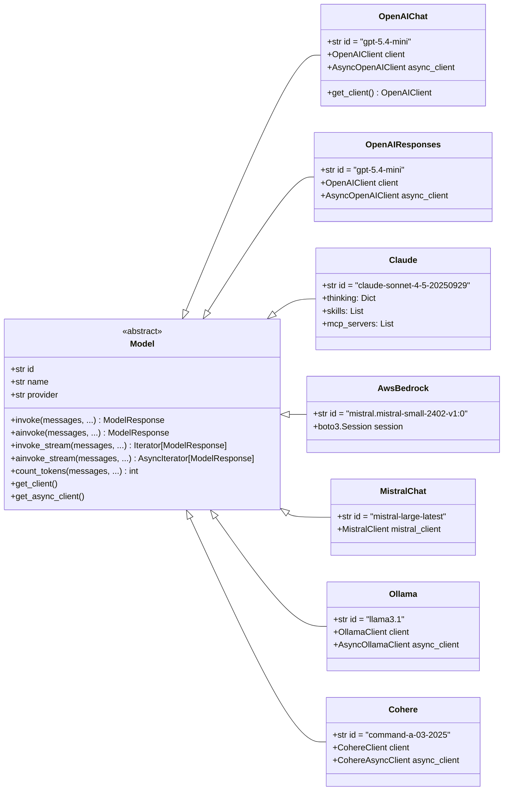
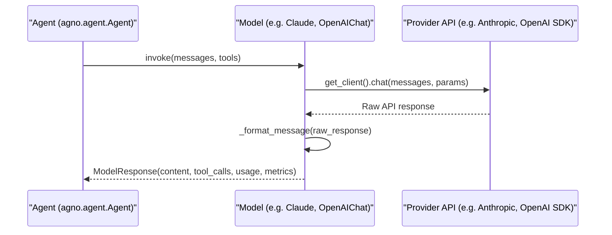
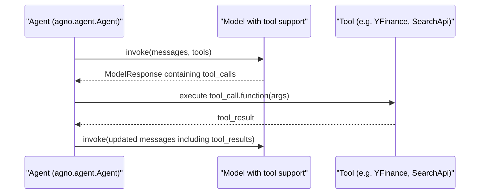
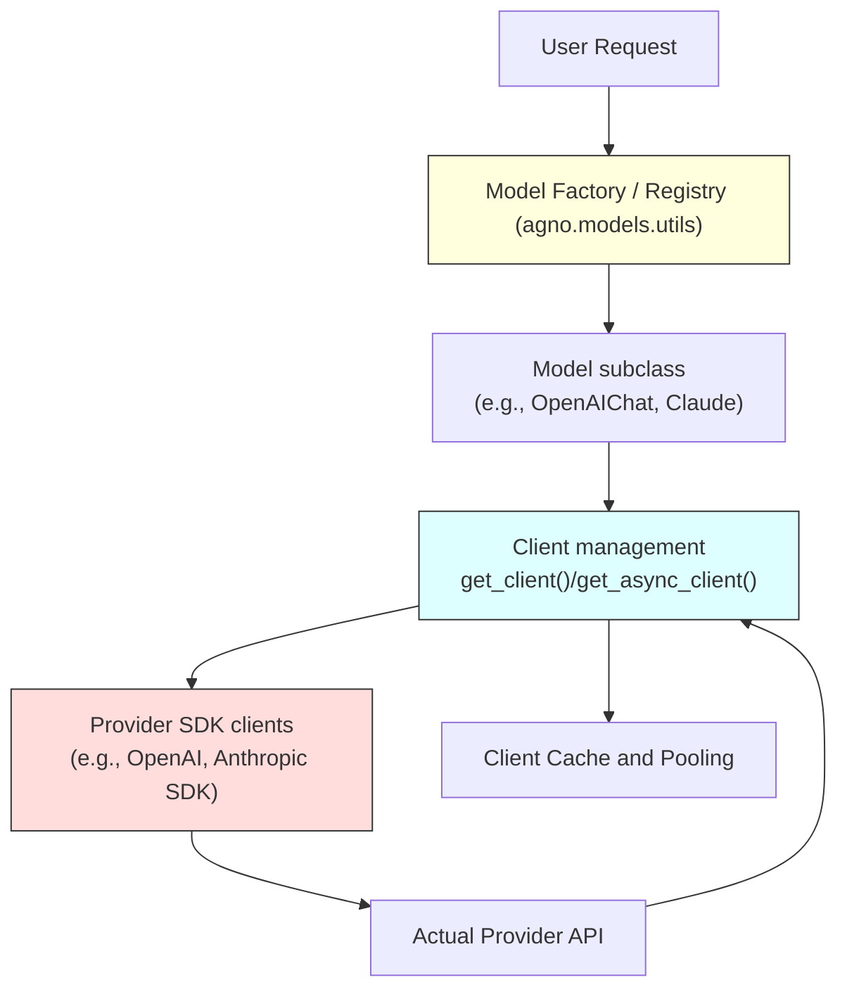

<!-- source: DeepWiki mcp.deepwiki.com · repo agno-agi/agno · page 3 Model Integrations · fetched 2026-10-26 -->

# Model Integrations

<details>
<summary>Relevant source files</summary>

The following files were used as context for generating this wiki page:

- [cookbook/90_models/anthropic/csv_input.py](cookbook/90_models/anthropic/csv_input.py)
- [cookbook/90_models/anthropic/markdown_input.py](cookbook/90_models/anthropic/markdown_input.py)
- [cookbook/90_models/anthropic/pydantic_tool_input.py](cookbook/90_models/anthropic/pydantic_tool_input.py)
- [cookbook/90_models/yapi/README.md](cookbook/90_models/yapi/README.md)
- [cookbook/90_models/yapi/TEST_LOG.md](cookbook/90_models/yapi/TEST_LOG.md)
- [cookbook/90_models/yapi/basic.py](cookbook/90_models/yapi/basic.py)
- [cookbook/90_models/yapi/tool_use.py](cookbook/90_models/yapi/tool_use.py)
- [libs/agno/agno/__init__.py](libs/agno/agno/__init__.py)
- [libs/agno/agno/models/anthropic/claude.py](libs/agno/agno/models/anthropic/claude.py)
- [libs/agno/agno/models/aws/bedrock.py](libs/agno/agno/models/aws/bedrock.py)
- [libs/agno/agno/models/aws/claude.py](libs/agno/agno/models/aws/claude.py)
- [libs/agno/agno/models/azure/ai_foundry.py](libs/agno/agno/models/azure/ai_foundry.py)
- [libs/agno/agno/models/azure/openai_chat.py](libs/agno/agno/models/azure/openai_chat.py)
- [libs/agno/agno/models/cohere/chat.py](libs/agno/agno/models/cohere/chat.py)
- [libs/agno/agno/models/groq/groq.py](libs/agno/agno/models/groq/groq.py)
- [libs/agno/agno/models/huggingface/huggingface.py](libs/agno/agno/models/huggingface/huggingface.py)
- [libs/agno/agno/models/ibm/watsonx.py](libs/agno/agno/models/ibm/watsonx.py)
- [libs/agno/agno/models/meta/llama.py](libs/agno/agno/models/meta/llama.py)
- [libs/agno/agno/models/mistral/mistral.py](libs/agno/agno/models/mistral/mistral.py)
- [libs/agno/agno/models/ollama/chat.py](libs/agno/agno/models/ollama/chat.py)
- [libs/agno/agno/models/openai/chat.py](libs/agno/agno/models/openai/chat.py)
- [libs/agno/agno/models/openai/responses.py](libs/agno/agno/models/openai/responses.py)
- [libs/agno/agno/models/utils.py](libs/agno/agno/models/utils.py)
- [libs/agno/agno/models/vertexai/claude.py](libs/agno/agno/models/vertexai/claude.py)
- [libs/agno/agno/models/yapi/__init__.py](libs/agno/agno/models/yapi/__init__.py)
- [libs/agno/agno/models/yapi/yapi.py](libs/agno/agno/models/yapi/yapi.py)
- [libs/agno/agno/utils/models/claude.py](libs/agno/agno/utils/models/claude.py)
- [libs/agno/tests/integration/models/anthropic/test_format_tools.py](libs/agno/tests/integration/models/anthropic/test_format_tools.py)
- [libs/agno/tests/integration/models/huggingface/test_basic.py](libs/agno/tests/integration/models/huggingface/test_basic.py)
- [libs/agno/tests/integration/models/huggingface/test_tool_use.py](libs/agno/tests/integration/models/huggingface/test_tool_use.py)
- [libs/agno/tests/unit/models/anthropic/test_citation_suppression.py](libs/agno/tests/unit/models/anthropic/test_citation_suppression.py)
- [libs/agno/tests/unit/models/test_client_caching.py](libs/agno/tests/unit/models/test_client_caching.py)
- [libs/agno/tests/unit/models/test_cross_model_tool_calls.py](libs/agno/tests/unit/models/test_cross_model_tool_calls.py)
- [libs/agno/tests/unit/models/test_mistral_request_params.py](libs/agno/tests/unit/models/test_mistral_request_params.py)
- [libs/agno/tests/unit/models/yapi/__init__.py](libs/agno/tests/unit/models/yapi/__init__.py)
- [libs/agno/tests/unit/models/yapi/test_yapi.py](libs/agno/tests/unit/models/yapi/test_yapi.py)
- [libs/agno/tests/unit/utils/test_claude.py](libs/agno/tests/unit/utils/test_claude.py)
- [libs/agno/tests/unit/utils/test_model_string.py](libs/agno/tests/unit/utils/test_model_string.py)

</details>


## Purpose and Scope

This page presents an overview of Agno’s unified model integration layer. It abstracts over 40 large language model (LLM) providers, offering a common interface for invoking models synchronously and asynchronously, streaming outputs, executing tool calls, and handling structured output formats. This abstraction enables developers to seamlessly switch providers or combine them while leveraging provider-specific capabilities transparently.

Key layer responsibilities include:

- Defining a consistent `Model` base interface for invoking models, managing clients, and token counting.
- Supporting multiple invocation styles: synchronous, asynchronous, streaming.
- Normalizing provider responses into `ModelResponse` objects.
- Handling lifecycle, authentication, retry logic, and connection pooling of model clients.
- Recognizing provider-specific features like output schemas, tool calling, and experimental betas.

For detailed technical design of the `Model` interface, client lifecycle, and retry mechanisms, see [Model Interface and Architecture](#3.1) and [Client Lifecycle and Retry Logic](#3.9).

Supported providers access a diverse ecosystem, including:

- OpenAI Chat and Responses APIs (GPT-4, GPT-5, etc.)
- Anthropic Claude models (Claude 3.5, Sonnet, Opus, etc.)
- Google Gemini and GeminiInteractions APIs
- AWS Bedrock-hosted models (Claude, Llama, Mistral)
- Mistral native API models
- Cohere Command R+
- Ollama local and cloud models
- Groq, DeepSeek, Together, Fireworks high-performance backends
- 30+ other providers with native integrations and community drivers

**Sources:** [libs/agno/agno/models/base.py:130-184](), [libs/agno/agno/models/utils.py:15-106](), [libs/agno/agno/models/anthropic/claude.py:95-173](), [libs/agno/agno/models/openai/chat.py:1-164](), [libs/agno/agno/models/openai/responses.py:31-153](), [libs/agno/agno/models/aws/bedrock.py:40-160]().

---

## Model Abstraction Architecture

Agno’s model layer organizes all supported providers as subclasses of the core abstract `Model` base class. This class defines key invocation methods with consistent signatures and manages client instances. Each subclass represents a provider-specific implementation, encapsulating authentication, API parameter translation, and streaming capabilities.

### Model Class Hierarchy Overview



This polymorphic design lets agents call models via the same interface, regardless of provider differences.

**Sources:** [libs/agno/agno/models/base.py:130-184](), [libs/agno/agno/models/openai/chat.py:35-91](), [libs/agno/agno/models/anthropic/claude.py:95-173](), [libs/agno/agno/models/aws/bedrock.py:40-160](), [libs/agno/agno/models/mistral/mistral.py:38-70](), [libs/agno/agno/models/ollama/chat.py:26-105](), [libs/agno/agno/models/cohere/chat.py:27-111]().

---

## Core Interface Methods

The `Model` base class defines the following core methods to interact with LLMs, supporting different invocation scenarios:

| Method              | Description                                  | Returns                            |
|---------------------|----------------------------------------------|----------------------------------|
| `invoke(messages, ...)`        | Synchronously call the model with a message list. Uses client internally. | `ModelResponse` [libs/agno/agno/models/base.py:214-225]() |
| `ainvoke(messages, ...)`       | Asynchronous equivalent of `invoke()`. | Awaitable `ModelResponse` [libs/agno/agno/models/base.py:226-261]()  |
| `invoke_stream(messages, ...)` | Synchronous streaming API returning iterator of incremental `ModelResponse` deltas. | Iterator `[ModelResponse]` [libs/agno/agno/models/base.py:242-252]() |
| `ainvoke_stream(messages, ...)`| Async streaming version returning async iterator of incremental responses. | AsyncIterator `[ModelResponse]` [libs/agno/agno/models/base.py:256-265]() |
| `count_tokens(messages, ...)`  | Estimate token usage for cost management and model constraints. Supports schemas. | `int` [libs/agno/agno/models/base.py:195-210]() |

Models also manage their underlying client instances and support lifecycle methods for caching, opening, and closing clients for HTTP efficiency and auth stability.

For comprehensive details on these interfaces, see [Model Interface and Architecture](#3.1).

**Sources:** [libs/agno/agno/models/base.py:130-270]().

---

## Supported Provider Implementations

Agno incorporates over 40 distinct providers, each modeled as a subclass of `Model`. The architecture consistently manages:

- Authentication via environment variables or explicit parameters.
- Client construction and caching for sync/async use.
- Request parameter normalization (temperature, max_tokens, stop sequences, etc.).
- Specialized capabilities like tool calling, output schema enforcement, and reasoning modes.

Some key providers and their noteworthy features include:

| Provider           | Model Class            | Highlights                                                  |
|--------------------|-----------------------|-------------------------------------------------------------|
| OpenAI Chat        | `OpenAIChat` [40-164] | Native structured outputs, detailed reasoning parameters, streaming support |
| OpenAI Responses   | `OpenAIResponses` [31-153] | Responses API, background task mode, parallel tool calls |
| Anthropic Claude   | `Claude` [95-173]       | Thinking modes, skills, prompt caching, structured outputs toggle |
| AWS Bedrock        | `AwsBedrock` [40-160]   | Native boto3 support, SSO, async via aioboto3, varied model backends |
| Mistral Chat       | `MistralChat` [38-69]   | Native SDK client, safe modes, tooling, structured outputs |
| Cohere             | `Cohere` [27-111]       | Command models with custom tools, strict tool validation |
| Ollama             | `Ollama` [26-105]       | Local and cloud host connection, streaming, function calls |
| Groq               | `Groq` [30-143]         | High-speed client, error management, streaming support |

Provider-specific nuances such as use of `httpx` clients or SDK clients and supported feature flags (`supports_native_structured_outputs`) are handled internally.

For detailed implementations, see these child pages:

- [OpenAI Integration](#3.2)
- [Anthropic Claude](#3.3)
- [Google Gemini and Other Providers](#3.4)
- [Provider-Specific Features](#3.5)

**Sources:** [libs/agno/agno/models/utils.py:15-106](), [libs/agno/agno/models/anthropic/claude.py:95-173](), [libs/agno/agno/models/openai/chat.py:35-164](), [libs/agno/agno/models/aws/bedrock.py:40-160](), [libs/agno/agno/models/mistral/mistral.py:38-69](), [libs/agno/agno/models/cohere/chat.py:27-111](), [libs/agno/agno/models/ollama/chat.py:26-105](), [libs/agno/agno/models/groq/groq.py:30-143]().

---

## Response Normalization and Metrics

Responses from any provider are encapsulated within standardized `ModelResponse` objects [libs/agno/agno/models/response.py:114-163](). This abstraction normalizes diverse provider formats into:

- `content`: Generated text or multimodal content.
- `tool_calls`: Tool/Fn calls requested in the response.
- `usage`: Token usage and latency metrics.
- `citations`: Source references when applicable.

### Normalization Flow (Synchronous)



Similarly, streaming responses emit incremental deltas parsed into partial `ModelResponse` objects, enabling real-time client consumption. Metrics like token counts, streaming latency, and reasoning costs are aggregated and exposed for observability [libs/agno/agno/models/response.py:156-163]().

For low-level streaming details and event parsing, see [Streaming and Response Processing](#3.8).

**Sources:** [libs/agno/agno/models/response.py:114-163](), [libs/agno/agno/models/mistral/mistral.py:178-187](), [libs/agno/agno/models/ollama/chat.py:150-196]().

---

## Tool Calling and Structured Outputs

Many models support calling tools or functions directly from the LLM output, allowing agents to execute external APIs or code. Agno facilitates this by:

- Translating `Message` objects with embedded tool call requests into provider-specific function call formats.
- Mapping outputs between JSON schemas and native Python types.
- Supporting parallel tool calls when available.
- Feeding tool call results back into subsequent model invocations to enable chaining.

The tool calling flow can be visualized as:



Models like Mistral, Ollama, and newer OpenAI/Anthropic providers natively support structured outputs via JSON schemas, enabled by flags such as `supports_native_structured_outputs`. Pydantic models can be used for the output schema parameter, enforcing correctness and facilitating parsing.

For complete understanding of tool calling mechanics and structured output enforcement, see [Tool Calling and Function Execution](#3.6) and [Structured Outputs](#3.7).

**Sources:** [libs/agno/agno/models/cohere/chat.py:165-173](), [libs/agno/tests/integration/models/huggingface/test_tool_use.py:10-50](), [libs/agno/agno/models/mistral/mistral.py:38-187](), [libs/agno/agno/models/ollama/chat.py:26-196]().

---

## Error Handling, Retry Logic, and Client Lifecycle

All models incorporate robust error and retry handling strategies tailored to provider-specific failure modes:

- Configurable retry attempts on transient errors via `retries` parameter.
- Special exceptions for authentication failures (`ModelAuthenticationError`) and rate limiting (`ModelRateLimitError`).
- Exponential backoff and jitter support to avoid API flooding.
- Automatic client reconnection and cleanup to prevent connection leaks.
- Client caching shared across requests where feasible to optimize resource usage.

For the comprehensive client lifecycle, connection management, and API error recovery mechanisms, see [Client Lifecycle and Retry Logic](#3.9).

**Sources:** [libs/agno/agno/models/base.py:170-187](), [libs/agno/agno/models/groq/groq.py:72-95](), [libs/agno/agno/models/aws/bedrock.py:120-160]().

---

# Diagrams Bridging Natural Language to Code Entity Space

### 1. From Natural Language to Model Interface Code Entities

```mermaid
graph TD
    NL1["Natural Language Request"] --> A[Agent (agno.agent.Agent)]
    A --> B[Model Selection (Provider-specific Model subclass)]
    B --> C{Model base class\n(libs/agno/agno/models/base.py)}
    C --> D[invoke() / ainvoke()]
    C --> E[invoke_stream() / ainvoke_stream()]
    D --> F[ModelResponse (libs/agno/agno/models/response.py)]
    E --> F
    F --> G[Tool Calls and Structured Outputs (libs/agno/agno/models/message.py)]
    
    style C fill:#f9f,stroke:#333,stroke-width:1px
    style F fill:#bbf,stroke:#333,stroke-width:1px
    style G fill:#bfb,stroke:#333,stroke-width:1px
```

This diagram traces a natural language prompt flow through Agno's agent to the model abstraction layer, exposing key code entities and files related to invocation and response handling.

---

### 2. Provider Selection and Client Lifecycle



This diagram illustrates the code path from user request through provider model resolution and internal client lifecycle management ensuring efficient API consumption.

---

# Summary

Agno’s model integration layer offers a powerful, extensible abstraction over a large ecosystem of LLM providers. It simplifies agent development by unifying provider diversity behind a stable interface supporting synchronous, asynchronous, streaming, and structured output workflows. Advanced support for tool calling and response normalization enables rich, multi-model reasoning pipelines. Behind the scenes, robust client lifecycle and retry logic maximize reliability and performance.

To dive into details on specific providers, usage patterns, and capabilities, explore the following child pages:

- [Model Interface and Architecture](#3.1)
- [OpenAI Integration](#3.2)
- [Anthropic Claude](#3.3)
- [Google Gemini and Other Providers](#3.4)
- [Provider-Specific Features](#3.5)
- [Tool Calling and Function Execution](#3.6)
- [Structured Outputs](#3.7)
- [Streaming and Response Processing](#3.8)
- [Client Lifecycle and Retry Logic](#3.9)

---

**Sources:**

- `Model` base and architecture: [libs/agno/agno/models/base.py:130-270](), [libs/agno/agno/models/utils.py:15-106]()
- OpenAI Chat and Responses: [libs/agno/agno/models/openai/chat.py:1-164](), [libs/agno/agno/models/openai/responses.py:31-153]()
- Anthropic Claude: [libs/agno/agno/models/anthropic/claude.py:95-173](), [libs/agno/agno/utils/models/claude.py:1-174]()
- AWS Bedrock: [libs/agno/agno/models/aws/bedrock.py:40-160](), [libs/agno/agno/models/aws/claude.py:23-137]()
- Mistral: [libs/agno/agno/models/mistral/mistral.py:38-69]()
- Cohere: [libs/agno/agno/models/cohere/chat.py:27-111]()
- Ollama: [libs/agno/agno/models/ollama/chat.py:26-105]()
- Groq: [libs/agno/agno/models/groq/groq.py:30-143]()
- ModelResponse normalization: [libs/agno/agno/models/response.py:114-163]()
- Tool calling: [libs/agno/agno/models/cohere/chat.py:165-173](), [libs/agno/tests/integration/models/huggingface/test_tool_use.py:10-50]()
- Client lifecycle and retry: [libs/agno/agno/models/base.py:170-187](), [libs/agno/agno/models/groq/groq.py:72-95](), [libs/agno/agno/models/aws/bedrock.py:120-160]()

---

