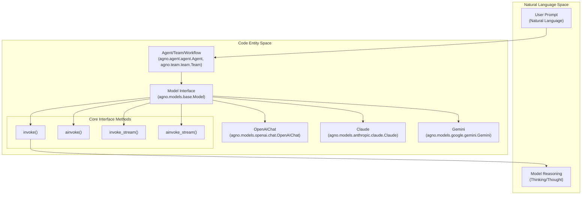
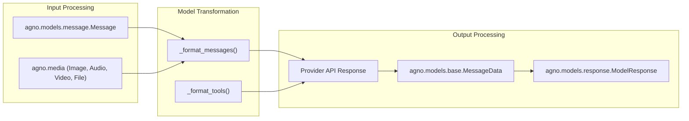
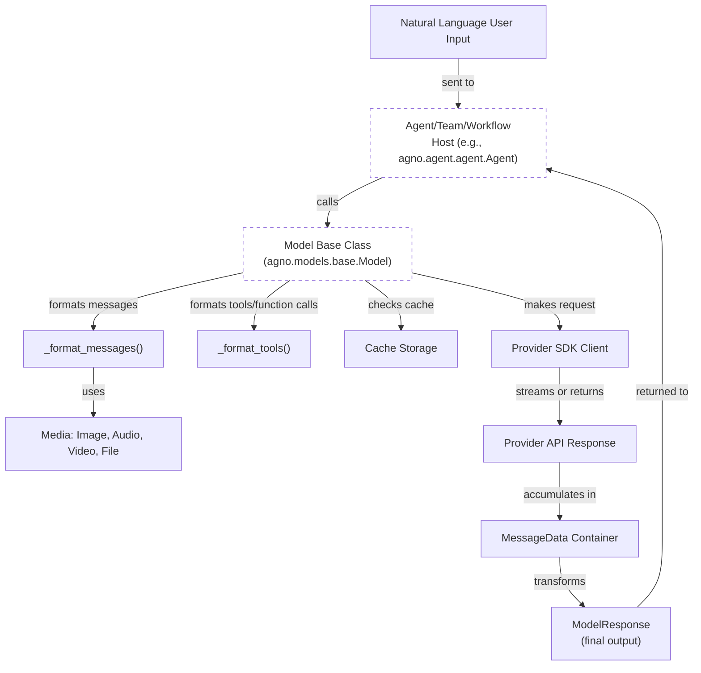

<!-- source: DeepWiki mcp.deepwiki.com · repo agno-agi/agno · page 3.1 Model Interface and Architecture · fetched 2026-10-26 -->

# Model Interface and Architecture

<details>
<summary>Relevant source files</summary>

The following files were used as context for generating this wiki page:

- [.github/workflows/test_on_release.yml](.github/workflows/test_on_release.yml)
- [cookbook/91_tools/smallest_tools.py](cookbook/91_tools/smallest_tools.py)
- [libs/agno/agno/agent/agent.py](libs/agno/agno/agent/agent.py)
- [libs/agno/agno/models/base.py](libs/agno/agno/models/base.py)
- [libs/agno/agno/models/message.py](libs/agno/agno/models/message.py)
- [libs/agno/agno/models/openai/like.py](libs/agno/agno/models/openai/like.py)
- [libs/agno/agno/models/response.py](libs/agno/agno/models/response.py)
- [libs/agno/agno/run/agent.py](libs/agno/agno/run/agent.py)
- [libs/agno/agno/run/team.py](libs/agno/agno/run/team.py)
- [libs/agno/agno/team/team.py](libs/agno/agno/team/team.py)
- [libs/agno/agno/tools/smallest.py](libs/agno/agno/tools/smallest.py)
- [libs/agno/agno/utils/events.py](libs/agno/agno/utils/events.py)
- [libs/agno/pyproject.toml](libs/agno/pyproject.toml)
- [libs/agno/tests/integration/agent/test_event_streaming.py](libs/agno/tests/integration/agent/test_event_streaming.py)
- [libs/agno/tests/integration/teams/test_event_streaming.py](libs/agno/tests/integration/teams/test_event_streaming.py)
- [libs/agno/tests/integration/test_basic.py](libs/agno/tests/integration/test_basic.py)
- [libs/agno/tests/integration/test_os_basic.py](libs/agno/tests/integration/test_os_basic.py)
- [libs/agno/tests/unit/models/test_message.py](libs/agno/tests/unit/models/test_message.py)
- [libs/agno/tests/unit/models/test_model_helpers.py](libs/agno/tests/unit/models/test_model_helpers.py)
- [libs/agno/tests/unit/run/test_run_input.py](libs/agno/tests/unit/run/test_run_input.py)
- [libs/agno/tests/unit/tools/test_smallest.py](libs/agno/tests/unit/tools/test_smallest.py)
- [scripts/run_model_tests.sh](scripts/run_model_tests.sh)

</details>


## Purpose and Scope

This page documents the **Model base class** and the core architecture that enables model-agnostic agent development in Agno. The `Model` class provides a unified interface for interacting with 40+ LLM providers, handling message formatting, response parsing, retry logic, and metrics collection [libs/agno/agno/models/base.py:134-188]().

This page covers the **abstract interface and common functionality** shared across all model providers. For specific provider implementations, see:
- OpenAI Integration: [3.2]()
- Anthropic Claude: [3.3]()
- Google Gemini: [3.4]()
- Provider-Specific Features: [3.5]()

For model capabilities like tool calling and structured outputs, see [3.6]() and [3.7]().

---

## Architecture Overview

The model system follows a provider abstraction pattern where all LLM providers implement a common `Model` interface [libs/agno/agno/models/base.py:134-143](). Orchestrators like `Agent`, `Team`, and `Workflow` interact with this interface rather than specific provider SDKs.

### System Architecture Diagram



Sources: [libs/agno/agno/models/base.py:134-188](), [libs/agno/agno/agent/agent.py:73-84](), [libs/agno/agno/team/team.py:80-88]()

---

## Model Base Class

The `Model` class is an abstract base class defined at [libs/agno/agno/models/base.py:134-188](). It encapsulates common logic around provider interaction while requiring concrete subclasses to implement low-level API calls.

### Key Attributes

| Attribute | Type | Description |
|-----------|------|-------------|
| `id` | `str` | Model identifier (e.g., "gpt-4o", "gemini-2.0-flash") [libs/agno/agno/models/base.py:136]() |
| `name` | `Optional[str]` | Human-readable name for the model [libs/agno/agno/models/base.py:138]() |
| `provider` | `Optional[str]` | Provider name (e.g., "OpenAI", "Google") [libs/agno/agno/models/base.py:140]() |
| `supports_native_structured_outputs` | `bool` | Supports native JSON schema enforcement for structured outputs [libs/agno/agno/models/base.py:149]() |
| `supports_json_schema_outputs` | `bool` | Requires JSON schema for structured outputs (e.g., LMStudio) [libs/agno/agno/models/base.py:151]() |
| `retries` | `int` | Number of retry attempts for provider errors [libs/agno/agno/models/base.py:178]() |
| `delay_between_retries` | `int` | Delay in seconds between retries [libs/agno/agno/models/base.py:180]() |
| `exponential_backoff` | `bool` | If true, delay between retries is doubled each time [libs/agno/agno/models/base.py:182]() |
| `retry_with_guidance` | `bool` | Whether to retry once with corrective instructions on known errors [libs/agno/agno/models/base.py:185]() |
| `cache_response` | `bool` | Cache model responses to reduce redundant calls during development [libs/agno/agno/models/base.py:172]() |

### Design Notes

- The class uses `@dataclass` for attribute management.
- It defines a `MessageData` container to accumulate outputs during streaming.
- The `Model` instance acts as an adapter between Agno's message schemas and provider SDKs.

Sources: [libs/agno/agno/models/base.py:134-188]()

---

## Core Invocation Methods

All concrete `Model` subclasses must implement four core API interaction methods, that support synchronous, asynchronous, streaming, and non-streaming patterns [libs/agno/agno/models/base.py:587-653]().

### Method Signatures and Behavior

#### 1. `invoke`

- Synchronous interface to generate a single `ModelResponse`.
- Accepts formatted messages, assistant message placeholder, output schema, tools, and contextual parameters.
- Returns a fully populated `ModelResponse` after completing the inference.

```python
def invoke(self, messages: List[Message], assistant_message: Message, ...) -> ModelResponse: ...
```

Referenced at [libs/agno/agno/models/base.py:587-602]().

#### 2. `ainvoke`

- Asynchronous counterpart of `invoke`.
- Suitable for asyncio-based runtimes and streaming environments.

```python
async def ainvoke(self, messages: List[Message], assistant_message: Message, ...) -> ModelResponse: ...
```

Referenced at [libs/agno/agno/models/base.py:604-619]().

#### 3. `invoke_stream`

- Synchronous generator yielding incremental `ModelResponse` events.
- Enables progressive consumption of tokens or partial results.

```python
def invoke_stream(self, messages: List[Message], assistant_message: Message, ...) -> Iterator[ModelResponse]: ...
```

Referenced at [libs/agno/agno/models/base.py:621-636]().

#### 4. `ainvoke_stream`

- Async generator variant for streaming model outputs.
- Yields partial `ModelResponse` objects asynchronously.

```python
async def ainvoke_stream(self, messages: List[Message], assistant_message: Message, ...) -> AsyncIterator[ModelResponse]: ...
```

Referenced at [libs/agno/agno/models/base.py:638-653]().

---

### Common Parameters

| Parameter | Description |
|-----------|-------------|
| `messages` | List of Agno `Message` instances representing conversation history [libs/agno/agno/models/message.py:56-126]() |
| `assistant_message` | `Message` object to be populated with the model's reply [libs/agno/agno/models/base.py:590]() |
| `response_format` | Optional Pydantic model or dict defining the output schema for structured outputs [libs/agno/agno/models/base.py:591]() |
| `tools` | Optional list of `Function` or `Toolkit` objects defining callable tools [libs/agno/agno/models/base.py:592]() |
| `tool_choice` | Controls function/tool calling mode ("auto", "none", or specific function spec) [libs/agno/agno/models/base.py:593]() |
| Additional params like `request_id`, `retry`, `session_state`, and others are common across methods for caching, error handling, and context |

Sources: [libs/agno/agno/models/base.py:587-653](), [libs/agno/agno/models/message.py:56-126]()

---

## Message and Media Data Flow

The `Model` interface translates Agno's internal message representation into provider-specific formats, and vice versa upon response.

### Data Flow Diagram



### MessageData Class

- A dataclass to accumulatively store partial output data such as content, reasoning, citations, media (audio, image, video, file), and tool call metadata.
- Used internally during streaming to assemble the final `ModelResponse` [libs/agno/agno/models/base.py:68-87]().

### Key Formatting Methods

- `_format_messages()`: Converts the list of Agno `Message` objects into the provider-specific message format, including role mapping and media serialization [libs/agno/agno/models/base.py:1176-1240]().
- `_format_tools()`: Formats Agno `Function` instances into function call definitions recognizable by the model provider APIs [libs/agno/agno/models/base.py:1144-1174]().

Sources: [libs/agno/agno/models/base.py:68-87](), [libs/agno/agno/models/base.py:1144-1240](), [libs/agno/agno/models/message.py:56-126]()

---

## Token Counting and Metrics

Agno supports token usage estimation across diverse providers for cost management and observability.

### Token Counting Logic

The `count_tokens()` method estimates tokens for model input and output based on:

1. Counting tokens in input `messages` using a provider or model-specific tokenizer fallback to a default method.
2. Counting tokens contributed by tools in function call schemas.
3. Counting tokens for output schemas when structured output is enabled.

This allows early estimation of token use before sending requests [libs/agno/agno/models/base.py:1070-1100]().

### Metrics Tracking

- `ModelResponse` dataclass encapsulates metrics including:
  - `input_tokens`, `output_tokens`, and `total_tokens` consumed.
  - `time_to_first_token` latency measure.
  - Special counters like `reasoning_tokens` when available to track model internal thought generation.
- These metrics allow fine-grained observability during runs and are included in streaming events [libs/agno/agno/models/response.py:113-162]().

Sources: [libs/agno/agno/models/base.py:1070-1100](), [libs/agno/agno/models/response.py:113-162]()

---

## Client Lifecycle and Caching

### Client Management

- Models maintain an internal client instance for provider SDK interactions.
- This instance is cached on the model object to reuse connections and authentication [inferred from provider patterns and pyproject dependencies].
- Subclasses like `OpenAIChat` manage dedicated clients per provider [libs/agno/pyproject.toml](lines related to OpenAI).

### Response Caching

- When enabled via `cache_response=True`, the model caches response data on disk in a designated directory.
- The cache key is an MD5 hash computed from the model ID, messages, function calls, and output schema to uniquely identify identical queries.
- This mechanism reduces API usage during development or testing [libs/agno/agno/models/base.py:415-450]().

Sources: [libs/agno/agno/models/base.py:415-450](), [libs/agno/agno/models/base.py:172-174]()

---

## Retry and Error Classification

Agno incorporates robust retry logic to handle transient and persistent errors from model providers.

### Retry Logic Implementation

- Synchronous `_invoke_with_retry()` and asynchronous `_ainvoke_with_retry()` methods wrap the core invocations with retry.
- Retries honor configured counts, delays, and exponential backoff options [libs/agno/agno/models/base.py:220-313]().

### Retryable Errors

- Errors like rate limits, intermittent server errors, and connection failures are classified as `RetryableModelProviderError`.
- The `classify_error()` function categorizes errors to decide retry eligibility to prevent futile retries [libs/agno/agno/models/base.py:196-218](), [libs/agno/agno/exceptions.py:34-40]().

### Non-Retryable Errors

- Context window exceeded errors raise `ContextWindowExceededError`.
- User-triggered cancellations raise `RunCancelledException`.
- Generic `ModelProviderError` without retryable flags prevent retries.

Sources: [libs/agno/agno/models/base.py:196-313](), [libs/agno/agno/exceptions.py:34-40]()

---

## Summary Diagram: LLM Model Request Flow in Agno



---

This completes the detailed technical overview of the Model base class interface and architecture in Agno, describing the unified model interface, lifecycle, caching, retry, token counting, and streaming mechanisms.

Sources:  
- [libs/agno/agno/models/base.py:134-188]()  
- [libs/agno/agno/models/base.py:587-653]()  
- [libs/agno/agno/models/base.py:415-450]()  
- [libs/agno/agno/models/base.py:1070-1100]()  
- [libs/agno/agno/models/response.py:113-162]()  
- [libs/agno/agno/exceptions.py:34-40]()  
- [libs/agno/agno/agent/agent.py:73-84]()  
- [libs/agno/agno/team/team.py:80-88]()  
- [libs/agno/agno/models/message.py:56-126]()

---

