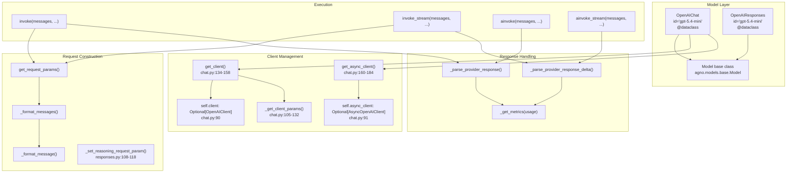
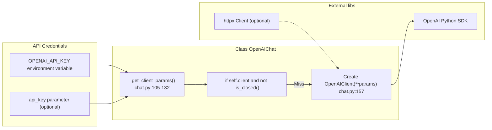

<!-- source: DeepWiki mcp.deepwiki.com · repo agno-agi/agno · page 3.2 OpenAI Integration · fetched 2026-10-26 -->

# OpenAI Integration

Relevant source files

The following files were used as context for generating this wiki page:

- [cookbook/90_models/anthropic/csv_input.py](cookbook/90_models/anthropic/csv_input.py)
- [cookbook/90_models/anthropic/markdown_input.py](cookbook/90_models/anthropic/markdown_input.py)
- [cookbook/90_models/anthropic/pydantic_tool_input.py](cookbook/90_models/anthropic/pydantic_tool_input.py)
- [cookbook/90_models/openai/chat/image_agent_file.py](cookbook/90_models/openai/chat/image_agent_file.py)
- [cookbook/90_models/openai/chat/pdf_input_bytes.py](cookbook/90_models/openai/chat/pdf_input_bytes.py)
- [cookbook/90_models/openai/responses/README.md](cookbook/90_models/openai/responses/README.md)
- [cookbook/90_models/openai/responses/TEST_LOG.md](cookbook/90_models/openai/responses/TEST_LOG.md)
- [cookbook/90_models/openai/responses/background.py](cookbook/90_models/openai/responses/background.py)
- [cookbook/90_models/openai/responses/image_agent_file.py](cookbook/90_models/openai/responses/image_agent_file.py)
- [cookbook/90_models/openai/responses/stored_responses_without_chaining.py](cookbook/90_models/openai/responses/stored_responses_without_chaining.py)
- [libs/agno/agno/__init__.py](libs/agno/agno/__init__.py)
- [libs/agno/agno/memory/__init__.py](libs/agno/agno/memory/__init__.py)
- [libs/agno/agno/memory/strategies/__init__.py](libs/agno/agno/memory/strategies/__init__.py)
- [libs/agno/agno/memory/strategies/base.py](libs/agno/agno/memory/strategies/base.py)
- [libs/agno/agno/memory/strategies/summarize.py](libs/agno/agno/memory/strategies/summarize.py)
- [libs/agno/agno/memory/strategies/types.py](libs/agno/agno/memory/strategies/types.py)
- [libs/agno/agno/models/anthropic/claude.py](libs/agno/agno/models/anthropic/claude.py)
- [libs/agno/agno/models/aws/bedrock.py](libs/agno/agno/models/aws/bedrock.py)
- [libs/agno/agno/models/aws/claude.py](libs/agno/agno/models/aws/claude.py)
- [libs/agno/agno/models/azure/ai_foundry.py](libs/agno/agno/models/azure/ai_foundry.py)
- [libs/agno/agno/models/azure/openai_chat.py](libs/agno/agno/models/azure/openai_chat.py)
- [libs/agno/agno/models/cohere/chat.py](libs/agno/agno/models/cohere/chat.py)
- [libs/agno/agno/models/groq/groq.py](libs/agno/agno/models/groq/groq.py)
- [libs/agno/agno/models/huggingface/huggingface.py](libs/agno/agno/models/huggingface/huggingface.py)
- [libs/agno/agno/models/ibm/watsonx.py](libs/agno/agno/models/ibm/watsonx.py)
- [libs/agno/agno/models/meta/llama.py](libs/agno/agno/models/meta/llama.py)
- [libs/agno/agno/models/mistral/mistral.py](libs/agno/agno/models/mistral/mistral.py)
- [libs/agno/agno/models/ollama/chat.py](libs/agno/agno/models/ollama/chat.py)
- [libs/agno/agno/models/openai/chat.py](libs/agno/agno/models/openai/chat.py)
- [libs/agno/agno/models/openai/responses.py](libs/agno/agno/models/openai/responses.py)
- [libs/agno/agno/models/vertexai/claude.py](libs/agno/agno/models/vertexai/claude.py)
- [libs/agno/agno/os/interfaces/whatsapp/helpers.py](libs/agno/agno/os/interfaces/whatsapp/helpers.py)
- [libs/agno/agno/utils/models/claude.py](libs/agno/agno/utils/models/claude.py)
- [libs/agno/agno/utils/openai.py](libs/agno/agno/utils/openai.py)
- [libs/agno/agno/utils/tokens.py](libs/agno/agno/utils/tokens.py)
- [libs/agno/tests/integration/models/anthropic/test_format_tools.py](libs/agno/tests/integration/models/anthropic/test_format_tools.py)
- [libs/agno/tests/integration/models/huggingface/test_basic.py](libs/agno/tests/integration/models/huggingface/test_basic.py)
- [libs/agno/tests/integration/models/huggingface/test_tool_use.py](libs/agno/tests/integration/models/huggingface/test_tool_use.py)
- [libs/agno/tests/unit/models/anthropic/test_citation_suppression.py](libs/agno/tests/unit/models/anthropic/test_citation_suppression.py)
- [libs/agno/tests/unit/models/openai/test_openai_responses_background.py](libs/agno/tests/unit/models/openai/test_openai_responses_background.py)
- [libs/agno/tests/unit/models/openai/test_openai_responses_chaining.py](libs/agno/tests/unit/models/openai/test_openai_responses_chaining.py)
- [libs/agno/tests/unit/models/openai/test_openai_responses_id_handling.py](libs/agno/tests/unit/models/openai/test_openai_responses_id_handling.py)
- [libs/agno/tests/unit/models/test_client_caching.py](libs/agno/tests/unit/models/test_client_caching.py)
- [libs/agno/tests/unit/models/test_cross_model_tool_calls.py](libs/agno/tests/unit/models/test_cross_model_tool_calls.py)
- [libs/agno/tests/unit/models/test_mistral_request_params.py](libs/agno/tests/unit/models/test_mistral_request_params.py)
- [libs/agno/tests/unit/scorer/test_model_identity.py](libs/agno/tests/unit/scorer/test_model_identity.py)
- [libs/agno/tests/unit/utils/test_claude.py](libs/agno/tests/unit/utils/test_claude.py)
- [libs/agno/tests/unit/utils/test_openai.py](libs/agno/tests/unit/utils/test_openai.py)
- [libs/agno/tests/unit/utils/test_tokens.py](libs/agno/tests/unit/utils/test_tokens.py)

Agno provides a comprehensive integration with OpenAI's ecosystem primarily through two key model classes: `OpenAIChat` and `OpenAIResponses`. These classes encapsulate intricate functionality such as client management, API authentication, multimodal input handling, structured output parsing, and advanced features like built-in reasoning support and background execution modes.

This page delivers an in-depth technical overview of these components, detailing their architecture, data flow, configuration parameters, and special API features.

---

## Core Components

Agno’s OpenAI integration distinguishes between two major API paradigms: the traditional Chat Completions API and the newer Responses API. The two main classes represent these respectively:

- `OpenAIChat` encapsulates usage of the Chat Completions API.
- `OpenAIResponses` targets the newer, experimental Responses API.

Both inherit from the base `Model` class and expose synchronized and asynchronous methods for invoking completions.

### Class Structure and Execution Flow

This diagram summarizes the relationships between OpenAI model classes (`OpenAIChat` and `OpenAIResponses`), client provision, request preparation, invocation, and response processing.

Sources: [libs/agno/agno/models/openai/chat.py:34-164](), [libs/agno/agno/models/openai/responses.py:31-170]()

### API Variants and Use Cases

| Feature                    | OpenAIChat                                                        | OpenAIResponses                                                 |
|----------------------------|------------------------------------------------------------------|----------------------------------------------------------------|
| **API Endpoint**            | `chat.completions.create()`                                     | `responses.create()`                                            |
| **Default Model**           | `"gpt-5.4-mini"`                                                 | `"gpt-5.4-mini"`                                                |
| **Reasoning Model Support** | `reasoning_effort` parameter controls thinking depth [chat.py:51]()| Specialized `reasoning` dict parameter enables reasoning [responses.py:50]() |
| **Structured Outputs**      | Native JSON schema support with `strict_output` (default `True`) | Native support with `strict_output`                            |
| **Background Execution**    | Not supported                                                   | Supported via `background=True` with polling [responses.py:65-71]() |
| **Audio Output**            | Configurable via `audio` parameter (voices, formats) [chat.py:61-63]() | Supports `modalities` configuration                           |
| **Metrics Collection**      | Optional with `collect_metrics_on_completion` flag              | Default metrics collection per interaction                     |

The two classes enable flexible usage depending on the developer’s preference for the stable Chat API or newer Response API experimental features.

Sources: [libs/agno/agno/models/openai/chat.py:34-76](), [libs/agno/agno/models/openai/responses.py:31-71]()

---

## Authentication and Client Management

Agno manages OpenAI client lifecycles efficiently by caching client instances inside model objects to prevent repeated creation overhead.

- API keys are auto-fetched from the environment variable `OPENAI_API_KEY` unless explicitly provided.
- Optional injection of `httpx.Client` or `httpx.AsyncClient` allows customized HTTP transport handling.
- Clients are wrapped from the official OpenAI Python SDK and cached internally; they are recreated only when closed or missing.

### Client Initialization Flow

This lifecycle ensures that client connection reuse is maximized, reducing latency and resource consumption for repeated model calls.

Sources: [libs/agno/agno/models/openai/chat.py:105-158](), [libs/agno/agno/models/openai/responses.py:120-166]()

---

## Reasoning Model Support

Agno integrates special handling for OpenAI’s reasoning-focused models (`o1`, `o3`, `o4-mini`, `gpt-5` families). These models perform multi-phase thought processes that can be extracted and programmatically managed.

- `OpenAIChat` accepts a `reasoning_effort` parameter describing the depth/effort of reasoning.
- `OpenAIResponses` detects reasoning models by ID prefixes (`o3`, `o4-mini`, `gpt-5`) and uses a dedicated `reasoning` config dictionary in the request.
- Thought content is extracted from raw provider responses using utility functions like `extract_thinking_content`.

The integration allows agents to use advanced reasoning hints and expose intermediate reasoning steps as structured outputs or metrics.

Sources: [libs/agno/agno/models/openai/responses.py:104-118](), [libs/agno/agno/models/openai/chat.py:50-52]()

---

## Structured Outputs and Schema Validation

Both `OpenAIChat` and `OpenAIResponses` classes support OpenAI's native JSON schema-based structured output format:

- The `supports_native_structured_outputs` attribute is set to `True`.
- The `strict_output` boolean flag (default `True`) enforces rigid adherence to provided Pydantic output schemas.
- If a schema is supplied via the `Agent` or `Workflow` output mechanisms, Agno instructs OpenAI models to conform to that JSON schema.
- Violations or parsing errors raise structured exceptions or fallback gracefully.

This enables Agno to integrate typed response validation directly at the model interaction level, promoting fidelity and correctness in AI responses.

Sources: [libs/agno/agno/models/openai/chat.py:45-71](), [libs/agno/agno/models/openai/responses.py:42-60](), [libs/agno/tests/integration/models/openai/chat/test_structured_response.py:30-34](), [libs/agno/tests/integration/models/openai/responses/test_structured_response.py:32-36]()

---

## File Handling and Multimodal Inputs

OpenAI models in Agno can handle multimodal inputs such as images, audio, and files, powered by rich message content conversion:

- `images_to_message` utility converts Agno `Image` media objects into a format recognized by OpenAI APIs.
- `OpenAIChat` exposes an `audio` parameter for configuring voice types and audio formats in generated responses.
- File attachments and audio media are formatted with helpers like `_format_file_for_message` and `audio_to_message`.
- In the `OpenAIResponses` model, a `vector_store_name` parameter denotes the default retrieval vector store for knowledge augmentation and tool use.
- Agno abstracts multipart file handling and encoding inside message creation pipelines.

This allows agents and workflows to incorporate diverse media modalities seamlessly into interaction sessions backed by OpenAI.

Sources: [libs/agno/agno/models/openai/chat.py:20-63](), [libs/agno/agno/models/openai/responses.py:85]()

---

## Metrics and Token Usage Tracking

Precise token usage metrics are collected and validated for every OpenAI interaction:

- Metrics include `input_tokens`, `output_tokens`, and `total_tokens`.
- For streaming completions, token counts can be tracked per-chunk or deferred until the final chunk using `collect_metrics_on_completion`.
- Integration tests verify consistency and correctness of token counts for both sync and async invocations.
- Metrics support empowers monitoring, cost estimation, and rate limit management across OpenAI calls.

Sources: [libs/agno/agno/models/openai/chat.py:47](), [libs/agno/tests/integration/models/openai/chat/test_basic.py:18-60](), [libs/agno/tests/integration/models/openai/responses/test_basic.py:18-33]()

---

## Specialized Azure OpenAI Integration

Agno provides the `AzureOpenAI` class to interface with Azure Hosted OpenAI deployments, extending the OpenAI-like interface with Azure-specific parameters:

- Supports `azure_endpoint`, `azure_deployment`, and `api_version` configurable either via constructor or environment variables (`AZURE_OPENAI_*`).
- Supports authentication with API keys, Azure AD tokens, or external token providers.
- Overrides client parameter resolution and caching to handle Azure OpenAI peculiarities.
- Implements a deep copy method to preserve client references and authentication state crucial for reasoning flows that involve client reuse.
- Allows injection of custom `httpx` clients for transport-layer configuration.

This class facilitates enterprise-grade integration with Azure OpenAI while reusing the Agno OpenAI model interface patterns.

Sources: [libs/agno/agno/models/azure/openai_chat.py:41-173]()

---

# Summary Diagram Linking OpenAI Concepts to Agno Code

```mermaid
graph TD
    NLS["Natural Language Space"]
    CES["Code Entity Space"]

    NLS --> |"OpenAI Chat API"| CES_OpenAIChat["OpenAIChat (libs/agno/agno/models/openai/chat.py)"]
    NLS --> |"OpenAI Responses API"| CES_OpenAIResponses["OpenAIResponses (libs/agno/agno/models/openai/responses.py)"]
    NLS --> |"Azure OpenAI API"| CES_AzureOpenAI["AzureOpenAI (libs/agno/agno/models/azure/openai_chat.py)"]
    
    CES_OpenAIChat --> |"Get sync client"| GET_CLIENT["get_client()"]
    CES_OpenAIChat --> |"Get async client"| GET_ASYNC_CLIENT["get_async_client()"]
    CES_OpenAIResponses --> |"Get sync client"| GET_CLIENT_RESP["get_client()"]
    CES_OpenAIResponses --> |"Get async client"| GET_ASYNC_CLIENT_RESP["get_async_client()"]
    CES_AzureOpenAI --> |"Get sync client"| GET_CLIENT_AZ["get_client()"]
    CES_AzureOpenAI --> |"Get async client"| GET_ASYNC_CLIENT_AZ["get_async_client()"]

    CES_OpenAIChat --> |"Invoke (sync/async)"| INVOKE_CHAT["invoke()/ainvoke()"]
    CES_OpenAIResponses --> |"Invoke (sync/async)"| INVOKE_RESP["invoke()/ainvoke()"]

    CES_OpenAIChat --> |"Supports reasoning"| REASONING_CHAT["reasoning_effort param"]
    CES_OpenAIResponses --> |"Supports reasoning"| REASONING_RESP["reasoning dict param"]

    CES_OpenAIChat --> |"Structured output support"| STRUCTURED_CHAT["strict_output param"]
    CES_OpenAIResponses --> |"Structured output support"| STRUCTURED_RESP["strict_output param"]
```

This diagram bridges high-level conceptual entities in the natural language AI ecosystem to the concrete Agno code entities, highlighting the OpenAI integration classes and their critical members.

Sources: Entire section above.

---

# API-Specific Features and Notes

- `OpenAIResponses` introduces a `background` mode, which allows tasks to return immediately and be polled until ready. This suits long-running or batch operations.

- `OpenAIChat` allows nuanced audio generation parameters enabling voice and format specification like `"alloy"` voice or `"wav"` audio format.

- Both models utilize tightly controlled error handling for rate limits, context window errors (`ContextWindowExceededError`), and authentication failures.

- Both classes provide legacy mechanisms for role mapping (`role_map`) between Agno Message roles and provider roles.

- File and media handling functions ensure that rich media objects from the agent context can be correctly serialized into OpenAI API message formats.

---

# References

- `OpenAIChat` and client management: [libs/agno/agno/models/openai/chat.py:30-164]()
- `OpenAIResponses` and reasoning integration: [libs/agno/agno/models/openai/responses.py:1-153]()
- `AzureOpenAI` and Azure-specific client handling: [libs/agno/agno/models/azure/openai_chat.py:1-173]()
- Multimodal helpers in OpenAI utilities: [libs/agno/agno/utils/openai.py]()
- Structured output conventions: integration test examples [libs/agno/tests/integration/models/openai/chat/test_structured_response.py](), [libs/agno/tests/integration/models/openai/responses/test_structured_response.py]()

---

This concludes the detailed technical overview of OpenAI integration within the Agno framework.

---

