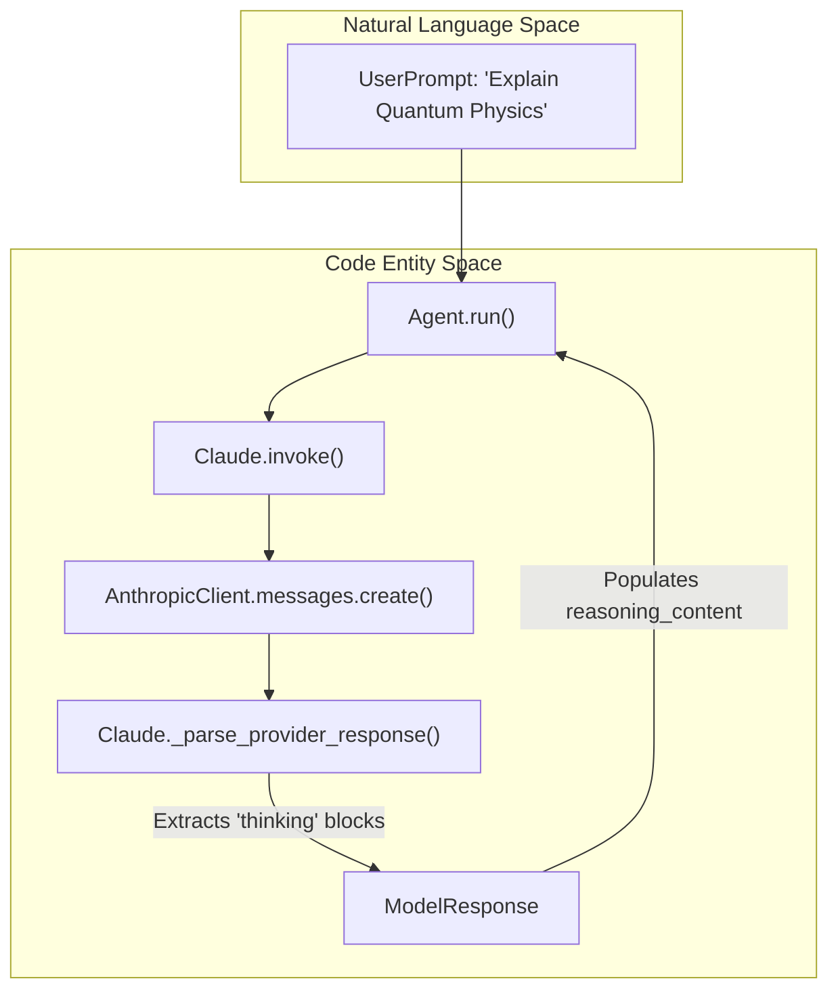
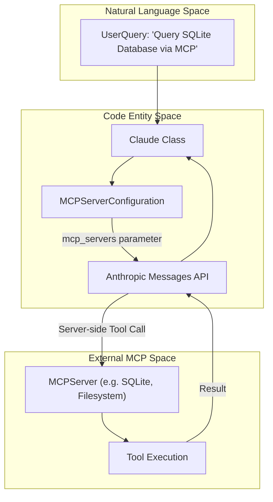

<!-- source: DeepWiki mcp.deepwiki.com · repo agno-agi/agno · page 3.3 Anthropic Claude · fetched 2026-10-26 -->

# Anthropic Claude

Relevant source files

The following files were used as context for generating this wiki page:

- [cookbook/90_models/anthropic/csv_input.py](cookbook/90_models/anthropic/csv_input.py)
- [cookbook/90_models/anthropic/markdown_input.py](cookbook/90_models/anthropic/markdown_input.py)
- [cookbook/90_models/anthropic/pydantic_tool_input.py](cookbook/90_models/anthropic/pydantic_tool_input.py)
- [libs/agno/agno/__init__.py](libs/agno/agno/__init__.py)
- [libs/agno/agno/models/anthropic/claude.py](libs/agno/agno/models/anthropic/claude.py)
- [libs/agno/agno/models/aws/bedrock.py](libs/agno/agno/models/aws/bedrock.py)
- [libs/agno/agno/models/aws/claude.py](libs/agno/agno/models/aws/claude.py)
- [libs/agno/agno/models/azure/ai_foundry.py](libs/agno/agno/models/azure/ai_foundry.py)
- [libs/agno/agno/models/azure/openai_chat.py](libs/agno/agno/models/azure/openai_chat.py)
- [libs/agno/agno/models/cohere/chat.py](libs/agno/agno/models/cohere/chat.py)
- [libs/agno/agno/models/groq/groq.py](libs/agno/agno/models/groq/groq.py)
- [libs/agno/agno/models/huggingface/huggingface.py](libs/agno/agno/models/huggingface/huggingface.py)
- [libs/agno/agno/models/ibm/watsonx.py](libs/agno/agno/models/ibm/watsonx.py)
- [libs/agno/agno/models/meta/llama.py](libs/agno/agno/models/meta/llama.py)
- [libs/agno/agno/models/mistral/mistral.py](libs/agno/agno/models/mistral/mistral.py)
- [libs/agno/agno/models/ollama/chat.py](libs/agno/agno/models/ollama/chat.py)
- [libs/agno/agno/models/openai/chat.py](libs/agno/agno/models/openai/chat.py)
- [libs/agno/agno/models/openai/responses.py](libs/agno/agno/models/openai/responses.py)
- [libs/agno/agno/models/vertexai/claude.py](libs/agno/agno/models/vertexai/claude.py)
- [libs/agno/agno/os/routers/database.py](libs/agno/agno/os/routers/database.py)
- [libs/agno/agno/utils/models/claude.py](libs/agno/agno/utils/models/claude.py)
- [libs/agno/agno/utils/streamlit.py](libs/agno/agno/utils/streamlit.py)
- [libs/agno/tests/integration/agent/test_input.py](libs/agno/tests/integration/agent/test_input.py)
- [libs/agno/tests/integration/agent/test_multimodal.py](libs/agno/tests/integration/agent/test_multimodal.py)
- [libs/agno/tests/integration/agent/test_output_model.py](libs/agno/tests/integration/agent/test_output_model.py)
- [libs/agno/tests/integration/agent/test_parser_model.py](libs/agno/tests/integration/agent/test_parser_model.py)
- [libs/agno/tests/integration/models/anthropic/test_betas.py](libs/agno/tests/integration/models/anthropic/test_betas.py)
- [libs/agno/tests/integration/models/anthropic/test_format_tools.py](libs/agno/tests/integration/models/anthropic/test_format_tools.py)
- [libs/agno/tests/integration/models/anthropic/test_multimodal.py](libs/agno/tests/integration/models/anthropic/test_multimodal.py)
- [libs/agno/tests/integration/models/anthropic/test_prompt_caching.py](libs/agno/tests/integration/models/anthropic/test_prompt_caching.py)
- [libs/agno/tests/integration/models/anthropic/test_thinking.py](libs/agno/tests/integration/models/anthropic/test_thinking.py)
- [libs/agno/tests/integration/models/anthropic/test_tool_use.py](libs/agno/tests/integration/models/anthropic/test_tool_use.py)
- [libs/agno/tests/integration/models/fireworks/test_tool_use.py](libs/agno/tests/integration/models/fireworks/test_tool_use.py)
- [libs/agno/tests/integration/models/huggingface/test_basic.py](libs/agno/tests/integration/models/huggingface/test_basic.py)
- [libs/agno/tests/integration/models/huggingface/test_tool_use.py](libs/agno/tests/integration/models/huggingface/test_tool_use.py)
- [libs/agno/tests/integration/models/openai/chat/test_multimodal.py](libs/agno/tests/integration/models/openai/chat/test_multimodal.py)
- [libs/agno/tests/integration/models/openai/responses/test_multimodal.py](libs/agno/tests/integration/models/openai/responses/test_multimodal.py)
- [libs/agno/tests/integration/os/test_db_migrations.py](libs/agno/tests/integration/os/test_db_migrations.py)
- [libs/agno/tests/integration/teams/test_team_with_output_model.py](libs/agno/tests/integration/teams/test_team_with_output_model.py)
- [libs/agno/tests/unit/models/anthropic/test_citation_suppression.py](libs/agno/tests/unit/models/anthropic/test_citation_suppression.py)
- [libs/agno/tests/unit/models/test_client_caching.py](libs/agno/tests/unit/models/test_client_caching.py)
- [libs/agno/tests/unit/models/test_cross_model_tool_calls.py](libs/agno/tests/unit/models/test_cross_model_tool_calls.py)
- [libs/agno/tests/unit/models/test_mistral_request_params.py](libs/agno/tests/unit/models/test_mistral_request_params.py)
- [libs/agno/tests/unit/utils/test_claude.py](libs/agno/tests/unit/utils/test_claude.py)

## Purpose and Scope
This page documents the Anthropic Claude model integration in Agno, covering the `Claude` class [libs/agno/agno/models/anthropic/claude.py:95-180](), its configuration options, and provider-specific features including thinking mode, skills, prompt caching, message formatting, and Model Context Protocol (MCP) integration.

Agno provides a unified interface for Claude across multiple hosting environments:
- **Anthropic Direct**: via `agno.models.anthropic.Claude` [libs/agno/agno/models/anthropic/claude.py:95-180]()
- **AWS Bedrock**: via `agno.models.aws.Claude` [libs/agno/agno/models/aws/claude.py:23-43]()
- **Google Vertex AI**: via `agno.models.vertexai.Claude` [libs/agno/agno/models/vertexai/claude.py:18-35]()

Sources: [libs/agno/agno/models/anthropic/claude.py:95-180](), [libs/agno/agno/models/aws/claude.py:23-43](), [libs/agno/agno/models/vertexai/claude.py:18-35]()

---

## Claude Class Overview

The `Claude` class in `libs/agno/agno/models/anthropic/claude.py` [libs/agno/agno/models/anthropic/claude.py:95-180]() encapsulates the Anthropic Claude model interaction, providing configuration, client management, and request/response handling. It serves as the base integration for Anthropic-hosted Claude models.

### Key Configuration Parameters

| Parameter                          | Type                                                                 | Default                         | Description                                                                                   |
|------------------------------------|----------------------------------------------------------------------|---------------------------------|-----------------------------------------------------------------------------------------------|
| `id`                               | `str`                                                                | `"claude-sonnet-4-5-20250929"` | Model identifier for Anthropic Claude [libs/agno/agno/models/anthropic/claude.py:128]()                                                         |
| `thinking`                         | `Optional[Dict[str, Any]]`                                            | `None`                          | Enables extended thinking/reasoning mode (e.g. budget_tokens) [libs/agno/agno/models/anthropic/claude.py:134]()                                 |
| `output_config`                    | `Optional[Dict[str, Any]]`                                            | `None`                          | Configuration for structured outputs [libs/agno/agno/models/anthropic/claude.py:135]()                                                          |
| `cache_system_prompt`              | `Optional[bool]`                                                     | `False`                         | Enable ephemeral prompt caching for system messages [libs/agno/agno/models/anthropic/claude.py:140]()                                           |
| `extended_cache_time`              | `Optional[bool]`                                                     | `False`                         | Extend system prompt cache TTL from 5 minutes to 1 hour [libs/agno/agno/models/anthropic/claude.py:141]()                                       |
| `cache_tools`                      | `bool`                                                               | `False`                         | Enable caching for tools [libs/agno/agno/models/anthropic/claude.py:142]()                                                                      |
| `system_prompt_blocks`             | `Optional[Union[List[SystemPromptBlock], Callable[[], List[SystemPromptBlock]]]]` | `None`                          | Multi-block system prompts with per-block cache control [libs/agno/agno/models/anthropic/claude.py:149]()                                       |
| `betas`                            | `Optional[List[str]]`                                                | `None`                          | List of experimental or beta feature flags [libs/agno/agno/models/anthropic/claude.py:153]()            |
| `mcp_servers`                      | `Optional[List[MCPServerConfiguration]]`                             | `None`                          | Configurations for Model Context Protocol servers [libs/agno/agno/models/anthropic/claude.py:155]()                                              |
| `skills`                           | `Optional[List[Dict[str, str]]]`                                     | `None`                          | Anthropic agent skills (PowerPoint, Excel, PDF) [libs/agno/agno/models/anthropic/claude.py:156]()                                               |
| `citations`                        | `bool`                                                               | `True`                          | Attach citations to document blocks [libs/agno/agno/models/anthropic/claude.py:163]()                                                           |
| `append_trailing_user_message`     | `Optional[bool]`                                                     | `None`                          | Appends trailing user message if conversation ends with assistant message [libs/agno/agno/models/anthropic/claude.py:168]()       |

#### System Prompt Block
The `SystemPromptBlock` [libs/agno/agno/models/anthropic/claude.py:74-92]() allows for fine-grained cache control over segments of the system prompt. This is useful for caching static instructions while keeping dynamic parts uncached. `ttl` can override the model-level `extended_cache_time` for that specific block [libs/agno/agno/models/anthropic/claude.py:85-87]().

Sources: [libs/agno/agno/models/anthropic/claude.py:74-180]()

---

## Extended Thinking Mode

Claude models support extended thinking (reasoning), where the model generates internal thought blocks before the final response.

### Implementation and Validation
- **Validation**: Agno maintains a `NON_THINKING_MODELS` set to prevent invalid requests for models like Haiku 3 [libs/agno/agno/models/anthropic/claude.py:105-111]().
- **Configuration**: Thinking is enabled by passing a dictionary (e.g., `{"type": "enabled", "budget_tokens": 1024}`) to the `thinking` parameter [libs/agno/agno/models/anthropic/claude.py:134]().
- **Interleaved Thinking**: Supported via beta flags like `interleaved-thinking-2025-05-14` [libs/agno/tests/integration/models/anthropic/test_thinking.py:58]().

### Reasoning Data Flow

Title: Claude Reasoning Data Flow

The `_parse_provider_response` method in the `Claude` class iterates through content blocks to extract thinking content [libs/agno/agno/models/anthropic/claude.py:95]().

Sources: [libs/agno/agno/models/anthropic/claude.py:95-111](), [libs/agno/agno/models/anthropic/claude.py:134](), [libs/agno/tests/integration/models/anthropic/test_thinking.py:38-64]()

---

## Skills and Beta Features

Claude utilizes specialized "skills" and beta headers to unlock advanced capabilities like native code execution and document analysis.

### Skills Integration
Skills are configured as a list of dictionaries. For example, to enable PowerPoint generation:
`skills=[{"type": "anthropic", "skill_id": "pptx", "version": "latest"}]` [libs/agno/agno/models/anthropic/claude.py:156-158]().

### Automatic Beta Header Injection
Agno manages beta headers dynamically. When features like `mcp_servers` or `skills` are detected, the model integration ensures the appropriate `betas` are included in the request parameters [libs/agno/agno/models/anthropic/claude.py:153-155]().

Sources: [libs/agno/agno/models/anthropic/claude.py:153-158]()

---

## Message and Media Formatting

Claude has specific requirements for multimodal inputs and message sequences.

### Multimodal Handling
- **Images**: `_format_image_for_message` handles local file paths, URLs, and raw bytes, converting them to the Anthropic `base64` source format [libs/agno/agno/utils/models/claude.py:128-195]().
- **Files/Documents**: `_format_file_for_message` handles PDFs (as base64) and text-based files like CSVs or Markdown (as raw text blocks) [libs/agno/agno/utils/models/claude.py:6-22]().
- **Citations**: Agno can attach citations to document blocks [libs/agno/agno/utils/models/claude.py:22](), but suppresses them if structured output is used to avoid API conflicts [libs/agno/agno/models/anthropic/claude.py:161-163]().

### Assistant Message Prefill
Claude 4.6+ models deprecated assistant message prefill. Agno manages this via `append_trailing_user_message`. If the conversation ends with an assistant message, Agno can append a "continue" user turn [libs/agno/agno/models/anthropic/claude.py:165-170](). Prefill support is determined by `supports_prefill` which checks model ID prefixes and aliases [libs/agno/agno/utils/models/claude.py:42-64]().

Sources: [libs/agno/agno/utils/models/claude.py:42-64](), [libs/agno/agno/utils/models/claude.py:128-195](), [libs/agno/agno/models/anthropic/claude.py:161-170]()

---

## Prompt Caching

Agno implements Anthropic's ephemeral prompt caching to reduce costs and latency for large contexts.

### Caching Mechanism
- **System Caching**: `cache_system_prompt=True` adds `cache_control` to the system message [libs/agno/agno/models/anthropic/claude.py:140]().
- **Tool Caching**: `cache_tools=True` enables caching for the tool definitions [libs/agno/agno/models/anthropic/claude.py:142]().
- **Extended TTL**: `extended_cache_time=True` sets the cache TTL to 1 hour [libs/agno/agno/models/anthropic/claude.py:141]().

### Block-Level Control
Using `SystemPromptBlock`, developers can define which specific parts of a prompt are cached [libs/agno/agno/models/anthropic/claude.py:74-92]().

Sources: [libs/agno/agno/models/anthropic/claude.py:74-92](), [libs/agno/agno/models/anthropic/claude.py:140-142]()

---

## MCP Integration

Claude supports the Model Context Protocol (MCP) to interact with external tool servers.

### Configuration
MCP servers are defined via `MCPServerConfiguration` [libs/agno/agno/utils/models/claude.py:74-80](). These configurations are passed to the `Claude` model [libs/agno/agno/models/anthropic/claude.py:155]().

### Tool Call Flow with MCP

Title: Claude MCP Tool Call Flow

Sources: [libs/agno/agno/utils/models/claude.py:74-80](), [libs/agno/agno/models/anthropic/claude.py:155]()

---

