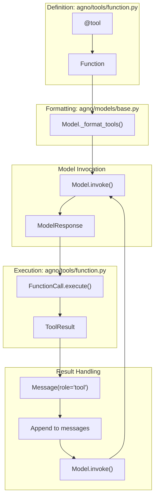
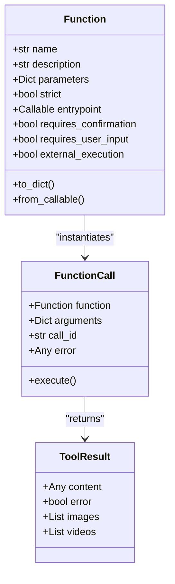
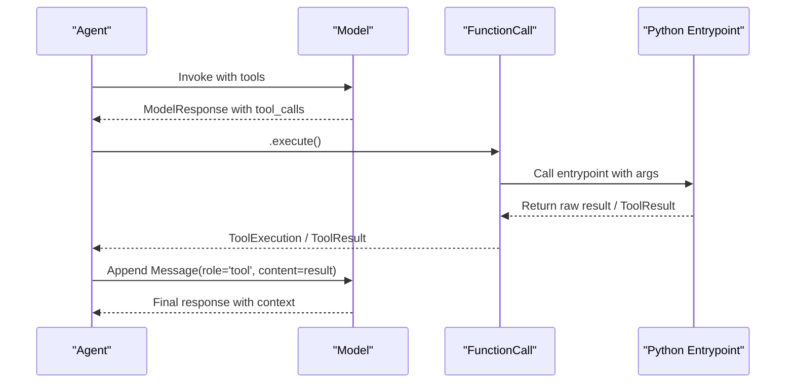

<!-- source: DeepWiki mcp.deepwiki.com · repo agno-agi/agno · page 3.6 Tool Calling and Function Execution · fetched 2026-10-26 -->

# Tool Calling and Function Execution

Relevant source files

The following files were used as context for generating this wiki page:

- [cookbook/90_models/tuning_engines/README.md](cookbook/90_models/tuning_engines/README.md)
- [cookbook/90_models/tuning_engines/basic.py](cookbook/90_models/tuning_engines/basic.py)
- [libs/agno/agno/models/tuning_engines/__init__.py](libs/agno/agno/models/tuning_engines/__init__.py)
- [libs/agno/agno/models/tuning_engines/tuning_engines.py](libs/agno/agno/models/tuning_engines/tuning_engines.py)
- [libs/agno/agno/tools/function.py](libs/agno/agno/tools/function.py)
- [libs/agno/agno/tools/mcp/mcp.py](libs/agno/agno/tools/mcp/mcp.py)
- [libs/agno/agno/utils/functions.py](libs/agno/agno/utils/functions.py)
- [libs/agno/agno/utils/mcp.py](libs/agno/agno/utils/mcp.py)
- [libs/agno/tests/integration/models/aws/bedrock/test_tool_use.py](libs/agno/tests/integration/models/aws/bedrock/test_tool_use.py)
- [libs/agno/tests/integration/models/aws/claude/test_tool_use.py](libs/agno/tests/integration/models/aws/claude/test_tool_use.py)
- [libs/agno/tests/integration/models/azure/ai_foundry/test_tool_use.py](libs/agno/tests/integration/models/azure/ai_foundry/test_tool_use.py)
- [libs/agno/tests/integration/models/azure/openai/test_tool_use.py](libs/agno/tests/integration/models/azure/openai/test_tool_use.py)
- [libs/agno/tests/integration/models/cohere/test_tool_use.py](libs/agno/tests/integration/models/cohere/test_tool_use.py)
- [libs/agno/tests/integration/models/google/test_basic.py](libs/agno/tests/integration/models/google/test_basic.py)
- [libs/agno/tests/integration/models/google/test_multimodal.py](libs/agno/tests/integration/models/google/test_multimodal.py)
- [libs/agno/tests/integration/models/google/test_tool_use.py](libs/agno/tests/integration/models/google/test_tool_use.py)
- [libs/agno/tests/integration/models/groq/test_tool_use.py](libs/agno/tests/integration/models/groq/test_tool_use.py)
- [libs/agno/tests/integration/models/ibm/watsonx/test_tool_use.py](libs/agno/tests/integration/models/ibm/watsonx/test_tool_use.py)
- [libs/agno/tests/integration/models/mistral/test_tool_use.py](libs/agno/tests/integration/models/mistral/test_tool_use.py)
- [libs/agno/tests/integration/models/nvidia/test_tool_use.py](libs/agno/tests/integration/models/nvidia/test_tool_use.py)
- [libs/agno/tests/integration/models/ollama/test_tool_use.py](libs/agno/tests/integration/models/ollama/test_tool_use.py)
- [libs/agno/tests/integration/models/openai/chat/test_tool_use.py](libs/agno/tests/integration/models/openai/chat/test_tool_use.py)
- [libs/agno/tests/integration/models/openai/responses/test_tool_use.py](libs/agno/tests/integration/models/openai/responses/test_tool_use.py)
- [libs/agno/tests/integration/models/xai/test_tool_use.py](libs/agno/tests/integration/models/xai/test_tool_use.py)
- [libs/agno/tests/unit/models/tuning_engines/__init__.py](libs/agno/tests/unit/models/tuning_engines/__init__.py)
- [libs/agno/tests/unit/models/tuning_engines/test_tuning_engines.py](libs/agno/tests/unit/models/tuning_engines/test_tuning_engines.py)
- [libs/agno/tests/unit/tools/test_functions.py](libs/agno/tests/unit/tools/test_functions.py)
- [libs/agno/tests/unit/tools/test_mcp.py](libs/agno/tests/unit/tools/test_mcp.py)
- [libs/agno/tests/unit/tools/test_mcp_pagination.py](libs/agno/tests/unit/tools/test_mcp_pagination.py)
- [libs/agno/tests/unit/utils/test_functions.py](libs/agno/tests/unit/utils/test_functions.py)

This page documents how models invoke tools through the function calling interface, including tool parameter formatting, `ToolUseBlock` / `FunctionCall` mechanics, parallel tool execution, tool result handling, and the complete execution lifecycle. This covers the integration layer between LLM providers and the Agno function system.

For information about defining custom tools and the `@tool` decorator, see [4.2 Creating Tools with @tool Decorator](). For human-in-the-loop tool execution controls, see [4.4 Human-in-the-Loop (HITL)](). For built-in toolkits and integrations, see [4.5 Built-in Tool Integrations]().

---

## 1. Overview of Tool Calling Flow

Tool calling enables large language models (LLMs) to invoke external functions dynamically during conversation processing. The framework automates the entire lifecycle, bridging model requests to actual function executions, then feeding results back to the model in subsequent turns.

**Tool Calling Lifecycle in Code**

**Key Code Entities:**

| Entity | Location | Purpose |
| :--- | :--- | :--- |
| `Function` | [libs/agno/agno/tools/function.py:1-50]() | Tool definition with schema, instructions, and entrypoint |
| `FunctionCall` | [libs/agno/agno/tools/function.py:1-50]() | Represents a requested function call with arguments and ID |
| `ToolResult` | [libs/agno/agno/tools/function.py:1-50]() | Encapsulates the execution result, metrics, and media |
| `get_function_call` | [libs/agno/agno/utils/functions.py:10-75]() | Decodes function arguments from model payloads |

Sources: [libs/agno/agno/tools/function.py:1-50](), [libs/agno/agno/utils/functions.py:10-75]()

---

## 2. Function Class and Tool Schema

### Function Class Structure

The core `Function` class encapsulates a callable tool that models can invoke. It manages metadata, JSON schema conversion, and execution configuration.

- **Definition and Introspection:** `Function.from_callable` inspects Python function signatures, docstrings (via `docstring_parser`), and type hints to automatically build JSON Schema objects for parameter validation [libs/agno/tests/unit/tools/test_functions.py:100-121]().
- **Strict Mode:** When `strict=True` is enabled, all parameters are marked as required in the generated schema to satisfy provider constraints [libs/agno/tests/unit/tools/test_functions.py:165-177]().
- **Argument Decoding:** `get_function_call` parses JSON-encoded or literal argument strings returned by the model, handling edge cases such as empty lists, boolean flags, and `null` values [libs/agno/agno/utils/functions.py:10-75]().

Sources: [libs/agno/agno/tools/function.py:1-50](), [libs/agno/tests/unit/tools/test_functions.py:100-177](), [libs/agno/agno/utils/functions.py:10-75]()

---

## 3. Function Declaration Formatting

Before sending tools to an LLM provider, Agno formats each registered `Function` into the schema format expected by the underlying API provider. 

- **Serialization:** The `Function.to_dict()` method exports the function name, description, parameters schema, and strictness flags into a standardized dictionary [libs/agno/tests/unit/tools/test_functions.py:77-99]().
- **Model Translation:** Subclasses of `Model` (such as OpenAI, Anthropic, Gemini, and Bedrock) override or adapt these definitions into native provider request payloads (e.g., OpenAI tool objects or Gemini `FunctionDeclaration` structures).

Sources: [libs/agno/tests/unit/tools/test_functions.py:77-99](), [libs/agno/agno/tools/function.py:1-50]()

---

## 4. Tool Choice and Parallel Tool Calls

### Tool Choice Parameter

The agent parameter `tool_choice` governs how the model selects and utilizes tools:
- `"auto"`: The model autonomously determines whether to call tools.
- `"none"`: Disables tool invocation entirely, forcing text generation.
- Specific function configuration dictionaries or objects to force a specific tool call.

This is verified across various provider integrations such as Gemini [libs/agno/tests/integration/models/google/test_tool_use.py:121-163]() and OpenAI Responses [libs/agno/tests/integration/models/openai/responses/test_tool_use.py:126-144]().

### Parallel Tool Calls

Agno models support parallel tool invocation, where the model requests multiple function executions in a single assistant turn.

- **Execution Handling:** `ModelResponse` captures a list of tool calls (`tool_calls`), which are iterated and executed concurrently or sequentially depending on the runtime context.
- **Integration Validation:** Integration tests for providers like Groq, AWS Bedrock, and OpenAI verify that multiple function calls in a single prompt (e.g., looking up multiple stock prices simultaneously) are correctly parsed and executed [libs/agno/tests/wait/../integration/models/groq/test_tool_use.py:101-122](), [libs/agno/tests/integration/models/aws/bedrock/test_tool_use.py:55-73](), [libs/agno/tests/integration/models/openai/responses/test_tool_use.py:126-144]().

Sources: [libs/agno/tests/integration/models/google/test_tool_use.py:121-163](), [libs/agno/tests/integration/models/groq/test_tool_use.py:101-122](), [libs/agno/tests/integration/models/aws/bedrock/test_tool_use.py:55-73](), [libs/agno/tests/integration/models/openai/responses/test_tool_use.py:126-144]()

---

## 5. Tool Results and Context Feedback

Once a `FunctionCall` is executed via `FunctionCall.execute()`, the resulting output is wrapped in a `ToolResult` object.

- **Feedback Loop:** The tool execution output is mapped into a chat `Message` with `role="tool"` and the corresponding `tool_call_id`, feeding the execution context back into the conversation history [libs/agno/tests/unit/tools/test_functions.py:1-50]().
- **Caching Results:** Tools can enable file-based result caching via `cache_results=True`, `cache_dir`, and `cache_ttl` configured on the `Function` or toolkit [libs/agno/agno/utils/functions.py:78-170]().

Sources: [libs/agno/agno/tools/function.py:1-50](), [libs/agno/agno/utils/functions.py:78-170]()

---

## 6. Execution Lifecycle and Streaming Events

When executing runs with streaming enabled (`stream=True` and `stream_events=True`), tool execution progress emits fine-grained events:
1. `ToolCallStarted`: Emitted when tool execution begins.
2. `ToolCallCompleted`: Emitted once the function finishes execution and returns a result.
3. `ToolCallPaused`: Emitted if execution pauses due to human-in-the-loop (HITL) confirmation or required user input.

These events are tested across providers to ensure robust real-time observability [libs/agno/tests/integration/models/google/test_tool_use.py:33-63](), [libs/agno/tests/integration/models/aws/bedrock/test_tool_use.py:29-54]().

Sources: [libs/agno/tests/integration/models/google/test_tool_use.py:33-63](), [libs/agno/tests/integration/models/aws/bedrock/test_tool_use.py:29-54]()

---

