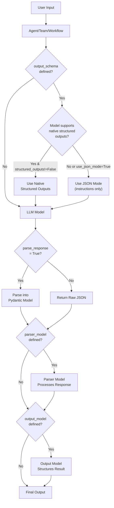
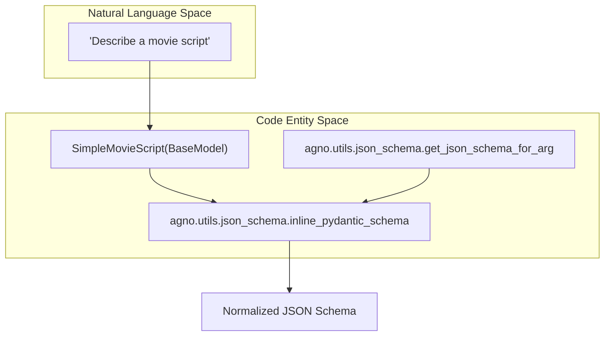
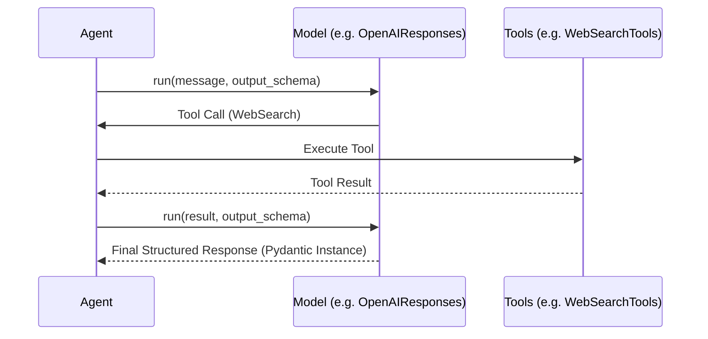

<!-- source: DeepWiki mcp.deepwiki.com · repo agno-agi/agno · page 3.7 Structured Outputs · fetched 2026-10-26 -->

# Structured Outputs

<details>
<summary>Relevant source files</summary>

The following files were used as context for generating this wiki page:

- [cookbook/02_agents/04_tools/04_tools_with_literal_type_param.py](cookbook/02_agents/04_tools/04_tools_with_literal_type_param.py)
- [cookbook/02_agents/04_tools/README.md](cookbook/02_agents/04_tools/README.md)
- [cookbook/02_agents/04_tools/TEST_LOG.md](cookbook/02_agents/04_tools/TEST_LOG.md)
- [cookbook/90_models/google/gemini/parallel_grounding.py](cookbook/90_models/google/gemini/parallel_grounding.py)
- [cookbook/90_models/google/gemini/timeout.py](cookbook/90_models/google/gemini/timeout.py)
- [libs/agno/agno/models/google/gemini.py](libs/agno/agno/models/google/gemini.py)
- [libs/agno/agno/utils/gemini.py](libs/agno/agno/utils/gemini.py)
- [libs/agno/agno/utils/json_schema.py](libs/agno/agno/utils/json_schema.py)
- [libs/agno/agno/utils/models/openai_responses.py](libs/agno/agno/utils/models/openai_responses.py)
- [libs/agno/agno/utils/models/schema_utils.py](libs/agno/agno/utils/models/schema_utils.py)
- [libs/agno/tests/integration/agent/test_tool_parsing.py](libs/agno/tests/integration/agent/test_tool_parsing.py)
- [libs/agno/tests/integration/models/google/test_structured_response.py](libs/agno/tests/integration/models/google/test_structured_response.py)
- [libs/agno/tests/integration/models/google/test_tool_parsing.py](libs/agno/tests/integration/models/google/test_tool_parsing.py)
- [libs/agno/tests/integration/models/openai/chat/test_structured_response.py](libs/agno/tests/integration/models/openai/chat/test_structured_response.py)
- [libs/agno/tests/integration/models/openai/responses/test_structured_response.py](libs/agno/tests/integration/models/openai/responses/test_structured_response.py)
- [libs/agno/tests/unit/agent/test_agentic_state_schema.py](libs/agno/tests/unit/agent/test_agentic_state_schema.py)
- [libs/agno/tests/unit/models/google/test_gemini.py](libs/agno/tests/unit/models/google/test_gemini.py)
- [libs/agno/tests/unit/utils/test_gemini.py](libs/agno/tests/unit/utils/test_gemini.py)
- [libs/agno/tests/unit/utils/test_gemini_dict_support.py](libs/agno/tests/unit/utils/test_gemini_dict_support.py)
- [libs/agno/tests/unit/utils/test_json_schema.py](libs/agno/tests/unit/utils/test_json_schema.py)
- [libs/agno/tests/unit/utils/test_openai_responses.py](libs/agno/tests/unit/utils/test_openai_responses.py)

</details>


Structured output generation in Agno enables agents, teams, and workflows to produce responses conforming to predefined schemas using Pydantic models or JSON schemas. This ensures that LLM responses are type-safe and ready for integration with downstream systems. For information about model integrations, see [Model Interface and Architecture](). For tool-related structured outputs, see [Tool Calling and Function Execution]().

## Purpose and Scope

Structured outputs provide a bridge between natural language model responses and structured data required by code entities. This document covers:

- Configuration parameters for structured outputs on agents, teams, and workflows.
- Model provider support for native structured outputs vs. JSON mode.
- Pydantic model and JSON schema usage, including complex field support (Dicts, Enums, Unions).
- Provider-specific implementations (OpenAI, Gemini).
- Tool integration with structured response parsing.

Sources: [libs/agno/agno/agent/agent.py:276-298](), [libs/agno/agno/team/team.py:257-274]()

## Configuration Overview

The `Agent`, `Team`, and `Workflow` classes expose parameters for controlling structured output generation:

| Parameter | Type | Default | Description |
|-----------|------|---------|-------------|
| `output_schema` | `Union[Type[BaseModel], Dict[str, Any]]` | `None` | Pydantic model or JSON schema defining the output structure. |
| `structured_outputs` | `bool` | `None` | Enable/disable native structured outputs (provider-dependent). |
| `parse_response` | `bool` | `True` | Parse model response into the output schema. |
| `use_json_mode` | `bool` | `False` | Use JSON mode instead of native structured outputs. |
| `parser_model` | `Model` | `None` | Secondary model for parsing primary model responses. |
| `output_model` | `Model` | `None` | Model for structuring the final output. |

Sources: [libs/agno/agno/agent/agent.py:276-298](), [libs/agno/agno/team/team.py:257-274]()

### Structured Output Flow

The framework determines whether to use native structured outputs (like OpenAI's Structured Outputs or Gemini's Response Schema) or fallback to JSON mode instructions based on model capabilities.



Sources: [libs/agno/agno/agent/agent.py:276-298](), [libs/agno/agno/models/base.py:133-136]()

## Model Support for Native Structured Outputs

Different model providers have varying levels of support for structured outputs.

### Capability Detection

The `Model` base class defines flags that subclasses set to indicate their structured output capabilities:

```python
# From agno/models/base.py
supports_native_structured_outputs: bool = False
supports_json_schema_outputs: bool = False
```

Sources: [libs/agno/agno/models/base.py:133-136]()

### Provider Support Matrix

| Provider | Native Support | Default Model | Schema Format |
|----------|----------------|---------------|---------------|
| **OpenAIChat** | ✅ Yes | `gpt-4o` | JSON Schema with `strict_output: true` |
| **OpenAIResponses** | ✅ Yes | `gpt-4o` | Native Responses API |
| **Gemini** | ✅ Yes | `gemini-3.7-flash` | `google.genai.types.Schema` |

Sources: [libs/agno/agno/models/openai/chat.py:41-44](), [libs/agno/agno/models/openai/responses.py:38-41](), [libs/agno/agno/models/google/gemini.py:100-101]()

## Pydantic Models and Schema Normalization

Agno supports complex Pydantic models, including nested objects, Enums, and Dictionaries. Agno performs normalization before sending the schema to the provider to ensure compatibility.

### Schema Normalization Logic

The `inline_pydantic_schema` function handles inlining Pydantic model schemas by recursively replacing `$ref` with actual schema definitions. This is critical for providers that do not support the `$defs` section of JSON Schema.



Sources: [libs/agno/agno/utils/json_schema.py:46-96](), [libs/agno/agno/utils/json_schema.py:99-187]()

### Complex Field Support

*   **Enums:** Supported across providers. `get_json_schema_for_arg` extracts member values for the JSON `enum` field [libs/agno/agno/utils/json_schema.py:142-144]().
*   **Dictionaries (`Dict[K, V]`):** Handled by `get_json_schema_for_arg` which generates `propertyNames` for keys and `additionalProperties` for values. Bare `dict` types default to `additionalProperties: True` [libs/agno/agno/utils/json_schema.py:126-130](), [libs/agno/tests/unit/utils/test_json_schema.py:118-120]().
*   **Unions:** Supported via `anyOf` in the JSON schema, allowing fields to accept multiple types (e.g., `Union[str, int, bool]`) [libs/agno/agno/utils/json_schema.py:131-140]().
*   **Literals:** `Literal` types are converted to JSON schema `enum` with appropriate validation for `string`, `integer`, `boolean`, or `number` [libs/agno/agno/utils/json_schema.py:106-122]().

Sources: [libs/agno/agno/utils/json_schema.py:99-187]()

## Provider-Specific Implementations

### Gemini Structured Outputs

Gemini requires conversion of Pydantic schemas into `google.genai.types.Schema` objects. Agno provides utilities to handle problematic patterns like circular references or dictionary fields.

| Function | Role |
|----------|------|
| `prepare_response_schema` | Prepares Pydantic model for Gemini; converts if native handling is insufficient [libs/agno/agno/utils/gemini.py:51-80](). |
| `needs_conversion` | Checks for self-references, circularity, or `additionalProperties` (Dicts) [libs/agno/agno/utils/gemini.py:83-104](). |
| `convert_schema` | Recursively maps JSON schema types to Gemini types (e.g., `STRING`, `OBJECT`, `ARRAY`) [libs/agno/agno/utils/gemini.py:107-250](). |

Sources: [libs/agno/agno/utils/gemini.py:51-250]()

### OpenAI Responses API

The `OpenAIResponses` model supports native structured outputs via `sanitize_response_schema`. This function ensures compliance with OpenAI's strict mode rules.

| Rule | Implementation Detail |
|------|-----------------------|
| **Additional Properties** | Set to `false` for objects unless it's a Dict field [libs/agno/agno/utils/models/openai_responses.py:116-123](). |
| **Required Fields** | All fields in `properties` are added to `required`, excluding Dict fields [libs/agno/agno/utils/models/openai_responses.py:126-135](). |
| **Default Values** | Removes `default: null` from optional fields [libs/agno/agno/utils/models/openai_responses.py:137-139](). |

Sources: [libs/agno/agno/utils/models/openai_responses.py:103-147]()

## Tool Use with Structured Outputs

Agno supports combining tool calling with structured outputs. The agent can perform multi-turn tool execution before final response generation.



This integration ensures that `ToolCallStarted` and `ToolCallCompleted` events are correctly emitted during the execution lifecycle, even when the final target is a structured schema.

Sources: [libs/agno/tests/integration/models/openai/responses/test_structured_response.py:75-103](), [libs/agno/tests/integration/models/openai/responses/test_structured_response.py:105-153]()

## Strict Mode and Tool Schema

When agentic state updates or strict mode validation are enabled, Agno registers utility schemas that allow arbitrary keys where necessary while maintaining strict JSON schema validation for primary output fields.

Sources: [libs/agno/agno/utils/models/openai_responses.py:103-147](), [libs/agno/agno/utils/json_schema.py:46-96]()

---

