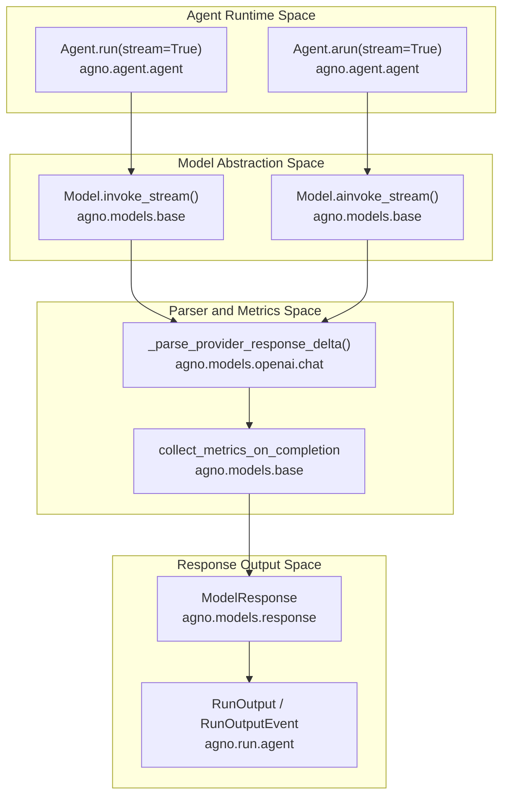
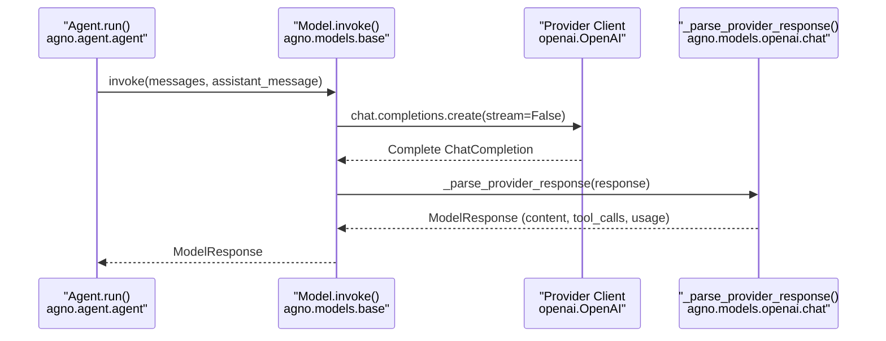
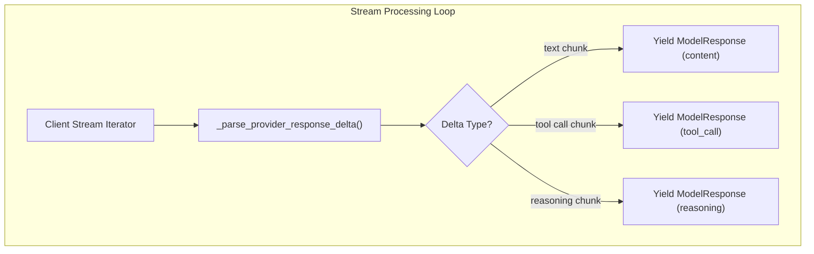

<!-- source: DeepWiki mcp.deepwiki.com · repo agno-agi/agno · page 3.8 Streaming and Response Processing · fetched 2026-10-26 -->

# Streaming and Response Processing

Relevant source files

The following files were used as context for generating this wiki page:

- [libs/agno/agno/reasoning/step.py](libs/agno/agno/reasoning/step.py)
- [libs/agno/agno/run/cancel.py](libs/agno/agno/run/cancel.py)
- [libs/agno/agno/run/cancellation_management/base.py](libs/agno/agno/run/cancellation_management/base.py)
- [libs/agno/agno/run/cancellation_management/in_memory_cancellation_manager.py](libs/agno/agno/run/cancellation_management/in_memory_cancellation_manager.py)
- [libs/agno/agno/run/cancellation_management/redis_cancellation_manager.py](libs/agno/agno/run/cancellation_management/redis_cancellation_manager.py)
- [libs/agno/agno/utils/response.py](libs/agno/agno/utils/response.py)
- [libs/agno/tests/integration/agent/test_agent_run_cancellation.py](libs/agno/tests/integration/agent/test_agent_run_cancellation.py)
- [libs/agno/tests/integration/models/anthropic/test_basic.py](libs/agno/tests/integration/models/anthropic/test_basic.py)
- [libs/agno/tests/integration/models/aws/bedrock/test_basic.py](libs/agno/tests/integration/models/aws/bedrock/test_basic.py)
- [libs/agno/tests/integration/models/aws/claude/test_basic.py](libs/agno/tests/integration/models/aws/claude/test_basic.py)
- [libs/agno/tests/integration/models/azure/ai_foundry/test_basic.py](libs/agno/tests/integration/models/azure/ai_foundry/test_basic.py)
- [libs/agno/tests/integration/models/azure/openai/test_basic.py](libs/agno/tests/integration/models/azure/openai/test_basic.py)
- [libs/agno/tests/integration/models/cohere/test_basic.py](libs/agno/tests/integration/models/cohere/test_basic.py)
- [libs/agno/tests/integration/models/deepseek/test_basic.py](libs/agno/tests/integration/models/deepseek/test_basic.py)
- [libs/agno/tests/integration/models/deepseek/test_tool_use.py](libs/agno/tests/integration/models/deepseek/test_tool_use.py)
- [libs/agno/tests/integration/models/fireworks/test_basic.py](libs/agno/tests/integration/models/fireworks/test_basic.py)
- [libs/agno/tests/integration/models/groq/test_basic.py](libs/agno/tests/integration/models/groq/test_basic.py)
- [libs/agno/tests/integration/models/mistral/test_basic.py](libs/agno/tests/integration/models/mistral/test_basic.py)
- [libs/agno/tests/integration/models/nvidia/test_basic.py](libs/agno/tests/integration/models/nvidia/test_basic.py)
- [libs/agno/tests/integration/models/ollama/test_basic.py](libs/agno/tests/integration/models/ollama/test_basic.py)
- [libs/agno/tests/integration/models/openai/chat/test_basic.py](libs/agno/tests/integration/models/openai/chat/test_basic.py)
- [libs/agno/tests/integration/models/openai/responses/test_basic.py](libs/agno/tests/integration/models/openai/responses/test_basic.py)
- [libs/agno/tests/integration/models/openrouter/test_basic.py](libs/agno/tests/integration/models/openrouter/test_basic.py)
- [libs/agno/tests/integration/models/sambanova/test_basic.py](libs/agno/tests/integration/models/sambanova/test_basic.py)
- [libs/agno/tests/integration/models/together/test_basic.py](libs/agno/tests/integration/models/together/test_basic.py)
- [libs/agno/tests/integration/models/xai/test_basic.py](libs/agno/tests/integration/models/xai/test_basic.py)
- [libs/agno/tests/unit/utils/test_response.py](libs/agno/tests/unit/utils/test_response.py)

This page covers how the Agno framework processes responses from Large Language Model (LLM) providers in both streaming and non-streaming execution modes [libs/agno/tests/integration/models/openai/chat.py:43-61](). It documents the mechanics of `invoke_stream` and `ainvoke_stream` [libs/agno/tests/integration/models/openai/chat.py:85-102](), `ModelResponse` delta handling [libs/agno/agno/utils/response.py:53-57](), provider-agnostic chunk parsing, streaming metrics collection [libs/agno/tests/integration/models/openai/chat.py:58-67](), and beta event handling for advanced reasoning and multimodal outputs [libs/agno/tests/integration/models/xai/test_basic.py:33-39]().

Sources: [libs/agno/tests/integration/models/openai/chat.py:43-102](), [libs/agno/agno/utils/response.py:53-57]()

---

## 1. Overview and Architecture

Agno provides a unified interface across more than 40 model providers, normalizing response handling regardless of whether the underlying API utilizes OpenAI-style chat completions [libs/agno/tests/integration/models/openai/chat.py:43](), Anthropic message streams [libs/agno/tests/integration/models/anthropic/test_basic.py:40-46](), or custom database-backed reasoning endpoints [libs/agno/tests/integration/models/openai/responses/test_basic.py:50-57]().

The response processing architecture bridges high-level agent execution logic with low-level provider clients:

Sources: [libs/agno/tests/integration/models/openai/chat.py:43-61](), [libs/agno/tests/integration/models/openai/responses/test_basic.py:50-67]()

---

## 2. Non-Streaming Response Processing

Non-streaming execution via `invoke` and `ainvoke` transmits a complete request payload to the provider and waits for the full generation to conclude before returning a unified `ModelResponse` object [libs/agno/tests/integration/models/openai/chat.py:30-41]().

### Non-Streaming Execution Flow

Sources: [libs/agno/tests/integration/models/openai/chat.py:30-41](), [libs/agno/tests/integration/models/openai/responses/test_basic.py:36-47]()

---

## 3. Streaming Response Processing (`invoke_stream`)

When `stream=True` is passed to `Agent.run()` [libs/agno/tests/integration/models/openai/chat.py:46-49]() or `Model.invoke_stream()` [libs/agno/tests/integration/models/openai/responses/test_basic.py:54-57](), the model returns an iterator yielding incremental `ModelResponse` chunks [libs/agno/tests/integration/models/openrouter/test_basic.py:37-49]().

### Chunk Parsing and Delta Accumulation

Each incoming chunk from the provider stream undergoes delta parsing via provider-specific implementations (e.g., `_parse_provider_response_delta`) [libs/agno/tests/integration/models/openai/chat.py:465-626](). These deltas extract:
- Text content increments (`content`) [libs/agno/tests/integration/models/openai/chat.py:48]()
- Reasoning or thinking blocks (`reasoning_content`) [libs/agno/tests/integration/models/xai/test_basic.py:37-39]()
- Partial tool call definitions (`tool_calls`) [libs/agno/tests/integration/models/deepseek/test_tool_use.py]()
- Provider metadata and citations [libs/agno/tests/integration/models/openai/responses/test_basic.py:56]()

Sources: [libs/agno/tests/integration/models/openai/chat.py:43-61](), [libs/agno/tests/integration/models/xai/test_basic.py:33-39]()

---

## 4. Metrics Collection on Streaming

Token metrics and timing counters (`time_to_first_token`, `duration`, `input_tokens`, `output_tokens`, `total_tokens`) are populated during streaming execution [libs/agno/tests/integration/models/openai/chat.py:58-67]().

Depending on the provider, token usage statistics are either reported incrementally across chunks or delivered entirely within the final message frame:
- **Incremental Counting**: Providers like OpenAI and Groq attach usage chunks or stream final usage statistics independently [libs/agno/tests/integration/models/openai/chat.py:58-67]().
- **Cumulative Counting**: Providers reporting cumulative totals utilize the `collect_metrics_on_completion` flag to compute token differentials exclusively upon stream exhaustion.

Sources: [libs/agno/tests/integration/models/openai/chat.py:58-67](), [libs/agno/tests/integration/models/groq/test_basic.py:15-25]()

---

## 5. Beta Event Handling and Advanced Modalities

Advanced reasoning models (such as deep-thinking variants or models utilizing beta headers) emit specialized events that require dedicated parsing pipelines:
- **Reasoning Content Streaming**: Models like xAI Grok and DeepSeek yield reasoning blocks that are populated into `ModelResponse.reasoning_content` [libs/agno/tests/integration/models/xai/test_basic.py:37-39]() prior to final answer generation.
- **Cancellation Management**: Active streaming iterations can be interrupted mid-flight via cancellation managers (`_cancellation_manager`), preserving partial content and emitting `RunCancelledEvent` records [libs/agno/tests/integration/agent/test_agent_run_cancellation.py:29-79]().

Sources: [libs/agno/tests/integration/agent/test_agent_run_cancellation.py:29-79](), [libs/agno/tests/integration/models/xai/test_basic.py:33-39]()

---

