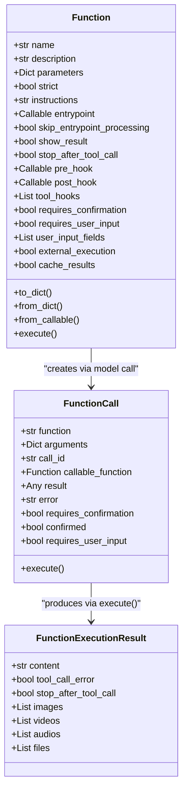
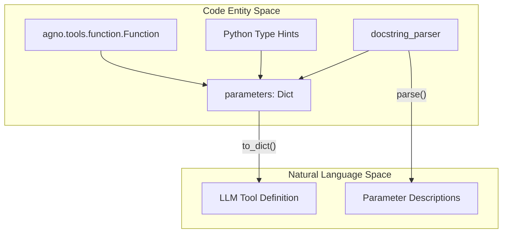
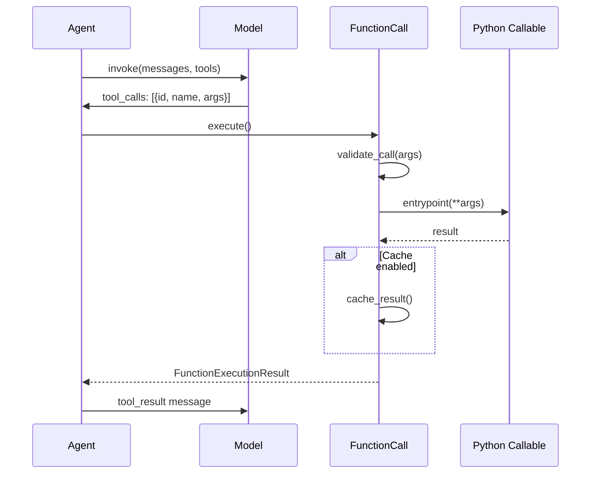
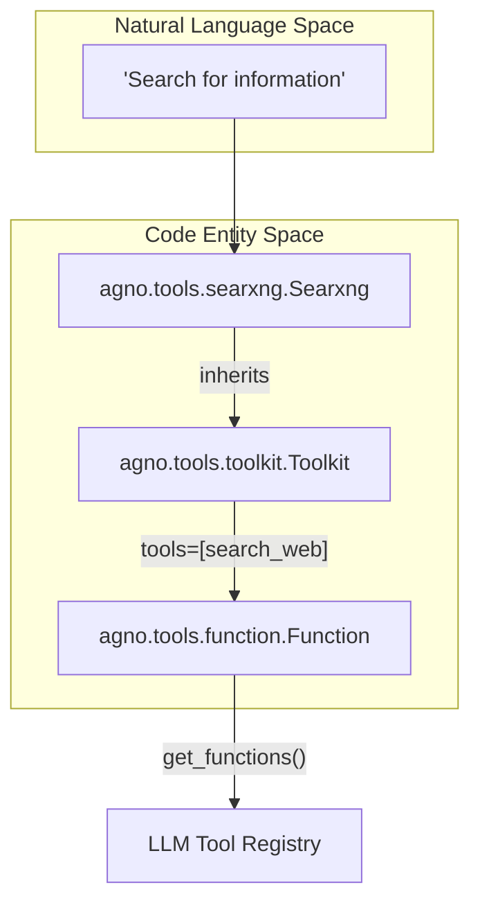

<!-- source: DeepWiki mcp.deepwiki.com · repo agno-agi/agno · page 4.1 Tool Architecture and Function Class · fetched 2026-10-26 -->

# Tool Architecture and Function Class

Relevant source files

The following files were used as context for generating this wiki page:

- [cookbook/90_models/tuning_engines/README.md](cookbook/90_models/tuning_engines/README.md)
- [cookbook/90_models/tuning_engines/basic.py](cookbook/90_models/tuning_engines/basic.py)
- [libs/agno/agno/models/tuning_engines/__init__.py](libs/agno/agno/models/tuning_engines/__init__.py)
- [libs/agno/agno/models/tuning_engines/tuning_engines.py](libs/agno/agno/models/tuning_engines/tuning_engines.py)
- [libs/agno/agno/tools/brightdata.py](libs/agno/agno/tools/brightdata.py)
- [libs/agno/agno/tools/clickup.py](libs/agno/agno/tools/clickup.py)
- [libs/agno/agno/tools/decorator.py](libs/agno/agno/tools/decorator.py)
- [libs/agno/agno/tools/function.py](libs/agno/agno/tools/function.py)
- [libs/agno/agno/tools/hackernews.py](libs/agno/agno/tools/hackernews.py)
- [libs/agno/agno/tools/mcp/mcp.py](libs/agno/agno/tools/mcp/mcp.py)
- [libs/agno/agno/tools/openweather.py](libs/agno/agno/tools/openweather.py)
- [libs/agno/agno/tools/searxng.py](libs/agno/agno/tools/searxng.py)
- [libs/agno/agno/tools/toolkit.py](libs/agno/agno/tools/toolkit.py)
- [libs/agno/agno/utils/functions.py](libs/agno/agno/utils/functions.py)
- [libs/agno/agno/utils/mcp.py](libs/agno/agno/utils/mcp.py)
- [libs/agno/agno/utils/string.py](libs/agno/agno/utils/string.py)
- [libs/agno/tests/integration/agent/test_structured_output_parsing.py](libs/agno/tests/integration/agent/test_structured_output_parsing.py)
- [libs/agno/tests/integration/tools/test_toolkit_run_context.py](libs/agno/tests/integration/tools/test_toolkit_run_context.py)
- [libs/agno/tests/unit/models/tuning_engines/__init__.py](libs/agno/tests/unit/models/tuning_engines/__init__.py)
- [libs/agno/tests/unit/models/tuning_engines/test_tuning_engines.py](libs/agno/tests/unit/models/tuning_engines/test_tuning_engines.py)
- [libs/agno/tests/unit/tools/test_brightdata.py](libs/agno/tests/unit/tools/test_brightdata.py)
- [libs/agno/tests/unit/tools/test_functions.py](libs/agno/tests/unit/tools/test_functions.py)
- [libs/agno/tests/unit/tools/test_hackernews.py](libs/agno/tests/unit/tools/test_hackernews.py)
- [libs/agno/tests/unit/tools/test_mcp.py](libs/agno/tests/unit/tools/test_mcp.py)
- [libs/agno/tests/unit/tools/test_mcp_pagination.py](libs/agno/tests/unit/tools/test_mcp_pagination.py)
- [libs/agno/tests/unit/tools/test_searxng.py](libs/agno/tests/unit/tools/test_searxng.py)
- [libs/agno/tests/unit/tools/test_toolkit.py](libs/agno/tests/unit/tools/test_toolkit.py)
- [libs/agno/tests/unit/utils/test_functions.py](libs/agno/tests/unit/utils/test_functions.py)
- [libs/agno/tests/unit/utils/test_string.py](libs/agno/tests/unit/utils/test_string.py)

This document describes the tool architecture in Agno, focusing on the `Function` class and its role in enabling agents to interact with external capabilities. The `Function` class wraps Python callables with metadata, parameter schemas, and execution controls that allow LLMs to discover and invoke tools dynamically.

## Purpose and Scope

The tool architecture provides a bridge between the natural language reasoning of an LLM and the structured execution of Python code. Key capabilities include:

- **Schema Generation**: Automatic JSON schema extraction from Python functions using type hints and docstrings [libs/agno/agno/tools/function.py:1-2981]().
- **Model Integration**: Formatting tool definitions for various LLM providers.
- **Execution Management**: Controlled tool invocation with pre/post hooks, validation, and error handling [libs/agno/agno/tools/function.py:1-2981]().
- **Human-in-the-Loop (HITL)**: Support for confirmation, user input, and external execution patterns [libs/agno/agno/tools/function.py:1-2981]().
- **Caching & Optimization**: Result caching via secure filesystem stores with TTL support [libs/agno/agno/utils/functions.py:78-170]().

Sources: [libs/agno/agno/tools/function.py:1-2981](), [libs/agno/agno/utils/functions.py:78-170]()

## Function Class Architecture

The `Function` class is a Pydantic `BaseModel` that serves as the primary data structure for tool definitions within the Agno framework.

### Tool System Entity Relationship

**Core Components:**

- **Function**: The static tool definition containing the JSON schema and the Python `entrypoint` [libs/agno/agno/tools/function.py:1-2981]().
- **FunctionCall**: A specific instance of a tool invocation requested by the model, containing the `arguments` and `call_id` [libs/agno/agno/utils/functions.py:10-75]().
- **Toolkit**: A collection container for registering and organizing related functions [libs/agno/agno/tools/toolkit.py:110-506]().

Sources: [libs/agno/agno/tools/function.py:1-2981](), [libs/agno/agno/tools/toolkit.py:110-506](), [libs/agno/agno/utils/functions.py:10-75]()

## Function Schema and Parameters

The `Function` class uses JSON Schema to describe parameters that the LLM can provide when calling the tool.

### Schema Generation Logic

**Parameter Schema Generation:**

The `from_callable()` factory method in `Function` extracts parameter schemas from Python functions automatically [libs/agno/tests/unit/tools/test_functions.py:101-122]():

1. **Signature Analysis**: Uses type hints to determine parameter names, types, and default values [libs/agno/tests/unit/tools/test_functions.py:60-74]().
2. **Docstring Parsing**: Uses `docstring_parser` to extract descriptions for each parameter, enriching schema documentation [libs/agno/tests/unit/tools/test_functions.py:107-111]().
3. **Requirement Logic**: Parameters without default values are added to the `required` list. In `strict` mode, all parameters are marked as required [libs/agno/tests/unit/tools/test_functions.py:166-177]().
4. **Injected Parameters**: Agno automatically identifies and excludes framework-level parameters like `RunContext`, `Agent`, or `Team` from the JSON schema sent to the LLM [libs/agno/agno/tools/function.py:33-45]().

Sources: [libs/agno/agno/tools/function.py:33-45](), [libs/agno/tests/unit/tools/test_functions.py:60-177]()

## Function Execution Lifecycle

The execution lifecycle manages the transition from a model's request to actual code execution, handling validation and hooks.

**Execution Steps:**

1. **Argument Validation**: Using `validate_call`, arguments from the model are validated against function signatures [libs/agno/tests/unit/tools/test_functions.py:139-142]().
2. **Entrypoint Invocation**: The Python callable is invoked, receiving arguments parsed and decoded safely [libs/agno/agno/utils/functions.py:10-75]().
3. **Caching**: If caching is enabled via `cache_result`, results are stored on the filesystem with configurable TTL [libs/agno/agno/utils/functions.py:78-170]().
4. **Error Resilience**: Argument decoding failures return clear error messages to the model to prompt correction [libs/agno/agno/utils/functions.py:38-43]().

Sources: [libs/agno/agno/utils/functions.py:10-170](), [libs/agno/tests/unit/tools/test_functions.py:139-142]()

## Tool-to-Function Conversion via Toolkit

The `Toolkit` class automates the registration of class methods or standalone callables as `Function` objects, providing a high-level interface for tool integration.

- **Automatic Registration**: The `Toolkit` constructor (with `auto_register=True`) iterates through methods and converts them to `Function` instances [libs/agno/agno/tools/toolkit.py:110-142]().
- **Filtering**: Toolkits support `include_tools` and `exclude_tools` to restrict which methods are exposed to agents [libs/agno/tests/unit/tools/test_toolkit.py:124-152]().
- **Async Surface**: Toolkits maintain separate sync and async surfaces, allowing flexible execution modes [libs/agno/agno/tools/toolkit.py:28-30]().
- **Subclassing Patterns**: Domain-specific toolkits (such as `Searxng`) inherit from `Toolkit` to bundle pre-configured tools and settings [libs/agno/agno/tools/searxng.py:11-35]().

Sources: [libs/agno/agno/tools/toolkit.py:28-142](), [libs/agno/agno/tools/searxng.py:11-35](), [libs/agno/tests/unit/tools/test_toolkit.py:124-152]()

## Code Entity Reference Map

| Concept | Primary Class/Function | File Location |
| :--- | :--- | :--- |
| Tool Wrapper | `Function` | [libs/agno/agno/tools/function.py:68]() |
| Invocation Helper | `get_function_call` | [libs/agno/agno/utils/functions.py:10]() |
| Tool Decorator | `@tool` | [libs/agno/agno/tools/decorator.py:90]() |
| Toolkit Base | `Toolkit` | [libs/agno/agno/tools/toolkit.py:110]() |
| Caching Decorator | `cache_result` | [libs/agno/agno/utils/functions.py:78]() |
| Searxng Toolkit | `Searxng` | [libs/agno/agno/tools/searxng.py:11]() |

Sources: [libs/agno/agno/tools/function.py:68-100](), [libs/agno/agno/tools/toolkit.py:110-142](), [libs/agno/agno/tools/decorator.py:90-131](), [libs/agno/agno/utils/functions.py:10-170](), [libs/agno/agno/tools/searxng.py:11-35]()

---

