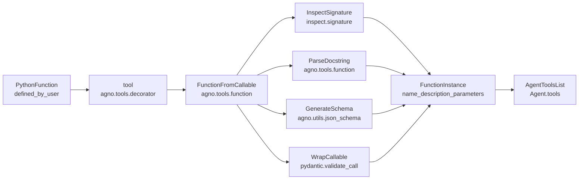
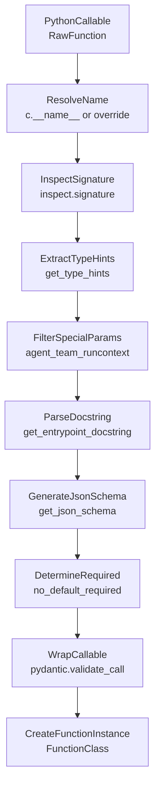
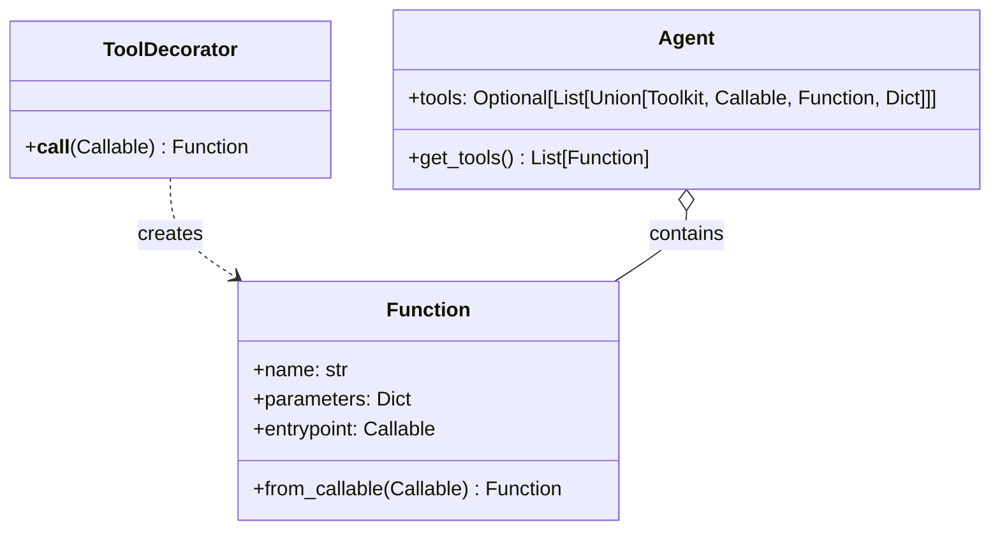

<!-- source: DeepWiki mcp.deepwiki.com · repo agno-agi/agno · page 4.2 Creating Tools with @tool Decorator · fetched 2026-10-26 -->

# Creating Tools with @tool Decorator

<details>
<summary>Relevant source files</summary>

The following files were used as context for generating this wiki page:

- [cookbook/03_teams/04_structured_input_output/response_as_variable.py](cookbook/03_teams/04_structured_input_output/response_as_variable.py)
- [cookbook/03_teams/04_structured_input_output/structured_output_streaming.py](cookbook/03_teams/04_structured_input_output/structured_output_streaming.py)
- [cookbook/03_teams/08_streaming/team_streaming.py](cookbook/03_teams/08_streaming/team_streaming.py)
- [libs/agno/agno/tools/brightdata.py](libs/agno/agno/tools/brightdata.py)
- [libs/agno/agno/tools/clickup.py](libs/agno/agno/tools/clickup.py)
- [libs/agno/agno/tools/decorator.py](libs/agno/agno/tools/decorator.py)
- [libs/agno/agno/tools/hackernews.py](libs/agno/agno/tools/hackernews.py)
- [libs/agno/agno/tools/openweather.py](libs/agno/agno/tools/openweather.py)
- [libs/agno/agno/tools/searxng.py](libs/agno/agno/tools/searxng.py)
- [libs/agno/agno/tools/toolkit.py](libs/agno/agno/tools/toolkit.py)
- [libs/agno/agno/utils/string.py](libs/agno/agno/utils/string.py)
- [libs/agno/tests/integration/agent/human_in_the_loop/test_multi_round_user_input.py](libs/agno/tests/integration/agent/human_in_the_loop/test_multi_round_user_input.py)
- [libs/agno/tests/integration/agent/test_shared_model.py](libs/agno/tests/integration/agent/test_shared_model.py)
- [libs/agno/tests/integration/agent/test_structured_output_parsing.py](libs/agno/tests/integration/agent/test_structured_output_parsing.py)
- [libs/agno/tests/integration/agent/test_tool_hooks.py](libs/agno/tests/integration/agent/test_tool_hooks.py)
- [libs/agno/tests/integration/tools/test_toolkit_run_context.py](libs/agno/tests/integration/tools/test_toolkit_run_context.py)
- [libs/agno/tests/unit/tools/test_brightdata.py](libs/agno/tests/unit/tools/test_brightdata.py)
- [libs/agno/tests/unit/tools/test_hackernews.py](libs/agno/tests/unit/tools/test_hackernews.py)
- [libs/agno/tests/unit/tools/test_searxng.py](libs/agno/tests/unit/tools/test_searxng.py)
- [libs/agno/tests/unit/tools/test_toolkit.py](libs/agno/tests/unit/tools/test_toolkit.py)
- [libs/agno/tests/unit/utils/test_string.py](libs/agno/tests/unit/utils/test_string.py)

</details>


This page explains how to use the `@tool` decorator in Agno to convert Python functions into callable tools that agents can invoke during execution. It covers the technical details of how the decorator works under the hood, including parameter type inference, docstring parsing into JSON Schema, tool hooks, and registering custom tools with agents.

---

## What the `@tool` Decorator Does

The `@tool` decorator, defined in the `agno.tools.decorator` module, transforms a Python function into an instance of the `Function` class [libs/agno/agno/tools/decorator.py:90-117](). This `Function` object encapsulates metadata about the function's name, description, parameters (as JSON Schema), and a wrapped entrypoint callable [libs/agno/agno/tools/function.py:132-200]().

When you decorate a Python function with `@tool`, the decorator uses `Function.from_callable()` to:

- Extract the function's name [libs/agno/agno/tools/function.py:277-285]().
- Inspect its signature and type annotations using `inspect.signature` and `typing.get_type_hints` [libs/agno/agno/tools/function.py:288-310]().
- Parse the function's docstring for descriptions using `docstring_parser` [libs/agno/agno/tools/function.py:23]().
- Convert Python types into JSON Schema for AI model function calling using utility functions like `get_json_schema_for_arg` [libs/agno/agno/utils/json_schema.py:120-221]().
- Wrap the original function with Pydantic's `validate_call` to enforce input validation automatically [libs/agno/agno/tools/function.py:365-385]().

### Tool Flow from Decorator to Model


Sources: [libs/agno/agno/tools/decorator.py:90-117](), [libs/agno/agno/tools/function.py:277-394](), [libs/agno/agno/utils/json_schema.py:120-125]()

---

## Basic Usage

To create a tool, apply the `@tool` decorator to any synchronous or asynchronous Python function. The decorator automatically detects async functions by checking for the `CO_COROUTINE` flag or `__wrapped__` attributes [libs/agno/agno/tools/decorator.py:13-53]().

```python
from agno.tools.decorator import tool

@tool
def get_weather(city: str) -> str:
    """Get the current weather for a city.

    Args:
        city: The city name to query.
    """
    return f"The weather in {city} is sunny."
```

After decoration, `get_weather` is no longer a simple function but a `Function` instance ready for registration with an `Agent` [libs/agno/agno/agent/agent.py:179]().

Sources: [libs/agno/agno/tools/decorator.py:13-53](), [libs/agno/agno/tools/function.py:277-394]()

---

## Decorator Configuration Arguments

You can customize tool metadata and execution behavior via keyword arguments to `@tool` [libs/agno/agno/tools/decorator.py:61-83]().

| Option | Default | Description |
| :--- | :--- | :--- |
| `name` | `func.__name__` | Override the tool name [libs/agno/agno/tools/function.py:137]() |
| `description` | Docstring | Override or supply tool description [libs/agno/agno/tools/function.py:139]() |
| `strict` | `None` | Enable strict parameter checking for the model [libs/agno/agno/tools/function.py:146]() |
| `instructions` | `None` | Instructions for the agent about tool usage [libs/agno/agno/tools/function.py:148]() |
| `show_result` | `False` | Show the tool result in the agent's output [libs/agno/agno/tools/function.py:157]() |
| `stop_after_tool_call` | `False` | Stop agent execution after this tool returns [libs/agno/agno/tools/function.py:159]() |
| `requires_confirmation`| `False` | Pause for user confirmation before execution [libs/agno/agno/tools/function.py:171]() |
| `requires_user_input` | `False` | Pause to ask user for input parameters [libs/agno/agno/tools/function.py:174]() |
| `external_execution` | `False` | Mark for execution outside the agent's control [libs/agno/agno/tools/function.py:181]() |
| `pre_hook` | `None` | Hook function that runs before tool execution [libs/agno/agno/tools/decorator.py:109]() |
| `post_hook` | `None` | Hook function that runs after tool execution [libs/agno/agno/tools/decorator.py:110]() |
| `tool_hooks` | `None` | List of hooks wrapping tool execution [libs/agno/agno/tools/decorator.py:111]() |
| `cache_results` | `False` | Enable result caching [libs/agno/agno/tools/function.py:191]() |

**Note:** Only one of `requires_user_input`, `requires_confirmation`, or `external_execution` can be set to `True` simultaneously [libs/agno/agno/tools/decorator.py:165-172]().

Sources: [libs/agno/agno/tools/decorator.py:61-172](), [libs/agno/agno/tools/function.py:132-200]()

---

## Tool Hooks and Execution Interception

Agno allows you to attach custom pre-hooks, post-hooks, or general tool hooks to intercept tool execution [libs/agno/agno/tools/decorator.py:77-79](). Hooks are useful for logging, auditing, telemetry, permission checking, or argument modification.

```python
from agno.tools.decorator import tool
from agno.run.base import RunContext
from agno.tools.function import FunctionCall

def logger_hook(
    function_name: str,
    function_call: Callable[..., Any],
    arguments: Dict[str, Any],
) -> Any:
    # Pre-execution logic
    result = function_call(**arguments)
    # Post-execution logic
    return result

@tool(tool_hooks=[logger_hook])
def sub(a: int, b: int) -> int:
    return a - b
```

Hooks can also accept `RunContext` parameters to inspect active messages or session states during execution [libs/agno/tests/integration/agent/test_tool_hooks.py:178-194]().

Sources: [libs/agno/agno/tools/decorator.py:77-111](), [libs/agno/tests/integration/agent/test_tool_hooks.py:17-38]()

---

## Parameter Type Inference and Schema Generation

Agno performs deep inspection of Python type hints to generate accurate JSON Schemas for AI models [libs/agno/agno/utils/json_schema.py:120-161]().

- **Basic Types:** Maps `int` to `integer`, `float` to `number`, `str` to `string`, and `bool` to `boolean` [libs/agno/agno/utils/json_schema.py:27-34]().
- **Collections:** Handles `List`, `Tuple`, `Set` (as `array`) and `Dict` (as `object`) [libs/agno/agno/utils/json_schema.py:144-151]().
- **Literals:** `Literal["a", "b"]` is converted to an `enum` in the JSON Schema [libs/agno/agno/utils/json_schema.py:127-143]().
- **Pydantic Models:** If a parameter is a Pydantic `BaseModel`, its schema is inlined into the tool parameters [libs/agno/agno/utils/json_schema.py:167-170]().
- **Unions:** `Union[str, int]` is represented using `anyOf` [libs/agno/agno/utils/json_schema.py:152-161]().

Sources: [libs/agno/agno/utils/json_schema.py:20-43](), [libs/agno/agno/utils/json_schema.py:120-221]()

---

## How `Function.from_callable` Processes a Function

`Function.from_callable` is the factory method that performs the transformation [libs/agno/agno/tools/function.py:277-394]().


Sources: [libs/agno/agno/tools/function.py:39-51](), [libs/agno/agno/tools/function.py:288-323]()

### Special Injected Parameters
The following parameters are automatically injected by the `Agent` or `Team` runtime and are **excluded** from the JSON Schema sent to the model [libs/agno/agno/tools/function.py:39-51]():
- `agent`: The current `Agent` instance.
- `team`: The current `Team` instance.
- `run_context`: The `RunContext` containing metadata.
- `images`, `videos`, `audios`, `files`: Media artifacts.

Sources: [libs/agno/agno/tools/function.py:39-51]()

---

## Docstring Parsing
Agno uses the `docstring-parser` library to extract tool and parameter descriptions [libs/agno/agno/tools/function.py:23]().
- The **Short Description** of the docstring becomes the main tool description [libs/agno/agno/tools/function.py:326-344]().
- The **Args** section is mapped to individual parameter descriptions in the JSON Schema [libs/agno/agno/tools/function.py:338-344]().

Sources: [libs/agno/agno/tools/function.py:23](), [libs/agno/agno/tools/function.py:326-344]()

---

## Tool Caching
Tools created with the `@tool` decorator can leverage file-based caching. When `cache_results` is set to `True`, the `cache_result` decorator factory creates a wrapper that stores results in a local JSON file [libs/agno/agno/utils/functions.py:78-170]().

- **Key Generation:** A hash is generated based on the function module, name, and arguments [libs/agno/agno/utils/functions.py:120-127]().
- **TTL Management:** Cached results are validated against a `cache_ttl` (default 3600s) [libs/agno/agno/utils/functions.py:142-146]().
- **Storage:** Results are saved in `cache_dir` or the system temporary directory under `agno_cache` [libs/agno/agno/utils/functions.py:111-118]().

Sources: [libs/agno/agno/utils/functions.py:78-170](), [libs/agno/agno/tools/function.py:191-196]()

---

## Registering Tools with an Agent

Once decorated, tools are added to the `Agent.tools` list. The `Agent` class handles these tools during initialization and execution [libs/agno/agno/agent/agent.py:179]().


Sources: [libs/agno/agno/agent/agent.py:179](), [libs/agno/agno/tools/function.py:132-200]()

---

