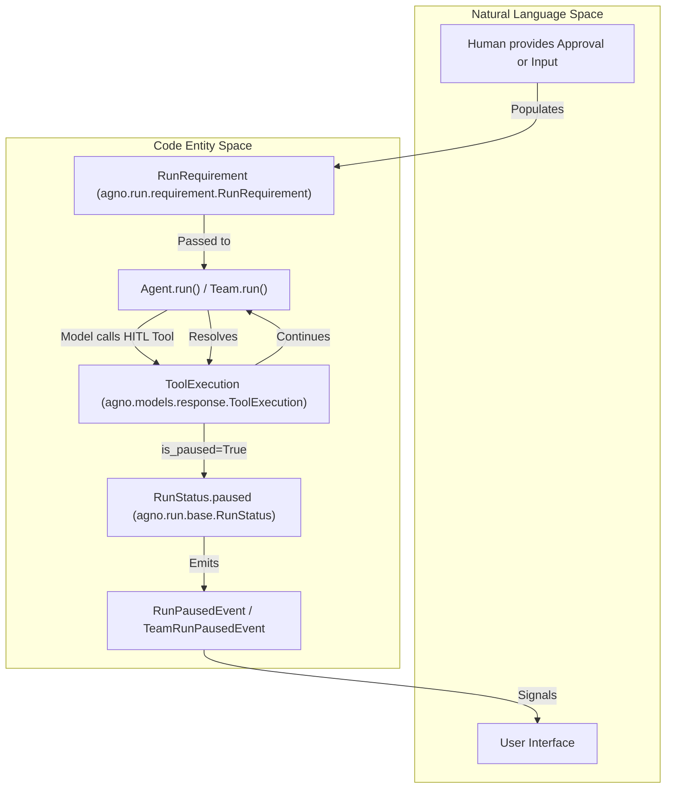
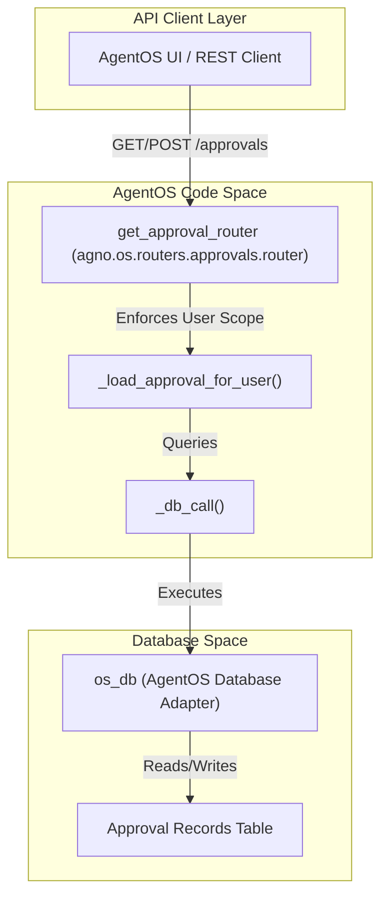

<!-- source: DeepWiki mcp.deepwiki.com · repo agno-agi/agno · page 4.4 Human-in-the-Loop (HITL) · fetched 2026-10-26 -->

# Human-in-the-Loop (HITL)

Relevant source files

The following files were used as context for generating this wiki page:

- [cookbook/02_agents/11_approvals/TEST_LOG.md](cookbook/02_agents/11_approvals/TEST_LOG.md)
- [cookbook/02_agents/11_approvals/approval_post_hook.py](cookbook/02_agents/11_approvals/approval_post_hook.py)
- [cookbook/03_teams/20_human_in_the_loop/CLAUDE.md](cookbook/03_teams/20_human_in_the_loop/CLAUDE.md)
- [cookbook/03_teams/20_human_in_the_loop/README.md](cookbook/03_teams/20_human_in_the_loop/README.md)
- [cookbook/03_teams/20_human_in_the_loop/confirmation_required_with_dependencies.py](cookbook/03_teams/20_human_in_the_loop/confirmation_required_with_dependencies.py)
- [cookbook/03_teams/20_human_in_the_loop/multi_round_user_input.py](cookbook/03_teams/20_human_in_the_loop/multi_round_user_input.py)
- [cookbook/91_tools/redmine_tools.py](cookbook/91_tools/redmine_tools.py)
- [libs/agno/agno/os/managers.py](libs/agno/agno/os/managers.py)
- [libs/agno/agno/os/routers/approvals/router.py](libs/agno/agno/os/routers/approvals/router.py)
- [libs/agno/agno/os/routers/approvals/schema.py](libs/agno/agno/os/routers/approvals/schema.py)
- [libs/agno/agno/os/routers/traces/schemas.py](libs/agno/agno/os/routers/traces/schemas.py)
- [libs/agno/agno/os/routers/traces/traces.py](libs/agno/agno/os/routers/traces/traces.py)
- [libs/agno/agno/run/approval.py](libs/agno/agno/run/approval.py)
- [libs/agno/agno/team/_session.py](libs/agno/agno/team/_session.py)
- [libs/agno/agno/tools/redmine.py](libs/agno/agno/tools/redmine.py)
- [libs/agno/tests/unit/run/test_approval.py](libs/agno/tests/unit/run/test_approval.py)
- [libs/agno/tests/unit/team/test_acontinue_run_background_stream.py](libs/agno/tests/unit/team/test_acontinue_run_background_stream.py)
- [libs/agno/tests/unit/team/test_paused_member_persistence.py](libs/agno/tests/unit/team/test_paused_member_persistence.py)
- [libs/agno/tests/unit/test_trace_search_api.py](libs/agno/tests/unit/test_trace_search_api.py)
- [libs/agno/tests/unit/tools/test_redmine.py](libs/agno/tests/unit/tools/test_redmine.py)

Human-in-the-Loop (HITL) in Agno is a critical mechanism enabling agents, teams, and workflows to pause execution and await human intervention before continuing. It supports explicit user confirmations, collection of structured user inputs, external executions, and control plane integrations via REST APIs while preserving the execution context for seamless resumption.

This page details tool-level HITL mechanics, the `RunPausedEvent` and `RunRequirement` structures, approval database persistence, the AgentOS approvals router, and resume-after-approval patterns.

---

## HITL Patterns in Agno

Agno provides four primary HITL patterns that apply to tools (`Function` objects or `@tool` decorated functions). These flags are captured in the `ToolExecution` model and emitted to clients when a run pauses.

| Pattern | Implementation Flag | Behavior | Typical Use Cases |
| :--- | :--- | :--- | :--- |
| **Confirmation** | `requires_confirmation=True` | Pauses execution requesting explicit user approval (`confirm()` or `reject()`) | Sensitive commands (deletion, financial transactions, outbound actions) |
| **User Input** | `requires_user_input=True` | Pauses to collect structured input parameters via `user_input_schema` | Dynamic parameters, missing arguments, interactive forms |
| **External Execution** | `external_execution_required=True` | Pauses to signal tool execution outside agent control | Long-running jobs, manual tasks, air-gapped systems |
| **Audit** | `approval_type="audit"` | Logs the action for auditing without necessarily gating execution | Compliance, tracking sensitive reads |

Sources: `[libs/agno/agno/models/response.py:47-62]()`, `[libs/agno/agno/run/agent.py:155-155]`, `[libs/agno/agno/run/team.py:130-140]()`

---

## ToolExecution and Pause State Tracking

`ToolExecution` represents the state and metadata of each tool call within a run output, tracking arguments, results, and HITL flags.

### Key Fields in `ToolExecution`

- `tool_call_id`: Unique identifier for the specific model tool call `[libs/agno/agno/models/response.py:31-31]()`.
- `requires_confirmation`: Boolean flag indicating the tool requires manual approval `[libs/agno/agno/models/response.py:47-47]()`.
- `requires_user_input`: Boolean flag indicating the tool needs missing fields `[libs/agno/agno/models/response.py:51-51]()`.
- `user_input_schema`: List of `UserInputField` defining required inputs `[libs/agno/agno/models/response.py:52-52]()`.
- `approval_id`: UUID linking the execution to a persistent approval record `[libs/agno/agno/models/response.py:64-64]()`.
- `approval_type`: Categorization of the approval (e.g., `"required"` or `"audit"`) `[libs/agno/agno/models/response.py:62-62]()`.

Sources: `[libs/agno/agno/models/response.py:28-68]`, `[libs/agno/agno/run/agent.py:12-12]`, `[libs/agno/agno/run/team.py:12-12]()`

---

## Execution Flow: Pause and Resume Lifecycle

When a run encounters a tool flagged for HITL, the runtime enters a paused state. The diagram below bridges the **Natural Language Space** (User/UI) with the **Code Entity Space** (Framework Runtime classes).

### Diagram: HITL Pause and Event Emission Flow

Sources: `[libs/agno/agno/models/response.py:67-68]`, `[libs/agno/agno/run/agent.py:155-156]`, `[libs/agno/agno/run/team.py:131-140]`, `[libs/agno/agno/run/requirement.py:15-15]`, `[libs/agno/agno/base.py:45-50]()`

---

## RunPausedEvent, RunRequirement, and Event Emission

### RunPausedEvent
When a run pauses for HITL, the runtime emits either a `RunPausedEvent` (single-agent) or a `TeamRunPausedEvent` (teams). These carry the active `ToolExecution` blocks and required resolution schemas.
- Agent run pause event constant: `RunEvent.run_paused = "RunPaused"` `[libs/agno/agno/run/agent.py:155-155]()`.
- Team run pause events are managed via utility event builders `[libs/agno/agno/utils/events.py:73-73]()`.

### RunRequirement
`RunRequirement` is the container object used to resolve pauses. It holds the human's decision (e.g., `confirm()`, `reject()`, or provided inputs). In multi-agent teams, requirements track member context via `member_agent_id` and `member_run_id` `[libs/agno/tests/unit/team/test_paused_member_persistence.py:59-61]()`.

Sources: `[libs/agno/agno/run/agent.py:15-15]`, `[libs/agno/agno/run/team.py:16-16]`, `[libs/agno/agno/run/requirement.py:15-15]`, `[libs/agno/agno/utils/events.py:107-107]()`

---

## Approval Management, Persistence, and Approvals Router

Production deployments require persistence so paused runs survive process restarts or client disconnections.

### Approval Record Generation
1. **Creation**: When a run pauses, `create_approval_from_pause()` generates an approval dictionary with `pause_type`, `tool_name`, `tool_args`, and `run_status=RunStatus.paused.value` `[libs/agno/agno/run/approval.py:152]()`.
2. **Stamping**: `_stamp_approval_id_on_tools()` stamps the `approval_id` on the corresponding tool executions `[libs/agno/agno/run/approval.py:46-59]()`.
3. **Storage**: The record is stored in the session database with a `"pending"` status `[libs/agno/agno/run/approval.py:128-148]()`.

### AgentOS Approvals Router (`get_approval_router`)
AgentOS exposes a dedicated FastAPI router (`get_approval_router`) in `agno.os.routers.approvals.router` for managing human approvals via REST API endpoints `[libs/agno/agno/os/routers/approvals/router.py:19-42]()`:
- `GET /approvals`: List pending, approved, rejected, expired, or cancelled approvals with pagination and user-scope filtering `[libs/agno/agno/os/routers/approvals/router.py:82-128]()`.
- `GET /approvals/count`: Retrieve the pending approval count `[libs/agno/agno/os/routers/approvals/router.py:130-139]()`.
- `GET /approvals/{approval_id}/status`: Check resolution status of a specific approval `[libs/agno/agno/os/routers/approvals/router.py:141-154]()`.
- `POST /approvals/{approval_id}/resolve`: Resolve (approve/reject) a pending approval (admin-only or user-scoped depending on auth config) `[libs/agno/agno/os/routers/approvals/router.py:28-34]()`.

### Diagram: Approvals Router and Persistence Architecture

Sources: `[libs/agno/agno/os/routers/approvals/router.py:19-163]`, `[libs/agno/agno/run/approval.py:1-149]()`

---

## Resume-after-Approval Patterns

To resume a paused run:
1. **Session Continuity**: The client provides the original `session_id` and `run_id`.
2. **Requirement Injection**: The resolved `RunRequirement` (containing user inputs or approval confirmation) is supplied to `agent.continue_run()` or `team.acontinue_run()`.
3. **Context Propagation**: The runtime forwards caller dependencies (`dependencies`), metadata (`metadata`), and knowledge filters (`knowledge_filters`) to member agents or continued tools `[cookbook/03_teams/20_human_in_the_loop/confirmation_required_with_dependencies.py:76-99]()`.
4. **Result Scrubbing**: Unresolved tool results are scrubbed while keeping pending tool calls intact so the resumed model receives correct historical payloads `[libs/agno/agno/team/_session.py:178-186]()`.

Sources: `[libs/agno/agno/run/agent.py:155-156]`, `[libs/agno/agno/team/_run.py:186-224]`, `[libs/agno/agno/team/_session.py:178-186]`, `[cookbook/03_teams/20_human_in_the_loop/confirmation_required_with_dependencies.py:1-103]()`

---

## Summary of HITL Classes and Endpoints

| Class / Function / Route | Role | Source |
| :--- | :--- | :--- |
| `RunEvent.run_paused` | Event emitted when an agent pauses for HITL. | `[libs/agno/agno/run/agent.py:155-155]()` |
| `ToolExecution` | Tracks metadata, schemas, and HITL flags for tool calls. | `[libs/agno/agno/models/response.py:28-68]()` |
| `RunRequirement` | Container for human-provided resolutions and inputs. | `[libs/agno/agno/run/requirement.py:15-15]()` |
| `create_approval_from_pause()` | Generates persistent approval records in the DB. | `[libs/agno/agno/run/approval.py:152-164]()` |
| `get_approval_router()` | FastAPI router factory providing CRUD and resolution endpoints for approvals. | `[libs/agno/agno/os/routers/approvals/router.py:19-42]()` |
| `RunStatus.paused` | Enum state representing a run waiting for intervention. | `[libs/agno/agno/run/base.py:45-50]()` |

Sources: `[libs/agno/agno/run/agent.py]`, `[libs/agno/agno/run/team.py]`, `[libs/agno/agno/run/base.py]`, `[libs/agno/agno/models/response.py]`, `[libs/agno/agno/run/approval.py]`, `[libs/agno/agno/os/routers/approvals/router.py]()`

---

