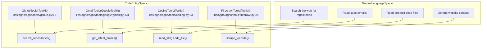
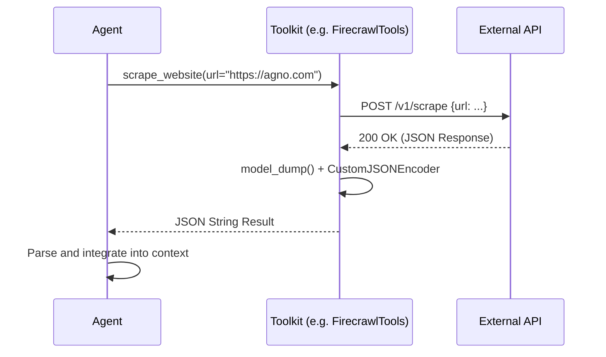

<!-- source: DeepWiki mcp.deepwiki.com · repo agno-agi/agno · page 4.5 Built-in Tool Integrations · fetched 2026-10-26 -->

# Built-in Tool Integrations

Relevant source files

The following files were used as context for generating this wiki page:

- [cookbook/02_agents/10_human_in_the_loop/user_feedback.py](cookbook/02_agents/10_human_in_the_loop/user_feedback.py)
- [cookbook/02_agents/10_human_in_the_loop/user_input.py](cookbook/02_agents/10_human_in_the_loop/user_input.py)
- [cookbook/12_context/07_google_drive.py](cookbook/12_context/07_google_drive.py)
- [cookbook/12_context/21_gdrive_office.py](cookbook/12_context/21_gdrive_office.py)
- [cookbook/91_tools/TEST_LOG.md](cookbook/91_tools/TEST_LOG.md)
- [cookbook/91_tools/adanos_tools.py](cookbook/91_tools/adanos_tools.py)
- [cookbook/91_tools/atomic_mail_tools.py](cookbook/91_tools/atomic_mail_tools.py)
- [cookbook/91_tools/coding_tools/01_basic_usage.py](cookbook/91_tools/coding_tools/01_basic_usage.py)
- [cookbook/91_tools/coding_tools/02_all_tools.py](cookbook/91_tools/coding_tools/02_all_tools.py)
- [cookbook/91_tools/coding_tools/README.md](cookbook/91_tools/coding_tools/README.md)
- [cookbook/91_tools/coding_tools/TEST_LOG.md](cookbook/91_tools/coding_tools/TEST_LOG.md)
- [cookbook/91_tools/file_tools.py](cookbook/91_tools/file_tools.py)
- [cookbook/91_tools/google/README.md](cookbook/91_tools/google/README.md)
- [cookbook/91_tools/google/gmail/action_items.py](cookbook/91_tools/google/gmail/action_items.py)
- [cookbook/91_tools/google/gmail/followup_tracker.py](cookbook/91_tools/google/gmail/followup_tracker.py)
- [cookbook/91_tools/google/gmail/inbox_triage.py](cookbook/91_tools/google/gmail/inbox_triage.py)
- [cookbook/91_tools/google_drive.py](cookbook/91_tools/google_drive.py)
- [cookbook/91_tools/google_maps_tools.py](cookbook/91_tools/google_maps_tools.py)
- [cookbook/91_tools/googlecalendar_tools.py](cookbook/91_tools/googlecalendar_tools.py)
- [cookbook/91_tools/googlesheets_tools.py](cookbook/91_tools/googlesheets_tools.py)
- [cookbook/91_tools/local_file_system_tools.py](cookbook/91_tools/local_file_system_tools.py)
- [cookbook/91_tools/minimax_tools.py](cookbook/91_tools/minimax_tools.py)
- [cookbook/91_tools/models/gemini_video_generation.py](cookbook/91_tools/models/gemini_video_generation.py)
- [cookbook/91_tools/shell_tools.py](cookbook/91_tools/shell_tools.py)
- [cookbook/91_tools/sofya_tools.py](cookbook/91_tools/sofya_tools.py)
- [cookbook/91_tools/superserve_tools.py](cookbook/91_tools/superserve_tools.py)
- [cookbook/91_tools/yfinance_tools.py](cookbook/91_tools/yfinance_tools.py)
- [cookbook/scripts/cookbook_runner.py](cookbook/scripts/cookbook_runner.py)
- [libs/agno/agno/models/dashscope/dashscope.py](libs/agno/agno/models/dashscope/dashscope.py)
- [libs/agno/agno/tools/adanos.py](libs/agno/agno/tools/adanos.py)
- [libs/agno/agno/tools/agentql.py](libs/agno/agno/tools/agentql.py)
- [libs/agno/agno/tools/api.py](libs/agno/agno/tools/api.py)
- [libs/agno/agno/tools/arxiv.py](libs/agno/agno/tools/arxiv.py)
- [libs/agno/agno/tools/atomic_mail.py](libs/agno/agno/tools/atomic_mail.py)
- [libs/agno/agno/tools/aws_lambda.py](libs/agno/agno/tools/aws_lambda.py)
- [libs/agno/agno/tools/baidusearch.py](libs/agno/agno/tools/baidusearch.py)
- [libs/agno/agno/tools/bitbucket.py](libs/agno/agno/tools/bitbucket.py)
- [libs/agno/agno/tools/brandfetch.py](libs/agno/agno/tools/brandfetch.py)
- [libs/agno/agno/tools/browserbase.py](libs/agno/agno/tools/browserbase.py)
- [libs/agno/agno/tools/calcom.py](libs/agno/agno/tools/calcom.py)
- [libs/agno/agno/tools/coding.py](libs/agno/agno/tools/coding.py)
- [libs/agno/agno/tools/confluence.py](libs/agno/agno/tools/confluence.py)
- [libs/agno/agno/tools/csv_toolkit.py](libs/agno/agno/tools/csv_toolkit.py)
- [libs/agno/agno/tools/daytona.py](libs/agno/agno/tools/daytona.py)
- [libs/agno/agno/tools/desi_vocal.py](libs/agno/agno/tools/desi_vocal.py)
- [libs/agno/agno/tools/duckdb.py](libs/agno/agno/tools/duckdb.py)
- [libs/agno/agno/tools/duckduckgo.py](libs/agno/agno/tools/duckduckgo.py)
- [libs/agno/agno/tools/e2b.py](libs/agno/agno/tools/e2b.py)
- [libs/agno/agno/tools/eleven_labs.py](libs/agno/agno/tools/eleven_labs.py)
- [libs/agno/agno/tools/exa.py](libs/agno/agno/tools/exa.py)
- [libs/agno/agno/tools/financial_datasets.py](libs/agno/agno/tools/financial_datasets.py)
- [libs/agno/agno/tools/firecrawl.py](libs/agno/agno/tools/firecrawl.py)
- [libs/agno/agno/tools/github.py](libs/agno/agno/tools/github.py)
- [libs/agno/agno/tools/google/calendar.py](libs/agno/agno/tools/google/calendar.py)
- [libs/agno/agno/tools/google/drive.py](libs/agno/agno/tools/google/drive.py)
- [libs/agno/agno/tools/google/gmail.py](libs/agno/agno/tools/google/gmail.py)
- [libs/agno/agno/tools/google/slides.py](libs/agno/agno/tools/google/slides.py)
- [libs/agno/agno/tools/local_file_system.py](libs/agno/agno/tools/local_file_system.py)
- [libs/agno/agno/tools/minimax.py](libs/agno/agno/tools/minimax.py)
- [libs/agno/agno/tools/models/gemini.py](libs/agno/agno/tools/models/gemini.py)
- [libs/agno/agno/tools/models/groq.py](libs/agno/agno/tools/models/groq.py)
- [libs/agno/agno/tools/moviepy_video.py](libs/agno/agno/tools/moviepy_video.py)
- [libs/agno/agno/tools/neo4j.py](libs/agno/agno/tools/neo4j.py)
- [libs/agno/agno/tools/newspaper.py](libs/agno/agno/tools/newspaper.py)
- [libs/agno/agno/tools/newspaper4k.py](libs/agno/agno/tools/newspaper4k.py)
- [libs/agno/agno/tools/openbb.py](libs/agno/agno/tools/openbb.py)
- [libs/agno/agno/tools/pubmed.py](libs/agno/agno/tools/pubmed.py)
- [libs/agno/agno/tools/reddit.py](libs/agno/agno/tools/reddit.py)
- [libs/agno/agno/tools/serper.py](libs/agno/agno/tools/serper.py)
- [libs/agno/agno/tools/shell.py](libs/agno/agno/tools/shell.py)
- [libs/agno/agno/tools/sofya.py](libs/agno/agno/tools/sofya.py)
- [libs/agno/agno/tools/spider.py](libs/agno/agno/tools/spider.py)
- [libs/agno/agno/tools/studio_runner.py](libs/agno/agno/tools/studio_runner.py)
- [libs/agno/agno/tools/superserve.py](libs/agno/agno/tools/superserve.py)
- [libs/agno/agno/tools/todoist.py](libs/agno/agno/tools/todoist.py)
- [libs/agno/agno/tools/trello.py](libs/agno/agno/tools/trello.py)
- [libs/agno/agno/tools/website.py](libs/agno/agno/tools/website.py)
- [libs/agno/agno/tools/whatsapp.py](libs/agno/agno/tools/whatsapp.py)
- [libs/agno/agno/tools/workflow.py](libs/agno/agno/tools/workflow.py)
- [libs/agno/agno/tools/workspace.py](libs/agno/agno/tools/workspace.py)
- [libs/agno/agno/tools/yfinance.py](libs/agno/agno/tools/yfinance.py)
- [libs/agno/agno/tools/youtube.py](libs/agno/agno/tools/youtube.py)
- [libs/agno/agno/tools/zendesk.py](libs/agno/agno/tools/zendesk.py)
- [libs/agno/agno/tools/zoom.py](libs/agno/agno/tools/zoom.py)
- [libs/agno/agno/utils/code_execution.py](libs/agno/agno/utils/code_execution.py)
- [libs/agno/agno/utils/shell.py](libs/agno/agno/utils/shell.py)
- [libs/agno/tests/unit/context/test_gdrive_mime_types.py](libs/agno/tests/unit/context/test_gdrive_mime_types.py)
- [libs/agno/tests/unit/db/test_span_schema.py](libs/agno/tests/unit/db/test_span_schema.py)
- [libs/agno/tests/unit/tools/models/test_gemini.py](libs/agno/tests/unit/tools/models/test_gemini.py)
- [libs/agno/tests/unit/tools/models/test_groq.py](libs/agno/tests/unit/tools/models/test_groq.py)
- [libs/agno/tests/unit/tools/test_adanos.py](libs/agno/tests/unit/tools/test_adanos.py)
- [libs/agno/tests/unit/tools/test_atomic_mail.py](libs/agno/tests/unit/tools/test_atomic_mail.py)
- [libs/agno/tests/unit/tools/test_bitbucket.py](libs/agno/tests/unit/tools/test_bitbucket.py)
- [libs/agno/tests/unit/tools/test_browserbase.py](libs/agno/tests/unit/tools/test_browserbase.py)
- [libs/agno/tests/unit/tools/test_coding_tools.py](libs/agno/tests/unit/tools/test_coding_tools.py)
- [libs/agno/tests/unit/tools/test_confluence.py](libs/agno/tests/unit/tools/test_confluence.py)
- [libs/agno/tests/unit/tools/test_csv_toolkit.py](libs/agno/tests/unit/tools/test_csv_toolkit.py)
- [libs/agno/tests/unit/tools/test_custom_api.py](libs/agno/tests/unit/tools/test_custom_api.py)
- [libs/agno/tests/unit/tools/test_daytona.py](libs/agno/tests/unit/tools/test_daytona.py)
- [libs/agno/tests/unit/tools/test_duckdb.py](libs/agno/tests/unit/tools/test_duckdb.py)
- [libs/agno/tests/unit/tools/test_e2b.py](libs/agno/tests/unit/tools/test_e2b.py)
- [libs/agno/tests/unit/tools/test_exa.py](libs/agno/tests/unit/tools/test_exa.py)
- [libs/agno/tests/unit/tools/test_filetools.py](libs/agno/tests/unit/tools/test_filetools.py)
- [libs/agno/tests/unit/tools/test_firecrawl.py](libs/agno/tests/unit/tools/test_firecrawl.py)
- [libs/agno/tests/unit/tools/test_github.py](libs/agno/tests/unit/tools/test_github.py)
- [libs/agno/tests/unit/tools/test_gmail_pagination.py](libs/agno/tests/unit/tools/test_gmail_pagination.py)
- [libs/agno/tests/unit/tools/test_gmail_tools.py](libs/agno/tests/unit/tools/test_gmail_tools.py)
- [libs/agno/tests/unit/tools/test_google_calendar.py](libs/agno/tests/unit/tools/test_google_calendar.py)
- [libs/agno/tests/unit/tools/test_google_drive.py](libs/agno/tests/unit/tools/test_google_drive.py)
- [libs/agno/tests/unit/tools/test_local_file_system.py](libs/agno/tests/unit/tools/test_local_file_system.py)
- [libs/agno/tests/unit/tools/test_minimax.py](libs/agno/tests/unit/tools/test_minimax.py)
- [libs/agno/tests/unit/tools/test_moviepy_video.py](libs/agno/tests/unit/tools/test_moviepy_video.py)
- [libs/agno/tests/unit/tools/test_pubmed.py](libs/agno/tests/unit/tools/test_pubmed.py)
- [libs/agno/tests/unit/tools/test_reddit.py](libs/agno/tests/unit/tools/test_reddit.py)
- [libs/agno/tests/unit/tools/test_serper.py](libs/agno/tests/unit/tools/test_serper.py)
- [libs/agno/tests/unit/tools/test_shell_tools.py](libs/agno/tests/unit/tools/test_shell_tools.py)
- [libs/agno/tests/unit/tools/test_sofya.py](libs/agno/tests/unit/tools/test_sofya.py)
- [libs/agno/tests/unit/tools/test_spider.py](libs/agno/tests/unit/tools/test_spider.py)
- [libs/agno/tests/unit/tools/test_superserve.py](libs/agno/tests/unit/tools/test_superserve.py)
- [libs/agno/tests/unit/tools/test_todoist_tools.py](libs/agno/tests/unit/tools/test_todoist_tools.py)
- [libs/agno/tests/unit/tools/test_workspace.py](libs/agno/tests/unit/tools/test_workspace.py)
- [libs/agno/tests/unit/tools/test_zoom_tools.py](libs/agno/tests/unit/tools/test_zoom_tools.py)
- [libs/agno/tests/unit/vectordb/test_elasticsearch.py](libs/agno/tests/unit/vectordb/test_elasticsearch.py)
- [scripts/dev_setup.sh](scripts/dev_setup.sh)

This page documents the pre-built tool integration classes included in the `agno.tools` package. These classes wrap third-party APIs and local execution environments, exposing their capabilities as callable tools that agents can invoke during a run.

For information on the underlying tool machinery (the `Function` class, `@tool` decorator, execution controls), see **Tool Architecture (4.1)** and **Creating Tools with @tool (4.2)**. For exposing external tools over the Model Context Protocol, see **Model Context Protocol (4.6)**.

---

## 1. How Built-in Tools Are Registered and Initialized

All built-in tool classes inherit from the `Toolkit` base class and are passed to the `Agent`'s `tools` parameter as instantiated objects. The agent's execution engine introspects each toolkit object, enumerates its callable methods, and registers each as a `Function` that the language model can invoke.

Multiple toolkits can be combined in the same list. Individual functions within a toolkit can be conditionally enabled or disabled during initialization using boolean flags (such as `enable_search` or `enable_get_contents` [libs/agno/agno/tools/exa.py:99-108](), or `enable_scrape` [libs/agno/agno/tools/firecrawl.py:69-70]()) to finely control tool exposure.

### Toolkit-to-Code Entity Mapping

Sources: [libs/agno/agno/tools/github.py:16-70](), [libs/agno/agno/tools/google/gmail.py:131-140](), [libs/agno/agno/tools/coding.py:23-48](), [libs/agno/agno/tools/firecrawl.py:25-78]()

---

## 2. Search and Web Toolkits

Pre-built web search and crawling toolkits enable agents to query search engines and parse web content.

### ExaTools
- **Module:** `agno.tools.exa`  
- **Class:** `ExaTools` [libs/agno/agno/tools/exa.py:16-16]()  
- **Credentials:** Requires `EXA_API_KEY` [libs/agno/agno/tools/exa.py:73-75]()  
- **Key Functions:** `search_exa`, `get_contents`, `find_similar`, `exa_answer`, `research` [libs/agno/agno/tools/exa.py:99-109](). Configures timeouts via thread pools [libs/agno/agno/tools/exa.py:112-122]() and parses results into JSON strings [libs/agno/agno/tools/exa.py:123-139]().

### FirecrawlTools
- **Module:** `agno.tools.firecrawl`  
- **Class:** `FirecrawlTools` [libs/agno/agno/tools/firecrawl.py:25-25]()  
- **Credentials:** Requires `FIRECRAWL_API_KEY` [libs/agno/agno/tools/firecrawl.py:58-60]()  
- **Key Functions:** `scrape_website`, `crawl_website`, `map_website`, `search_web` [libs/agno/agno/tools/firecrawl.py:68-77](). Uses `CustomJSONEncoder` to serialize complex objects [libs/agno/agno/tools/firecrawl.py:15-23]().

Sources: [libs/agno/agno/tools/exa.py:16-139](), [libs/agno/agno/tools/firecrawl.py:15-152]()

---

## 3. Finance Toolkits

### YFinanceTools
- **Module:** `agno.tools.yfinance`  
- **Class:** `YFinanceTools`  
- **Key Functions:** Retrieves stock prices, historical data, income statements, balance sheets, analyst recommendations, and company information via `yfinance`.

Sources: [libs/agno/agno/tools/yfinance.py:1-100]()

---

## 4. SaaS and Productivity Toolkits

### GithubTools
- **Module:** `agno.tools.github`  
- **Class:** `GithubTools` [libs/agno/agno/tools/github.py:16-16]()  
- **Credentials:** Requires `GITHUB_ACCESS_TOKEN` [libs/agno/agno/tools/github.py:23-23]()  
- **Key Functions:** `search_repositories`, `list_repositories`, `create_repository`, `get_pull_request`, `create_issue`, `create_file`, `update_file`, `search_code` [libs/agno/agno/tools/github.py:28-68](). Uses `PyGithub` under the hood [libs/agno/agno/tools/github.py:10-13]().

### GmailTools & Google Drive Tools
- **Modules:** `agno.tools.google.gmail`, `agno.tools.google.drive`  
- **Classes:** `GmailTools` [libs/agno/agno/tools/google/gmail.py:131-131](), `GoogleDriveTools`  
- **Credentials:** OAuth2 or Service Account credentials [libs/agno/agno/tools/google/gmail.py:47-64](), [libs/agno/agno/tools/google/drive.py:18-23]()  
- **Key Functions:** `get_latest_emails`, `send_email`, `create_draft_email`, `search_emails` [libs/agno/agno/tools/google/gmail.py:157-164](); `search_files`, `read_file`, `upload_file`, `download_file`. Features automatic binary detection [libs/agno/agno/tools/google/drive.py:164-169]() and specialized query instruction injection [libs/agno/agno/tools/google/drive.py:84-107]().

Sources: [libs/agno/agno/tools/github.py:16-70](), [libs/agno/agno/tools/google/gmail.py:131-169](), [libs/agno/agno/tools/google/drive.py:68-173]()

---

## 5. Code Execution and Workspace Toolkits

### CodingTools
- **Module:** `agno.tools.coding`  
- **Class:** `CodingTools` [libs/agno/agno/tools/coding.py:23-23]()  
- **Key Functions:** `read_file`, `edit_file`, `write_file`, `run_shell`, `grep`, `find`, `ls` [libs/agno/agno/tools/coding.py:80-114](). Designed for coding agents with strict base directory confinement (`restrict_to_base_dir`) and command allowlisting [libs/agno/agno/tools/coding.py:34-48]().

### E2B and Daytona Tools
- **Modules:** `agno.tools.e2b`, `agno.tools.daytona`  
- **Classes:** `E2BTools`, `DaytonaTools`  
- **Key Functions:** Provide remote sandbox execution environments where agents can run untrusted code, execute shell scripts, and manage files safely isolated from the host machine.

Sources: [libs/agno/agno/tools/coding.py:23-114](), [libs/agno/agno/tools/e2b.py:1-50](), [libs/agno/agno/tools/daytona.py:1-50]()

---

## 6. Data Toolkits

### CsvTools, DuckDBTools, and SQLTools
- **Modules:** `agno.tools.csv_toolkit`, `agno.tools.duckdb`, `agno.tools.sql`  
- **Classes:** `CsvTools`, `DuckDBTools`, `SQLTools`  
- **Key Functions:** Allow agents to query structured data files, execute ad-hoc SQL queries against local DuckDB databases, or connect to enterprise relational databases to fetch tabular results.

Sources: [libs/agno/agno/tools/csv_toolkit.py:1-50](), [libs/agno/agno/tools/duckdb.py:1-50]()

---

## 7. Technical Data Flow: Tool Execution Logic

The following sequence diagram illustrates how an agent invokes a built-in tool method and processes its return payload.

Sources: [libs/agno/agno/tools/firecrawl.py:80-91]()

---

## 8. Summary Table of Built-in Tools

| Toolkit | Module | Required Credential | Description |
| :--- | :--- | :--- | :--- |
| `GithubTools` | `agno.tools.github` | `GITHUB_ACCESS_TOKEN` [libs/agno/agno/tools/github.py:23-23]() | Full GitHub API repository & PR management [libs/agno/agno/tools/github.py:16-70]() |
| `GmailTools` | `agno.tools.google.gmail` | OAuth2 / Service Account [libs/agno/agno/tools/google/gmail.py:47-64]() | Email read, write, and draft operations [libs/agno/agno/tools/google/gmail.py:131-169]() |
| `GoogleDriveTools` | `agno.tools.google.drive` | OAuth2 / Service Account [libs/agno/agno/tools/google/drive.py:18-23]() | File search and management [libs/agno/agno/tools/google/drive.py:68-110]() |
| `ExaTools` | `agno.tools.exa` | `EXA_API_KEY` [libs/agno/agno/tools/exa.py:73-75]() | Neural web search and research [libs/agno/agno/tools/exa.py:16-72]() |
| `FirecrawlTools` | `agno.tools.firecrawl` | `FIRECRAWL_API_KEY` [libs/agno/agno/tools/firecrawl.py:58-60]() | Web scraping and crawling [libs/agno/agno/tools/firecrawl.py:25-57]() |
| `CodingTools` | `agno.tools.coding` | None | Local file editing, grep, and shell execution [libs/agno/agno/tools/coding.py:23-48]() |
| `YFinanceTools` | `agno.tools.yfinance` | None | Financial markets and stock data retrieval |
| `DuckDBTools` | `agno.tools.duckdb` | None | DuckDB SQL query execution |

Sources: [libs/agno/agno/tools/github.py:16-70](), [libs/agno/agno/tools/google/gmail.py:131-169](), [libs/agno/agno/tools/google/drive.py:68-110](), [libs/agno/agno/tools/exa.py:16-72](), [libs/agno/agno/tools/firecrawl.py:25-57](), [libs/agno/agno/tools/coding.py:23-48]()

---

