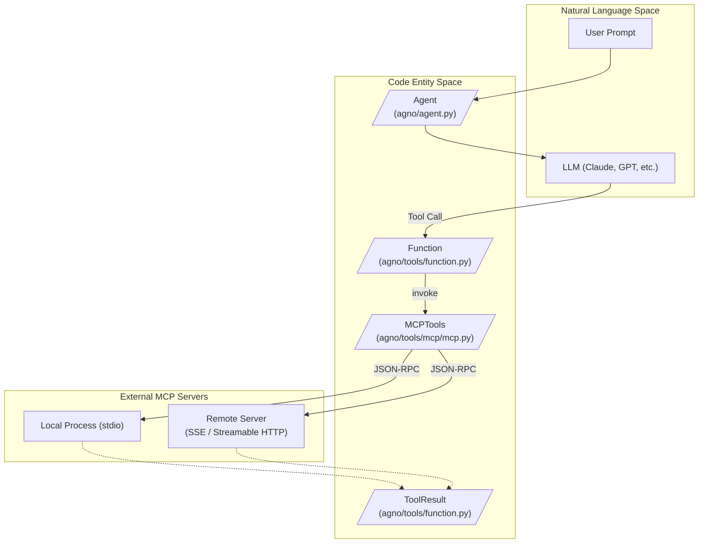
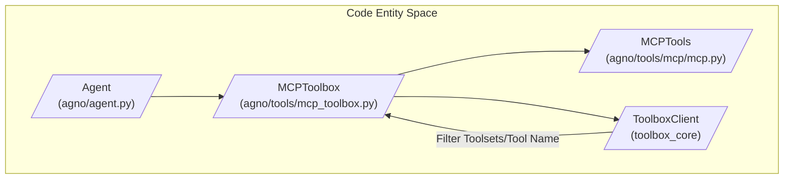

<!-- source: DeepWiki mcp.deepwiki.com · repo agno-agi/agno · page 4.6 Model Context Protocol (MCP) · fetched 2026-10-26 -->

# Model Context Protocol (MCP)

<details>
<summary>Relevant source files</summary>

The following files were used as context for generating this wiki page:

- [cookbook/02_agents/07_knowledge/agentic_rag_with_reranking.py](cookbook/02_agents/07_knowledge/agentic_rag_with_reranking.py)
- [cookbook/07_knowledge/09_archive/vector_dbs/llamaindex_db.py](cookbook/07_knowledge/09_archive/vector_dbs/llamaindex_db.py)
- [cookbook/07_knowledge/09_archive/vector_dbs/pgvector_with_bedrock_reranker.py](cookbook/07_knowledge/09_archive/vector_dbs/pgvector_with_bedrock_reranker.py)
- [cookbook/07_knowledge/09_archive/vector_dbs/redis_db_with_cohere_reranker.py](cookbook/07_knowledge/09_archive/vector_dbs/redis_db_with_cohere_reranker.py)
- [cookbook/90_models/anthropic/mcp_connector.py](cookbook/90_models/anthropic/mcp_connector.py)
- [cookbook/90_models/tuning_engines/README.md](cookbook/90_models/tuning_engines/README.md)
- [cookbook/90_models/tuning_engines/basic.py](cookbook/90_models/tuning_engines/basic.py)
- [cookbook/91_tools/mcp/README.md](cookbook/91_tools/mcp/README.md)
- [cookbook/91_tools/mcp/TEST_LOG.md](cookbook/91_tools/mcp/TEST_LOG.md)
- [cookbook/91_tools/mcp/magic_hour.py](cookbook/91_tools/mcp/magic_hour.py)
- [cookbook/91_tools/mcp/peer_cash.py](cookbook/91_tools/mcp/peer_cash.py)
- [cookbook/91_tools/mcp/pipedream_google_calendar.py](cookbook/91_tools/mcp/pipedream_google_calendar.py)
- [cookbook/91_tools/mcp/pipedream_linkedin.py](cookbook/91_tools/mcp/pipedream_linkedin.py)
- [cookbook/91_tools/mcp/pipedream_slack.py](cookbook/91_tools/mcp/pipedream_slack.py)
- [cookbook/91_tools/mcp/structured_content.py](cookbook/91_tools/mcp/structured_content.py)
- [libs/agno/agno/environments/__init__.py](libs/agno/agno/environments/__init__.py)
- [libs/agno/agno/environments/_engine.py](libs/agno/agno/environments/_engine.py)
- [libs/agno/agno/eval/suite.py](libs/agno/agno/eval/suite.py)
- [libs/agno/agno/models/tuning_engines/__init__.py](libs/agno/agno/models/tuning_engines/__init__.py)
- [libs/agno/agno/models/tuning_engines/tuning_engines.py](libs/agno/agno/models/tuning_engines/tuning_engines.py)
- [libs/agno/agno/tools/function.py](libs/agno/agno/tools/function.py)
- [libs/agno/agno/tools/mcp/mcp.py](libs/agno/agno/tools/mcp/mcp.py)
- [libs/agno/agno/tools/mcp_toolbox.py](libs/agno/agno/tools/mcp_toolbox.py)
- [libs/agno/agno/utils/functions.py](libs/agno/agno/utils/functions.py)
- [libs/agno/agno/utils/mcp.py](libs/agno/agno/utils/mcp.py)
- [libs/agno/agno/vectordb/redis/redisdb.py](libs/agno/agno/vectordb/redis/redisdb.py)
- [libs/agno/tests/unit/environments/__init__.py](libs/agno/tests/unit/environments/__init__.py)
- [libs/agno/tests/unit/environments/test_engine.py](libs/agno/tests/unit/environments/test_engine.py)
- [libs/agno/tests/unit/eval/test_suite.py](libs/agno/tests/unit/eval/test_suite.py)
- [libs/agno/tests/unit/models/tuning_engines/__init__.py](libs/agno/tests/unit/models/tuning_engines/__init__.py)
- [libs/agno/tests/unit/models/tuning_engines/test_tuning_engines.py](libs/agno/tests/unit/models/tuning_engines/test_tuning_engines.py)
- [libs/agno/tests/unit/tools/test_functions.py](libs/agno/tests/unit/tools/test_functions.py)
- [libs/agno/tests/unit/tools/test_mcp.py](libs/agno/tests/unit/tools/test_mcp.py)
- [libs/agno/tests/unit/tools/test_mcp_pagination.py](libs/agno/tests/unit/tools/test_mcp_pagination.py)
- [libs/agno/tests/unit/tools/test_mcp_toolbox_lifecycle.py](libs/agno/tests/unit/tools/test_mcp_toolbox_lifecycle.py)
- [libs/agno/tests/unit/utils/test_functions.py](libs/agno/tests/unit/utils/test_functions.py)

</details>


This page details the Model Context Protocol (MCP) integration within the Agno framework. It covers how agents consume external tools via `MCPTools`, support for various transport protocols (`stdio`, `SSE`, `streamable-http`), session and header management, advanced filtering via `MCPToolbox`, and multi-server agent configurations.

---

## 1. Overview and Architecture

The Model Context Protocol (MCP) is an open standard enabling AI models to interact with external tools and data sources through a unified interface. Within Agno, MCP integration allows agents to dynamically load and invoke remote or local tools exposed by any MCP-compliant server.

### Roles and Data Flow



**Sources:**
[libs/agno/agno/tools/mcp/mcp.py:30-58](), [libs/agno/agno/utils/mcp.py:87-112]()

---

## 2. Consuming External Tools with MCPTools

`MCPTools` extends `Toolkit` to manage connections, session lifecycles, tool discovery, and tool invocation against MCP servers [libs/agno/agno/tools/mcp/mcp.py:30-40]().

### Transports and Configuration

Agno supports three primary transport protocols for connecting to MCP servers:

| Transport | Configuration Class | Description |
| :--- | :--- | :--- |
| `stdio` | `StdioServerParameters` | Launches and communicates with a local subprocess over standard input/output [libs/agno/agno/tools/mcp/mcp.py:122-126]() |
| `sse` | `SSEClientParams` | Connects to legacy Server-Sent Events endpoints (largely superseded by streamable HTTP) [libs/agno/agno/tools/mcp/mcp.py:111-115]() |
| `streamable-http` | `StreamableHTTPClientParams` | Connects over modern streaming HTTP endpoints for efficient remote tool execution [libs/agno/agno/tools/mcp/mcp.py:127-130]() |

`MCPTools` automatically determines the transport based on input parameters (e.g., providing a `url` defaults to `streamable-http`, while a `command` defaults to `stdio`) [libs/agno/agno/tools/mcp/mcp.py:102-110]().

**Sources:**
[libs/agno/agno/tools/mcp/mcp.py:100-150](), [libs/agno/tests/unit/tools/test_mcp.py:28-50]()

---

## 3. Session and Header Management

`MCPTools` manages connection sessions and allows dynamic header injection per request, supporting authenticated endpoints and persistent sessions.

### Header Providers

For HTTP and streamable-http transports, dynamic headers can be injected using a `header_provider` callback function [libs/agno/tests/unit/tools/test_mcp.py:155-175](). This allows agents to fetch fresh bearer tokens or credentials at runtime:

```python
from agno.tools.mcp import MCPTools

mcp_tools = MCPTools(
    url="https://api.example.com/mcp",
    header_provider=lambda: {"Authorization": "Bearer " + get_fresh_token()}
)
```

### Session Protocols

The protocol mode can be configured to `"legacy"` (maintaining long-lived session state and using `ping_session` to check liveness) or `"auto"` (supporting newer sessionless or stateless execution modes) [cookbook/91_tools/mcp/README.md:52-55]().

**Sources:**
[libs/agno/agno/tools/mcp/mcp.py:74-125](), [libs/agno/tests/unit/tools/test_mcp.py:155-175](), [libs/agno/utils/mcp.py:128-144]()

---

## 4. MCP Toolbox Integration (`MCPToolbox`)

`MCPToolbox` combines MCP server connectivity with `toolbox-core` to provide advanced tool filtering [libs/agno/agno/tools/mcp_toolbox.py:21-28](). Instead of loading an entire server toolset into an agent's context window, `MCPToolbox` allows filtering by specific `toolsets` or a single `tool_name` [libs/agno/agno/tools/mcp_toolbox.py:30-50]().

### MCPToolbox Architecture



**Sources:**
[libs/agno/agno/tools/mcp_toolbox.py:21-75]()

---

## 5. Multi-Server Configurations

Agents can aggregate tools from multiple independent MCP servers simultaneously by passing multiple `MCPTools` (or `MCPToolbox`) instances into the agent's `tools` list [cookbook/91_tools/mcp/README.md:27-30]().

```python
from agno.agent import Agent
from agno.tools.mcp import MCPTools

filesystem_tools = MCPTools(command="npx -y @modelcontextprotocol/server-filesystem /tmp")
github_tools = MCPTools(command="npx -y @modelcontextprotocol/server-github")

agent = Agent(
    tools=[filesystem_tools, github_tools],
    show_tool_calls=True,
)
```

Each toolkit derives a unique and stable namespace based on its connection parameters using `get_default_toolkit_name`, preventing name collisions in the agent's function registry [libs/agno/agno/utils/mcp.py:51-94]().

**Sources:**
[cookbook/91_tools/mcp/README.md:27-30](), [libs/agno/agno/utils/mcp.py:51-94]()

---

